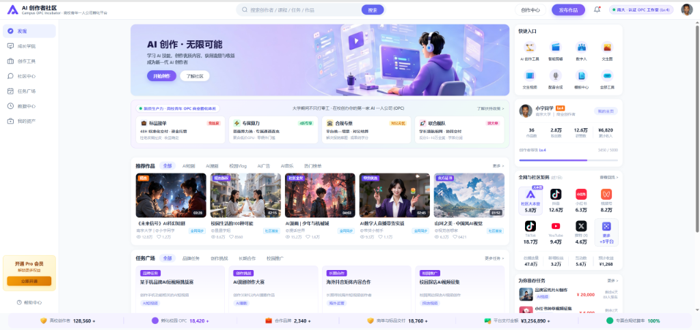
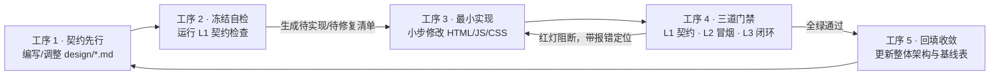

# AI 创作者社区 · 高校青年 OPC 超级个体商业孵化与赋能平台

<div align="center">


<p align="center">
  <b>面向高校创作者、商业创作者（OPC 一人公司）及企业发包方的“产-学-研-创-商-服”六位一体商业赋能高保真前端交互原型</b>
</p>

<p align="center">
  
</p>

</div>

---

## 📖 项目简介与定位

**AI 创作者社区** 是一套专为高校青年创作者、微型团队及一人公司（One-Person Company, OPC）打造的商业孵化与全生命周期赋能平台高保真前端交互原型。

平台将创作者从初探 AI 到商业化变现的全流程——**「知识研学 → 智能创作 → 接单履约 → 资金清算 → 矩阵赋能 → 社区裂变」**，打造成可在现代浏览器中端到端点通的商业飞轮。

### 核心设计原则与业务指标
- **零框架、零构建、零依赖**：基于原生 HTML5、CSS3、现代 ES6+ 与原生 Canvas 2D 引擎，无需 `npm install`，脱机双击即可秒级启动运行。
- **高拟真业务闭环**：打破传统管理后台割裂的跳转体验，全站采用无感抽屉（Drawer）、原生模态（Modal）与全屏响应式子页面就地闭环。
- **演示主体角色设定**：南京大学 Lv.4 认证校园 OPC 商业工作室（星芒 AI 视觉工作室）主理人「小宇同学」。
- **核心量化商用信用资产**：
  - **SLA 准时达成率**：`99.4%`
  - **平均交付时效**：`36h`
  - **OPC 商业信誉分**：`785 / 850`（享有全额免履约质保金与发包方算法优先撮合特权）

---

## 🔄 四大核心业务飞轮

平台业务生态由四大相互啮合的正向商业飞轮驱动运转：

```
       ┌─────────────────────────────────────────────────────────┐
       │                飞轮一：双轨积分资产解耦飞轮                │
       │    【AI 算力积分（消费型）】 ⟷ 【创作积分（成长型）】      │
       └────────────────────────────┬────────────────────────────┘
                                    │
                                    ▼
       ┌─────────────────────────────────────────────────────────┐
       │                飞轮二：商业履约与信誉驱动飞轮              │
       │   99.4%达成率 + 36h时效 + 785信誉分 ➔ 免保证金高额接单     │
       │   （前置工业级严格准入审核，确保高标交付质量与0违约履约）   │
       └────────────────────────────┬────────────────────────────┘
                                    │
                                    ▼
       ┌─────────────────────────────────────────────────────────┐
       │                飞轮三：内容-展厅-商单商业转化飞轮          │
       │    工具4K成片 ➔ 发现页展厅上架 ➔ 【找TA定制】定向商单成交    │
       └────────────────────────────┬────────────────────────────┘
                                    │
                                    ▼
       ┌─────────────────────────────────────────────────────────┐
       │              飞轮四：高校产教融合与学徒实训分润飞轮        │
       │    创作者研习认证 ➔ 组建OPC团队 ➔ 带教学弟学妹实训分润¥620    │
       └─────────────────────────────────────────────────────────┘
```

1. **双轨积分解耦流转飞轮**：
   - **AI 算力积分（消费型）**：用于模型 GPU 推理与渲染（Midjourney / SDXL 等），按批次扣减，失败全额原路退还；
   - **创作成长积分（信用型）**：通过课程打卡完课（+30）、结业证书（+100）、社区高赞及商单五星履约累积，**只增不减**，驱动创作者等级晋阶，避免“越创作等级越低”。
2. **商业履约与信誉驱动飞轮**：
   - 任务广场履约数据毫秒级回流，持续更新工作室权威指标（99.4% SLA、36h 时效、785 信用分），在接单时享受免质保金和优先推单特权。
3. **内容-展厅-商单转化飞轮**：
   - 工具箱生成的 4K 产物一键免下载上架发现页展厅，需求方浏览时可直接调起「找 TA 定制」定向下单，形成“创作即样片、展出即获客、交付即资产”。
4. **高校产教融合与学徒实训分润飞轮**：
   - 进阶商业工作室后，签约低年级学弟学妹协同交付，智能清算合约自动划拨学徒带教分成（如 ¥620.00），实现学研创商融合。

---

## 🧩 平台功能架构（7 大一级模块 + 1 治理底座）

| 模块名称 | 视图容器 / 路由 | 核心功能特性 |
| :--- | :--- | :--- |
| **1. 发现 (Discover)** | `#view-discover`<br>`#discover` | 商业样片展厅、精选优秀作品轮播、全网创作者橱窗、热门话题榜、一键「找 TA 定制」定向商单转存。 |
| **2. 成长学院 (Academy)** | `#view-academy`<br>`#academy` | **双轨进阶通道**：<br>• **常规研学轨**：视频课节研习打卡（+30分）、结业考核、证书领取（+100分），支持 Lv.1 → Lv.2 → Lv.3；<br>• **成手严审直通轨**：提交 3 部 4K 成片与工程文件，经 5 维工业级严审，直接签发 `CERT-LV3` 跳级解锁商单准入门槛。 |
| **3. 创作工具 (Tools)** | `#view-tools`<br>`#tools`<br>`#view-tool-detail` | AI 漫剧创作、AI 图像生成、提示词工坊、智能扣费与退款引擎、两阶段草稿与版本还原、一键提交交付物与展厅上架。 |
| **4. 社区中心 (Community)** | `#view-community`<br>`#community` | 同城高校创作者圈子、商业交付经验复盘长文、日周榜活跃度冲榜、关注互动与拜师入组。 |
| **5. 任务广场 (Tasks)** | `#view-tasks`<br>`#tasks`<br>`#tasks-publish-page`<br>`#tasks-detail-page` | 企业需求发包 4 步向导、赏金全额资金托管（Escrow）、6 维算法智能人岗匹配、高信誉免保签约竞标、多阶段成果物交付验收、仲裁与评价机制。 |
| **6. 数据中心 (Analytics)** | `#view-analytics`<br>`#analytics` | 个人 OPC 经营看板、SLA 准时率统计、全网 10 大平台矩阵授权流式数据回流监控、学徒带教实训明细台账。 |
| **7. 我的资产 (Assets)** | `#view-assets`<br>`#assets` | 双轨积分台账、作品版权证书与数字藏品、银行卡绑定与资金充值、出金四道闸安全校验（含 24h 改密风控锁）、Pro 会员订阅。 |
| **全局治理底座 (Admin)** | `#modal-system-admin` | RBAC 权限隔离、四视角切换（体验者 / 实训学徒 / 商业主理人 / 企业发包方）、系统算力与资金参数调控。 |

---

## 🏛️ 技术架构与工程实现

```
index.html (单页主入口 · 7 视图 + 8 全页子页 + 39 模态窗口)
  ├─ css/style.css                全局设计系统（33+ 个 CSS:root 主题变量，无第三方 UI 框架）
  ├─ js/icons.js                  全局图标库（Icons8 3D Fluency 图标与高精度内联 SVG 映射）
  ├─ js/mock_data.js              全站高拟真业务 Mock 字典（11 个一级数据域，响应式内存状态）
  ├─ js/charts.js                 原生 Canvas 2D 矢量图表引擎（折线图、环形饼图、贝塞尔曲线、Sparkline）
  └─ js/app.js                    核心交互引擎与状态机控制器（App 对象，原生 Hash 路由双向同步）
```

### 1. 技术栈选型
- **前端核心**：纯原生 HTML5 / CSS3 / ES6+ JavaScript
- **路由机制**：基于 `window.location.hash` 与 `App.navigateTo()` 的双向响应式 Hash 路由
- **可视化引擎**：零外部依赖的 `ChartEngine`（封装 Canvas 2D 上下文，支持 Retina 高清屏自适应缩放与平滑贝塞尔拟合）
- **状态管理**：集中式 `App` 状态机对象，脱机单页内存闭环，纯净无脏数据残留

### 2. 设计系统（Design System）
全站排版与色彩遵循严苛的设计规范，核心变量统一收敛于 `css/style.css`：
- 主色调：`--primary: #6366F1`（科技紫）、`--primary-hover: #4F46E5`
- 辅色调：`--secondary: #0EA5E9`（天际蓝）、`--accent-gold: #F59E0B`（商业金）
- 灰度背景：`--bg-page: #F8FAFC`、`--bg-card: #FFFFFF`、`--border-color: #E2E8F0`
- 阴影与圆角：`--radius-md: 12px`、`--shadow-card: 0 4px 20px -2px rgba(0,0,0,0.06)`

---

## 📐 设计驱动开发规范（Design-Driven Development）

项目遵循**“设计文档即唯一真源（Single Source of Truth），代码是文档的投影”**的严谨研发流：



### 自动化质量门禁体系（`tools/gates.js`）
项目自建了完全离线、零外部 npm 依赖的高可靠测试与审计套件：

- **L1 契约一致性门禁 (`doc-contract-check.js`)**：
  自动扫描 `design/*.md` 中提及的 DOM `#id`、`App.fn()`、`MockData.x` 及静态图片素材，与实际源码逐字比对，杜绝“文档越写越假”。
- **DUP 重复键门禁 (`dup-method-check.js`)**：
  对全局单例对象（`App`、`MockData`）进行语法级 AST/正则静态查重，杜绝对象字面量同名键覆盖导致的死代码与隐性缺陷（保持 **550 键 0 重复**）。
- **L2 结构冒烟门禁 (`smoke-test.js`)**：
  基于 Node 原生 `vm` 虚拟机与轻量 DOM 桩，在无浏览器环境下执行真实 `js/*.js`，全自动化验证全视图可达性、Hash 同步、DOM 开合状态及脏字面量。
- **L3 业务闭环套件 (`wb-*-verify.js` × 14 套)**：
  对关键链路进行深度契约走查与不变量断言，包含提现四道闸、资金充值、任务招募流转、成长学院双轨机制、创作者工具两阶段计费等，累计覆盖 **3,000+ 项断言**。
- **MX 架构图校验 (`mermaid-check.js`)**：
  自动检测全部设计文档中 59 个 Mermaid 时序图与状态机的结构合法性。

---

## 📁 目录结构导览

```text
ai-creator-community-web/
├── index.html                   # 平台唯一单页入口（7大视图容器 + 8大二级子页 + 39个弹窗）
├── README.md                    # 项目全景说明文档（本文件）
├── 项目分析报告-2026-09-21.md    # 项目历史全景审计与架构评估报告
│
├── css/
│   └── style.css                # 全局设计系统、主题变量与响应式样式库（~1.3万行）
│
├── js/
│   ├── app.js                   # 核心交互控制器、业务状态机与事件绑定
│   ├── mock_data.js             # 真实业务全集模拟数据（11个核心数据域）
│   ├── charts.js                # 原生 Canvas 2D 矢量可视化图表引擎
│   └── icons.js                 # 3D 图标库与矢量 SVG 映射管理器
│
├── assets/                      # 静态视觉资产库（250+ 文件）
│   ├── preview.png              # 平台首页与核心工作台高保真预览截图
│   ├── avatars/                 # 用户身份头像、角色标识
│   ├── banners/                 # 运营 Banner、活动展示图
│   ├── covers/                  # 作品展厅成片封面、任务配图
│   ├── decorations/             # 徽标 Logo、品牌元素
│   ├── icons/                   # 3D 立体图标与功能分类矢量图
│   └── nfts/                    # 数字藏品凭证、微学分勋章素材
│
├── design/                      # 设计驱动开发规范与模块详细设计真源
│   ├── _设计驱动开发规范.md       # DDD 开发法则、工序与门禁执行规范
│   ├── _模块设计文档模板.md       # 标准化模块文档模板
│   ├── _成长学院实施拆分.md       # 成长学院功能重构与实施细化方案
│   ├── 整体设计.md               # 7阶段全生命周期状态机与全局映射矩阵
│   ├── 发现页设计.md             # 发现模块架构与展厅定制方案
│   ├── 成长学院设计.md           # 研学课节与工业级双轨准入方案
│   ├── 创作工具设计.md           # AI Studio 工作台与两阶段计费规范
│   ├── 社区中心设计.md           # 社区圈子、复盘互动与裂变设计
│   ├── 任务广场设计.md           # 资金托管、算法匹配与履约状态机
│   ├── 数据中心设计.md           # 矩阵回流与 OPC 履约经营看板
│   ├── 我的资产设计.md           # 双轨积分、出金四道闸与风控锁
│   └── 用户管理设计.md           # RBAC 权限隔离、四视角与 Pro 订阅
│
├── tools/                       # 零依赖离线研发门禁与测试套件
│   ├── gates.js                 # 统一门禁执行调度入口（支持 Worker 隔离运行）
│   ├── gates-baseline.json      # 门禁基线与历史债务追踪表
│   ├── doc-contract-check.js    # L1 契约一致性校验器
│   ├── dup-method-check.js      # DUP 对象重复键查重器
│   ├── smoke-test.js            # L2 结构冒烟自动化测试
│   ├── mermaid-check.js         # Mermaid 架构图合法性检查器
│   ├── wb-*.verify.js           # 14 套 L3 核心业务闭环测试用例
│   └── README.md                # 门禁工具链详细使用文档
│
└── scratch/                     # 历史研发过程脚本与测试留存资产（不对正式代码产生引用）
```

---

## 🚀 快速上手与运行体验

### 1. 运行体验
本项目无需任何构建或后端服务，支持随时随地快速预览：

- **方式一（推荐，零安装）**：
  在文件资源管理器中直接双击根目录下的 `index.html`，通过现代浏览器（Chrome、Edge、Safari、Firefox）直接打开即可体验全部交互。

- **方式二（静态 HTTP 伺服）**：
  若希望获得更标准的前端 Web 体验，可在项目根目录下通过任意静态伺服启动：
  ```bash
  # Python 3
  python -m http.server 8080

  # Node.js (无需全局安装构建链)
  npx serve .
  ```
  在浏览器访问 `http://localhost:8080` 即可。

### 2. 运行质量门禁与自检
在修改设计文档或代码后，可通过项目内建的零依赖工具链验证系统健康度：

```bash
# 严格模式：串行执行全部门禁（L1 必须 0 ERROR，L2/L3 必须全绿）
node tools/gates.js

# 日常迭代模式：L1 契约差异 ≤ 已登记基线不阻断
node tools/gates.js --baseline

# 指定运行特定门禁（可选：l1 / dup / l2 / mx / l3）
node tools/gates.js l1 dup l2

# 静默简报模式（仅打印各门禁总结行）
node tools/gates.js --quiet
```

---

## 📚 详细设计文档索引

开发与业务走查请以 `design/` 下各篇权威文档为准：

- [整体设计方案与全流程状态机](file:///d:/OPCProject/ai-project/ai-creator-community-web/design/整体设计.md)
- [设计驱动开发规范（DDD 研发准则）](file:///d:/OPCProject/ai-project/ai-creator-community-web/design/_设计驱动开发规范.md)
- [发现页模块详细设计](file:///d:/OPCProject/ai-project/ai-creator-community-web/design/发现页设计.md)
- [成长学院模块详细设计](file:///d:/OPCProject/ai-project/ai-creator-community-web/design/成长学院设计.md)
- [创作工具模块详细设计](file:///d:/OPCProject/ai-project/ai-creator-community-web/design/创作工具设计.md)
- [社区中心模块详细设计](file:///d:/OPCProject/ai-project/ai-creator-community-web/design/社区中心设计.md)
- [任务广场模块详细设计](file:///d:/OPCProject/ai-project/ai-creator-community-web/design/任务广场设计.md)
- [数据中心模块详细设计](file:///d:/OPCProject/ai-project/ai-creator-community-web/design/数据中心设计.md)
- [我的资产模块详细设计](file:///d:/OPCProject/ai-project/ai-creator-community-web/design/我的资产设计.md)
- [用户管理与治理底座详细设计](file:///d:/OPCProject/ai-project/ai-creator-community-web/design/用户管理设计.md)
- 
---
### 本项目的后台功能代码已经完全实现了，github项目状态暂时还是Private

<div align="center">
  <sub>AI 创作者社区 · 高校青年 OPC 超级个体商业孵化与赋能平台 · Crafted with Design-Driven Precision</sub>
</div>
