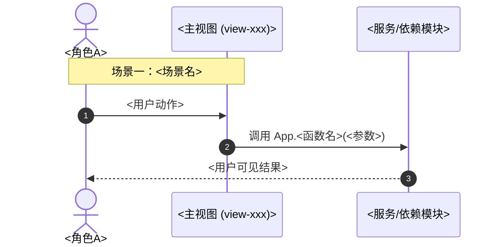
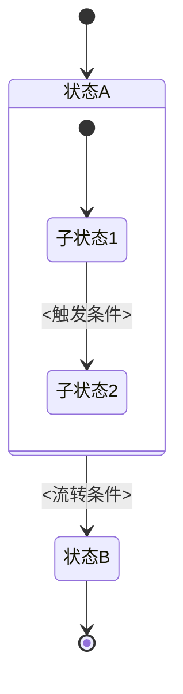

# <模块名>（<一句话定位，如：商单交易、展厅定制与履约闭环>）全业务架构设计方案

> 模板说明（使用后请删除本段）：本文件是 `design/` 模块设计文档的标准骨架，配合 `design/_设计驱动开发规范.md` 使用。
> 关键要求：**第四节「接口契约」必须是机器可解析的**——`#id` 与 `App.fn` 都要用反引号包裹，写完立刻跑 `node tools/doc-contract-check.js`。
> 文件命名：`design/<模块名>设计.md`；元文档才以 `_` 开头。

## 一、 用户故事

### 1. 本模块解决了什么问题？
用**用户视角的痛点**描述，不写技术方案。每条痛点对应一条现实中的损失或摩擦。
- **痛点 A（<谁>在<什么场景>遇到什么问题>）**：……
- **痛点 B**：……
- **痛点 C**：……

### 2. 实现了什么目标？
一句话给出模块定位（**加粗**），随后列 3~5 条能力，每条都要能落到下面的契约表里。
- **能力一**：……
- **能力二**：……

### 3. 涵盖哪些核心功能？
按界面结构逐层罗列，**每个交互入口在这里就要写出它对应的 `#id` 或函数名**，便于与第四节交叉核对。
- **顶部 Banner 行动区**：主标题……，包含【按钮】→ `App.xxx()`；
- **一级 Tab 组**：……
- **右侧辅助栏**：……

---

## 二、 多方角色业务交互时序图

要求：
- 每个 `View->>Service` 必须出现**真实的 `App.xxx()` 调用名**，供 L1 校验；
- 场景数量按业务流程走通的最小闭环来定，不凑数。

---

## 三、 全生命周期业务/任务状态机

要求：
- **状态名即契约**——文案、代码、验证脚本断言里出现的状态名必须与此处逐字一致；
- 每条流转边都要标注触发条件，便于 L3 逐状态走查；
- 有回退/闭环路径的（如"返修中 → 履约中"）必须显式画出，否则 L3 会漏测。

---

## 四、 核心功能模块与操作权限矩阵（接口契约表 · 必填）

> **本表是 L1 门禁的解析对象。** 反引号内的 `#id` 必须在 `index.html` 存在；`App.fn` 必须在 `js/app.js` 存在；`MockData.x` 必须在 `js/mock_data.js` 存在；`assets/...` 必须在磁盘存在。

| 功能模块与弹窗 | 对应前端 DOM 与触发方法 | 核心业务功能 | 关键数据指标与状态 | 普通创作者权限 | 高级/商业权限 |
| :--- | :--- | :--- | :--- | :--- | :--- |
| **<功能名>** | `#modal-xxx` / `App.openXxxModal` | <做什么> | <指标或状态，如：余额 ≥ ¥50> | <基础权限> | <**特权**> |

补充约定：
- 数据字段写入本表时用 `MockData.<对象名>` 形式，脚本只校验对象名存在，具体字段由 L2 断言 4 校验；
- 素材路径写成 `assets/covers/xxx.png` 会被脚本做存在性检查；
- 明知不一致但暂时保留的项，在行尾加 `<!-- contract-ignore: #old-id, App.oldFn -->` 并说明原因。

---

## 五、 与全局各模块的深度联动体系说明

逐条列出与其他模块的**双向**联动，每条都要指向具体契约（id / 函数 / 字段）：
1. **与【<模块A>】深度联动（<联动主题>）**：
   - <上游给下游提供了什么凭据>；
   - <下游如何消费，唤起哪个 `#modal-x` 或调用哪个 `App.fn`>。
2. **与【<模块B>】深度联动（<联动主题>）**：
   - ……

---

## 六、 变更记录

> 只增不删。变更类型仅四种：新增 / 重命名 / 删除 / 修正。

| 日期 | 变更类型 | 变更内容 | 影响的契约 | 验证方式 |
| :--- | :--- | :--- | :--- | :--- |
| YYYY-MM-DD | 新增 | <做了什么> | 新增 `#xxx`、`App.xxx` | L1 + L3（§三 状态机 <节点>） |
