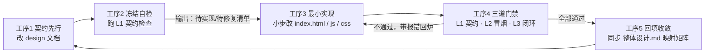

# 设计驱动开发规范（Design-Driven Development）

> 适用项目：AI 创作者社区 · 高校青年 OPC 孵化平台前端原型
> 版本：v1.0 ｜ 生效范围：`design/` `index.html` `css/` `js/` `assets/` `tools/` `scratch/`

---

## 一、 一句话定义

**`design/*.md` 是唯一真源，代码是它的投影。**

每一次迭代严格走：**改文档 → 跑契约检查拿到待办清单 → 最小实现 → 过三道门禁 → 回填收敛**。
文档不是写给人看的说明书，而是可被脚本比对、能被门禁拦住的**契约**。

---

## 二、 为什么本项目适合、且缺什么

### 1. 已有基础（不要推翻，要沿用）
- `design/` 下 9 份文档结构高度统一：**用户故事 → mermaid 时序图 → 状态机 → DOM/函数映射矩阵 → 跨模块联动**；
- `design/整体设计.md` 已经承担了全局状态机与映射矩阵的枢纽职责；
- `scratch/` 下已有 20 个 Playwright 端到端脚本，验证手段现成；
- 全局对象四分（`App` / `MockData` / `ChartEngine` / `Icons`），接口边界清晰，天然适合"按函数名对账"。

### 2. 当前缺口（本规范要解决的）
| 缺口 | 后果 | 本规范的解法 |
| :--- | :--- | :--- |
| 文档与代码之间没有机器可校验的契约 | 改名/删函数后文档静默失效，越写越假 | 命名即契约 + `tools/doc-contract-check.js` |
| 改动全凭记忆，漏改跨模块映射矩阵 | 整体设计与局部实现漂移 | 工序 5 强制回填 + 门禁 L1 |
| 没有固定的验证节奏 | 靠临时写脚本，验证不可重复 | 三道门禁 L1/L2/L3 固定化 |
| `scratch/` 过程产物与正式产物混用 | 检索被噪音污染 | 目录职责强约束（第七节） |

### 3. 技术约束倒逼的流程特征
本项目**零依赖、单入口 `index.html`、无构建、无 npm、无后端**。因此流程必须满足：
- **轻**：不引入 lint / CI / 构建链；校验器必须是零依赖 Node 脚本；
- **离线**：L1 门禁断网可跑、秒级返回；
- **单文件友好**：`index.html` 2400+ 行历史上有被整体写坏过（存在 `index.html.corrupt.bak`），实现必须小步编辑，禁止整文件覆盖。

---

## 三、 六个核心原则

1. **真源唯一（Single Source of Truth）**
   同一个事实只在一处描述：**跨模块的规则写在 `_设计驱动开发规范.md` 与 `整体设计.md`，模块内的写在模块文档**。代码里只允许存在契约本身（id / 函数名 / 字段名），不允许存在"第二份口径说明"。

2. **命名即契约（Naming is the contract）**
   文档里出现的 `#some-id`、`App.someFn`、`MockData.someField`、`assets/xxx.png`，必须与代码/磁盘**逐字一致**（含大小写与连字符）。这是 L1 门禁能成立的前提。

3. **一次一模块（One module per iteration）**
   一个迭代只动**一份模块设计文档 + 该模块对应的代码 + 一个验证脚本**。跨模块改动必须先升级到 `整体设计.md`，再拆成多个迭代。

4. **禁止裸改代码（No code-first unless you sync back）**
   允许紧急修复直接改代码，但**必须在同一轮迭代内回填文档**，否则下一次 L1 门禁会以红色报错收场——这是有意设计的摩擦。

5. **状态名对齐状态机（State names are canonical）**
   代码、Toast 文案、验证脚本断言里出现的业务状态名（如"待验收""返修中""24小时冷静期挂起"），必须与状态机图节点**逐字一致**，禁止同义词混用。

6. **门禁前置（Gate before you build）**
   先跑 L1 拿到"待实现清单"，再动手写代码。**校验器是你这一轮的 TODO 生成器**，不是事后检查官。

---

> ## 🔔 门禁体系变更说明（2026-09-24 · 本节状态以此为准）
>
> 本规范的**三道门禁定义未变**（L1 契约 / L2 结构冒烟 / L3 业务闭环），但**实现形态已于 2026-09-24 落地并调整**，下文 §四 工序 4、§六、§七、§十一 中与之不一致的表述**一律以本说明为准**：
>
> | 门禁 | 原规范表述 | **当前实现（2026-09-24 起）** |
> | :--- | :--- | :--- |
> | **L1** | `node tools/doc-contract-check.js`，0 ERROR | ✅ 不变；实测基线 **32 ERROR / WARN 0**（存量债务，未清零） |
> | **L2** | Playwright 固定 6 条断言，6/6 | ✅ **`node tools/smoke-test.js`** —— 用「最小 DOM 桩 + vm」的**零依赖近似实现**，6/6 通过。**不引入 Playwright**（会破坏本项目"零框架 / 零构建 / 零依赖"根本约束）。**能力边界**：不含真实浏览器渲染 / CSS 布局 / 真事件派发 |
> | **L3** | 按状态机逐状态走查（`scratch/` 脚本） | ✅ **`tools/wb-*-verify.js` × 9 套**（原在 `temp/`，已**转正**），合计 **2,068 项断言全过**。**形态差异**：属**断言级**业务自检，尚未做到"状态机逐节点走查" |
> | 附加 | — | ✅ `tools/mermaid-check.js`（Mermaid 图结构校验，0 问题 / 59 图块 / 12 文档） |
> | **统一入口** | — | ✅ **`node tools/gates.js [--baseline]`** —— 一次跑完 L1 + L2 + MX + L3，输出合并报告与总退出码 |
>
> **基线机制**：`tools/gates-baseline.json` 登记 L1 存量 ERROR（32）。`--baseline` 模式下 ≤ 基线视为**存量债务（WARN，不阻断）**，**超基线仍判 FAIL**（即"本轮引入新漂移"）。注意：**这不改变规范定义的通过标准**（L1 仍以 0 ERROR 为通过）。
>
> **两个必须知道的运行环境事实**（实测）：
> ① 本机 `spawnSync/execFileSync` 拉起 `node.exe` 抛 **EBUSY**，子进程 stdout 恒为空 —— 故门禁统一走**进程内 `require`**，不使用子进程（原 `temp/_run-verify.js` 汇总器即因此失效，已由 `gates.js` 取代）。
> ② 各套自检会泄漏未清理的定时器，单进程连跑会造成**后序套伪失败** —— 故跑批期间**屏蔽定时器**。**批量结果以 `gates.js` 为准**；单独运行某套脚本时行为略有差异。
>
> **权威细节**：`tools/README.md`（工具清单 / 用法 / 能力边界）与 `project-design/06-technical/technology-baseline.md`（项目级技术基线）。
> **变更记录**：`project-design/99-ai/change-impact.md` CHG-003。

---

## 四、 五道工序（核心循环）



### 工序 1 · 契约先行（Spec）
| 项 | 内容 |
| :--- | :--- |
| 输入 | 用户的一句话需求 / 业务新场景 |
| 动作 | 在对应 `design/<模块>设计.md` 中**先写第四节的"接口契约"表**（见第五节），再补用户故事、时序图、状态机 |
| 产出 | 更新后的模块文档（契约表必填，未实现部分正常写，这是"待办"而非"错误"） |
| 完成判据 | 契约表里每个函数都有动词前缀、每个 id 都有合法前缀、每个状态名都能在状态机里找到对应节点 |

### 工序 2 · 冻结自检（Freeze & Lint）
| 项 | 内容 |
| :--- | :--- |
| 输入 | 工序 1 的文档 |
| 动作 | 执行 `node tools/doc-contract-check.js` |
| 产出 | 分级清单：**ERROR**（文档声明了但代码里不存在）→ 就是你这一轮的实现清单；**WARN**（只在 JS 里动态生成、类名未命名空间化） |
| 完成判据 | 把 ERROR 列表复制成 TODO，不再人工翻文档找活干 |

### 工序 3 · 最小实现（Build）
| 项 | 内容 |
| :--- | :--- |
| 输入 | ERROR 清单 |
| 动作 | 逐条实现：`index.html` 加 `#id` 与触发入口 → `js/app.js` 加函数（严格用文档里的函数名）→ `css/style.css` 加样式（走 `:root` 变量）→ 需要数据则在 `js/mock_data.js` 补齐字段 |
| 约束 | 小步 `Edit`，禁止整文件重写；不引入任何外部库 / CDN / 构建工具 |
| 完成判据 | 文档中的名字在代码里**原样出现**，无需二次映射 |

### 工序 4 · 三道门禁（Gate）
| 级别 | 名称 | 手段 | 通过标准 | 耗时 |
| :--- | :--- | :--- | :--- | :--- |
| **L1** | 契约一致性 | `node tools/doc-contract-check.js` | **0 ERROR** | 秒级、离线 |
| **L2** | 结构冒烟 | Playwright 固定 6 条断言（见第六节） | 6/6 通过 | 需本地静态服务 |
| **L3** | 业务闭环 | 按状态机逐状态走查（沿用 `scratch/` 现有脚本写法） | 状态机全节点可达，无死路 | 分钟级 |

不通过则带报错回到工序 3。**禁止"改到不报错"式蒙混**——报错必须定位到具体缺哪个 id / 哪个函数。

### 工序 5 · 回填收敛（Sync back）
| 项 | 内容 |
| :--- | :--- |
| 输入 | 本轮所有产出 |
| 动作 | ① 更新模块文档"变更记录"；② 若涉及跨模块流转或新增状态，同步 `design/整体设计.md` 的**状态机 + 映射矩阵**；③ 把验证脚本与截图归档到 `scratch/` |
| 完成判据 | L1 复跑 0 ERROR；`整体设计.md` 描述的路径与代码实际行为一致 |

---

## 五、 契约书写规则（最关键的一节）

### 1. 模块文档固定六节结构
```
# <模块名>（<一句话定位>）全业务架构设计方案
## 一、 用户故事              ← 用户在什么场景下遇到什么问题、要什么
## 二、 多方角色业务交互时序图  ← mermaid sequenceDiagram，必须出现 App.xxx() 调用名
## 三、 全生命周期业务/任务状态机 ← mermaid stateDiagram-v2，状态名即契约
## 四、 核心功能模块与操作权限矩阵 ← 接口契约表（必填、机器可解析）
## 五、 与全局各模块的深度联动体系说明
## 六、 变更记录              ← 本规范新增，见第九节
```

### 2. 第四节"接口契约"表格式（脚本按此解析）

| 功能模块与弹窗 | 对应前端 DOM 与触发方法 | 核心业务功能 | 关键数据指标与状态 |
| :--- | :--- | :--- | :--- |
| **提现申请** | `#modal-withdraw` / `App.openWithdrawModal` | 校验余额、发起出金 | 余额 ≥ ¥50 / 24h 无敏感变更 |

硬性要求：
- **触发方法列必须用反引号包裹**，形如 `` `#id` / `App.fnName` `` 或 `` `App.fnName('参数')` ``；
- **id 出现即承诺存在**：写进表格的 `#id` 必须在 `index.html` 里真实存在；
- **数据字段**写成 `MockData.<对象>`，则 `<对象>` 必须在 `js/mock_data.js` 里有定义；
- **图片素材**写成 `assets/...` 相对路径，则磁盘上必须真有这个文件。

### 3. 命名规约
| 类型 | 规则 | 示例 |
| :--- | :--- | :--- |
| 一级视图容器 | `view-<module>` | `view-tasks`、`view-analytics` |
| 全页子页 | `<module>-<name>-page` | `tasks-publish-page`、`academy-lesson-page` |
| 弹窗 | `modal-<实体>-<动作>` | `modal-submit-delivery`、`modal-gallery-custom` |
| 抽屉 | `modal-<实体>-profile` / `-drawer` | `modal-creator-profile` |
| 列表项 / 卡片 | `.<module>-<实体>-<修饰>` | `.work-card`、`.task-card` |
| 函数 | 动词前缀：`open` / `show` / `close` / `submit` / `do` / `toggle` / `apply` / `switch` / `render` / `select` / `focus` | `App.openWithdrawModal()`、`App.submitWithdraw()` |
| 模块 id | `discover` `academy` `tools` `community` `tasks` `analytics` `assets` | 与 `App.navigateTo()` 入参一致 |

### 4. 元文档与豁免
- **`design/` 下以 `_` 开头的文件是元文档**（模板、规范），**不参与契约校验**，因为其中必然包含示例占位符；
- 确需保留的"历史遗留 / 明知不一致"项，在该行末尾加注释：
  ```markdown
  <!-- contract-ignore: #legacy-panel, App.oldExportFn -->
  ```
  脚本会把这些 token 计入"已豁免"并从报错中剔除。**豁免必须显式写出来**，不允许靠沉默放过。

---

## 六、 门禁 L2 · 结构冒烟固定 6 条断言

> 需先起本地静态服务（沿用现有约定端口 8089）：
> `python -m http.server 8089` 或 `npx serve -l 8089`，入口 `http://127.0.0.1:8089/index.html`

| # | 断言 | 判据 |
| :--- | :--- | :--- |
| 1 | 首屏洁净 | 无 `console.error` / `pageerror`；正文无 `undefined` / `NaN` / `[object Object]` |
| 2 | 七视图可达 | 逐个点击 `.nav-item[data-view=X]`，`#view-X` 可见且 URL hash 同步 |
| 3 | 弹窗矩阵可开可关 | 契约表中声明的每个 modal，都能被其触发方法唤起并正常关闭 |
| 4 | 数据字段有值 | 文档声明的 `MockData.*` 字段全部非空、非 undefined，且数值型字段是数字 |
| 5 | 状态回写正确 | 切换分类 / 排序 / Tab 后，DOM 内容确实跟随变化（不是只改了变量） |
| 6 | 跨模块闭环 | 关键跳转链路（如 发现页展厅 →「找 TA 定制」→ 任务广场 → 详情页）目标视图可见 |

断言 4 与 5 是现有脚本里最容易漏、但最能抓出"假实现"的两条，务必保留。

---

## 七、 目录职责与产物边界

| 目录 | 定位 | 规则 |
| :--- | :--- | :--- |
| `design/` | **唯一真源** | 只有文档；`_` 前缀为元文档；任何跨模块规则必须先落这里 |
| `index.html` | 唯一入口 | 小步编辑，禁止整文件覆盖；所有 `#id` 的唯一归属地 |
| `css/` | 样式单一来源 | 全部走 `:root` 变量，禁止散落硬编码颜色 |
| `js/` | 逻辑四对象 | 只放 `App` / `MockData` / `ChartEngine` / `Icons`，不新增第五个全局对象 |
| `assets/` | 素材仓库 | 新增图片按 `avatars` `banners` `covers` `icons/<域>` `decorations` 归档 |
| `tools/` | **正式工具** | 可复用、被文档引用的脚本（如契约校验器）。**禁止被 `scratch/` 或页面引用** |
| `scratch/` | **过程产物** | 验证脚本、截图、局部替换片段、`.bak`。**不是交付物，禁止被正式代码引用** |

> 边界铁律：**从 `scratch/` 到 `tools/` 是一次"转正"**。脚本要在下个迭代继续用，就移进 `tools/` 并补文档说明；否则留在 `scratch/` 当一次性消耗品。

---

## 八、 一次迭代的实操模板（8 步）

```bash
# 0. 定范围：本轮只做哪个模块？（如 tasks）
# 1. 改文档：在 design/任务广场设计.md 第四节补契约行
# 2. 跑 L1，把 ERROR 当 TODO
node tools/doc-contract-check.js

# 3. 实现（小步编辑）
#    index.html  → 加 #modal-xxx 与入口按钮
#    js/app.js   → 加 App.openXxxModal / App.doXxx（严格用文档里的名字）
#    js/mock_data.js → 补字段
#    css/style.css   → 加样式，走 :root 变量

# 4. 起服务
python -m http.server 8089

# 5. 跑 L2 结构冒烟 + L3 业务闭环（脚本放 scratch/）
node scratch/e2e_full_business_test.js

# 6. 复跑 L1，必须 0 ERROR
node tools/doc-contract-check.js

# 7. 回填：模块文档"变更记录" + 必要时 design/整体设计.md 的映射矩阵
# 8. 归档：截图与一次性脚本留在 scratch/；要复用的移到 tools/
```

---

## 九、 变更记录格式（模块文档第六节）

每份模块文档末尾维护一张表，**只增不删**：

| 日期 | 变更类型 | 变更内容 | 影响的契约 | 验证方式 |
| :--- | :--- | :--- | :--- | :--- |
| 2026-09-20 | 新增 | 提现增加 24h 风控熔断 | 新增 `#modal-risk-lock`、`App.checkWithdrawRisk` | L1 + L3（用户管理 §三 状态机） |
| 2026-09-20 | 重命名 | `openPerks` → `openLevelPerksModal` | 同步 `整体设计.md` 映射矩阵 | L1 |

变更类型只有四种：**新增 / 重命名 / 删除 / 修正**。重命名与删除**必须**在同一行标出"同步了哪些下游文档"。

---

## 十、 完成定义（DoD 勾选清单）

一轮迭代只有全部勾上才算完成：

- [ ] 模块文档第四节的契约行已更新，且命名符合第五节规约
- [ ] `node tools/doc-contract-check.js` 输出 **0 ERROR**
- [ ] L2 结构冒烟 **6/6 通过**
- [ ] L3 业务闭环：状态机新增/变更的节点全部可达，无死路
- [ ] 无新增外部依赖（无 CDN、无 npm 包、无构建配置）
- [ ] `index.html` 未发生整文件覆盖
- [ ] 涉及跨模块流转的，`design/整体设计.md` 状态机与映射矩阵已同步
- [ ] 模块文档"变更记录"已追加一行
- [ ] 验证脚本与截图归档到 `scratch/`，可复用工具已移入 `tools/`

---

## 十一、 落地路线（建议分三阶段推进）

| 阶段 | 目标 | 具体动作 | 见效标志 |
| :--- | :--- | :--- | :--- |
| **第一阶段 · 止血**（1 轮） | 让真源可信 | ① 用本规范第六节模板补齐 8 份模块文档的"接口契约"表与"变更记录"节；② 跑通 L1，修掉已有 ERROR；③ 修正 `design/*.md` 里失效的 `file:///Users/huangjianbin/...` 绝对链接为相对路径 | L1 0 ERROR，文档链接在 Windows 下可点 |
| **第二阶段 · 固化**（2~3 轮） | 让节奏稳定 | ① 每轮迭代严格走第五节 8 步；② 把 L2 冒烟从 `scratch/` 提炼为 `tools/smoke-test.js`；③ 用一个真实新功能（如某个新弹窗）走完整闭环做样板 | 出现第一份含完整"契约 → 实现 → 门禁 → 变更记录"的模块文档 |
| **第三阶段 · 提速**（持续） | 降低边际成本 | ① 校验器增加"契约覆盖率"统计（文档声明 vs 已实现）；② 提取 Playwright 公共断言为可复用模块；③ 把高频链路做成回归套件 | 新需求只需改文档即可驱动开发，代码侧几乎无需翻找 |

---

## 十二、 常见反模式（出现即视为流程违规）

| 反模式 | 为什么错 | 正确做法 |
| :--- | :--- | :--- |
| 先在 `app.js` 加函数，回头补文档 | 文档沦为事后描述，真源失效 | 先写契约表，再实现 |
| 文档写 `App.openModal`，代码却是 `App.showModal` | L1 报错，且半年后无人知道哪个对 | 逐字对齐，改名即全量替换 |
| 同一个状态在文档叫"待验收"、代码叫"pending" | 状态机不可校验 | 状态名统一以状态机图为准 |
| 把可复用脚本留在 `scratch/` | 下轮找不到、被当成垃圾清理 | 转正到 `tools/` |
| `index.html` 整文件重写 | 已发生过写坏事故（有 `.bak` 为证） | 小步 `Edit`，改完立刻 L1 + 刷新验证 |
| 用 `<!-- contract-ignore -->` 当消音器 | 豁免变成掩盖 | 每次豁免都要在变更记录里说明原因 |

---

_本规范由 AI 助手基于项目现状生成，位于 `design/_设计驱动开发规范.md`。修改本节内容属于流程变更，需同步更新版本号与"变更记录"。_
