# 任务广场（商单交易、展厅定制与履约闭环）全业务架构设计方案

## 一、 用户故事

### 1. 本模块解决了什么问题？
在自由职业接单和企业采购 AI 内容的传统撮合中，供需双方长期面临严重互信赤字与流程割裂：
- **发包方招募效率低且人选难评估**：候选人水平良莠不齐，发包方缺乏结构化的量化评估工具来快速筛选最匹配的制作人；
- **创作者接单履约缺乏资金安全保障**：缺乏第三方全额资金托管与验收自动放款机制，交付后易遭遇拖延付款或恶意扣款；
- **公域竞标与私域定向约单缺乏统筹**：创作者既希望在大厅公域竞标，又渴望将优质交付成果陈列在精选作品展厅，接受高客单价的定向商单定制；
- **缺乏双重视角的任务履约台账**：同一用户往往兼具“创作者”与“发包方”双重身份，缺乏清晰的分类台账跟踪。

### 2. 实现了什么目标？
任务广场（Task Market）定位为整个生态的**商业变现中枢、作品展厅陈列馆与信用履约保障底座**：
- **资金绝对安全（100% 监管资金托管）**：发包方发布任务时全额托管赏金，完工验收通过后即时打款结算；超时自动放款看门狗护航，彻底杜绝恶意欠款；
- **三位一体的一级模式架构**：
  - **模式一：任务大厅（`hall`）**：公域商单招募池，涵盖生命周期阶段（可报名/履约中/已结束）与多维分类筛选；
  - **模式二：作品展厅精选馆（`gallery`）**：陈列高校认证创作者真实商单样片，支持创作者自主管理【我的展位与档期 (`modal-my-gallery-manage`)】，发包方可看样片一键【发起定制约单 (`modal-gallery-custom`)】；
  - **模式三：我的任务台账（`mine`）**：一键切换【承接任务】与【发布任务】双重身份视角，全生命周期跟踪履约；
- **全页二级业务视图与专业弹窗矩阵**：
  - **全页发布任务中心（`tasks-publish-page`）**：4 步向导式发布任务（基础信息/需求交付/预算周期/托管合规），支持存草稿与发布；Step 3 选定赏金金额（人民币），确认发布后由平台全额托管冻结，冻结部分不允许提现；**草稿态（未付保证金、未上架大厅）可随时从台账【编辑】续编，也可经二次确认【删除】**；
  - **全页任务详情台（`tasks-detail-page`）**：展示商单详情与附件下载，发包方可查看候选人档案并依托 **6 维综合匹配度雷达算法（`computeCreatorTaskMatch`）** 选定合作人选——入口在「参与人员 · 参与竞标创作者与方案池」卡片内每位候选人的两个按钮：**【创作者主页】**（`App.openApplicantProfileModal()`，先核验其履约口碑与代表作）与 **【选定此人】**（`App.requestSelectApplicant()`，唤起二次确认弹窗 `modal-select-creator`，确认后由 `App.selectTaskApplicant()` 提交）；选定后任务转**「待接单」**并**自动向该创作者下发一条「合作邀请」站内消息**（`App.sendSiteMessage()`），待创作者响应接单才进入履约；亦可驳回申请（`modal-task-reject`）；
  - **履约与纠纷闭环弹窗**：报名投标（`modal-task-apply`）、提交商单交付物（`modal-submit-delivery`）、双向评价（`modal-task-evaluate`）、纠纷仲裁申请（`modal-task-dispute`）。

### 3. 涵盖哪些核心功能？
- **Banner 行动区**：主标题【任务广场】，副标“参与任务挑战，赢取奖励与成长；或逛作品展厅，找校园制作方定制”，包含【发布任务】（进入 `tasks-publish-page`）与【逛作品展厅】快捷按钮；
- **一级三大模式 Tab（tasks-mode-tabs）**：
  - **1. 任务大厅（`hall`）**：
    - 生命周期阶段切换：`可报名`（正在招募）、`履约中`（制作进行中）、`已结束`（已验收结案）；
    - 7 大任务品类 Tab：`全部`、`热门`、`AI短视频`、`AI漫画`、`数字人`、`图文创作`、`品牌合作`；
    - 搜索与 3 种排序：关键词检索，支持 `赏金从高到低`、`即将截止`、`报名人数最多`；
    - 商单卡片内容：标题、封面、赏金金额、发包方认证标、截止日期、当前报名人数、技术标签、点击直达详情页；
  - **2. 作品展厅精选馆（`gallery`）**：
    - 展厅导言栏：“沉淀高校认证创作者真实商单交付成果与高分样片，支持在线观摩与一键定制”；
    - 【我的展位与档期】入口：唤起展位与档期管理弹窗（`modal-my-gallery-manage`）；
    - 6 大展品品类 Tab：`全部`、`AI短剧`、`AI短视频`、`AI漫画`、`数字人`、`图文创作`；
    - 4 种排序菜单：`精选优先`、`按热度`、`最新入选`、`报价从低到高`；
    - 展品卡片：4K样片封面、制作团队/OPC认证标、起步定制报价（¥）、档期状态、一键【发起定制约单】唤起 `modal-gallery-custom`；
    - **`modal-gallery-custom` 报价口径为「明确价格」**：不再提供预算区间下拉，改为 `gallery-custom-budget` 数字输入（单位：元）+ 创作者服务套餐快捷卡片（`gallery-custom-pkgs`，取自 `work.servicePackages` 的**明码标价**，点击由 `App.pickGalleryCustomPrice()` 直接填入）；默认值为 `work.basePrice` 解析出的金额，最低 ¥100；
    - **【发送定制邀请】即生成一条「待接单」定向商单**：`App.confirmGalleryCustom()` → 明确价格闸门 → `App.freezeEscrow()` 全额托管 → `App.createGalleryCustomTask()` 在 `MockData.tasks.list` 落库一条 `customSource='gallery'` 的任务（`status='待接单'`，单一受邀候选人 `status='accepted'`，`_preSelectStatus` 快照为 `pending`）→ 下发**发包方 + 承接方双台账** → `App.sendSiteMessage()` 发出一条「定制邀请」站内消息；承接方随即在【我的任务 · 承接任务 · 待接单】看到该商单并可【响应商单】；
  - **3. 我的任务台账（`mine`）**：
    - 双身份角色切换：`承接任务`（创作者视角） vs `发布任务`（发包方视角）；
    - 多状态过滤标签：承接侧含 `待接单`（发包方已选定、待你响应接单，卡片提供【响应商单】→ `modal-custom-confirm`）、`待选定`、`履约中`、`待验收` 等；发布侧含 `招募中`、`待接单`（已选定创作者、待对方响应，卡片提供【查看合作邀请】与【催办响应】——催办会向该创作者补发一条「响应催办」站内消息，但**不改任务状态**）等；发布任务视角额外提供 `草稿` 标签页，草稿卡片提供【编辑】与【删除】两个操作（**仅「草稿」状态可删除**，已发布任务不提供删除入口）；
    - **「进行中（履约中）」双侧协同入口**：**承接侧卡片不再提供【填报日报】按钮**——日报填报入口唯一化为「点整张卡片 → 进任务详情页 → 在正文『项目进度与日报协同看板』内填报」，卡片整卡点击对「进行中 / 返修中」自动带 `focus='fulfillment'` 直达看板；承接侧卡片仅保留【提交交付】与【申请仲裁】；发布侧卡片提供【查看进度日报】（同一看板只读视角）与【催办日报】（`App.remindDailyReport()`，向承接方补发一条「日报催办」站内消息，**不改任务状态、不改项目进度**）；详情页顶栏在「进行中」下承接方只保留【提交交付】（【填报项目日报】按钮已随卡片一并下线）；
    - **「招募中」发包方入口收敛**：该状态下发包方侧只保留一个入口，不再出现与选人入口职责重叠的【查看名额】；**2026-09-24 起全站统一为报名制**——原 `auto`（名额即接 / 立即接单）模式已下线，所有任务一律【选定创作者】，文案由 `App.getTaskOpenActionLabel()` 统一输出（恒返回「选定创作者」）；
- **右侧侧边栏辅助功能舱（col-side）**：
  - **个人任务成长卡片（creator-profile-card）**：
    - 创作者名片（小宇同学 Lv.4，南京大学 ｜ 商业创作者），点击【我的任务 >】快速定位至进行中订单；
    - 4 项履约战绩：进行中（3）、累计完成（12）、累计奖励（¥6,820）、可用创作积分（2680）；
    - 任务等级经验条：任务等级 Lv.4（2680 / 4000，进度 67%）；
  - **今日推荐任务**：随大厅与展厅模式动态切换优质单源，支持【换一批 >】一键刷新；
  - **任务排行榜 (本周)**：周度接单创收榜单，支持【更多 >】模态框（`App.openTasksLeaderboardModal()`）；
  - **底部升级特权卡**：激励创作者完成任务升级，点击唤起 `modal-level-perks`。

---

## 二、 多方角色业务交互时序图

本模块的时序图按**「全景 → 单边视角」**三层组织，同一批业务在三种粒度下各有侧重：

- **§2.1 全角色综合交互时序图（全局全景 · 场景一 ~ 场景六）**：供需双方与平台同框，按「发布托管 → 报名选人 → 交付验收 → 展厅定向 → 评价仲裁」总览全链路协同；**其下再按场景拆分为 §2.1.1 ~ §2.1.6 共六张子时序图**，每张只保留该场景真正参与的角色与泳道、去除无关噪声，便于逐段精读与逐场景验收；
- **§2.2 发布者主视角业务时序图（发包方全链路 · 场景七）**：站在**发包方**立场，聚焦其**决策点与资金出口**——需求如何成型、赏金何时托管、6 维算法如何辅助选人、验收与超时放款如何兜底、争议如何升级；
- **§2.3 创作者主视角业务时序图（OPC 全链路 · 场景八）**：站在**创作者**立场，聚焦其**产能入口与收入入口**——如何筛单投标、中标后如何履约生产、交付物如何入账，以及作品展厅展位如何承接高客单价定向商单；
- **§2.4 发布任务创单与草稿生命周期时序图（发包方自助 · 场景九）**：把「发布任务」环节**从一次性的向导提交**扩展为「暂存 → 续编 → 放弃」的可逆生命周期，聚焦草稿的**产生、续编与删除**三条出口及其台账一致性。

### 2.1 全角色综合交互时序图（全局全景 · 场景一 ~ 场景六）

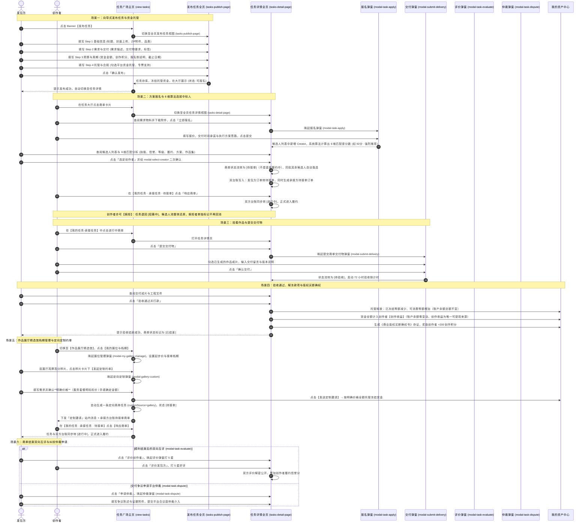

#### 2.1.1 场景一子时序图：向导式发布任务与赏金全额托管

> 角色口径：**发包方** = 发布任务、出资托管、验收付款的一方；**创作者** = 报名承接、履约交付、收取收益的一方。

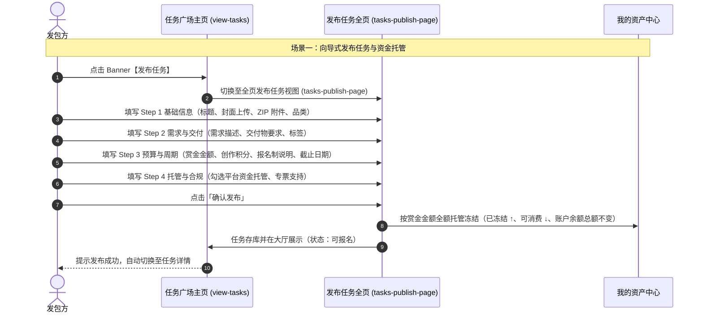

#### 2.1.2 场景二子时序图：方案报名、6 维算法选人与双向握手

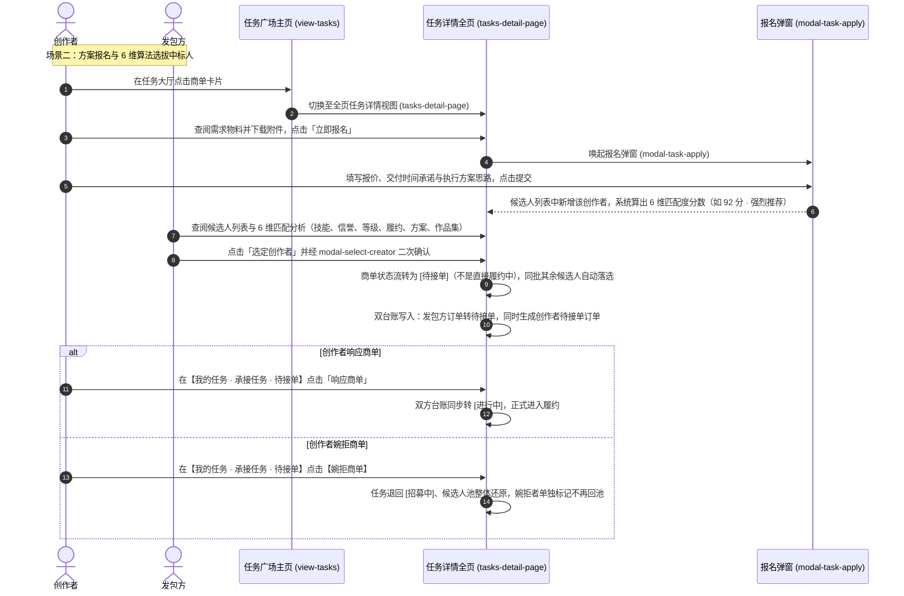

#### 2.1.3 场景三子时序图：交付物挂载与在线提交

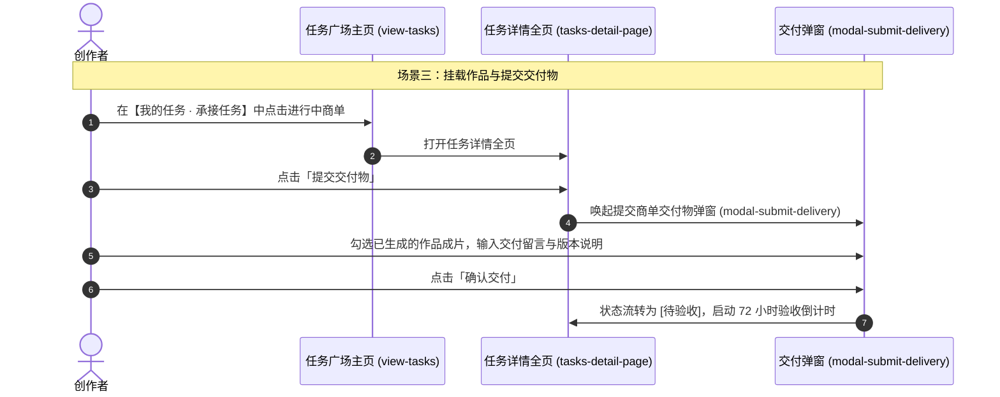

#### 2.1.4 场景四子时序图：验收通过、托管释放与创作收益入账

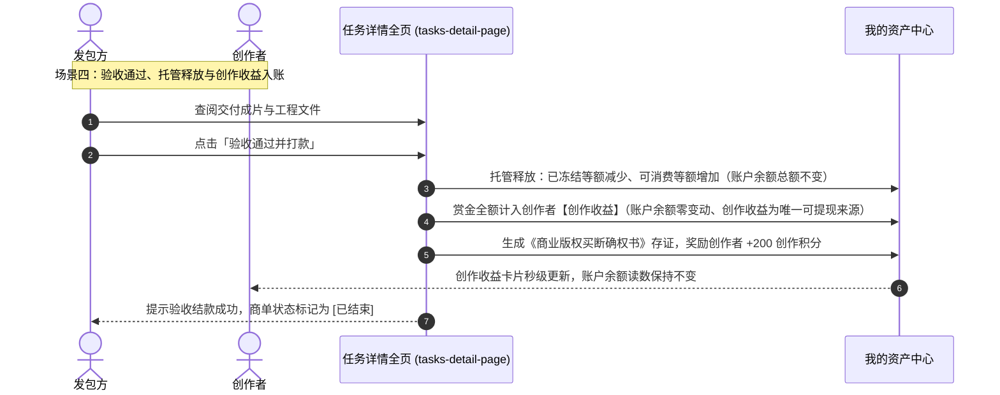

#### 2.1.5 场景五子时序图：作品展厅档期管理与定向定制约单

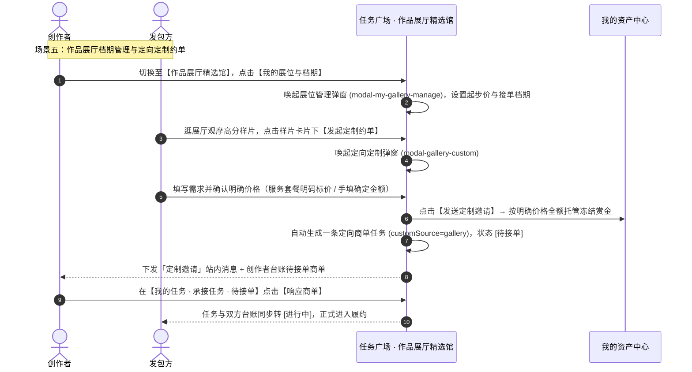

#### 2.1.6 场景六子时序图：结案双向互评与纠纷仲裁申请

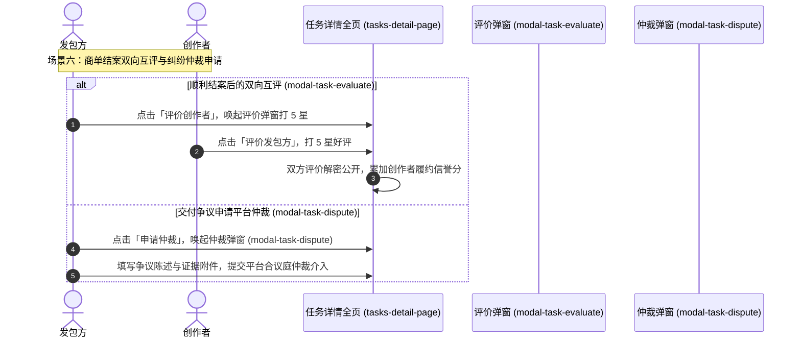

---

### 2.2 发布者主视角业务时序图（发包方全链路 · 场景七）

> 本场景对应 §一「全页发布任务中心（tasks-publish-page）」与「全页任务详情台（tasks-detail-page）」，把**发包方**从「有需求」到「结案」的完整决策链单独抽出。
> 视角要点：① **资金出口唯一**——赏金须先全额划入平台托管专户冻结方可上架，发布者全程不直接触达创作者钱包；② **选人靠算法而非感觉**——6 维匹配度分值是选定的量化依据；③ **验收有兜底**——72 小时看门狗使发布者「忘记验收」不会变成无限期占用创作者资金，超时自动放款；④ **争议有出口**——交付不达预期先走退回重做，协商破裂再升级合议庭仲裁，争议期内资金持续冻结。

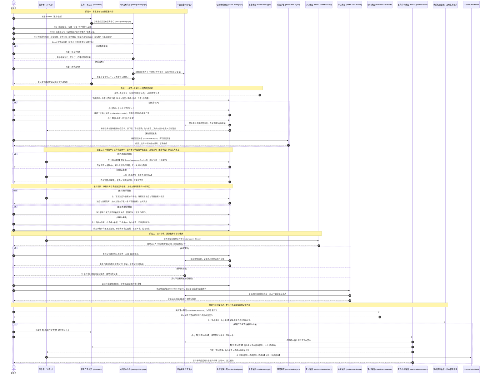

### 2.3 创作者主视角业务时序图（OPC 全链路 · 场景八）

> 本场景对应 §一「任务大厅（hall）」与「我的任务台账 · 承接任务视角」，把**创作者 / OPC 工作室**从「找单」到「收款」的完整链路单独抽出，与 §2.2 构成供需镜像。
> 视角要点：① **接单有准入门槛**——未结业对应品类实战课的创作者会被拦截并引导回成长学院，结业后自动激活该品类接单权限；② **产能由创作工具承接**——中标后经创作工作台（modal-studio）产出成片，一键【提交为商单交付物】带回履约台账，避免成果物在模块间手工搬运；③ **收入可预期**——赏金在发布时已全额托管，创作者交付后验收通过即入账，超时亦自动放款，杜绝恶意拖欠；④ **展位是溢价通道**——作品展厅展位与档期开放后，创作者可承接发包方定向约单，从「竞标低价」转向「询价定制」。

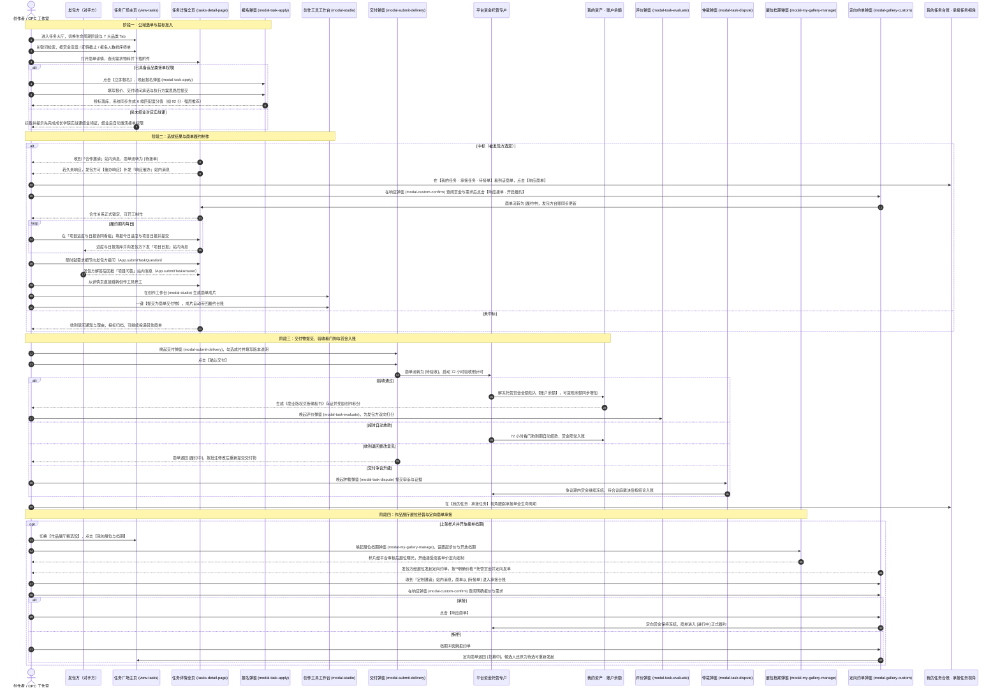

### 2.4 发布任务创单与草稿生命周期时序图（发包方自助 · 场景九）

> 本场景对应 §一「全页发布任务中心（tasks-publish-page）」与「我的任务台账（`mine`）· 发布任务视角」，是 §2.2 第 1 阶段的展开。
> 视角要点：① **草稿是发布任务的中间态而非终态**——未付托管保证金的草稿不上架大厅、不占用资金，只以「草稿」状态留在发包方自己的台账里；② **续编有入口**——台账草稿卡片提供【编辑】，载入后发布任务中心顶栏额外亮出【删除草稿】；③ **放弃需二次确认**——删除是不可逆动作，必须经 `modal-confirm` 二次确认（展示草稿标题并明示不可恢复），取消则草稿原样保留；④ **草稿转化为发布**——从草稿编辑态正式发布成功后，原草稿条目被移除，台账呈现「草稿 → 招募中」的状态转化，不残留重复条目。

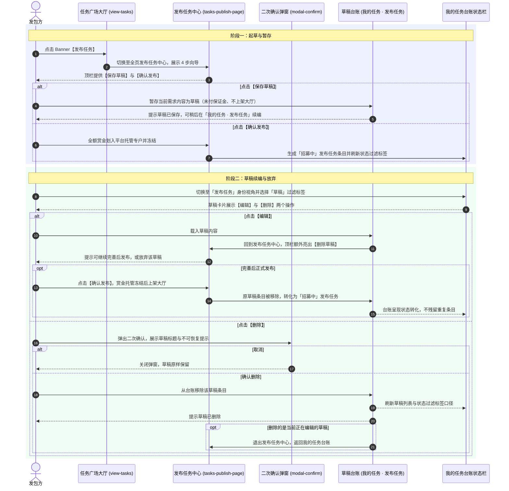

---

## 三、 全生命周期业务/任务状态机

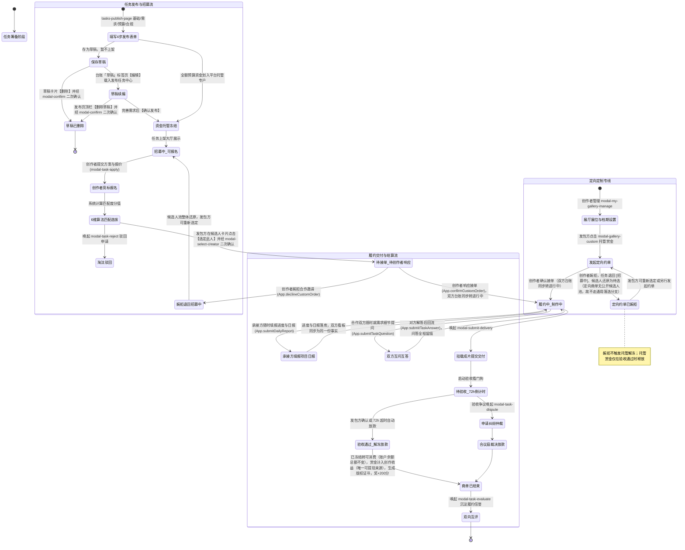

---

## 四、 核心功能模块与操作权限矩阵

| 界面区域与板块 | 对应前端控件与触发动作 | 核心管理能力 | 资金与结算状态 | 普通创作者权限 | OPC/工作室主理人权限 |
| :--- | :--- | :--- | :--- | :--- | :--- |
| **任务大厅 (hall)** | 阶段切换 / 7 大分类 Tab / 3 种排序控件 | 浏览全网商单、分类筛选与检索 | 资金托管公示 | 查阅基础商单与创作挑战 | 优先承接品牌高额商单 |
| **全页发布任务 (tasks-publish-page)** | 4 步向导表单 / 【保存草稿】/【确认发布】/ 草稿编辑态【删除草稿】(`publish-delete-draft-btn`) | 发布任务全流程、附件打包、开票托管配置；草稿续编与放弃 | 预冻结发包方资金（草稿态不占资金） | 允许发布小额急单与社团挑战 | 允许发布大型品牌商业商单 |
| **全页任务详情 (tasks-detail-page)** | 查看需求附件、候选人列表、选定与驳回 候选人列表锚点 `task-detail-applicants` 【选定此人】(`App.requestSelectApplicant()`) 【创作者主页】(`App.openApplicantProfileModal()`) 顶栏【选定创作者】(`App.focusTaskDetailBlock()` 滚动定位到候选人池) 履约区块锚点 `task-detail-fulfillment` | 6 维匹配度算法分析、选拔合作创作者；**「招募中」发包方侧只保留一个入口**——全站统一报名制，一律为【选定创作者】，文案由 `App.getTaskOpenActionLabel()` 统一输出（旧【查看名额】已下线，原 `auto` 模式的【查看接单】也随「立即接单」一并下线） | **选定后转「待接单」（赏金仍全额托管）** | 报名参与竞标、查看个人匹配度、核验对手方创作者主页 | 发包方视角下核验候选人主页、二次确认后选定与驳回候选人 |
| **履约协同看板 (task-detail-fulfillment)** | 区块锚点 `task-detail-fulfillment` 四阶段流水 + 进度条（`App.getFulfillmentStages()` / `App.getFulfillmentStage()`） 项目日报时间线（`App.getTaskFulfillment()`） 承接方填报表单 `daily-report-form`（`daily-report-progress` / `daily-report-stage` / `daily-report-done` / `daily-report-plan` / `daily-report-risk`） 【提交今日日报】(`App.submitDailyReport()`) / 【清空】(`App.resetDailyReportForm()`) 发包方【催办日报】(`App.remindDailyReport()`) | **「进行中」状态唯一的项目协同底座**：① **承接方随时填报**进度与日报，一次提交同时写日报台账、任务进度与双方台账；② **发包方随时查看**同一份日报与进度，**双向看板同源、不存在两份事实**；③ **权限边界**：合作双方（`App.getTaskPartyRole()` 判定为 `publisher` / `creator`）可见日报正文，**任务大厅访客仅可见整体进度与阶段流水，日报正文脱敏**；④ **进度 1~99% 闸门**——交付必须走【提交交付】（100% 请勿用日报绕过）；⑤ 填报与催办均为**零资金变动**（赏金继续托管冻结） | 无资金变动（进度与日报均不触发划拨） | 承接方填报进度与日报；对发包方提问并解答发包方的提问 | 发包方只读查看进度与日报、可催办日报（不改状态）、可提问与解答 |
| **选取创作者入口文案 (getTaskOpenActionLabel)** | `App.getTaskOpenActionLabel(task)` | **「招募中」状态下发包方侧入口的唯一文案口径**：全站统一为**报名制**（2026-09-24 起），一律输出【选定创作者】，这是唯一的选人入口。**原 `auto`（名额即接 / 立即接单）模式已整体下线**——创作者必须先提交报名方案、由发包方从候选人中选定，不再支持抢单直取名额；随之【查看接单】入口一并下线，**全项目不再出现【查看名额】按钮**——它与选人入口职责重叠、易让发包方误以为可跳过选拔 | 无资金变动 | 无权限（非发包方） | 决定招募中状态下唯一的选人入口 |
| **项目日报填报与催办 (submitDailyReport / remindDailyReport)** | 【提交今日日报】(`App.submitDailyReport(orderId)`) 【清空草稿】(`App.resetDailyReportForm()`) 【催办日报】(`App.remindDailyReport(orderId)`) | **承接方填报的唯一写入口**：三重闸门（必须是本人承接单 / 任务必须「进行中」/ 进度必须 1~99 且今日完成内容非空）通过后，写日报台账 `MockData.tasks.list[].fulfillment.dailyReports`、同步任务与**双方台账**进度、并向发包方下发一条「项目日报」站内消息；发包方【催办日报】为纯提醒动作——**只发消息、不改任务状态、不改项目进度**，非「进行中」一律拦截且零写入 | 无资金变动（日报不构成资金事件，漏报扣费为平台规约提示） | 填报自己的承接单日报 | 催办承接方补报日报 |
| **协同问答 (renderTaskQaThread / modal-qa-answer)** | 问答卡（`App.renderTaskQaThread()`，仅「进行中」渲染） 提问输入区 `task-qa-input`（`App.submitTaskQuestion()`） 【解答该问题】(`App.openTaskAnswerModal(taskId, questionId)`) 解答弹窗 `#modal-qa-answer`（`#qa-answer-question` 问题回显 / `#qa-answer-input` 解答输入 / `#qa-answer-title` 标题 / `#qa-answer-sub` 提问方信息） 【提交解答】(`App.submitTaskAnswer()`) / 【稍后再说】(`App.closeTaskAnswerModal()`) | **「进行中」状态下的合作双方互问互答**：发包方与承接方可随时就需求细节、交付口径、排期提问与解答；闸门＝任务必须「进行中」+ 提问人必须是合作双方 + **不能解答自己提出的问题** + 已解答不可重复解答；提问写问答台账 `fulfillment.questions` 并向对手方下发「项目问答」站内消息，解答写回同一条记录并回推提问方，**问答全程留痕、可追溯**；非「进行中」状态沿用既有静态答疑卡（公开答疑） | 无资金变动 | 承接方可提问、可解答发包方的提问 | 发包方可提问、可解答承接方的提问 |

| **选定创作者二次确认 (modal-select-creator)** | 候选人卡片【选定此人】(`App.requestSelectApplicant()`) 候选人名片 (`#select-creator-card`) 状态影响提示 (`#select-creator-impact`) 确认提交 (`App.confirmSelectCreator()`) 取消退出 (`App.closeSelectCreatorModal()`) 隐藏域 (`#select-creator-task-id` / `#select-creator-applicant-id`) | **选定是不可逆排他动作，必须二次确认**：弹窗列明「任务将转待接单 / 其余 N 位候选人自动落选 / 赏金仍托管冻结」三项影响后才提交；取消则任务与台账**零变动**；非发包方 / 未知任务 / 未知候选人 / 非待审候选人一律拦截且不打开弹窗 | 无资金变动（仍为托管冻结） | 无权限（非发包方） | 自主选定合作创作者并承担排他后果 |
| **创作者主页抽屉 (modal-creator-profile)** | `App.openCreatorProfile(name)` `App.openApplicantProfileModal(taskId, applicantId)` 档案真源 `App.getCreatorProfile()` 主页内【选定此人】(`App.selectFromCreatorProfile()`) 履约口碑统计 / 能力标签 / 代表作网格 | **选定前的核验入口**：展示创作者履约口碑（完成商单 / 好评 / 准时率 / 平均响应）、能力标签、简介与代表作；数据三级回落——① 显式档案 `MockData.tasks.creatorProfiles` ② 作品展厅 `gallery.works` 按作者名聚合 ③ 由报名记录现场合成，**任何候选人都不会出现死链**；发包方在主页内可直接【选定此人】并回到二次确认流 | 无资金变动 | 只读查阅（大厅不出现选定按钮） | 查阅候选人主页并直接发起合作邀请 |
| **商单响应 (modal-custom-confirm)** | 承接卡片【响应商单】(`App.openCustomConfirmModal()`) 响应接单 (`App.confirmCustomOrder()`) 婉拒邀请 (`App.declineCustomOrder()`) 动态标题/按钮 (`#custom-confirm-title` / `#custom-confirm-accept` / `#custom-confirm-decline`) | **创作者侧唯一响应入口**，广场任务与展厅定向定制共用：① 广场口径 → 响应接单后任务与双方台账**同步转「进行中」**；婉拒则任务退回「招募中」且**候选人池整体还原**（婉拒者标记未入选，不可被再次选定）；② 展厅口径 → 维持原有「接单 / 婉拒退款」语义 | 响应接单即进入资金结算链路（赏金仍冻结） | 响应对自己的合作邀请 | 响应或婉拒合作邀请 |
| **站内消息中心 (modal-messages)** | 顶栏铃铛入口 (`#btn-notify`) / 未读角标 (`#notify-badge`) / 通知下拉 (`#notify-dropdown`) / 【查看全部站内消息】(`App.openMessagesModal()`) 收件箱 Tab (`#messages-tab-inbox`) / 已发送 Tab (`#messages-tab-sent`) / 全部已读 (`#messages-mark-all-btn`) / 列表容器 (`#messages-center-body`) **唯一写入口** `App.sendSiteMessage()`；读 `App.getSiteMessages()` / `App.countUnreadMessages()` / `App.markMessageRead()` / `App.markAllMessagesRead()` / `App.updateNotifyBadge()`；Tab 切换与关闭 `App.switchMessagesTab()` / `App.closeMessagesModal()` | **协同动作的站内留痕中心**：任务广场的两处协同动作会自动下发站内消息——①【选定此人】确认后向**中标创作者**发「合作邀请」（说明赏金已托管、请尽快响应接单）；②待接单卡片【催办响应】向**已选定创作者**发「响应催办」（**只发消息，不改任务状态**）。通知下拉、未读角标、消息中心三处同源刷新（`App.refreshMessages()`）；未读角标**只统计收件箱**，我发出的消息对我恒为已读 | 无资金变动（纯通知：不发钱、不冻结、不改变任务状态） | 查阅收件箱通知，点开条目按 route 跳转对应模块 | 以发包方视角向创作者发出合作邀请与响应催办 |
| **发包方身份判定 (isPublisherOfTask)** | `App.isPublisherOfTask(task)` | **判定「当前登录用户是否为该任务的发包方」的唯一口径**：真源＝「我的任务」台账中存在 `role` 为 publisher / buyer 且 `sourceId` / `id` 指向该任务的订单；兜底＝任务署名包含当前用户昵称。⚠️ **不得再用 `publisherRole` 关键词（企业 / 品牌 / 发包方）猜测**——用户自己发布的任务署名是「我发布的任务（小宇同学 / 星芒视觉工作室）」，三个关键词都不含，会被误判为非发包方 | 无资金变动 | 决定大厅中自己发布的任务不可报名 | 决定详情页是否渲染【选定此人】与发包方视角顶栏 |
| **报名投标 (modal-task-apply)** | 输入报价、承诺工期、方案思路并提交 | 方案申报与资质展示 | 待选定 | 允许对可报名单提交提案 | 允许提交团队协同商业提案 |
| **交付物挂载 (modal-submit-delivery)** | 选择作品成片、输入交付说明并提交 | 挂载成果物启动 72h 验收看门狗 | 待验收放款 | 创作者提交商单终稿交付物 | 创作者提交商单终稿交付物 |
| **作品展厅精选馆 (gallery)** | 6 大分类 / 4 种排序 / 【发起定制约单】/ 展品卡片【找 TA 定制】(`App.openGalleryCustomModal()`) / 卡片参考报价取 `work.basePrice`（旧实现读 `work.priceRange`，10 件展品全部回落到同一个假区间 `¥1,500-3,000`） | 浏览高分样片、向作者发起定向约单；展品卡片的创作者信息取 `author*` 字段（`author` / `authorAvatar` / `authorRole` / `authorSchool` / `ordersCount`） | 定向托管赏金 | 观摩样片、发起定向约单定制 | 观摩样片、发起定向约单定制 |
| **找 TA 定制 · 明确价格与自动建单 (modal-gallery-custom)** | 商单标题 `gallery-custom-title` / 需求简述 `gallery-custom-brief` / **明确价格 `gallery-custom-budget`（数字输入，单位元）** / 期望交付 `gallery-custom-deadline` / 套餐卡片区 `gallery-custom-pkgs`（`App.pickGalleryCustomPrice()` 点击填入）/ 报价提示 `gallery-custom-price-hint` / 【发送定制邀请】(`App.confirmGalleryCustom()`) / 建单入口 `App.createGalleryCustomTask()` / 金额解析 `App.parseMoneyText()` | **① 报价口径改为明确价格**——预算区间下拉已下线，报价必须是一个确定的正数金额，空值 / 0 / 非数字一律拦截且零落库；默认值取 `work.basePrice`，服务套餐为明码标价可直接点选。**②【发送定制邀请】= 自动生成一条「待接单」定向商单**——全额托管后在 `MockData.tasks.list` 落库 `customSource='gallery'` 的任务（单一受邀候选人 `accepted`，`_preSelectStatus` 快照为 `pending`），并下发**发包方 + 承接方双台账**与一条「定制邀请」站内消息；**③ 承接方立即可响应**——该商单出现在【我的任务 · 承接任务 · 待接单】，【响应商单】后任务与双方台账同步转「进行中」；**④ 婉拒不留死局**——`App.declineCustomOrder()` 对 `customSource==='gallery'` 走独立分支：任务退回「招募中」且候选人还原为**待选**（若走通用分支会被标记 rejected，导致无人可选、任务卡死） | **按明确价格全额托管冻结**赏金；响应接单前不发生划拨 | 无权限（非发起方） | 以发包方身份发起定向定制并承担托管资金 |
| **展位与档期管理 (modal-my-gallery-manage)** | 设置样片起步价、上架展位、开放档期 | 自主管理展厅曝光展位与生产档期 | 定价基准 | Lv.3 以上可申请样片上架 | 自主管理展位曝光与团队档期 |
| **双向评价与仲裁 (evaluate / dispute)** | 结案互评打分 / 纠纷申请仲裁 | 信用积累、争议仲裁与资金保护 | 仲裁合议放款 | 提交评价与在争议时申请仲裁 | 提交评价与在争议时申请仲裁 |
| **我的任务台账 (mine)** | 承接任务 vs 发布任务双视角切换 / 状态过滤标签（承接侧含 `待接单`，发布侧含 `待接单`）/ 草稿卡片【编辑】与【删除】/ 待接单承接卡片【响应商单】(`App.openCustomConfirmModal()`) / 待接单发布卡片【查看合作邀请】与【催办响应】(`App.remindCreatorAccept()`，下发「响应催办」站内消息) / **进行中承接卡片【填报日报】(`App.openTaskDetailPage(sourceId, 'fulfillment')`) 与【提交交付】/ 进行中发布卡片【查看进度日报】与【催办日报】(`App.remindDailyReport()`，下发「日报催办」站内消息)** | 全生命周期跟踪订单进行状态；草稿任务续编与删除；**「待接单」双向待办**（发包方待对方响应、创作者待响应接单）；**「进行中」双向协同**（承接方填报进度与日报、发包方只读查看同一份日报） | 状态实时跟踪（草稿无资金占用；待接单与进行中均仍为托管冻结） | 查阅承接订单进度、填报日报并响应合作邀请 | 查阅承接与发包双向订单大盘、催办响应与催办日报 |
| **通用二次确认弹窗 (modal-confirm)** | `App.openConfirmModal()` 驱动 / 【取消】`App.closeConfirmModal()` / 【确定】`App.confirmModalAction()` | 破坏性动作（删除草稿等）的统一二次确认入口 | 无资金变动 | 取消则原样保留，确认才生效 | 取消则原样保留，确认才生效 |

---

## 五、 与全局各模块的深度联动体系说明

1. **与【创作工具】深度联动（生产-交付无缝闭环）**：
   - 创作者接单后，在任务详情页可直接跳转至【创作工具】开工；在创作工作台（`modal-studio`）生成成片后，可一键【💼 提交为商单交付物 (`App.submitStudioToTask()`)】，自动带回任务广场履约台账。
2. **与【我的资产】深度联动（资金托管、放款结算与版权存证）**：
   - 发包方赏金全额冻结于托管专户中，在【我的资产】的“商单资金托管库”中实时体现；
   - 商单验收通过后，资金自动解冻至创作者【账户余额】成为可提现资金，同时在资产中心生成《商业版权买断确权书》永久存证，并奖励创作积分。
   - **选定 → 待接单：赏金不划拨**：发包方【选定此人】并经二次确认后，任务由「招募中」转「**待接单**」，【我的资产】「商单资金托管库」中原先冻结的赏金**保持锁定**；同一任务的发包方台账条目**就地由「招募中」转为「待接单」，不新增重复条目**，同时向创作者侧下发一条「待接单」承接商单（`MockData.tasks.myOrders` 中 `role` 为 creator），形成双向待办。
   - **响应接单才是履约起点**：创作者响应接单（`App.confirmCustomOrder()`）后，任务与**双方台账同步转「进行中」**，此后才进入交付与验收链路；若创作者婉拒（`App.declineCustomOrder()`），任务退回「招募中」、候选人池整体还原，**全程不产生任何赏金划拨**。
   - **草稿不构成资金事件**：草稿态任务（`MockData.tasks.myOrders` 中 `status` 为「草稿」的条目）**未支付托管保证金**，因此草稿的**新建、续编与删除均不产生任何资产台账变动**，【我的资产】的「商单资金托管库」与账户余额不受影响——在草稿编辑态正式【确认发布】并冻结赏金的那一刻，才首次进入托管链路。
3. **与【发现页】深度联动（样片展示与双向约单）**：
   - 发现页推荐商单卡片点击可直达任务广场；发现页精选作品详情弹窗（`modal-work-detail`）常驻【💼 找 TA 定制同款 (`App.orderCustomWork`)】，直接为任务广场展厅定制导流。
4. **与【成长学院】深度联动（训战一体接单准入）**：
   - 创作者在成长学院完成实战课并结业领证后，系统自动在【任务广场】为其激活对应品类的商单接单权限，免收履约保证金。
5. **与【数据中心】深度联动（商业履约效能沉淀）**：
   - 商单履约的准时达成率（99.4%）、平均交付时效（36小时）与双向好评数据，全量沉淀至【数据中心】的 OPC 商业履约与信誉看板中。
6. **与【顶栏通知中心】深度联动（协同动作留痕）**：
   - 任务广场的协同动作统一经**唯一写入口** `App.sendSiteMessage()` 写入站内消息台账 `MockData.messages`，再由顶栏通知中心（铃铛 `#btn-notify` + 未读角标 `#notify-badge` + 通知下拉 `#notify-dropdown`）与站内消息中心弹窗 `modal-messages`（收件箱 / 已发送双 Tab）统一呈现，三处同源刷新（`App.refreshMessages()`）。
   - **六类发送点**：① 发包方【选定此人】确认（`App.selectTaskApplicant()`）→ 向中标创作者发「合作邀请」，正文说明赏金已托管冻结、请尽快响应接单；② 发包方【催办响应】（`App.remindCreatorAccept()`）→ 向已选定创作者发「响应催办」，**只发消息、不改变任务状态**，且非「待接单」商单一律拦截且零消息写入；③ 承接方提交项目日报（`App.submitDailyReport()`）→ 向发包方发「项目日报」，告知本期进度与今日完成摘要；④ 发包方【催办日报】（`App.remindDailyReport()`）→ 向承接方发「日报催办」，**不改任务状态、不改项目进度**，且非「进行中」商单一律拦截且零消息写入；⑤ 合作双方在协同问答中提问（`App.submitTaskQuestion()`）→ 向对手方发「项目问答」提问通知；⑥ 对手方提交解答（`App.submitTaskAnswer()`）→ 向提问方回推「项目问答」解答通知。
   - **方向与未读口径**：站内消息按 `direction` 分 `in`（收件箱）与 `out`（我发出）两个方向；未读角标**只统计收件箱**（`App.countUnreadMessages()`）——我发出的消息对我恒为已读，因此选定 / 催办 / 日报 / 问答**都不会增加自己的未读角标**，也不产生任何资金变动。
7. **履约协同以「同一份事实」为原则（进度与日报不产生两份数据）**：
   - 「进行中」商单的项目进度与项目日报统一落在 `MockData.tasks.list[].fulfillment` 上，读入口唯一为 `App.getTaskFulfillment()`（缺失时由台账自愈合成，**任何进行中任务打开看板都不会空白或死链**），写入口唯一为 `App.submitDailyReport()`。承接方提交一次日报，同时更新**日报台账、任务对象、承接侧订单、发布侧订单**四处，使发包方看板与承接方看板呈现完全一致的进度与内容。
   - 阶段口径唯一为 `App.getFulfillmentStages()`（四段：分镜与设定确认 → 素材生成与粗剪 → 4K 超分与渲染 → 版权交付与验收），阶段由进度区间推导（`App.getFulfillmentStage()`），不做人工双写。
   - **权限边界**：合作双方由 `App.getTaskPartyRole()` 唯一判定（`publisher` / `creator`）；日报正文与协同问答**仅对合作双方开放**，任务大厅访客只可见整体进度与阶段流水，正文脱敏。
   - **与【我的资产】的关系**：日报与问答均**不构成资金事件**——不冻结、不解冻、不划拨；赏金全程按原托管口径运行。

---

## 六、 变更记录

| 日期 | 变更类型 | 变更内容 | 影响范围 |
| :--- | :--- | :--- | :--- |
| 2026-09-24 | 文档结构优化 | **时序图按场景拆分 + 全站角色名词统一**： **① 子时序图拆分**——§二 完整保留「全角色综合交互时序图（全局全景 · 场景一 ~ 场景六）」，其下新增 **§2.1.1 ~ §2.1.6 六张子时序图**：场景一 向导式发布与赏金全额托管、场景二 方案报名与 6 维算法选人及响应 / 婉拒双向握手、场景三 交付物挂载与提交、场景四 验收通过托管释放与创作收益入账、场景五 作品展厅档期管理与定向定制约单、场景六 结案双向互评与纠纷仲裁；每张只保留该场景真正参与的角色与泳道。 **② 名词统一**——两类用户统一为**「创作者」**与**「发包方」**：原「接单创作者 / 接单方 / 接单者 / 学员」收敛为**创作者**，原「发包企业 / 买家 / 雇主 / 发布方」收敛为**发包方** | §二（新增 2.1.1 ~ 2.1.6）/ 全文档名词；无新增契约、无代码改动；L1 32 ERROR 持平 / 本文件 0 ERROR、WARN 0；Mermaid 59 块 0 问题 |
| 2026-09-24 | 口径修订（文档与代码对齐） | **验收结算资金口径重订 + 时序图 / 状态机冲突消解**：按【我的资产】2026-09-24 新口径，**商单验收通过后创作者的账户余额零变动、赏金只计入创作收益**（创作收益为全站唯一可提现来源）。 **① §二 场景四重写**：原「释放冻结资金，全额划入创作者【账户余额】(可提现余额增加)」改为「托管释放：已冻结等额减少、可消费等额增加（账户余额总额不变）+ 赏金全额计入创作收益」。 **② §二 场景二补「待接单」握手**：原图「选定 TA 合作 → 商单状态流转为 [履约中]」与代码不符（代码为 招募中 → 待接单 →〔创作者响应〕进行中），补充双台账写入、创作者【响应商单】与【婉拒】（任务退回招募中、候选人池整体还原）三条分支。 **③ §三 状态机修订**：「验收通过_解冻放款 → 商单已结束」的注解由「资金入账可提现」改为「赏金计入创作收益（唯一可提现来源）」；「定向定制专线」原「创作者婉拒，托管赏金原路退回发包方」与代码不符（`App.declineCustomOrder()` 对展厅定向单只回退任务状态与候选人，**不触发托管解冻**），改为「任务退回 [招募中]、候选人还原为待选」，并补注「婉拒不触发托管解冻，赏金仅在验收通过时释放」 | §二（2.1 场景二、场景四）/ §三（履约交付与结算流、定向定制专线）/ §六；与【我的资产设计.md】资金口径同源；无新增契约（均为口径修订） |
| 2026-09-24 | 下线（口径收敛） | **去掉「立即接单」场景，全站统一为报名制**：原 `auto`（名额即接）模式整体下线，**所有任务都必须先报名、再由发包方从候选人中选定合作人选**。 **① 单一真源收敛**：`App.getTaskAcceptMode()` 恒返回 `manual`（不再读 `task.acceptMode`），一次性收敛全部 `auto` 分支；`App.getAcceptModeLabel()` 输出「方案选拔 · 报名制」，`App.getTaskOpenActionLabel()` 恒输出【选定创作者】（原 `auto` 的【查看接单】随之消失）； **② 文案统一**：大厅卡片 CTA、详情页顶栏与正文 CTA 一律改为【去报名】/【提交报名】/【提交报名材料】，发包方侧提示统一为「请从上方候选人中选定一位合作创作者」；选拔规则看板文案改为【方案选拔 · 报名制】； **③ 状态与口径简化**：`App.getTaskDisplayStatus()` 去掉「已满额」分支，`App.formatTaskParticipants()` 统一输出「N 人竞标」（原 auto 的「N/M 人接单」下线）；选人入口 `canSelect` 不再判 mode，只认「招募中 + 发包方」； **④ 发布向导**：Step 3「接单模式」由两个单选项（报名即接 / 发包方选定）改为**一张固定说明卡**（发包方选定 · 报名制），syncPublishAcceptModeUI 删除（发布向导不再需要模式联动），`pt-quota-hint` 文案同步改为报名制口径； **⑤ 台账对齐**：`MockData.tasks` 中 2 条 `acceptMode: "auto"` 改为 `manual`，新建任务本就是 `manual`，全站无 auto 残留 | §一（发包方入口文案、任务详情选人入口、发布向导 Step 3）、§二（2.1 全景图 / 2.2 发布者主视角 Step 3 文案）、§三（状态机去掉「已满额」）、§四（选取创作者入口文案行、任务详情行）；L1 **32 ERROR 持平 / 本文件 0 ERROR**、WARN 0；Mermaid 32 图块 0 问题；九套自检 **1,971 项断言全过**（选人闭环脚本 C 组 5 条按报名制重写并新增 6 条口径断言） |
| 2026-09-22 | 新增并回退 | 上午曾在发布任务流程中新增**任务价值额度校验与资金冻结**（Step 3 可用额度校验、确认发布即冻结、场景一双分支、状态机额度核算链路、矩阵与联动同步）。 **经需求确认后回退**：人民币账户充值已与发布任务解耦（见 `我的资产设计.md`「人民币账户充值」），本模块移除全部「发布前置充值 / 可用发布额度 = 账户总额 − 已冻结金额」表述，恢复为原有的「4 步向导发布 → 全额赏金托管冻结 → 上架招募」机制；资金托管、验收解冻放款、版权存证等本模块自有业务保持不变 | §一 ~ §五；联动【我的资产】口径对齐为「**账户总额 = 可提现余额 + 冻结金额**」，充值不构成发布前置条件 |
| 2026-09-23 | 新增 | §二 时序图由单图扩为**「全景 + 单边视角」三层结构**，新增两张主视角业务时序图： **§2.2 发布者主视角（发包方全链路 · 场景七）**——4 步向导发布 → 全额赏金托管冻结 → 6 维匹配度选人（选定 / 逐位驳回）→ 交付验收四分支（验收通过 / 超时自动放款 / 退回重做 / 升级仲裁）→ 结案互评与发包方侧定向约单； **§2.3 创作者主视角（创作者 / OPC 全链路 · 场景八）**——公域选单与投标准入（未结业实战课被拦截）→ 中标 / 未中标分流 → 经创作工作台产出并一键【提交为商单交付物】→ 交付验收四分支 → 展位经营与定向约单承接（承接 / 婉拒）。 两图与 §2.1 全景图构成供需镜像，差异集中在「发起方」「焦点节点」「资金出口方向」三处 | §二（新增 §2.2 / §2.3）；与 §一 双身份台账（承接任务 / 发布任务）、§三 状态机节点、§五 联动口径（成长学院接单准入、创作工具转交付物、我的资产托管放款）逐一对应，无新增业务规则；同步为 §三 定向定制专线补「**创作者婉拒 → 托管赏金原路退回发包方**」分支，使状态机与 §2.3 图口径一致 |
| 2026-09-23 | 工具增强 | `tools/mermaid-check.js` 新增 **else 宿主块栈式回溯校验**：原「块级关键字与 end 全局计数」判配对存在盲区——当图内同时存在 `alt` 与 `opt`（或 loop / par 等）时，`else` 错落在 `opt` 内计数完全相等、旧版报 0 问题，而该结构会导致整图渲染失败；新版可精确定位到行号 | tools/（门禁工具）；全项目 20 个时序图块复核后为 0 问题，属纯能力增强，未影响任何既有文档 |
| 2026-09-23 | 文案调整 | 草稿卡片的主操作按钮由【继续编辑】改为【编辑】——按钮文案与其他状态卡片（【重新发布】/【查看详情】/【查看进度】等）统一为**两字动词短语**，列表视觉更整齐；**仅改文案与注释，`App.resumePublishTaskDraft()` 行为、删除闸门与资金口径均不变** | §一（发布任务中心、我的任务台账）、§二（§2.4 图内文案）、§三（状态机注释）、§四（映射矩阵）；代码侧 `js/app.js` 草稿卡片 `actions` 分支文案 + `css/style.css` 注释，无逻辑变更 |
| 2026-09-23 | 新增 | 「发布任务」环节补齐**草稿任务的可逆生命周期**：**当任务状态为「草稿」时，支持删除该任务**。 ① **删除入口**：我的任务 · 发布任务视角的草稿卡片新增【删除】按钮（`App.requestDeleteDraft()`）；发布任务中心在草稿编辑态额外亮出顶栏【删除草稿】（`App.syncPublishDraftActions()` 控制显隐）； ② **二次确认**：删除前统一经通用二次确认弹窗 `modal-confirm`（`App.openConfirmModal()` / `App.confirmModalAction()` / `App.closeConfirmModal()`），弹窗展示草稿标题与不可恢复提示，取消则草稿原样保留； ③ **状态闸门**：`App.isDraftOrder()` 收敛草稿判定口径（`status === '草稿'` 或 `isDraft`），**仅草稿可删**——已发布任务调用删除会被拦截并提示走关闭流程； ④ **草稿转化**：由草稿编辑态正式发布成功后，原草稿条目被移除，台账呈现「草稿 → 招募中」的状态转化，不残留重复条目； ⑤ **编辑态收口**：`App.resumePublishTaskDraft()` 记录编辑中的草稿 id，发布页退出 / 发布成功 / 草稿失效时统一清理； ⑥ **资金口径不变**：草稿未支付托管保证金，删除不触发任何资产台账变动 | §一（发布任务中心、我的任务台账）、§二（新增 §2.4 时序图 · 场景九）、§三（状态机补「保存草稿 / 草稿续编 → 草稿已删除」分支）、§四（新增 `modal-confirm` 行并扩写发布任务与我的任务台账行）、§五（补「草稿不构成资金事件」）；与【我的资产】托管链路解耦，无跨模块资金影响 |
| 2026-09-23 | 新增 | **选定创作者二次确认 + 创作者主页核验**：① **二次确认**：候选人卡片【选定此人】不再直接提交，改由 `App.requestSelectApplicant()` 唤起二级确认弹窗 `modal-select-creator`（`App.confirmSelectCreator()` 才提交、`App.closeSelectCreatorModal()` 取消）——弹窗列明「任务将转待接单 / 其余 N 位候选人自动落选 / 赏金仍托管冻结」三项影响，取消则任务与台账零变动；② **创作者主页**：候选人卡片新增【创作者主页】按钮（`App.openApplicantProfileModal()` → 复用既有 `modal-creator-profile` 抽屉，未新建重复节点），展示履约口碑（完成商单 / 好评 / 准时率 / 平均响应）、能力标签、简介与代表作，发包方可先核验再决定；③ **档案三级回落**：新增 `MockData.tasks.creatorProfiles`（9 位待审候选人显式档案，含 27 部代表作）为第一真源，其次回落作品展厅聚合，最后由报名记录现场合成，**任何候选人都不出现死链**；④ **候选人 id 兜底**：`App.syncTaskApplicantMeta()` 为缺 id 的候选人（如 TK13 林工AI）自动补齐，避免按钮渲染出 `undefined` 参数 | §一(2)(3)、§二 2.2/2.3、§三、§四、§五；新增契约 `App.requestSelectApplicant` / `App.renderSelectCreatorModal` / `App.closeSelectCreatorModal` / `App.confirmSelectCreator` / `App.openApplicantProfileModal` / `App.selectFromCreatorProfile` / `App.getCreatorProfile` 与节点 `#modal-select-creator` / `#select-creator-card` / `#select-creator-impact`、数据集 `MockData.tasks.creatorProfiles` |
| 2026-09-23 | 新增 | **「待接单」状态：选定后须创作者响应接单才进入履约**：① **状态回流**：发包方选定后任务由「招募中」转「**待接单**」（不再直接转「进行中」），`App.getTaskHallLifecycle()` 将其归入「履约中」阶段（大厅不可再报名），封面角标与详情页状态看板均显示「待接单」，顶栏转为「已选定 · 待创作者响应」；② **双向待办**：同一动作向创作者侧下发一条 `role` 为 creator 的「待接单」承接商单（`assigneeName` 标注被选定创作者），使商单出现在「我的任务 · 承接任务 · 待接单」标签页并提供【响应商单】；发布侧台账原地由「招募中」转「待接单」，不新增重复条目，并新增【催办响应】`App.remindCreatorAccept()`；③ **响应 / 婉拒闭环**：`App.confirmCustomOrder()` 响应接单后任务与双方台账**同步转「进行中」**；`App.declineCustomOrder()` 婉拒后任务**退回「招募中」且候选人池整体还原**（选定前状态由 `_preSelectStatus` 快照还原，婉拒者标记未入选以防重复选定）——两条路径均**不产生任何赏金划拨**；④ **响应弹窗复用**：`modal-custom-confirm` 由「展厅定向定制」扩展为「广场商单 + 展厅定制」双口径，标题 / 副标题 / 按钮文案随来源动态切换，弹窗新增可切换节点 `#custom-confirm-title` / `#custom-confirm-sub` / `#custom-confirm-accept` / `#custom-confirm-decline` | §一(3)、§二 2.2/2.3、§三（新增 `待接单_待创作者响应` 状态与婉拒回边）、§四、§五；`MockData.tasks.myOrders` 新增 `assigneeName` / `applicantId` 字段口径 |
| 2026-09-23 | 修复 | **「发布任务 · 招募中」点【选定创作者】后无法选定合作创作者**：根因是发包方身份判定 `App.isPublisherOfTask()` 用 `publisherRole` 关键词白名单（含「企业 / 品牌 / 发包方」）猜测——用户自己发布的任务署名为「我发布的任务（小宇同学 / 星芒视觉工作室）」，三个关键词都不含，于是被判成「非发包方」，详情页走投稿人分支：候选人只渲染只读的「创作者主页」占位按钮，【选定此人】消失，顶栏还错显【提交报名】。 ① **判定改为台账真源**：`App.isPublisherOfTask()` 以「我的任务」台账中 `role` 为 publisher / buyer 且指向该任务的订单为准，署名含当前用户昵称作兜底； ② **选定入口只认身份**：`canSelect` 由 `manual + 招募中 + 发包方 + manage` 收敛为 `manual + 招募中 + 发包方`，不再受「从哪个视图进入」限制； ③ **跳转锚点落地**：候选人列表补 `task-detail-applicants` 锚点，顶栏【选定创作者】的滚动定位从空操作变为真实定位； ④ **台账就地转化**：`App.selectTaskApplicant()` 补发包方身份闸门，并把既有「招募中 / 待选定」发布订单**就地转为「进行中」**（写回中标创作者与履约期口径），不再额外新增重复条目； ⑤ **连带修正**：大厅打开自己发布的任务不再显示【去报名】/【立即接单】 | §一（发包方身份判定、任务详情页选人入口）、§三（选人节点命名对齐）、§四（任务详情行扩写 + 新增「发包方身份判定」行）、§五（补「选人即资金事件起点」）；新增自检 `temp/wb-task-select-verify.js`（76 项） |
| 2026-09-23 | 新增 | **进行中（履约中）双人协同：项目进度 / 项目日报 / 合作双方问答**：① **承接方随时填报**——`App.submitDailyReport()` 为唯一写入口（其余入口一律拦截），三重闸门＝本人承接单 + 任务「进行中」+ 进度 1~99 且「今日完成内容」非空，通过后**一次提交同时更新日报台账、任务进度、承接侧订单、发布侧订单**四处，并向发包方下发「项目日报」站内消息；② **发包方随时查看**——同一「项目进度与日报协同看板」只读视角，进度条与阶段流水由真实数据驱动（**替换原先写死的 75% 里程碑**），并提供【催办日报】`App.remindDailyReport()`（只发消息、不改状态、不改进度）；③ **同一份事实**——进度与日报统一落在 `MockData.tasks.list[].fulfillment`，读入口唯一 `App.getTaskFulfillment()`（缺失时由台账自愈合成，杜绝空白/死链），阶段口径唯一 `App.getFulfillmentStages()` / `App.getFulfillmentStage()`；④ **权限边界**——合作双方由 `App.getTaskPartyRole()` 唯一判定（`publisher` / `creator`），日报正文与协同问答仅对双方开放，**大厅访客只可见整体进度与阶段流水、正文脱敏**；⑤ **双方互问互答**——`App.submitTaskQuestion()` 提问、`App.openTaskAnswerModal()` + `App.submitTaskAnswer()` 解答（新增弹窗 `modal-qa-answer`），闸门＝任务「进行中」+ 是合作双方 + **不能自答** + 已解答不可重复答，问答全程留痕并可回推站内消息；⑥ **「查看名额」整体下线**——新增 `App.getTaskOpenActionLabel()` 收敛「招募中」发包方入口文案（`manual` →【选定创作者】、`auto` →【查看接单】），消除与选人入口的职责重叠；⑦ **两处死接线修复**——补 `task-detail-fulfillment` 锚点，并让 `_detailFocusApplicants` / `_detailFocusFulfillment` 入场焦点标志**被真正消费**（此前只写不读，顶栏跳转全是空操作），统一经 `App.focusTaskDetailBlock()`；⑧ **数据补齐**——新增发包方视角「进行中」样本任务 `TK02B`（同时修复发布台账 `MO-P2` 指向不存在任务的死链），并为 `TK02` 补齐结构化日报与问答种子数据 | §一(3)、§二（§2.2 补履约协同段、§2.3 补日报与问答）、§三（履约中补日报 / 问答自环节点）、§四（新增「履约协同看板」「选取创作者入口文案」「项目日报填报与催办」「协同问答」四行，重写「全页任务详情」「我的任务台账」两行）、§五（第 6 条发送点由两类扩为六类，新增第 7 条「履约协同以同一份事实为原则」）；新增契约 `App.getTaskFulfillment` / `App.getTaskPartyRole` / `App.getTaskPublisherLabel` / `App.getTaskCounterpartLabel` / `App.renderFulfillmentBoard` / `App.submitDailyReport` / `App.remindDailyReport` / `App.resetDailyReportForm` / `App.submitTaskQuestion` / `App.openTaskAnswerModal` / `App.closeTaskAnswerModal` / `App.submitTaskAnswer` / `App.renderTaskQaThread` / `App.getTaskOpenActionLabel` / `App.focusTaskDetailBlock` / `App.getFulfillmentStages` / `App.getFulfillmentStage` / `App.getDemoNowText`，新增节点 `task-detail-fulfillment` / `daily-report-form` / `#modal-qa-answer` / `#qa-answer-question` / `#qa-answer-input`，新增任务样本 `TK02B` 与 `fulfillment.dailyReports[].progress/stage/done/plan/risk`、`fulfillment.questions` 字段口径 |
| 2026-09-23 | 新增 | **作品展厅【找 TA 定制】优化：报价改为明确价格 + 发送邀请即生成「待接单」定向商单**：① **明确价格口径**——`modal-gallery-custom` 的「预算区间」下拉下线，改为 `gallery-custom-budget` 数字输入（单位元，最低 ¥100），并新增服务套餐快捷卡片 `gallery-custom-pkgs`（取自 `work.servicePackages` 的**明码标价**，由 `App.pickGalleryCustomPrice()` 点击填入）；默认价取自 `work.basePrice`。空值 / 0 / 非数字一律拦截且**零落库**。② **发送即建单**——`App.confirmGalleryCustom()` 经明确价格闸门与 `App.freezeEscrow()` 全额托管后，调新增的 `App.createGalleryCustomTask()` 在 `MockData.tasks.list` 落库一条 `customSource='gallery'`、`status='待接单'` 的定向商单（单一受邀候选人 `accepted`，`_preSelectStatus` 快照为 `pending`），并下发**发包方 + 承接方双台账**与一条「定制邀请」站内消息，承接方在【我的任务 · 承接任务 · 待接单】可直接【响应商单】。③ **婉拒不留死局**——`App.declineCustomOrder()` 对 `customSource==='gallery'` 走独立分支：任务退回「招募中」且候选人**还原为待选**（通用分支会标记 rejected，导致该定向商单无人可选、卡死在招募中）。④ **顺带修复三处死接线**：弹窗原读取 `custom-title-input` / `custom-budget-input` / `custom-days-input` / `custom-requirement-input`，而 HTML 中**根本不存在这些节点**，四个字段全部静默回落到默认值；创作者信息读 `work.creator`（展厅作品只有 `author*` 字段）恒为空；展品卡片报价读 `work.priceRange`（真实字段为 `basePrice`），导致 10 件展品全部显示同一个假区间 `¥1,500-3,000`。⑤ **大厅徽章口径收敛**——大厅卡片原有 `taskLife === 'active' ? '履约中'` 硬编码分支，会把「待接单」商单误显示为「履约中」，与承接列表 / 详情页不一致；现统一走 `App.getHallCoverBadge()` 并补 `badge-cyan` 色调 |
| 2026-09-23 | 优化 | **日报入口收敛：下线「填写日报」按钮，统一走「点整卡 → 详情页填报」**：① **承接侧卡片**——「进行中」承接卡片移除【填报日报】按钮（该按钮与"点整张卡片进详情页"完全等价，属冗余入口），卡片动作区仅保留【提交交付】与【申请仲裁】；② **详情页顶栏**——承接方「进行中」顶栏同步移除【填报项目日报】按钮，只保留【提交交付】；③ **整卡点击增强**——`renderMyTasks` 的 `cardClick` 对「进行中 / 返修中」订单自动追加 `focus='fulfillment'`，点整卡即直达正文「项目进度与日报协同看板」，补齐被移除按钮的便捷性；④ **唯一落点不变**——日报填报仍只经 `App.submitDailyReport()`，表单 `daily-report-form` 仍在详情页正文，发包方【查看进度日报】/【催办日报】不受影响。自检新增 M 组 13 条（`wb-task-select-verify.js` 518 → 532 项）。 |
| 2026-09-23 | 新增 | **站内消息通知：选定创作者与催办响应各下发一条站内消息**：① **唯一写入口**：新增 `App.sendSiteMessage(payload)` 作为全站「发站内消息」的**唯一写入口**，按 `direction` 区分 `out`（我发出）与 `in`（收件箱），业务侧只传参、禁止直写台账；② **两处发送点**：`App.selectTaskApplicant()` 选定成功后向**中标创作者**发「合作邀请」消息（正文说明赏金已托管冻结、请尽快响应接单）；`App.remindCreatorAccept()`【催办响应】向**已选定创作者**发「响应催办」消息（**只发消息、不改任务状态**，非「待接单」商单一律拦截且零消息写入）；③ **三处同源呈现**：顶栏未读角标 `#notify-badge` / 通知下拉 `#notify-dropdown`（含「我发出的站内消息」区与【查看全部站内消息】入口）/ 站内消息中心 `modal-messages`（收件箱 `#messages-tab-inbox` 与已发送 `#messages-tab-sent` 双 Tab、列表容器 `#messages-center-body`、「全部已读」`#messages-mark-all-btn`），统一经 `App.refreshMessages()` 刷新；④ **未读口径**：角标**只统计收件箱**（`App.countUnreadMessages()`），我发出的消息对我恒为已读——**选定 / 催办不会增加自己的未读角标**；⑤ **数据与资金口径**：新增 `MockData.messages` 数据集（3 条收件箱种子消息），站内消息台账与资金台账**完全解耦**——不发钱、不冻结、不改变任务状态 | §一(2)(3)、§二（§2.2 图内补「合作邀请 / 响应催办 站内消息」、§2.3 图内补「合作邀请消息 + 催办消息」）、§四（新增「站内消息中心」行、扩写「我的任务台账」行）、§五（新增第 6 条「与顶栏通知中心深度联动」）；新增契约 `App.sendSiteMessage` / `App.getSiteMessages` / `App.countUnreadMessages` / `App.updateNotifyBadge` / `App.markMessageRead` / `App.markAllMessagesRead` / `App.refreshMessages` / `App.renderNotifyDropdown` / `App.buildMessageAction` / `App.openMessagesModal` / `App.closeMessagesModal` / `App.switchMessagesTab` / `App.renderMessagesModal`，新增节点 `#modal-messages` / `#messages-center-body` / `#messages-tab-inbox` / `#messages-tab-sent` / `#messages-mark-all-btn` / `#notify-badge`，新增数据集 `MockData.messages` |
