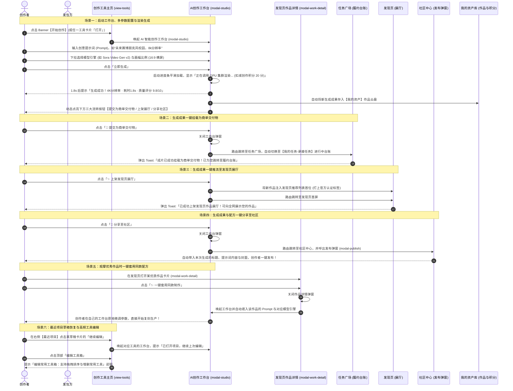
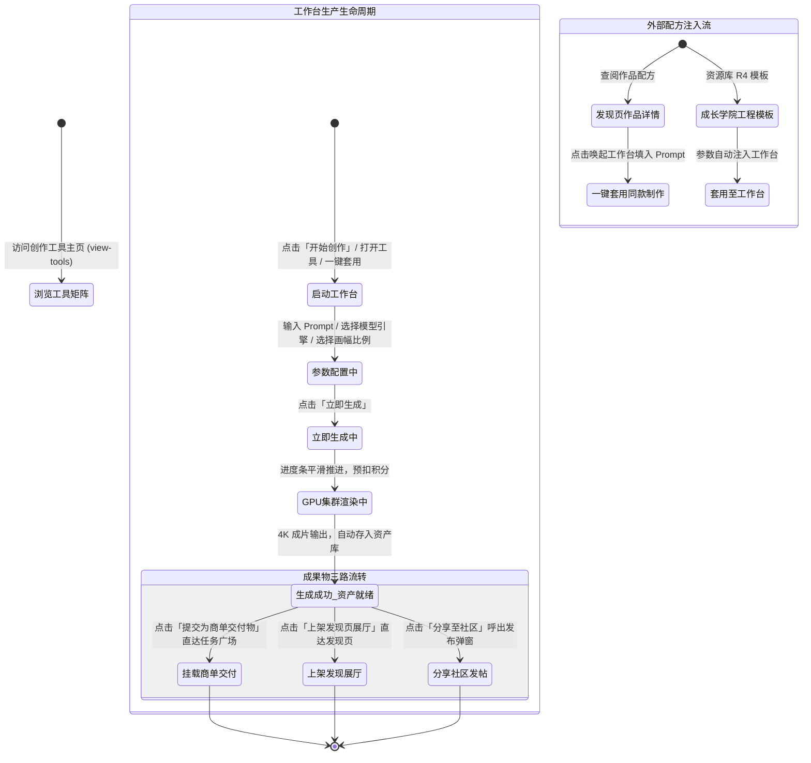

# 创作工具（AI 多模态生产力工作台）全业务架构设计方案

## 一、 用户故事

### 1. 本模块解决了什么问题？
在多模态 AI 商业化创作中，底层大模型（如文生视频、数字人、文生图、长文写作等）技术分散且操作门槛高，创作者在生产实践中常遭遇三大现实卡点：
- **创作工作流与商业场景脱节**：市面上的工具往往只负责“生成出图/出视频”，生成后的成品无法直接对接到商单交付、展厅上架或社区分享，创作者需要反复手动下载、转存、重新上传；
- **灵感与配方难以复用**：看到优秀作品时无法直接复用其提示词工程配方，必须手动一个字一个字抄写，缺乏“一键套用同款制作”的高效通道；
- **缺乏个人常用生产力工具箱沉淀**：面对繁多的 AI 工具，缺乏个性化常用工具箱与草稿项目断点恢复支持。

### 2. 实现了什么目标？
创作工具（Creative Studio）定位为创作者的**多模态生产力引擎、草稿项目仓与商单直通交付中枢**：
- **高并发 GPU 算力工作台容器（`modal-studio`）**：支持自主输入创意提示词 (Prompt)、切换核心模型引擎（SDXL Turbo、Midjourney v6.1、Sora Video Gen v2、Claude 3.5 Sonnet）与画幅比例（16:9 横屏、9:16 竖屏、1:1 方图、3:4 小红书图文），带平滑实时进度条渲染；
- **生成即享三路跨模块流转闭环**：在工作台生成 4K 成片后，动态点亮 3 大流转动作：
  - 💼 **提交为商单交付物 (`App.submitStudioToTask()`)**：直接挂载成片并无缝跳转至【任务广场】履约台账；
  - ✨ **上架发现页展厅 (`App.publishStudioToShowcase()`)**：自动将作品推入全站精选作品展厅并跳转至【发现页】；
  - 💬 **分享至社区 (`App.publishFromStudio()`)**：携带草稿内容一键唤起【社区中心】发布弹窗；
- **生态级配方一键套用制作**：与【发现页】作品详情弹窗（`modal-work-detail`）联动，支持“✨ 一键套用同款制作 (`App.applyPromptToStudio`)”；与【成长学院】资源库 R4 模板联动，支持“套用至工作台 (`App.applyTemplateToWorkspace`)”；
- **个性化工具箱与项目草稿箱**：提供常用高频工具网格、7 大垂类热门工具筛选、8 个未完成项目工程草稿恢复编辑。

### 3. 涵盖哪些核心功能？
- **顶部 Banner 创作行动区**：
  - 主标题【创作工具 · 提升创作效率】，副标“AI 赋能创作全流程，从灵感到成品，释放无限创意”；
  - 行动按钮：【开始创作】（唤起 `modal-studio` AI 智能创作工作台）与【使用指南】（唤起 `modal-help-faq` 常见问题速查）；
- **我的工具箱（常用工具区）**：
  - 收纳常用高频工具（AI 智能文案、即梦绘画、快手可灵视频、Suno 音乐大师、极速去水印、批量图片放大）；
  - 点击“编辑工具箱”提示拖拽排序与增删常用工具说明；点击各工具卡片直接调起对应创作工作台；
- **热门创作工具（含 7 大分类 Tab）**：
  - **分类 Tab**：`全部`、`AI 写作`、`图像生成`、`视频制作`、`音频处理`、`设计辅助`、`效率工具`；
  - **工具卡片信息**：工具图标、名称、描述、星级评分、累计使用次数与【打开】按钮；
  - 支持点击【更多工具 >】平滑滚动至全量分类导航；
- **创作工具 6 大分类导航与大盘指标**：
  - 涵盖 AI 写作与文案、AI 绘画与设计、AI 视频与动效、AI 音频与音乐、3D 与数字人、效率与辅助工具；
  - **大盘统计栏**：工具总数 62+、月活跃 28.6万+、累计使用 156.8万+次、满意度 4.8/5.0、本月已消耗 AI 积分 86.2万；
- **右侧侧边栏辅助功能舱（col-side）**：
  - **最近项目（草稿箱）**：展示 8 个未完成工程项目，点击【继续编辑】直接唤起工作台并恢复该项目编辑；
  - **生成任务（后台队列）**：展示当前后台渲染排队中与处理中的任务列表；
  - **热门工具榜单**：Top 5 热门工具综合排行榜，点击可直达打开对应工具；
  - **工具使用技巧**：高阶实用技巧文章卡片，点击可查阅实战心得。

---

## 二、 多方角色业务交互时序图

---

## 三、 全生命周期业务/任务状态机

---

## 四、 核心功能模块与操作权限矩阵

| 界面区域与功能模块 | 对应前端控件与触发动作 | 核心管理能力 | 积分与算力扣减 | 普通创作者权限 | OPC/工作室主理人权限 |
| :--- | :--- | :--- | :--- | :--- | :--- |
| **顶部 Banner 创作区** | 【开始创作】(`App.openAIWorkbench`) 【使用指南】(`App.openHelpFaqModal`) | 全屏唤起通用创作工作台、查阅帮助常见问题 | 免费启动体验 | 支持基础创作与常见问题速查 | 尊享极速渲染节点与商业指导指南 |
| **我的工具箱 (自选区)** | 点击各工具卡片唤起工作台；点击【编辑工具箱】查看说明 | 个性化常用工具直达与快捷管理 | 依底层模型而定 | 支持常用 6 款工具快速唤起 | 支持常用工具快速唤起 |
| **热门创作工具 (7大Tab)** | `全部` / `AI写作` / `图像生成` / `视频制作` / `音频处理` / `设计辅助` / `效率工具` | 矩阵分类工具筛选与直接启动 | 依工具耗时扣减 | 支持全部分类工具筛选与启动 | 支持全部分类工具，专享算力 8 折 |
| **创作工具分类 (6大卡片)** | 6 大核心品类卡片联动索引 | 目录导航与品类定位 | 免费查阅索引 | 允许查阅所有分类与推荐工具清单 | 允许查阅所有分类与企业定制工具 |
| **大盘统计栏 (5大指标)** | 工具总数/月活/累计使用/满意度/月消耗积分 | 全局数据概览 | 免费公开展示 | 全站公开实时数据展示 | 全站公开实时数据展示 |
| **AI 创作工作台 (modal-studio)** | 提示词输入、模型选择、画幅比例选择、立即生成 | 实时渲染输出 4K 成片，自动落盘资产库 | 每次消耗 20 创作/AI积分 | 支持单次渲染出片并获得预览 | 支持连续多次生成出片 |
| **三路流转动作闭环** | 【提交为商单交付物】/【上架展厅】/【分享社区】 | 生产成果无缝输送至任务广场、发现页与社区中心 | 无需额外扣费 | 允许将生成成果一键挂载与分发 | 允许一键挂载商单交付并优先展厅曝光 |
| **右侧：最近项目 (草稿箱)** | 8 个工程卡片，点击【继续编辑】 | 恢复上次编辑工程未完成的提示词与配置 | 免费存储恢复 | 支持近 8 个草稿项目继续编辑 | 支持草稿项目继续编辑与云端管理 |
| **右侧：生成任务与排行榜** | 生成队列状态卡片、Top 5 热门榜单点击直达 | 后台任务监控与全站爆款工具快速启动 | 免费查阅与启动 | 允许查看任务进度与启动榜单工具 | 允许查看任务进度与启动榜单工具 |

---

## 五、 与全局各模块的深度联动体系说明

1. **与【任务广场】深度联动（商单交付闭环）**：
   - 创作者在创作工作台（`modal-studio`）完成作品渲染后，直接点击【💼 提交为商单交付物 (`App.submitStudioToTask()`)】，系统自动将最新成片挂载为交付成果物，并跳转至【任务广场】的履约台账（`taken` 进行中），打通“生产-交付”链路。
2. **与【发现页】深度联动（展厅上架与配方套用双向穿透）**：
   - **正向推流**：在工作台点击【✨ 上架发现页展厅 (`App.publishStudioToShowcase()`)】，作品即刻推入发现页首屏作品流；
   - **反向复用**：在发现页作品详情弹窗（`modal-work-detail`）中，创作者可点击【✨ 一键套用同款制作 (`App.applyPromptToStudio`)】，将精选样片的 Prompt 配方秒级注入工作台。
3. **与【社区中心】深度联动（经验发帖分享）**：
   - 在工作台生成成片后，点击【💬 分享至社区 (`App.publishFromStudio()`)】，系统自动携带生成的标题、提示词与封面，唤起社区发帖弹窗（`modal-publish`），促进创作经验交流。
4. **与【我的资产】深度联动（算力计费与作品资产归档）**：
   - 每次生成完成后，系统自动在【我的资产】作品云盘中新增一条作品资产记录；
   - 生成消耗的算力严格在【我的资产】AI 积分算力池中结算与记录明细。
5. **与【成长学院】深度联动（教案工程模板一键上机）**：
   - 在成长学院资源库 R4（生产模板与工程源文件）中点击【套用至工作台 (`App.applyTemplateToWorkspace`)】，模板配置自动同步至创作工具。
