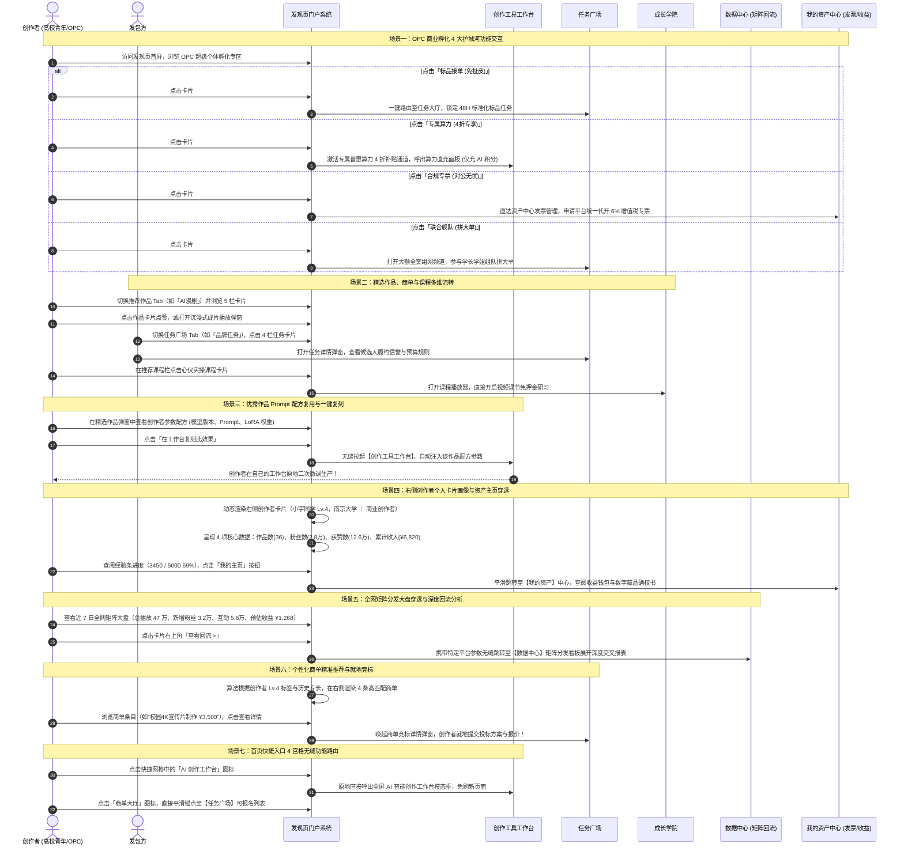
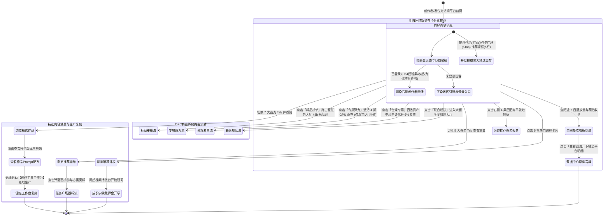

# 发现页（全景生态门户与高校青年 OPC 商业孵化枢纽）全业务架构设计方案

## 一、 用户故事

### 1. 本模块解决了什么问题？
在 AI 创作者生态中，创作者（尤其是高校青年与独立个体）常面临多重进入壁垒：在校期间只能打零工无法形成长效商业资产；传统商业商单需求模糊导致频繁改稿扯皮；高昂的 GPU 硬件门槛限制了出片能力；缺乏对公合规发票导致无法承接企业预算；个人单打独斗接不下数万元的全案大单。同时，新用户进入平台往往缺乏一个“一屏纵览全站精华”的聚合总览入口。

### 2. 实现了什么目标？
发现页（Discover Hub）是平台的**全景生态首发展示门户与高校青年 OPC（一人公司）商业孵化枢纽**：
- **打造高校青年 OPC 4 大护城河**：大学期间不只打零工，通过“标品接单、专属算力、合规专票、联合舰队”孵化在校创办的第一家 AI 一人公司；
- **全站业务精华三联驱动**：在一屏中无缝聚合“高分推荐作品、任务广场精选商单、成长学院热门课程”，打造高效的内容发现与业务分发阵地；
- **创作者个人资产与全网分发看板**：右侧常驻创作者个人画像（等级、作品、获赞、累计收益）与近 7 日全网多平台（社区、抖音、小红书、视频号、TikTok、YouTube、X 等）分发与回流收益矩阵。

### 3. 涵盖哪些核心功能？
- **顶部 Hero 视觉看板**：平台生态愿景引导与“开始创作”、“了解社区”一键直达；
- **高校青年 OPC 超级个体孵化专区（4大护城河卡片）**：
  1. **标品接单（免扯皮）**：48H 标准化交付 · 资金托管，杜绝改稿扯皮，收益确定；
  2. **专属算力（4折专享）**：普惠算力池 · 专属通道直充，聚合低价 GPU，零硬件门槛；
  3. **合规专票（对公无忧）**：平台统一开具增值税专票 · 对公结算，解决报销难题，成果纳学分；
  4. **联合舰队（拼大单）**：学长领航组网 · 协同交付，瓜分 5~10 万全案，学弟学妹分润。
- **推荐作品精选模块（5 栏流式卡片，带 7 大分类 Tab）**：
  - 支持 `全部`、`AI短剧`、`AI漫剧`、`校园Vlog`、`AI广告`、`AI音乐`、`热门榜单`；
  - 展示封面、时长、精选金标、作者名、点赞/播放量互动与沉浸式弹窗播放；
- **任务广场精选模块（4 栏卡片流，带 5 大分类 Tab）**：
  - 支持 `全部`、`品牌任务`、`创作挑战`、`长期合作`、`校园推广`；
  - 显示类型标签、赏金金额、申报人数、截止倒计时与申请者头像堆叠槽；
- **推荐课程精选模块（5 栏卡片）**：
  - 精选热门课程封面、导师名称、实战难度等级与创作者在读规模，支持直通开课；
- **右侧多功能仪表盘边栏（col-side）**：
  - **快捷入口网格**：一键直达常用工具与服务；
  - **创作者个人卡片**：头像、昵称、院校/身份、Lv 创作者等级与经验进度条、作品/粉丝/获赞/累计收入 4 维核心数据；
  - **全网与社区矩阵分发看板 (近 7 日)**：多平台图标（社区大本营、抖音、小红书、视频号、TikTok、YouTube、推特等），展示近 7 日总播放量、新增粉丝、互动数与预计收益，支持一键点击“查看回流”联动【数据中心】；
  - **为你推荐任务列表**：智能推荐适合当前创作者等级的 4 条高匹配商单，支持一键查看详情。

---

## 二、 多方角色业务交互时序图

---

## 三、 全生命周期业务/任务状态机

---

## 四、 核心功能模块与操作权限矩阵

| 功能模块 | ① 高校创作者 (OPC) | ② 发包方 | ③ 认证导师/教学机构 | ④ 平台运营管理员 |
| :--- | :--- | :--- | :--- | :--- |
| **Hero 看板与快捷入口** | 点击“开始创作”与快捷功能图标导航 | 浏览平台生态实力，快速发起需求 | 了解平台运营动向，直通备课 | 配置 Banner 图文与全站公告跑马灯 |
| **OPC 商业孵化 4 大专区** | **享受 48H 标品、4折算力、专票与组网拼单** | 查看标准化标品交付保障与开票规则 | 带领团队承接全案，担任舰队领航员 | 调控算力补贴折扣、审核大额全案商单 |
| **推荐作品流 (7大Tab)** | 浏览成片、点赞互动、展开播放弹窗 | **寻找对口风格，挑选心仪创作者** | 展示所带创作者优秀成果 | **维护推荐算法权重、配置精选金标** |
| **任务广场精选 (5大Tab)** | **查阅公开商单、点击弹窗查看并报名竞标** | **发布商单招募、查看申请者头像槽** | 协助创作者评估商单难度与报价 | 监控商单真实性、下架虚假与违规需求 |
| **推荐课程精选 (5栏)** | 选课学习、点击直达课程视频播放器 | 查看平台人才培训标准与教学深度 | **展示名师标杆课程，引流创作者选课** | 编排首页推荐课程位与排序规则 |
| **创作者个人资产卡片** | **查看本人 Lv 等级、经验条、获赞与累计收入** | 仅显示游客/企业公开简版档案 | 查看个人教学收益与导师等级 | 监管创作者账户状态与信誉波动 |
| **全网矩阵看板 (近7日)** | **查看全网播放量、粉丝与预估收益，点击回流** | 无个人分发矩阵数据 | 查看教学课程全网联合分发走势 | 监控多平台 API 抓取与回流数据健康度 |
| **为你推荐任务 (4条)** | **查阅个性化匹配商单，一键直通投标** | 查看同类需求市场行情 | 推荐给班级内空闲学生接单 | 训练推荐算法，根据技能标签精准分流 |

---

## 五、 与全局各模块的深度联动体系说明

1. **与【任务广场】深度联动（双向商单直通车）**：
   - 发现页不仅在主栏提供“任务广场精选（5大分类 Tab）”，还在右侧常驻“为你推荐任务”列表；创作者点击任意任务卡片均可就地弹出任务详情弹窗并直接报名竞标；OPC 专区的“标品接单”与“联合舰队”直接导流至任务广场对应的标准化大厅与协同大单频道。
2. **与【创作工具】深度联动（普惠算力直充与生产跳转）**：
   - 顶部 Hero 点击“开始创作”直接切换至【创作工具】工作台；OPC 专区的“专属算力”卡片点击后直接为创作者激活专属低价算力池 4 折补贴通道，支持多通道直充 **AI 积分**。
3. **与【成长学院】深度联动（知识发现与技能变现）**：
   - 发现页下方的“推荐课程”精选模块，实时展示成长学院的五星好评爆款课程，创作者点击卡片秒级唤醒课程播放器开始学习；同时创作者在学院看视频获得的 **创作积分** 实时反哺右侧个人卡片的 Lv 等级成长经验条。
4. **与【数据中心】深度联动（全网矩阵分发与回流透视）**：
   - 右侧常驻的“全网与社区矩阵看板”汇总了创作者在社区大本营、抖音、小红书、视频号、TikTok、YouTube 等平台的近 7 日播放量与预估收益；点击“查看回流”直接跳转至【数据中心】的矩阵分发深度看板，展开快手、B站、Facebook 等全量渠道的详细转化漏斗。
5. **与【我的资产】深度联动（对公合规专票与收入核对）**：
   - OPC 专区的“合规专票”直通【我的资产】发票与合规中心，由平台统一代开增值税专票，彻底解决高校创作者对公报销难题；右侧个人卡片显示的“累计收入（¥6,820）”与资产中心的实发收益 100% 穿透对齐。
6. **与【社区中心】深度联动（文化认同与组队社交）**：
   - 顶部 Hero 的“了解社区”与推荐作品栏右侧的“更多 >”直接引导至【社区中心】讨论大厅；推荐作品卡片上展示的“本站大本营同步标签”直接与社区圈子打通，形成全域互动闭环。
