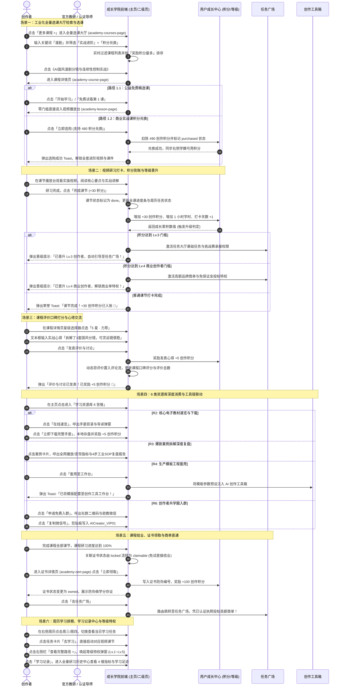
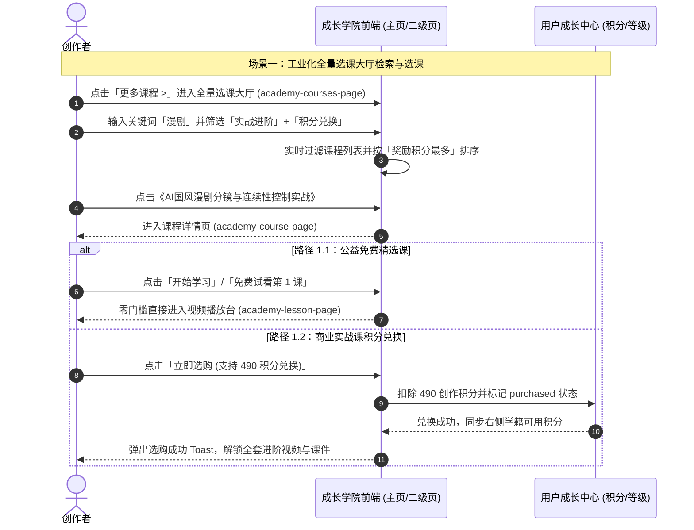
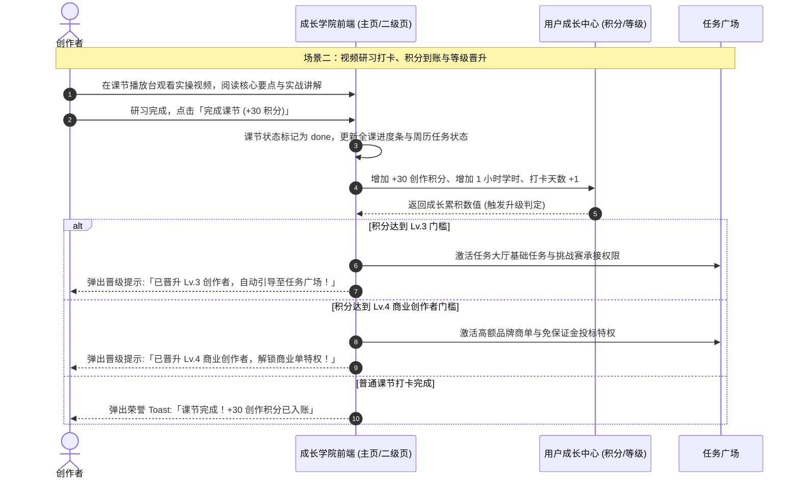
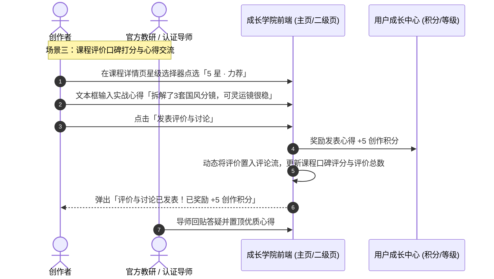
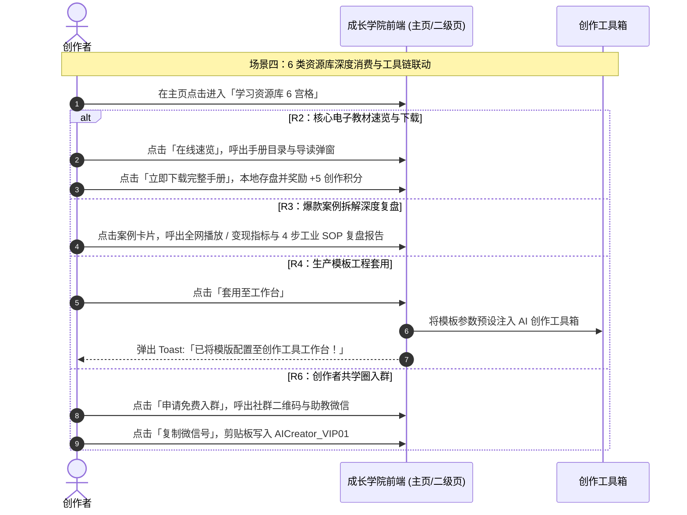
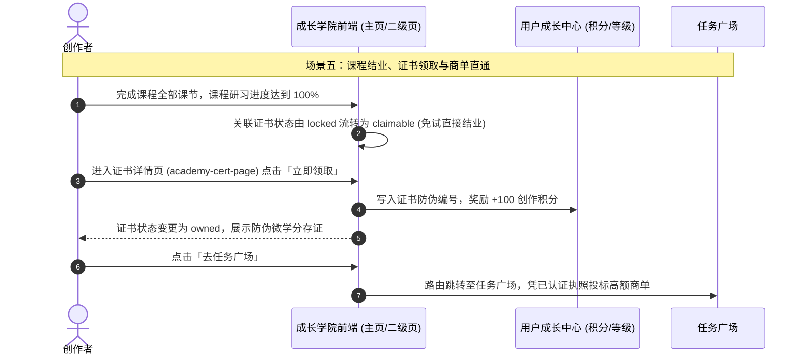
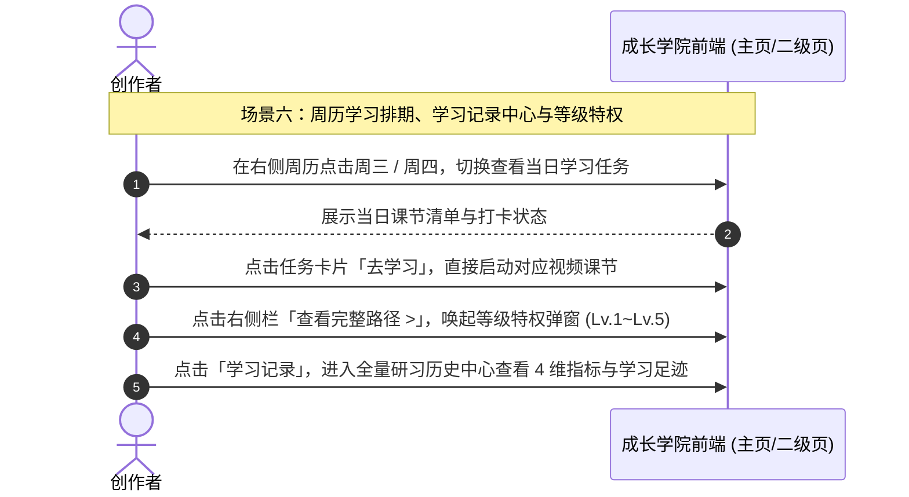
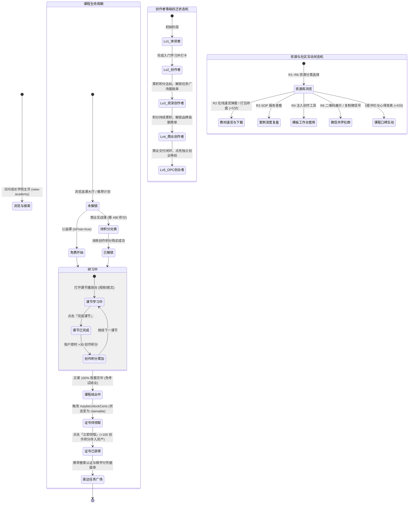

# 成长学院（研训学练与技能认证体系）全业务架构设计方案

## 一、 用户故事

### 1. 本模块解决了什么问题？
传统在线教育普遍存在“收取强制督学押金增加学生资金负担、死记硬背刷题考试脱离工业实际、学练脱节无法接单商用、资源零散不成体系”等痛点。年轻创作者与高校学生在学习 AI 创作技能时，往往面临“缺少正向反馈激励、无法直观查看成长进阶路径、学习成果缺乏官方权威背书与商单准入凭证”的三重困境。

### 2. 实现了什么目标？
成长学院（Academy）定位为整个社区的**全周期人才实战孵化底座与技能认证中枢**：
- **训战一体零门槛**：取消做题考试与押金机制，全部课程以实操视频、图文课件、商业工程解析与参数手册为核心，打造“看完视频即学懂，学懂即出片”的实战体系；
- **边学边领「创作积分」正反馈**：创作者完成视频课节打卡即时奖励 **+30 创作积分**，发表课程实战讨论心得奖励 **+5 创作积分**，领取证书奖励 **+100 创作积分**，即时累积个人成长值，驱动创作者能力等级（Lv.1 体验者 → Lv.5 OPC 创业者）跃迁；
- **全链路 6 大二级子页面无缝穿透**：提供“选课大厅（多维过滤/搜索/排序）、课程详情（大纲/试看/评价心得）、课节播放台（视频/打卡/上下节/目录）、学习记录中心（学时/积分/足迹）、6 类差异化资源库（速览/下载/套用工作台/共学入群）、官方证书详情（领证/防伪微学分/商单直达）”，形成自洽的学习-认证-商业闭环。

### 3. 涵盖哪些核心功能？
- **学院主看板（一级页面 view-academy）**：
  - **顶部 Hero 看板**：愿景呈现，【我的学习路径】平滑滚动锚点与【学习记录】中心直达；
  - **我的成长路径（Lv.1 ~ Lv.5 实战台阶 · 每级门槛与需完成内容全量公开）**：卡片直观展示 Lv.1 AI 体验者、Lv.2 AI 创作者、Lv.3 内容创作者、Lv.4 商业创作者、Lv.5 OPC 创业者，**每张卡片额外给出该等级的达成度「n / m 项达成」与进度条**；点击任一等级卡片（含未解锁等级）呼出「成长路径 · 等级说明」弹窗（`modal-growth-level`），分三段完整说明：**① 晋级门槛**（创作积分区间 + 当前积分 + 距该等级还差多少积分）、**② 需完成内容**（逐条清单，带 ✓/○ 达成标记与「当前 / 要求」量化对照）、**③ 达成后解锁**（权益标签 + 业务范围）；点击【查看完整路径 >】呼出「创作者等级权益」弹窗（`modal-level-perks`），**Lv.1 ~ Lv.5 五级全量纵向对照**（门槛 / 条件清单 / 权益齐全），每行可【查看该等级完整说明 >】下钻单级详情；
  - **推荐学习计划（含 5 大分类 Tab）**：分类 Tab（全部、新手入门、技能提升、实战进阶、出海运营、商业变现），展示课程封面、资费标签（免费/付费）、奖励积分、进度条与点击进课；
  - **学习资源库 6 宫格**：体系化课单（R1）、AI核心教材（R2）、爆款案例拆解（R3）、生产模板工程（R4）、AI工具参数全解（R5）、创作者共学圈（R6）；
  - **右侧多功能学籍与学习仪表盘（col-side）**：
    - **个人学籍画像卡片**：头像、院校认证、Lv.4 商业创作者标识与【我的证书 >】弹窗入口；
    - **4 维核心学籍数据**：学习时长 (128小时)、课程完成 (16门)、获得证书 (8张)、可用创作积分 (2680分)；
    - **连续学习打卡金牌（Streak Banner）**：展示连续学习天数（7天）、每日 60 分钟学习进度条（如 28/60 分钟）及打卡金牌；
    - **本周学习周历与今日任务（周一至周日选择器）**：动态切换日期，展示今日待研习课节清单、完成状态与一键播放直达；
    - **我的成就勋章墙**：展示勤学之星、实战先锋等徽章与获颁时间。
- **6 大专业二级子页面体系**：
  1. **全量选课大厅（`academy-courses-page`）**：沉浸式 Banner、实时关键词检索、5 大热门检索标签、方向分类与资费模式双维度筛选、4 大排序（推荐/创作者/评分/积分奖励）；
  2. **课程详情中心（`academy-course-page`）**：课程概览、讲师信息、全实战大纲课节清单、免费试看第 1 课 / **付费课程经【我的资产】账户余额选购**（`App.buyAcademyPlan()`）、创作者 1~5 星口碑打分与心得讨论发表（奖励 +5 创作积分）；
  3. **课节实战播放台（`academy-lesson-page`）**：视频/图文双模态播放舞台、核心要点清单、实战图文讲解、完成课节打卡（+30 积分）、上一节/下一节导航、右侧所属课程与课节大纲即时切换；
  4. **全量学习记录中心（`academy-records-page`）**：4 维学籍统计看板、进行中的课程进度卡片、最近研习动态足迹、证书与学分快捷看板；
  5. **学习资源库详情（`academy-resource-page`）**：顶部 6 大资源库横向导航、资源内搜索，并针对教材提供【在线速览】、案例提供【SOP深度复盘报告】、模板提供【一键套用至创作工具工作台】、社群提供【微信扫码/复制助理微信号入群】；
  6. **官方证书详情台（`academy-cert-page`）**：巨幅防伪证书、颁发机构、微学分存证，支持一键领取（+100 积分）与持证直达【任务广场】接单。

---

## 二、 多方角色业务交互时序图

本模块的时序图按**「全景 → 单场景」**两层组织：先以一张全角色综合交互图总览场景一 ~ 场景六，再把每个场景单独抽成一张子时序图，只保留该场景真正参与的角色与泳道。

> 角色口径：**创作者** = 在成长学院研习、打卡、考取认证的高校创作者（含 OPC 主理人）；**官方教研 / 认证导师** = 供给课程与签发认证的一方。

### 全角色综合交互时序图（全局全景 · 场景一 ~ 场景六）

### 场景一子时序图：工业化选课大厅多维检索与自主选课

### 场景二子时序图：课节视频研习、打卡领积分与等级自动晋升

### 场景三子时序图：课程评价口碑打分与实战心得互动

### 场景四子时序图：6 大资源库多态消费与一键套用工作台

### 场景五子时序图：课程 100% 结业、官方证书领取与商单直达

### 场景六子时序图：右侧学习看板、周历打卡与等级特权总览

---

## 三、 全生命周期业务/任务状态机

---

## 四、 核心功能模块与操作权限矩阵

| 功能模块 | ① 高校创作者 | ② 认证导师/教学机构 | ③ 发包方 | ④ 平台教务审核专员 |
| :--- | :--- | :--- | :--- | :--- |
| **主页看板与成长路径** | 查看当前 Lv 等级、成长进度条、呼出特权弹窗 | 查看平台培养体系标准 | 查看创作者认证等级分布 | 维护成长路径等级规则与经验系数 |
| **成长路径 · 等级说明 (modal-growth-level)** | **查看任一等级（含未解锁）的晋级门槛、需完成内容清单（带达成标记与量化对照）与解锁权益**，并按等级获得「去学院学习 / 去任务广场接单 / 去作品展厅接单」的行动引导 | 对照等级标准设计课程路径 | 理解各等级创作者的能力与交付边界 | 配置各等级门槛区间、需完成清单与权益项 |
| **选课大厅 (academy-courses-page)** | **类型筛选 (`#academy-courses-filter` / `App.setAcademyCourseCategory()` / `App.setAcademyCourseFee()` / `App.getAcademyCourseCategories()`)+ 资费筛选 + 关键词检索 + 多规则排序** | 查看旗下课程热度与选课规模 | 查看创作者技能学习课目 | 课程上架、分类标签与权重排序配置 |
| **课程详情 (academy-course-page)** | **查看大纲、免费试看、付费课程余额选购、口碑打分** | 回复创作者心得讨论、置顶优质评价 | 查看课程专业度作为合作参考 | 审查课程合规性、处理违规评价 |
| **课节播放台 (academy-lesson-page)** | **定制播放器观看（防拖拽 / 断点续播 / 动态水印）、查阅课件、打卡领取 +30 创作积分** | 查看课节完播率与创作者打卡分布 | 无需使用 | 检查视频播放流畅度与防盗链机制 |
| **- 定制课程播放器 (`course-video-player`)** | 播放器初始化 (`App.initCourseVideoPlayer()`) 播放/暂停 (`App.toggleCourseVideo()` / `App.playCourseVideo()` / `App.pauseCourseVideo()`) 停表落盘 (`App.stopCourseVideo()`) 进度条拖拽 (`App.beginCourseVideoSeek()` / `App.applyCourseVideoSeek()`) 预设倍速 (`App.cycleCourseVideoSpeed()`) 状态同步 (`App.renderCourseVideoState()`) 进度台账 (`App.getLessonProgress()` / `App.saveLessonProgress()` / `App.getLessonWatchPercent()`) 时长与时钟 (`App.parseLessonDuration()` / `App.formatVideoClock()`) 口径真源 (`App.getPlayerConfig()`) | **三大能力**：① **防拖拽**——进度条只能落在「已观看水位线」内（含 3 秒回看容差），越过即回弹并提示，方向键/PageUp 等键盘快进同样被拦截；② **断点续播**——观看位置经 `App.saveLessonProgress()` 落盘（会话内存 + localStorage 持久化），重进课节自动定位；③ **播放安全**——自研 DOM 播放器不使用原生 `<video>`（天然屏蔽下载 / 画中画 / 任意倍速），禁用右键菜单，叠加**动态水印**（署名 + 学号 + 滚动时间戳）与**观看凭证心跳**；防拖拽与「看完 95% 才可完成本节」形成学习有效性闭环 | 学习有效性保护 | 正常观看、回看、续播并领取积分 | 管理课件与完播口径 |
| **学习记录 (academy-records-page)** | **查看 4 维学籍数据、在学进度、最近研习动态** | 查阅班级整体学时分布 | 验证应聘创作者真实学时背书 | 统计全站创作者日活与打卡留存率 |
| **6 大资源库 (academy-resource-page)** | **在线速览(R2)、案例复盘(R3)、套用工作台(R4)、入群(R6)** | 上传自研工程模板与参数手册 | 采购官方合规资产授权 | 版权合规审查、下架侵权模板 |
| **官方证书台 (academy-cert-page)** | **领取证书(+100分)、查看微学分防伪、直通任务广场** | 查看颁发证书总量与通过率 | 扫码验证证书真实性与学分存证 | 签发官方认证、微学分真实性核验 |
| **右侧学籍与周历打卡** | **切换周一至周日查看任务、一键开学、查看连续打卡** | 查看带教创作者打卡率 | 无需使用 | 监控每日打卡活跃数据 |

---

## 五、 与全局各模块的深度联动体系说明

1. **与【用户管理/成长体系】深度联动（创作积分驱动等级跃迁）**：
   - 创作者在学院观看课节打卡获得的 **+30 创作积分**、发表心得讨论获得的 **+5 创作积分**、领取证书获得的 **+100 创作积分**，实时累加至用户中心的成长档案中，直接驱动能力等级（Lv.1 ~ Lv.5）晋升与勋章点亮；**创作积分只增不减，不用于任何购买或兑换**——付费课程与付费实战课时一律经【我的资产】账户余额以人民币购买。
2. **成长路径自身的等级口径（门槛 / 需完成内容 / 权益唯一真源 = `MockData.academy.paths`）**：
   - 每一级由 **6 个字段**完整描述：`goal`（等级定位一句话）、`scope`（该等级可承接的业务范围）、`pointsMin`/`pointsMax`（创作积分门槛区间，最高级 `pointsMax: null` 不封顶）、`requirements[]`（**需完成内容清单**）、`perks[]`（达成后解锁权益）、`perk`（一句话摘要，用于卡片 hover 与旧文案兼容）。
   - **`requirements[]` 的达成判定**：带 `points` 的项由**真实创作积分动态判定**（`App.getGrowthRequirementState()`，改积分则判定随之变，不写死）；其余项以种子 `done` 为准，并通过 `metric` 给出「当前 / 要求」量化对照（如 `12 / 15 单`、`99.4% / 95%`）。等级整体完成度由 `App.getGrowthLevelProgress()` 统一输出 `done/total/percent/pointsGap`。
   - **5 级门槛区间严格递进不重叠**：Lv.1 `0~499` → Lv.2 `500~1,499` → Lv.3 `1,500~2,499` → Lv.4 `2,500~3,999` → Lv.5 `≥4,000`；当前账号创作积分 2,680 恰好落在 Lv.4 区间，与 `currentUser.level = 4` 自洽。
   - **未解锁等级同样公开条件**：Lv.5 虽为「未解锁」，点开仍完整展示「还差 1,320 积分 / 12 / 30 单 / ¥6,820 / ¥20,000」等三项缺口——**成长路径对创作者完全透明，不存在隐藏门槛**。
3. **与【任务广场】深度联动（训战一体商单准入）**：
   - 彻底打破“学完无处变现”的死局。创作者完成特定垂类课程（如数字人或短剧）100% 结业并领取官方证书后，系统自动打通【任务广场】对应商单品类的投标权限，并在个人主页点亮“官方认证创作者”金标，免收履约保证金。
4. **与【创作工具】深度联动（教案与工程模板一键上机）**：
   - 在资源库（R4 生产模板）点击「套用至工作台」，系统自动将导师调优的工程模板和推荐参数注入【创作工具】对应的工作台；在 R5 工具调优手册中点击「去创作工具实测」，无缝切换到工具箱进行出片实操。
5. **与【发现页】深度联动（精品课双向引流）**：
   - 成长学院的优质精选课动态推送至【发现页】首屏的“推荐课程”栏目；创作者在发现页点击课程卡片即可直达学院二级课程详情页进行选课。
6. **与【我的资产】深度联动（证书、微学分与资产归档）**：
   - 创作者领取的官方结业证书、高校微学分凭证（CERT-CREDIT）、OPC 准入执照等，全量同步存证至【我的资产】的“资质认证中心”，支持随时查验与链上防伪核验；
   - **付费课程统一余额支付**：课程详情页的付费课程经账户余额人民币购买，**免费课程不经过支付校验**；未购课程的全部课节呈「待解锁」态，选购成功后即时解锁并可继续学习；重复选购同一课程不二次扣款；
   - **余额不足统一引导**：余额不足以支付课程价格时，统一唤起余额不足引导弹窗（展示应付 / 可用 / 尚缺三项），可一键跳转人民币账户充值，充值到账后返回课程详情页重试。
7. **与【社区中心】深度联动（微信共学圈与圈子沉淀）**：
   - 资源库 R6（创作者共学圈）提供微信社群二维码与助教微信号复制，将创作者无缝沉淀至垂直方向的创作者圈子中，进行日常答疑与商业合作交流。

---

## 六、 变更记录

| 日期 | 变更类型 | 变更内容 | 影响范围 |
| :--- | :--- | :--- | :--- |
| 2026-09-24 | 文档结构优化 | **时序图按场景拆分 + 全站角色名词统一**： **① 子时序图拆分**——§二 完整保留「全角色综合交互时序图（全局全景 · 场景一 ~ 场景六）」并补齐标题与角色口径说明，其下新增**六张子时序图**：场景一 全量选课大厅多维检索与自主选课、场景二 课节研习打卡与积分到账与等级晋升、场景三 口碑打分与心得互动、场景四 6 类资源库消费与工具链联动、场景五 结业领证与商单直达、场景六 周历学习看板与学习记录中心。 **② 名词统一**——两类用户统一为**「创作者」**（原「学员」）与**「发包方」** | §二（新增 6 张子图）/ 全文档名词；无新增契约、无代码改动；L1 32 ERROR 持平 / 本文件 0 ERROR、WARN 0；Mermaid 59 块 0 问题 |
| 2026-09-23 | 实现 + 契约修订 | **定制课程播放器 + 全量课程中心类型筛选**： **① 定制播放器（`course-video-player`）**：课节页的视频区块由「假封面 + 点击即完成」整体替换为**自研 DOM 播放器**——受项目零依赖与无外部媒体约束，播放由**虚拟时间轴**驱动（`MockData.academy.playerConfig` 为口径唯一真源），不使用原生 `<video>`，天然屏蔽下载 / 画中画 / 任意倍速；**防拖拽**：`App.applyCourseVideoSeek()` 只允许落在已观看水位线内（含 `seekToleranceSec: 3` 回看容差），越过即回弹并提示，`App.bindCourseVideoGuards()` 同时拦截方向键 / PageUp 等键盘快进；**断点续播**：`App.saveLessonProgress()` 落盘（会话内存 + localStorage），重进课节由 `App.initCourseVideoPlayer()` 自动定位并给出续播提示；**播放安全**：动态水印（署名 + 学号 + 滚动时间戳）、禁用右键、观看凭证心跳（`heartbeatSec: 30`）、预设倍速 1.0~3.0x；并与 `App.completeLessonById()` 形成闭环——**观看进度未达 95% 不允许标记完成**（搭配倍速引导）。 **② 全量课程中心类型筛选**：二级页新增静态筛选容器 `#academy-courses-filter`，主维度**课程类型**（由 `MockData.academy.plans` 的 badge/category 派生并带计数）由 `App.getAcademyCourseCategories()` / `App.setAcademyCourseCategory()` 承载，次维度**资费**（全部 / 免费 / 付费）由 `App.setAcademyCourseFee()` 承载，组合筛选经 `App.getFilteredAcademyCourses()` 输出，无匹配时渲染空态并给出【重置筛选条件】。 **§四 矩阵同步**：新增「定制课程播放器 (`course-video-player`)」行，并修订「选课大厅」与「课节播放台」两行 | §一、§四、§六；新增契约 `course-video-player`、`#academy-courses-filter` 与 15 个播放器方法；`css/style.css` 新增 `cvp-shell 等播放器样式` 播放器样式组与 `academy-filter-bar 等筛选条样式` 筛选条样式组；新增 `temp/wb-assets-plus-verify.js`（230 项，含 D 组播放器 31 项与 E 组筛选 16 项）；回归七脚本合计 **1,669 项断言全通过**；L1 保持 **32 ERROR**（本文件 **0 ERROR / WARN 0**）；Mermaid 结构门禁 **0 问题 / 32 图块**；联动【我的资产】账户余额支付（`App.payFromAccountBalance()`）用于付费课程选购 |
| 2026-09-23 | 新增 | **成长路径 Lv.1 ~ Lv.5 等级说明全量公开（门槛 / 需完成内容 / 权益三段式）**：① **数据层**——`MockData.academy.paths` 每级补齐 `goal`（等级定位）、`scope`（业务范围）、`pointsMin`/`pointsMax`（创作积分门槛区间，Lv.5 不封顶）、`requirements[]`（需完成清单）、`perks[]`（解锁权益），门槛严格递进不重叠（0~499 / 500~1,499 / 1,500~2,499 / 2,500~3,999 / ≥4,000），数值全部对齐 `currentUser` 真实档案；② **判定层**——新增 `App.getGrowthRequirementState()`（带 `points` 的条件由真实积分**动态判定**）与 `App.getGrowthLevelProgress()`（输出 done/total/percent/pointsGap）；③ **渲染层**——路径卡片新增「n / m 项达成」与进度条，点击任一等级（**含未解锁等级**）打开新增的 `modal-growth-level` 等级说明弹窗（晋级门槛 / 需完成内容带 ✓○ 与量化对照 / 达成后解锁 / 行动引导）；④ `modal-level-perks` 由硬编码 Lv.3~5 三张卡改为**数据驱动 5 级纵向全列**，每行可下钻单级详情；⑤ 旧入口 `App.onGrowthPathClick()` 收敛为打开详情（不再只弹 Toast），未解锁等级不再被「尚未解锁」拦在门外。自检新增 `temp/wb-academy-path-verify.js`（182 项）。 |
| 2026-09-22 | 契约修订 | 付费课程选购口径接入**全站统一余额支付**：① §一「推荐学习计划」资费标签由「免费/积分/现金」改为「免费/付费」；② §一「课程详情中心」由「积分选购」改为「付费课程经【我的资产】账户余额选购（`App.buyAcademyPlan()`）」；③ §四 矩阵「课程详情」行同步；④ §五 联动第 1 条明确**创作积分只增不减、不用于任何购买或兑换**（原「兑换付费实战课时优先扣减创作积分」表述作废）；⑤ §五 联动第 5 条补充「付费课程统一余额支付」与「余额不足统一引导」两条 | §一、§四、§五，并新建 §六；联动【我的资产】统一余额支付口径（`App.payFromAccountBalance()`）与余额不足引导弹窗（`modal-balance-insufficient`）；`App.buyAcademyPlan()` 已实现 |

