# 我的资产（全域资产总金库、OPC 后勤基础设施与版权确权）全业务架构设计方案

## 一、 用户故事

### 1. 本模块解决了什么问题？
在青年创作者向商业化迈进的过程中，普遍面临“资产分散易丢、无对公资质无法开票、在途资金缺乏托管感知、双轨积分混淆”四大痛点：
- **大学生/创作者无对公资质开票难**：B 端企业客户采购必须报销增值税发票，创作者由于无法办税易错失大单机会；
- **商单在途资金缺乏安全托管感知**：创作者对“哪些钱还在平台托管库中、何时能提现”缺乏透明可视的展示；
- **双轨积分混淆与算力成本不可控**：平台需要将“创作者升级成长值（创作积分）”与“工具 GPU 算力点（AI 积分）”明确划分，避免消耗混乱；
- **数字版权与荣誉缺乏统一陈列**：商单交付版权确权书、高校赛事荣誉与培训证书分散，缺乏一站式数字藏品陈列与验真。

### 2. 实现了什么目标？
我的资产（My Assets & Portfolio Hub）定位为创作者的**全域数字资产总金库、校园 OPC 商业合规后勤中枢与版权凭据中心**：
- **校园 OPC 商业合规与后勤基础设施 4 大中枢**：平台统一提供【增值税专票代开】（解决无资质痛点，直达 `modal-invoice` 发票管理）、【商单资金托管库】（专户锁定 ¥1,500.00 安全款项，点击查看名下全部托管项目进度）、【专属普惠算力特权】（剩余 12,500 Tflops 额度，经**账户余额** 4 折普惠充值）与【学徒带教生态分润】（带教 3 位学弟学妹分成 ¥620）；
- **全站唯一现金支付源（统一支付口径）**：账户余额是**平台购买类行为**的**唯一支付来源**——算力特权充值、学院付费课程选购等一律从账户余额扣减，**这些购买入口都不直连微信 / 支付宝 / 银联**；余额不足时统一引导前往 `modal-account-recharge` 充值后再试——**人民币账户充值本身走微信支付 / 支付宝官方收款二维码（`modal-recharge-qr`）**，这是全站**唯一**的外部支付通道入口。**Pro 会员订阅为第二个扫码场景**：会员订阅走独立订阅结算通道（`modal-pro-pay-qr` 扫码支付），不占用账户余额、不产生冻结额、不写入资产流水，详见【用户管理设计.md】；
- **4 大核心资产卡片与严谨双轨积分架构**：明确划分【账户余额】（展示总额 ¥6,820.50，并按 **已冻结 ¥1,500.00 + 可消费 ¥5,320.50 = 账户余额 ¥6,820.50** 的公式拆分展示，仅支持唤起 `modal-account-recharge` 充值、**不可提现**）、【创作收益】（历史变现 ¥12,680.30，全站唯一可提现来源）、【创作积分（可用）】（2,680 积分，严格用于创作者 Lv.1~Lv.5 等级认证）与【AI 积分】（2,340.00 积分，严格用于工具 GPU 算力消耗）；
- **资产明细流水穿透与数字藏品展柜**：6 大分类 Tab（全部/收入/支出/提现/创作积分/AI积分）与时间周期下拉筛选，5 宫格数字藏品展柜支持全屏查看与【我的证书与成就 (`modal-my-certs`)】全览；
- **右侧多功能安全与常用面板**：100% 满格绿色安全防御舱（直达 `modal-security-settings` 安全设置）、Pro 权益特权展位（直达 `modal-pro`）及常用功能 7 项快捷面板。**「资产概览」面板已于 2026-09-24 下线**：原「总资产估值 + 资产构成占比列表」与 4 大核心资产卡片信息重复，且总额读的是 `breakdown.total` 硬编码字符串、冻结/解冻后不重算（会失真），故整体移除；总资产与资产构成的展示口径统一由 4 大核心资产卡片承载。

### 3. 涵盖哪些核心功能？
- **Banner 区域**：主标【我的资产】，副标“个人中心 · 管理数字资产与创作收益”；
- **个人中心资料条（assets-profile-hub）**：展示当前登录创作者头像、姓名、认证身份（南京大学 ｜ 商业创作者）、创作等级 Lv.4、**作品 / 浏览量 / 粉丝 / 获赞 / 创作积分 5 项统计**与账户概览；**创作积分（可用）资产卡已于 2026-09-24 下线，个人当前创作者积分改由本资料条第 5 格展示**（读数节点 `profile-stat-points`，真源 `MockData.currentUser.learningPoints`，由 `App.refreshCreatorPointsDisplay()` 刷新）；
- **校园 OPC 商业合规与后勤基础设施 4 大中枢（opc-infrastructure-grid）**：
  - **1. 增值税专票代开**：解决大学生无对公资质难题，平台统筹合规开具专票，卡片与底部操作均唤起点击【发票管理 >】（`App.openInvoiceModal()` → `modal-invoice`），可对人民币账户充值记录申请开具增值税普通发票 / 专用发票；
  - **2. 商单资金托管库**：展示已安全托管未结算商单款项 **¥1,500.00**（**恒等于资产卡「冻结金额」**），完工立即到账；点击卡片或【查看托管进度 >】唤起**托管进度弹窗**（`App.openEscrowProgressModal()` → `modal-escrow-progress`），按**冻结时间倒序**展示当前商户名下**全部托管项目及每个项目冻结的金额**；
  - **3. 专属普惠算力特权**：展示剩余 12,500 Tflops 高性能 GPU 额度，**经账户余额 4 折普惠充值**（`App.openComputeRechargeModal()` → `modal-compute-recharge`），不直连微信 / 支付宝 / 银联等任何外部支付通道；
  - **4. 学徒带教生态分润**：展示已签约带教 3 位低年级学弟学妹，本月分润 ¥620.00，点击查看带教管理说明；
- **3 大核心资产卡片（assets-overview-cards-4）**：
  - **账户余额 (元)**：展示总额 ¥6,820.50，副行并列**「可消费 ¥5,320.50」与「已冻结 ¥1,500.00」**两项读数（冻结款＝进行中商单托管金额）；**「已冻结 + 可消费 = 账户余额」公式脚注已于 2026-09-24 下线，卡片不再展示**，冻结读数由 `App.refreshFrozenDisplay()` 刷新；内置【去充值 >】按钮（唤起 `modal-account-recharge` 人民币账户充值弹窗，`App.openAccountRechargeModal()`），**无提现入口**（账户余额只可充值、不可提现）；
  - **创作收益 (元)**：展示累计变现 ¥12,680.30，标明“本月预估 ¥2,680.30”，内置【收益明细 >】过滤定位；
  - ~~**创作积分（可用）**：展示可用 2,680 积分，标明“累计获得 4,120 积分”，副标明确标注用于等级晋升，内置【积分明细 >】过滤定位；~~ **（2026-09-24 已下线，积分改在个人中心资料条展示，见 §六 变更记录）**；
  - **AI 积分**：展示算力池储备 2,340.00，副标明确标注用于工具算力消耗，内置【积分明细 >】与【去充值 >】两个入口（后者唤起 `modal-compute-recharge` 算力充值弹窗，`App.openComputeRechargeModal()`）；
- **人民币账户充值（modal-account-recharge）**：
  - **业务定位**：面向**创作者与发包方均可使用**的**通用现金入金通道**，独立于任务发布等任何业务流程，不构成发布任务的前置条件；
  - **入口位置**：唯一入口位于【我的资产】「账户余额 (元)」卡片副行的【去充值 >】链接（与「已冻结 / 可消费」读数同区排布，绑定 `App.openAccountRechargeModal()`），点击唤起 `modal-account-recharge` 充值弹窗；
  - **充值通道（硬口径 · 2026-09-24 改版）**：**只能通过「微信支付 / 支付宝官方收款二维码」扫码入金**——原「已绑定本人同名借记卡协议代扣」通道**已整体下线**，弹窗内**不再出现任何银行卡下拉**；渠道真源 `MockData.assets.rechargeRules.channels`（`wechat` / `alipay` 两项），渠道以 `data-channel` **按钮**承载（全站仍不存在以 `<option>` 陈列外部支付通道的入口）；
  - **两段式充值链路**：① `modal-account-recharge` 选渠道 + 填金额 → ② 提交后生成充值单（`RC` 前缀单号，状态「待支付」）并唤起**扫码支付弹窗 `modal-recharge-qr`**（`App.openRechargeQrModal()`），弹窗内可**二次切换渠道并重绘二维码**（`App.switchRechargeChannel()`，单号不变）；③ 用户点【我已完成支付】才由 `App.confirmRechargePayment()` 入金；
  - **充值三闸校验链（`App.submitAccountRecharge()`）**：闸一 必须已实名（未实名时提交被拦截并自动跳转【安全设置】实名认证 `App.openSecuritySettings('实名认证')`）/ 闸二 支付渠道必须是二维码渠道白名单内的渠道（非法渠道 id 一律回落默认渠道「微信支付」，永不为空）/ 闸三 金额有效、不低于单笔下限时值且不超过单笔上限 ¥50,000；
  - **🔴 未支付不入金（红线）**：三闸全过只生成充值单与二维码，**此阶段账户总额 / 可提现余额 / 冻结额 / 流水全部零变动**；只有【我已完成支付】才是唯一入金口；
  - **订单失效两出口**：用户点【取消订单】（`App.cancelRechargeOrder()`）或 15 分钟倒计时归零（`App.startRechargeQrCountdown()`，真源 `rechargeRules.qrExpireSec`）→ 撤单、关弹窗、**零入金零流水**；
  - **合规口径可视（`#recharge-rule-row`）**：弹窗顶部以 chips 固定展示「必须已实名 / 仅官方收款二维码 / 单笔上限 ¥50,000」三条口径，未实名时首条转红；
  - **充值档位与自定义金额**：快捷档位 ¥500 / ¥1,000 / ¥5,000 / ¥10,000，同时支持自定义输入任意金额（单笔下限 ¥1、单笔上限 ¥50,000，唯一真源 `MockData.assets.rechargeRules.minPerTx` / `maxPerTx`）；
  - **到账时效**：扫码支付成功**即时到账 · 免手续费**（`rechargeRules.arrivalNote`）；
  - **账户余额构成口径（唯一真源公式）**：**账户总额 = 可提现余额 + 冻结金额**；冻结金额为进行中商单托管款，**不允许提现**；
  - **账本联动**：入金成功即时增加账户总额与可提现余额，并在资产明细「收入」Tab 生成一条「人民币账户充值」流水；**流水名格式为 `人民币账户充值 (微信支付)` / `人民币账户充值 (支付宝)`**，发票管理的「充值渠道」字段直接取该括号内文本，故每一笔充值都可追溯到扫码渠道；
  - **与 AI 积分解耦**：人民币充值只进人民币现金账户，不产生任何 AI 积分或创作积分，不触碰双轨积分体系；
  - **与业务解耦**：充值只改变现金账户余额，不影响任务发布资格、接单资格或创作等级；
- **商单资金托管库 · 托管进度明细（modal-escrow-progress）**：
  - **业务定位**：以**当前商户（登录账号主体）**为口径，汇总展示其名下**全部托管项目**的进度与资金状态，解决「哪些钱还在平台托管库中、何时能提现」的透明化诉求；
  - **入口位置**：唯一入口位于【我的资产】OPC 基础设施「商单资金托管库」卡片（整卡与底部【查看托管进度 >】均绑定 `App.openEscrowProgressModal()`）；
  - **排序规则（硬约束）**：项目列表**一律按冻结时间倒序排列**（最新冻结的排在最上方），排序键为 `MockData.assets.escrowProjects[].frozenAtTs`，`frozenAt` 仅作界面展示文本；
  - **列表字段**：每个托管项目展示 **项目名称 / 商单号 / 交易对手 / 本商户角色 / 冻结金额 / 冻结时间 / 托管状态 / 履约进度条 / 阶段说明 / 结算规则**；
  - **冻结金额口径（唯一真源）**：所有**进行中项目**（`statusKey = active`）的冻结金额之和**恒等于资产卡「冻结金额」**（当前 ¥1,500.00），并与 `MockData.assets.transactions` 中 `status = 托管中` 的流水通过 `txId` 一一对应；已结算 / 已退还项目展示「原冻结金额」且**不计入**冻结合计；
  - **汇总条三格**：托管中金额（进行中项目冻结合计）/ 进行中项目数 / 累计已结算金额，由 `App.getEscrowSummary()` 统一计算；
  - **筛选维度**：`App.filterEscrowProjects('all' | 'active' | 'settled')` 三档胶囊筛选——全部 / 进行中（`statusKey = active`）/ 已结算 · 已退还（`statusKey = settled`）；
  - **状态取值**：进行中可为 `招募选拔中` / `履约中` / `待验收` / `返修中`；终态为 `已结算` / `已退还`；
  - **与发布 / 结算联动**：发布商单全额托管（`App.freezeEscrow()`）时自动在托管库新增一条进行中项目（`frozenAt = 刚刚`）；验收解冻结算（`App.releaseEscrow()`）时按金额匹配冻结最早的进行中项目，自动转为「已结算 · 进度 100%」；
  - **卡片文案同源**：托管库卡片描述（`#escrow-library-desc`）由 `App.renderEscrowLibraryCard()` 按上述冻结合计动态渲染，杜绝卡片数字与列表、资产卡三处漂移；
- **全站统一余额支付口径（购买类支付唯一来源）**：
  - **业务定位**：账户余额是平台内**购买类行为**的唯一支付来源，由 `App.payFromAccountBalance(amount, name)` 统一承担扣款与记账，杜绝各业务模块各自对接外部支付通道；
  - **适用范围**：专属普惠算力特权充值、成长学院付费课程选购（¥49 / ¥59 / ¥69 / ¥79 / ¥99），以及后续新增的购买类付费能力；**不含 Pro 会员订阅**（会员订阅为独立订阅结算通道，见下方「支付边界划分」）；
  - **唯一入金通道（2026-09-24 改版）**：账户余额的**唯一入金方式是 `modal-account-recharge` 选渠道后生成的「微信支付 / 支付宝官方收款二维码」（`modal-recharge-qr`）**——原「已绑定本人同名借记卡协议代扣」通道**已整体下线**，弹窗内不再出现任何银行卡下拉；银联对公转账渠道亦不复活。**全站仅两处扫码型外部支付入口**：人民币账户充值 `modal-recharge-qr` 与 Pro 会员订阅 `modal-pro-pay-qr`，且两者均以渠道按钮（`data-channel`）呈现而非 `<option>` 下拉，与账户余额互不影响；
  - **扣款口径**：购买直接扣减**可提现余额**（不产生冻结额），账户总额与可提现余额同步减少，并写入一条「支出」流水，状态 `已完成`；
  - **余额不足统一引导**：当 `可用余额 < 应付金额` 时，统一唤起 `modal-balance-insufficient` 余额不足引导弹窗（`App.openInsufficientBalanceModal()`），展示「应付金额 / 当前可用余额 / 尚缺金额」三项，并提供【去充值 >】直达 `modal-account-recharge`；**充值成功后返回原购买弹窗可重试**；
  - **免费能力不拦截**：免费课程、课节打卡、证书领取等不产生费用的能力不经过支付校验；
- **支付边界划分（余额支付 vs 会员订阅独立结算）**：
  - **余额支付**：算力特权充值、学院付费课程选购 → 扣账户余额 → 写「支出」资产流水 → 余额不足唤起 `modal-balance-insufficient`；
  - **会员订阅独立结算**：Pro 会员开通 / 续费 → 扫码支付（`modal-pro-pay-qr`）→ **完全不动账户余额、不产生冻结额、不写入资产流水**，仅在 `MockData.systemAdmin.membership.orders` 登记订阅订单，并回写会员有效期至；
  - **判定依据**：会员订阅是**账号级服务订购**，与账户现金钱包解耦，避免订阅支出污染资金台账与「总额 = 可提现 + 冻结」恒等式；
- **申请提现（modal-withdraw · 合规四道闸）**：
  - **业务定位**：账户余额的**出金通道**，**仅支持提现至本人同名的银行借记卡**——四道合规闸门全部通过才允许扣款出金，任一未过即拦截且余额与流水零变动；
  - **闸一 · 必须已实名**：当前账号 `MockData.currentUser.idVerified` 必须为 `true`（判定入口 `App.isIdVerified()`）；未实名时弹窗顶部实名状态条转红、提交按钮置灰，提交被拦截并自动跳转【安全设置】实名认证（`App.openSecuritySettings('实名认证')`）；
  - **闸二 · 必须同名提现**：收款卡持卡人姓名必须**逐字等于**实名认证姓名（当前「黄*彬」），由 `App.validateWithdrawAccount()` 校验；持卡人与实名不一致的卡在下拉中置灰不可选并标注原因；
  - **闸三 · 单笔上限 ¥10,000**：单笔提现金额不得超过 **¥10,000.00**（唯一真源 `MockData.assets.withdrawRules.maxPerTx`），超限时输入框下方实时提示并引导拆分为多笔提现；
  - **闸四 · 仅限借记卡**：信用卡（如中国银行尾号 6608）在下拉中置灰不可选，提示「仅支持提现至银行借记卡」；**非银行卡渠道（微信零钱等）一律不出现在提现入口**；
  - **创作收益校验**：四道闸全部通过后，仍须校验 `提现金额 ≤ 创作收益`——**账户余额只可充值、不可提现**，冻结金额为进行中商单托管款亦不可提现，**全站唯一可提现来源是「创作收益」**；
  - **收款账户下拉口径**：不可用的卡**保留展示但置灰并标注不可用原因**（由 `App.renderWithdrawAccounts()` 渲染），让四条合规规则在界面上可被用户直接看见；
  - **金额实时提示**：`App.onWithdrawAmountInput()` 在输入过程中即时反馈「本次扣减金额 / 提现后剩余可提现余额」或超限、超额原因；
  - **扣款与流水**：四闸全过才扣减**创作收益**（资金来源单一真源 `MockData.assets.withdrawRules.sourceCardKey`），**账户余额、可消费、冻结额一律一分不动**（「总额 = 可提现 + 冻结」恒等式不受影响），并写入一条「创作收益提现 · 提现到 XX 银行借记卡 (尾号 NNNN)」流水，状态 `处理中`、分类 `提现`；
  - **入口收敛**：余额卡片【去提现 >】与常用功能「提现管理」统一走 `App.openWithdrawModal()`，不再裸开弹窗；
  - **到账时效**：T+0 实时到账 · 免手续费；
- **专属普惠算力特权充值（modal-compute-recharge）**：
  - **业务定位**：校园普惠算力池的**账户余额扣款式充值**，用现金余额换取工具算力点（AI 积分），**不直连微信 / 支付宝 / 银联**；
  - **算力包档位（4 折普惠价）**：¥40 → 100 算力点（原价 ¥100）、¥200 → 500 算力点（原价 ¥500）、¥400 → 1,000 算力点（原价 ¥1,000）、¥2,000 → 5,000 算力点（原价 ¥5,000）；
  - **Pro 加成**：Pro 会员在 4 折基础上额外赠 10% 算力点（档位副标实时体现），非 Pro 会员可经 `modal-pro` 开通后返回；
  - **扣款资金来源三选一（2026-09-24 新增，唯一真源 `MockData.assets.computeFundSources` + `MockData.assets.computeFundRules`）**：弹窗顶部必须先选定本次充值的扣款来源——
    - **账户余额**：只从现金账户的**可消费余额**扣款（`cardKey: withdrawable`），该来源**只可充值、不可提现**；
    - **创作收益**：只从**创作收益**扣款（`cardKey: monthlyEarnings`），把商单变现收益直接转成算力生产力；
    - **账户余额 + 创作收益（组合）**：**扣款顺序是契约**——先扣尽账户余额，不足部分再由创作收益补足（`computeFundRules.mixOrder = [balance, earnings]`）；
    - 弹窗实时展示「扣款构成」（如 `账户余额 ¥ 20.00 + 创作收益 ¥ 20.00`），摘要区 `compute-pay-split` 与提示条 `compute-fund-note` 同源；
    - **创作收益不可充值**（`computeFundRules.earningsNoRecharge`）：该来源不足时引导文案明确说明「只能靠承接商单与带教分润累积，建议改用账户余额或组合扣款」，**不导向人民币充值**；账户余额不足才唤起 `modal-balance-insufficient` 并引导 `modal-account-recharge`；
  - **扣款与入账**：确认后经统一资金扣款引擎 `App.payFromFundSources()` 按所选来源扣款，算力点仍按**所选算力类型**折算入对应账本（`tokensSelf` / `tokensIntegrated` 独立计量），并写入带来源标注的支出流水，category 归入「支出」Tab；
  - **资金隔离**：任一来源扣款都**不产生冻结额**；创作收益扣款路径**完全不触碰账户余额与可消费**，账户余额扣款路径**完全不触碰创作收益**；
- **发票管理（modal-invoice）**：
  - **业务定位**：人民币账户**充值完成后的开票中心**，创作者与发包方均可对充值记录申请开具增值税发票；
  - **入口位置**：① 常用功能 9 宫格「发票管理」；② OPC 基础设施「增值税专票代开」卡片与【发票管理 >】；③ `modal-account-recharge` 充值成功后的 Toast 引导；
  - **可开票记录列表**：按时间倒序列出每一笔「人民币账户充值」流水，字段含充值时间、充值渠道、金额、开票状态（`未开票` / `已开票`）与开票金额；
  - **发票类型**：增值税普通发票（个人 / 企业抬头均可）与增值税专用发票（**仅企业抬头**，须填写纳税人识别号）；
  - **开票申请表单**：发票类型、抬头类型（个人 / 企业）、发票抬头、纳税人识别号、接收邮箱、备注；
  - **校验规则**：开票金额不得大于所选充值记录金额；选择专票时抬头类型必须为企业且纳税人识别号必填；
  - **提交结果**：所选记录状态更新为 `已开票`，写入一条开票记录并提示「发票申请已提交，电子发票将于 3 个工作日内推送至预留邮箱」；
- **资产明细流水账本（transactions-table）**：
  - **6 大分类 Tab**：`全部`、`收入`、`支出`、`提现`、`创作积分`、`AI 积分`；
  - **时间范围下拉筛选**：`全部时间`、`近 1 个月`、`近 3 个月`、`近 1 年`；
  - **明细字段**：类型、名称、金额 (元/积分)、状态（已入账/扣减成功/处理中等）、时间；
  - 底部操作：【查看更多明细 >】（增量动态加载历史数据）；
- **我的数字藏品库（NFT / 版权证明）**：
  - **5 宫格藏品展柜**：展示数字艺术藏品与纪念卡片（如：未来之城 #001、星际探索者 #042 等稀有/珍稀藏品），支持点击灯箱全屏预览（`modal-preview-lightbox`）；
  - 支持点击【查看全部 >】唤起【我的证书与成就 (`modal-my-certs`)】；
- **右侧辅助功能侧边栏（col-side）**：
  - **1. 资产安全中心**：
    - 账户安全等级：高（100% 满格绿色安全进度条）；
    - 3 大安全要素：实名认证 (已认证)、支付密码 (已设置)、绑定手机 (已绑定)；
    - **银行卡能力已迁出主面板与安全设置（2026-09-22 迁移）**：资产安全中心只保留安全等级、3 大安全要素与【前往安全设置 >】入口，**不陈列任何银行卡明细**；
    - 【前往安全设置 >】入口（唤起 `modal-security-settings` 安全设置弹窗）**只承载「个人信息」与「安全防护」两块**，不再包含银行卡分区；
    - **银行卡绑定与换绑（2026-09-22 新增 · 同日迁至常用功能）**：
      - **两条硬性口径（本功能的要求来源）**：①「**只支持借记卡绑定**」——信用卡、以及 Visa / MasterCard 等国际卡组织卡号段一律不许绑定；②「**必须完成实名认证后方可绑定**」——未实名时绑定入口置灰、提交被拦截并自动跳转安全设置实名认证页；
      - **唯一陈列位（常用功能弹窗）**：银行卡的查看与操作**全部收敛到 `modal-bank-card-manage`「银行卡管理」弹窗**（入口＝常用功能 9 宫格「银行卡管理」）——弹窗内为绑卡口径 chips + **已绑定银行卡列表（固定展示 2 条记录）**（卡号掩码 / 发卡行 / 卡种 / 持卡人 / 绑定日期 / 可用状态标签）+ 【+ 绑定新银行卡】按钮，**每张卡提供【换绑】**，可用卡另提供【设为默认】与【解绑】（**默认结算卡不可解绑**）；
      - **绑卡表单校验链**：闸一 必须已实名 → 闸二 持卡人须与实名姓名一致 → 闸三 卡号 16-19 位且通过 Luhn 校验 → 闸四 **仅限借记卡**（按银联 BIN 号段离线识别发卡行与卡种）→ 闸五 短信验证码（发送至实名预留手机号）→ 闸六 张数上限；
      - **换绑语义**：换绑 = 「**用一张合规借记卡替换原卡**」，原卡即刻解绑、**卡位复用（不新增卡位、不占新增名额）**、默认结算标记保留；台账中若存在不合规卡（信用卡 / 异名卡）则标记为**待整改**并给出【去换绑】主操作；
      - **与提现的闭环**：新绑定的借记卡**立即可用于提现收款**（提现弹窗的收款账户下拉同步出现该卡）；提现弹窗内也提供快捷绑卡入口，形成「提现无可用卡 → 就地绑卡 → 返回提现」的闭环；**2026-09-24 起充值改为二维码扫码入金，不再依赖银行卡台账**；
      - **资金隔离红线**：绑定、换绑、解绑、设为默认**均不触碰账户余额、不产生冻结额、不写入资产流水**，「总额 = 可提现 + 冻结」恒等式始终成立；
      - **张数上限（2026-09-22 调整为 2 张）**：**单个账户最多绑定 2 张银行卡**（按**在册卡位**计，含待整改存量卡；换绑为卡位复用不计入新增）；台账存量超过上限时弹窗给出「存量已超出上限，请先解绑」提示，并允许对待整改卡直接解绑以腾出卡位；**演示台账固定 2 张本人同名借记卡，列表只展示 2 条记录**——不合规样本（信用卡 / 异名卡）改由自检脚本在测试内临时注入，既覆盖闸门拦截路径又不污染生产台账；绑定规则唯一真源为 `MockData.assets.bankBindRules`，卡号识别依据为 `MockData.assets.bankBinTable`，演示卡号为 `MockData.assets.bankCardDemos`，卡台账为 `MockData.assets.bankCards`；
      - **下钻弹窗置顶（2026-09-22 新增）**：「银行卡管理」弹窗（`modal-bank-card-manage`）内点【+ 绑定新银行卡】唤起绑定弹窗（`modal-bank-card-bind`）时为**父子弹窗叠加场景**，父弹窗 DOM 位置更靠后会把子弹窗盖住。`App.openModal()` 因此在打开任意弹窗时先探测是否已有其他弹窗处于打开态（`querySelectorAll('.modal-backdrop.active')`），若有则给当前弹窗追加 **is-stacked 修饰类**，把该弹窗的层级由底座 1000 抬到 1100，稳定压在父弹窗之上；二次确认弹窗（1200）与全局 Toast（2000）仍在其上，**确认弹窗恒在最前**（置顶规则显式排除二次确认弹窗）；
  - **2. 我的权益与特权（个人勋章 / 荣耀墙）**：展示创作者本人**已获得的全部勋章与荣耀**（校园 OPC 主理人、商业创作者 Lv.4、AI 创作达人、内容创作专家、商业变现新星、连续创作 7 日、版权存证守护者、校园影响力创作者），每枚勋章以**图片**呈现并标注等级（传说 / 史诗 / 黄金 / 白银 / 青铜 / 稀有）；**点击任意勋章图片即唤起详情弹窗 `modal-honor-detail`**（`App.openHonorDetail(id)`），展示该勋章的大图、等级、获得时间、一句话说明、**解锁条件**与**权益详细说明清单**（`honors[].perks` 逐条渲染）；未解锁勋章置灰加锁标，主按钮变为【去达成条件 >】跳转成长学院，已点亮勋章主按钮为【去使用权益 >】跳等级权益总览。数据唯一真源为 `MockData.assets.honors`，渲染由 `App.renderHonorsGrid()` 完成，标题右侧汇总条 `assets-honors-summary` 显示「已点亮 N / M 枚 · 在享 X 项权益」；
  - **3. 常用功能 5 项快捷面板（3 列 · common-functions-grid）**：
    - `提现管理`（直达提现弹窗 `modal-withdraw`，`App.openWithdrawModal()`）；
    - `发票管理`（唤起发票管理弹窗 `modal-invoice`，`App.openInvoiceModal()`，可对人民币账户充值记录申请开票）；
    - `银行卡管理`（**直达银行卡管理弹窗 `modal-bank-card-manage`**，`App.openBankCardManageModal()`，查看已绑定卡台账并完成绑定 / 换绑 / 设为默认 / 解绑）；
    - `优惠券`（**唤起优惠券弹窗 `modal-coupon`**，`App.openCouponModal()`，按可用 / 已使用 / 已过期查看券包并【去使用】跳转到对应结算场景）；
    - `赞赏记录`（快速定位资产明细 `收入` Tab 并提示说明）。
    - **口径说明**：宫格共 **5 项**，由 `MockData.assets.commonTools` 单点驱动渲染；`合作账单`、`更多功能`、`礼品卡`、`积分兑换` 已于 **2026-09-24 下线**（合作账单与「赞赏记录」同指向收入明细、功能重复；更多功能只是跳等级特权的占位入口；礼品卡与积分兑换为本次需求点名移除），`handleCommonFuncClick` 中对应分支同步删除，礼品卡弹窗与积分兑换弹窗（连同对应 MockData 台账、App 方法与 CSS 样式）均已整体删除、不留死引用。
    - **AI 积分卡新增【去充值 >】**：AI 积分卡片副行在【积分明细 >】之外并列【去充值 >】，绑定 `App.openComputeRechargeModal()`，**直接唤起算力充值弹窗 `modal-compute-recharge`**（该充值仅入 AI 积分、按所选算力类型分账，与账户余额充值 `modal-account-recharge` 是两条独立通道）。

---

## 二、 多方角色业务交互时序图

本模块的时序图按**「全景 → 单场景」**两层组织：先以一张全角色综合交互图总览场景一 ~ 场景六，再把每个场景单独抽成一张子时序图，只保留该场景真正参与的角色与泳道，便于逐场景精读与验收。

> 角色口径：**创作者** = 承接商单、产出作品、收取创作收益的一方（含 OPC 主理人）；**发包方** = 发布商单、出资托管、验收付款的一方。

### 全角色综合交互时序图（全局全景 · 场景一 ~ 场景六）

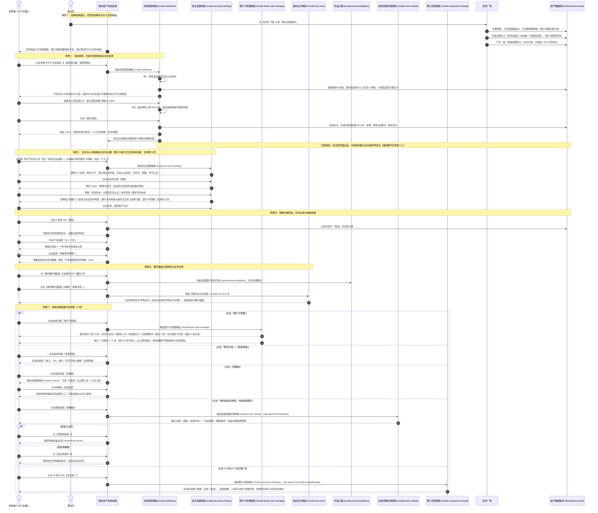

### 场景一子时序图：商单验收通过、托管释放与创作收益入账

> 资金口径（2026-09-24 确立）：商单验收通过后**创作者的账户余额零变动**，托管款走「已冻结 ↓ / 可消费 ↑」内部转移，赏金**全额计入创作收益**，创作收益是全站唯一可提现来源。

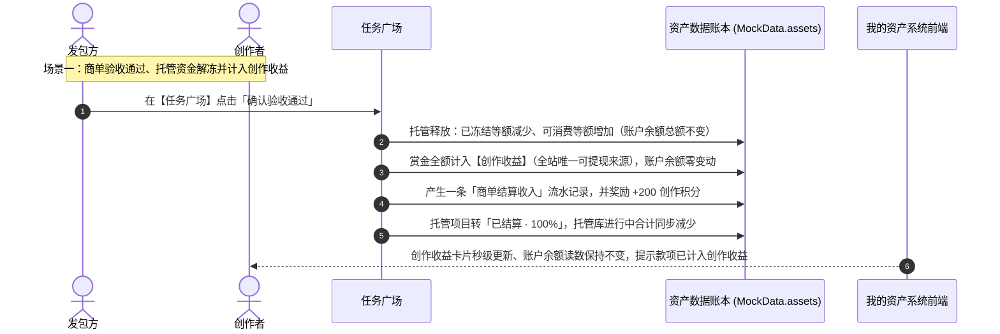

### 场景二子时序图：发起提现与四道合规闸校验

> 提现资金来源红线：**只扣创作收益**，账户余额与冻结额一分不动。四道闸 = 实名 → 同名 → 单笔上限 → 仅限借记卡；逐闸细节见「场景十三专项时序图」。

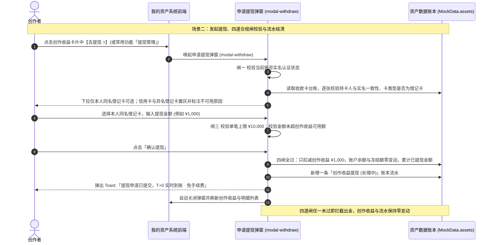

### 场景三子时序图：资产安全中心核验与个人安全设置

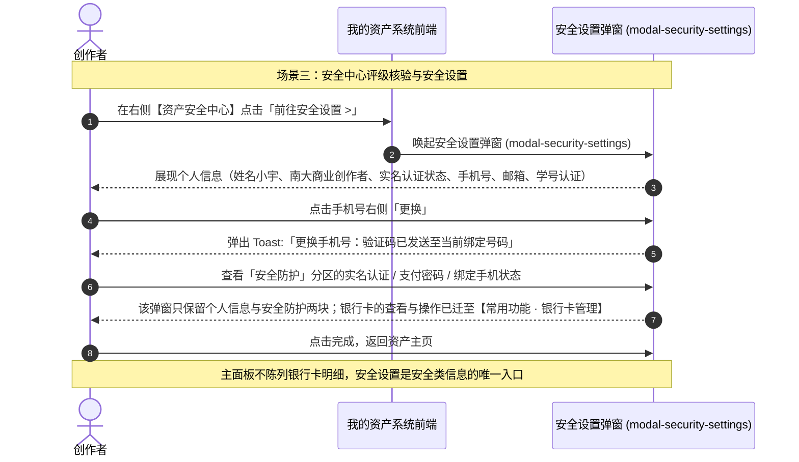

### 场景四子时序图：资产明细分类筛选、时间过滤与增量加载

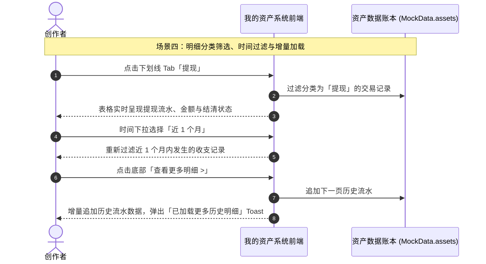

### 场景五子时序图：数字藏品灯箱大图预览与证书全景穿透

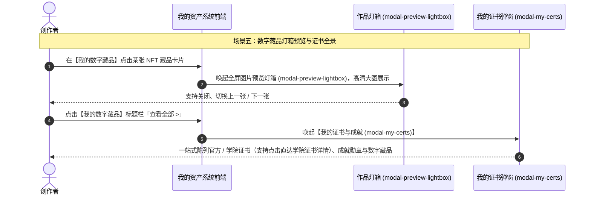

### 场景六子时序图：常用功能 5 项快捷分发、勋章墙与 AI 积分去充值

> 常用功能宫格现为 5 项：提现管理 / 发票管理 / 银行卡管理 / 优惠券 / 赞赏记录（合作账单、更多功能、礼品卡、积分兑换 已于 2026-09-24 下线）。

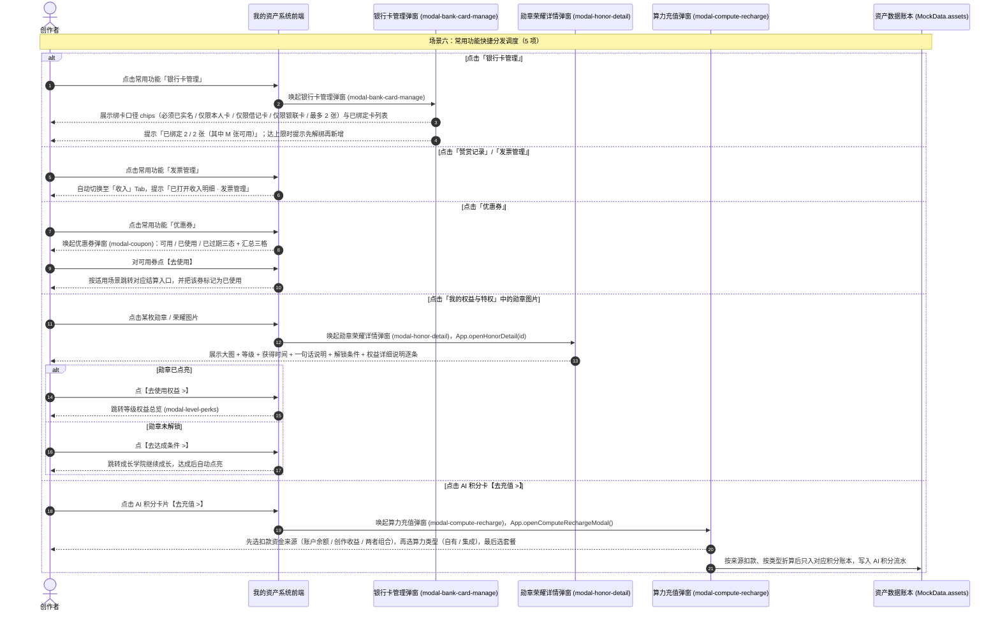

---

### 专属普惠算力特权充值专项时序图（资金来源三选一 · 场景七）

> 本场景对应 §一「专属普惠算力特权充值」与「全站统一余额支付口径」。核心约束：**算力充值不直连微信 / 支付宝 / 银联，扣款资金来源在「账户余额 / 创作收益 / 账户余额+创作收益」中三选一**（真源 `MockData.assets.computeFundSources` + `computeFundRules`）——账户余额的唯一入金口 `modal-account-recharge` 已改版为「微信支付 / 支付宝官方收款二维码」（`modal-recharge-qr`），全站扫码型外部支付入口现共两处：本充值链路与 Pro 会员订阅的 `modal-pro-pay-qr`；余额不足时统一经 `modal-balance-insufficient` 引导充值后重试。
> 遵循全局「双轨积分解耦飞轮」：算力充值只进 AI 积分算力池（消费型），创作积分成长池（信用型）只增不减、严禁任何形式充值。

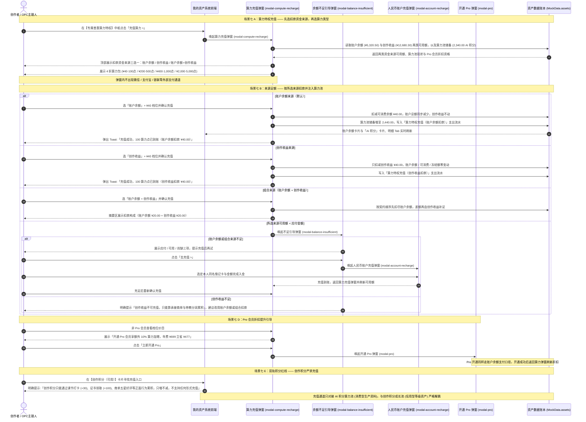

### 人民币账户充值专项时序图（微信 / 支付宝官方收款二维码 · 场景八）

> 本场景对应 §一「人民币账户充值」，定位为**独立于任务发布的通用现金入金通道**：创作者与发包方均可将人民币充入账户余额，充值即时提升账户总额与可提现余额，不绑定任何发布动作。
> **硬口径（2026-09-24 改版）**：充值**只能通过「微信支付 / 支付宝官方收款二维码」扫码入金**——原「已绑定本人同名借记卡协议代扣」通道**已整体下线**，弹窗内不再有银行卡下拉；银联对公转账渠道亦不复活。
> **🔴 未支付不入金**：三闸全过只生成充值单与二维码，此阶段账户总额 / 可提现余额 / 冻结额 / 流水**全部零变动**；只有【我已完成支付】才是唯一入金口。
> 代码现状备注：`modal-account-recharge` 与 `modal-recharge-qr` **均已实现**（入口为【账户余额】卡片副行的【去充值 >】）；全站扫码型外部支付入口现共两处——本场景与 Pro 会员订阅的 `modal-pro-pay-qr`。

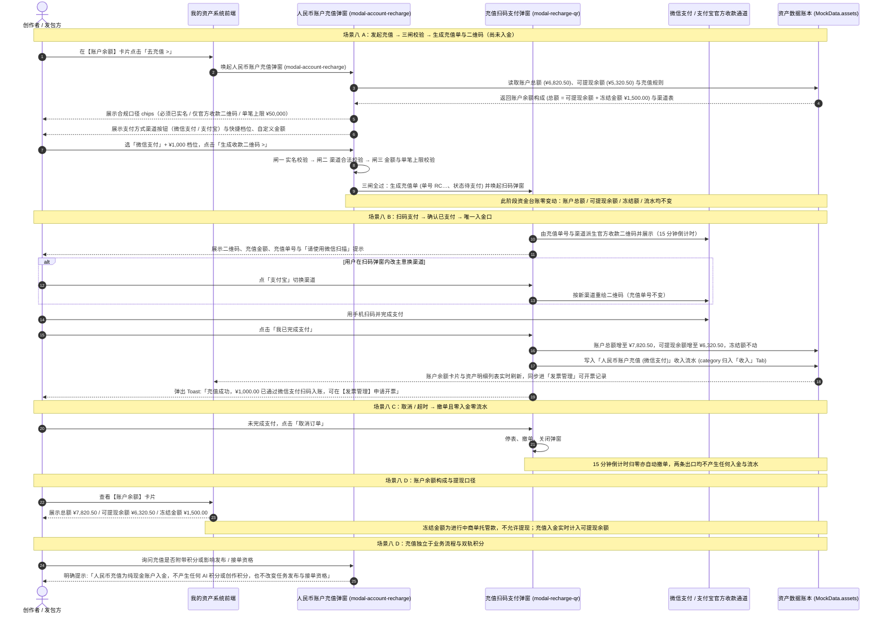

### 全站统一余额支付与余额不足引导专项时序图（场景九）

> 本场景对应 §一「全站统一余额支付口径（购买类行为唯一支付源）」。适用于**全部购买类行为**：算力特权充值、学院付费课程选购。
> **边界**：**【Pro 会员】订阅已从本口径中剥离**（改由独立订阅扫码通道承接，见场景十一），本图不含订阅业务。
> **铁律**：账户余额的唯一入金口是 `modal-account-recharge` + `modal-recharge-qr` 的**「微信支付 / 支付宝官方收款二维码」**（原借记卡协议代扣通道已下线）——全站已不存在任何以 `<option>` 下拉形式陈列外部支付通道的入口；扫码型外部通道仅两处：人民币账户充值 `modal-recharge-qr` 与 Pro 会员订阅 `modal-pro-pay-qr`，任何购买入口均不得出现。

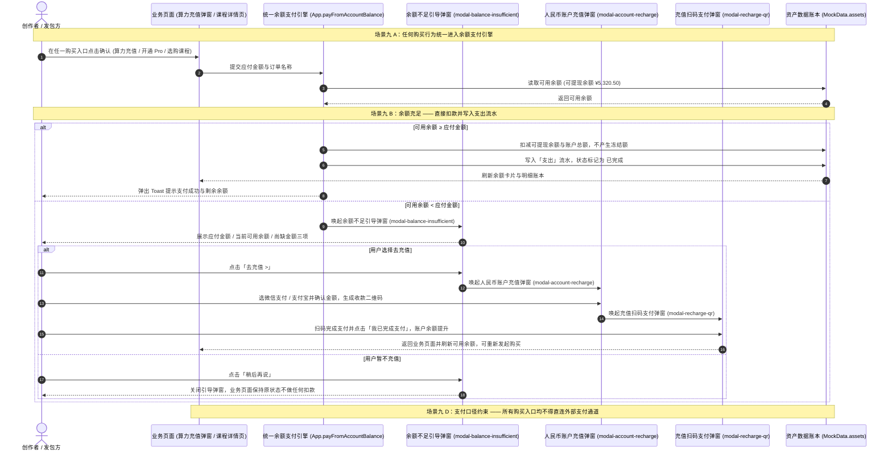

### 发票管理专项时序图（充值后开票 · 场景十）

> 本场景对应 §一「发票管理」：人民币账户**充值完成后**，创作者与发包方均可对充值记录申请开具增值税发票。
> 入口有三处：常用功能「发票管理」、OPC 基础设施「增值税专票代开」、充值成功后的 Toast 引导。

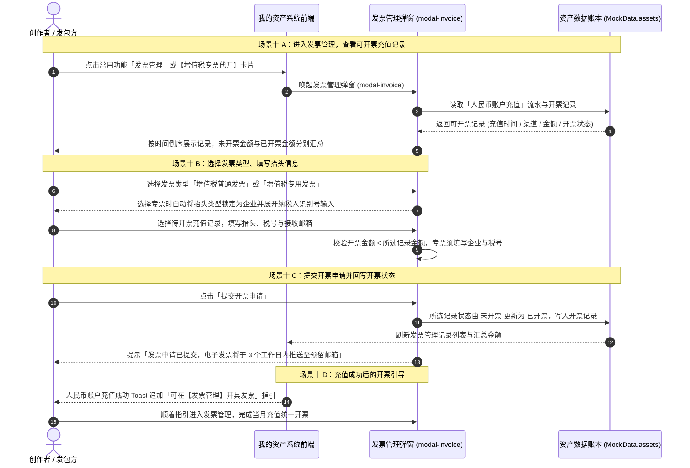

### Pro 会员开通与续费专项时序图（独立订阅结算 · 场景十一）

> 本场景对应 §一「支付边界划分（余额支付 vs 会员订阅独立结算）」与 §五 第 7 条联动。核心约束：**Pro 会员订阅是与账户余额完全解耦的独立结算通道**——开通与续费全程**不扣账户余额、不产生冻结金额、不写入资产交易明细账本**，订阅订单仅登记在 `MockData.systemAdmin.membership.orders`。
> 付费业务的归属方是【用户管理】（业务定义见 `用户管理设计.md` §二 场景四）；本图只描述**从我的资产侧发起的入口、会员信息回显口径与资金结算边界**。

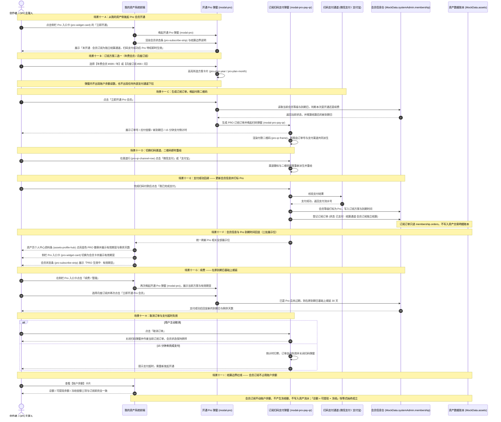

### 商单资金托管库 · 托管进度专项时序图（按冻结时间倒序 · 场景十二）

> 本场景对应 §一「商单资金托管库 · 托管进度明细」。核心口径：以**当前商户**为主体，列表**按冻结时间倒序**展示名下**全部托管项目及每个项目冻结的金额**；所有**进行中项目**的冻结金额之和**恒等于资产卡「冻结金额」**，并与资产明细中 `托管中` 的支流水通过 `txId` 一一对应。

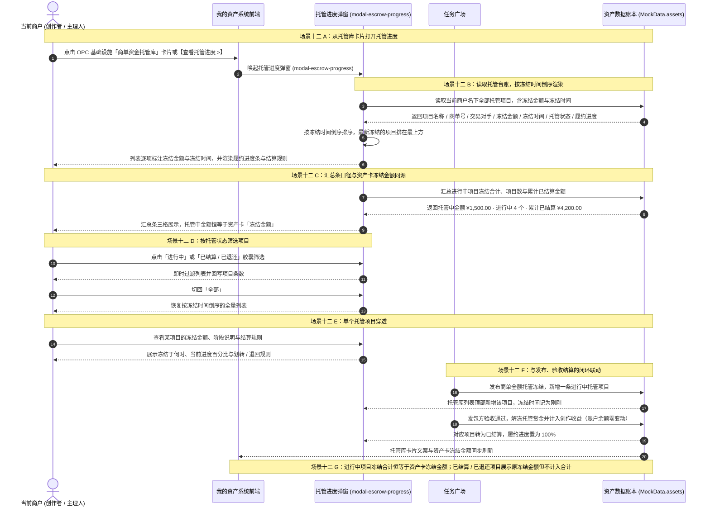

---

### 申请提现合规四道闸专项时序图（实名 / 同名 / 单笔上限 / 仅限借记卡 · 场景十三）

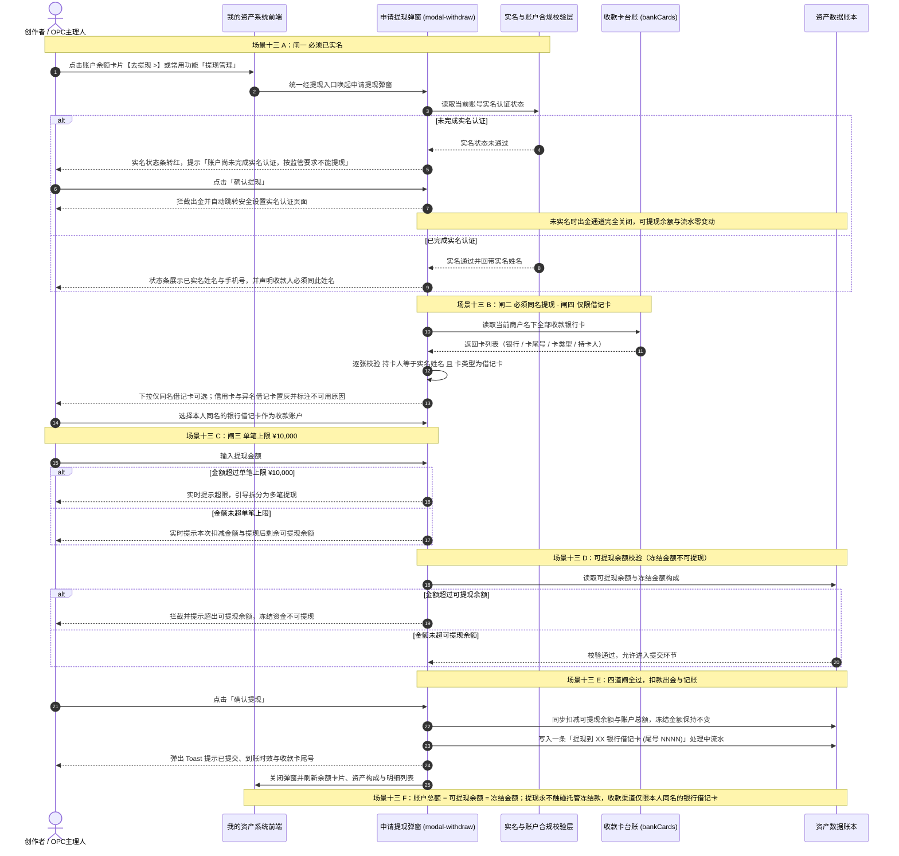

---

### 银行卡绑定与换绑专项时序图（仅支持本人同名借记卡 · 场景十四）

> **两条硬口径**：①「**只支持借记卡绑定**」——信用卡与国际卡组织卡号段一律不许绑定；②「**必须完成实名认证后方可绑定**」——未实名时入口置灰、提交被拦截并自动跳转实名认证。
> 本图侧重**从【常用功能 · 银行卡管理】进入 `modal-bank-card-manage` 后发起的绑定 / 换绑全链路**（资产主面板与安全设置均不陈列银行卡明细），与场景十三（提现四道闸）共用同一份银行卡台账，互为闭环；**2026-09-24 起充值改为二维码扫码入金，不再消费银行卡台账**。

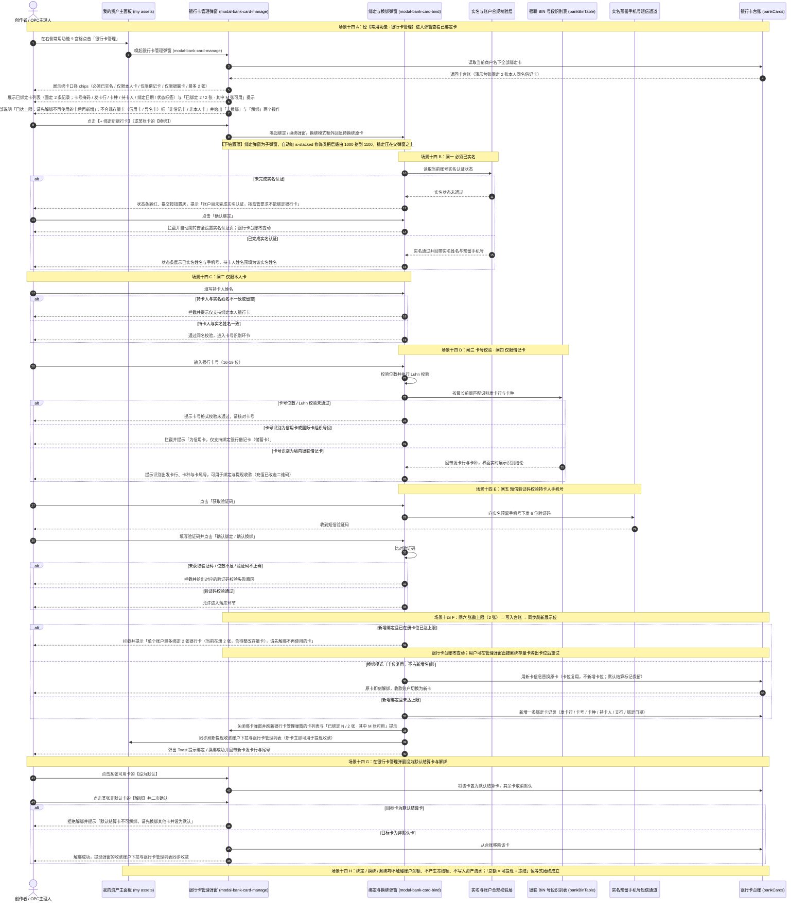

---

## 三、 全生命周期业务/任务状态机

```mermaid
stateDiagram-v2
    [*] --> 资产账户建立: 创作者建档并加载资产大盘
    
    state 核心资产账户状态机 {
        [*] --> 现金资产流: 账户余额 (¥6,820.50) / 可提现余额 (¥5,320.50)
        [*] --> 商业收益流: 累计变现 (¥12,680.30) / 本月预估 (¥2,680.30)
        [*] --> 创作积分成长流: 可用 2,680 积分 (驱动 Lv.1~Lv.5 等级，卡片已下线、改在个人资料条展示)
        [*] --> 创作收益提现流: 累计变现 ¥12,680.30 为全站唯一可提现资金来源
        [*] --> AI积分算力流: 算力池储备 2,340.00 积分 (工具消耗)
    }

    state 提现业务生命周期 {
        [*] --> 收益充足: 创作收益 > 0（全站唯一可提现来源）
        收益充足 --> 唤起提现弹窗: 点击创作收益卡片「去提现 >」打开 modal-withdraw
        唤起提现弹窗 --> 实名前置校验: 闸一 必须已实名
        实名前置校验 --> 未实名_拦截出金: 实名认证未通过
        未实名_拦截出金 --> 安全设置实名认证: 自动跳转安全设置完成实名
        安全设置实名认证 --> 实名前置校验: 实名通过后返回重试
        实名前置校验 --> 收款账户准入校验: 实名认证通过
        收款账户准入校验 --> 卡片不可用_置灰标注: 闸二 持卡人与实名不一致，或闸四 卡类型非借记卡
        卡片不可用_置灰标注 --> 收款账户准入校验: 改选本人同名的银行借记卡
        收款账户准入校验 --> 金额合规校验: 选中同名借记卡作为收款账户
        金额合规校验 --> 超单笔上限_拦截: 闸三 金额 > ¥10,000
        金额合规校验 --> 超创作收益_拦截: 金额 > 创作收益（账户余额不可提现）
        超单笔上限_拦截 --> 金额合规校验: 拆分为多笔后重新输入
        超创作收益_拦截 --> 金额合规校验: 下调金额后重新输入
        金额合规校验 --> 四闸全过_提交申请: 金额有效且未超单笔上限与创作收益
        四闸全过_提交申请 --> 扣减创作收益: 只扣创作收益，账户余额 / 可消费 / 冻结额零变动
        扣减创作收益 --> 写入提现流水: 明细账本生成「创作收益提现-处理中」记录
        写入提现流水 --> 提现到账结清: T+0 实时到账本人同名借记卡
    }

    state 人民币账户充值生命周期 {
        [*] --> 账户余额构成核算: 账户总额 = 可提现余额 + 冻结金额
        账户余额构成核算 --> 发起人民币账户充值: 点击账户余额卡片【去充值 >】打开 modal-account-recharge
        发起人民币账户充值 --> 充值三闸校验: ① 必须已实名 ② 渠道为微信支付 / 支付宝 ③ 金额有效且不超 ¥50,000
        充值三闸校验 --> 未实名_拦截跳转实名: 闸一未过
        未实名_拦截跳转实名 --> 充值三闸校验: 完成实名认证后回到充值弹窗
        充值三闸校验 --> 金额无效_拦截: 闸三未过（≤0 / 低于下限 / 超单笔上限）
        金额无效_拦截 --> 充值三闸校验: 调整金额后重新提交
        充值三闸校验 --> 生成充值单与收款二维码: 三闸全过，唤起 modal-recharge-qr（15 分钟倒计时）
        %% 未支付不入金：生成充值单与收款二维码 状态下资金台账零变动、零流水
        生成充值单与收款二维码 --> 生成充值单与收款二维码: 弹窗内切换渠道，二维码重绘（充值单号不变）
        生成充值单与收款二维码 --> 订单已取消_零入金: 点【取消订单】撤单
        生成充值单与收款二维码 --> 订单已超时_零入金: 15 分钟倒计时归零自动撤单
        订单已取消_零入金 --> 账户余额构成核算: 关弹窗，账户总额与流水均不变
        订单已超时_零入金 --> 账户余额构成核算: 关弹窗并提示重新发起充值
        生成充值单与收款二维码 --> 充值到账余额提升: 点击【我已完成支付】确认扫码支付成功
        充值到账余额提升 --> 写入充值收入流水: 明细账本生成「人民币账户充值 (微信支付 / 支付宝)」收入记录
        写入充值收入流水 --> 账户余额构成核算: 刷新账户余额卡片与资产明细列表，同步进发票可开票记录
    }

    state 商单资金托管项目生命周期 {
        [*] --> 托管项目建立: 发布商单或发起定制时全额冻结，登记冻结金额与冻结时间
        托管项目建立 --> 招募选拔中: 任务上架大厅等待创作者报名
        招募选拔中 --> 履约中: 选定创作者并进入履约制作
        招募选拔中 --> 已退还_流标退回: 选拔截止未选定，托管资金全额原路退回
        履约中 --> 待验收: 创作者提交交付物，发包方 72 小时验收倒计时
        待验收 --> 返修中: 发包方驳回，返修期间托管赏金继续冻结
        返修中 --> 待验收: 创作者重新提交交付物
        待验收 --> 已结算_赏金计入创作收益: 验收通过，已冻结转可消费（账户余额总额不变），赏金全额计入创作收益
        已结算_赏金计入创作收益 --> [*]
    }

    state 全站资金支付与不足引导生命周期 {
        [*] --> 发起购买行为: 算力充值 / 选购付费课程
        发起购买行为 --> 选择扣款资金来源: 账户余额 / 创作收益 / 账户余额+创作收益（组合）
        选择扣款资金来源 --> 可用资金比对: 统一经资金扣款引擎校验所选来源可用额
        可用资金比对 --> 余额充足_扣款完成: 应付金额 ≤ 所选来源可用额
        可用资金比对 --> 资金不足_引导处理: 应付金额 > 所选来源可用额
        余额充足_扣款完成 --> 写入支出流水: 按来源扣款（账户余额扣可消费与总额 / 创作收益只扣收益），不产生冻结额
        写入支出流水 --> 业务能力即时生效: 算力点按算力类型入账 / 付费课程解锁
        资金不足_引导处理 --> 唤起余额不足引导弹窗: 打开 modal-balance-insufficient
        唤起余额不足引导弹窗 --> 创作收益不足_建议改来源: 创作收益不可充值，引导改用账户余额或组合扣款
        创作收益不足_建议改来源 --> 选择扣款资金来源: 改选来源后重新校验
        资金不足_引导处理 --> 唤起余额不足引导弹窗: 账户余额 / 组合来源不足时打开 modal-balance-insufficient
        唤起余额不足引导弹窗 --> 发起人民币账户充值: 点击【去充值 >】跳转 modal-account-recharge
        发起人民币账户充值 --> 可用余额比对: 充值到账后返回原弹窗重新校验
        唤起余额不足引导弹窗 --> 放弃购买_无扣款: 点击稍后再说，业务保持原状态
    }

    state Pro会员订阅结算生命周期 {
        [*] --> 未开通状态: 会员等级为免费版，资产页不展示 PRO 徽章
        未开通状态 --> 订阅方案已选择: 打开 modal-pro 选择年费会员或月度订阅
        订阅方案已选择 --> 扫码待支付: 生成 PRO 订阅订单并唤起 modal-pro-pay-qr
        扫码待支付 --> 扫码待支付: 切换微信支付 / 支付宝渠道，二维码即时重绘
        扫码待支付 --> 订单已取消: 点击取消订单，关闭弹窗并作废订单
        扫码待支付 --> 订单已超时: 15 分钟倒计时归零，订单自动失效
        扫码待支付 --> 会员信息已更新: 支付成功回调，打标 Pro 并写入订阅方案
        会员信息已更新 --> 到期时间已回显: 资料条 PRO 徽章 / 侧栏入口卡 / 会员状态条三处回显有效期至
        订单已取消 --> 未开通状态: 会员状态保持原样，账户资金零变动
        订单已超时 --> 未开通状态: 需重新发起开通
        到期时间已回显 --> 续费顺延中: 已是 Pro 且未过期，再次下单订阅
        续费顺延中 --> 会员信息已更新: 在原到期日基础上顺延 30 天或 365 天
        到期时间已回显 --> 未开通状态: 到期未续订，平稳收回 Pro 加速通道
    }

    state 发票开具生命周期 {
        [*] --> 充值到账累计可开票金额: 人民币账户充值写入可开票记录
        充值到账累计可开票金额 --> 进入发票管理: 常用功能「发票管理」或【增值税专票代开】
        进入发票管理 --> 选择发票类型: 增值税普通发票 / 增值税专用发票
        选择发票类型 --> 填写抬头与税号: 专票锁定企业抬头并必填纳税人识别号
        填写抬头与税号 --> 提交开票申请: 校验开票金额 ≤ 所选充值记录金额
        提交开票申请 --> 记录状态置为已开票: 写入开票记录并刷新汇总
    }

    state 资产安全中心生命周期 {
        [*] --> 安全要素核验: 实名认证 / 支付密码 / 绑定手机
        安全要素核验 --> 高安全等级_100分: 满格绿色安全防御条
        高安全等级_100分 --> 前往安全设置: 点击打开 modal-security-settings（只承载个人信息与安全防护）
        前往安全设置 --> 个人信息维护: 手机换绑短信验证 / 邮箱换绑 / 学号认证
        安全要素核验 --> 银行卡管理: 常用功能「银行卡管理」打开 modal-bank-card-manage
        银行卡管理 --> 个人信息维护: 未实名时给出「先去安全设置完成实名」引导
    }

    state 银行卡绑定与换绑生命周期 {
        [*] --> 是否已完成实名认证: 进入绑定 / 换绑弹窗
        是否已完成实名认证 --> 绑定入口置灰并拦截: 未实名（点击提交自动跳转实名认证）
        绑定入口置灰并拦截 --> 是否已完成实名认证: 完成实名后返回重试
        是否已完成实名认证 --> 填写持卡人与卡号: 已实名（持卡人预填为实名姓名）
        填写持卡人与卡号 --> 卡号识别: 位数校验 + Luhn 校验 + 银联 BIN 号段匹配
        卡号识别 --> 填写持卡人与卡号: 位数 / Luhn 未通过
        卡号识别 --> 拒绝绑定非借记卡: 识别为信用卡或国际卡组织号段
        拒绝绑定非借记卡 --> 填写持卡人与卡号: 更换为本人借记卡号
        卡号识别 --> 短信验证码校验: 识别为境内银联借记卡
        短信验证码校验 --> 短信验证码校验: 未获取 / 位数不足 / 验证码错误
        短信验证码校验 --> 张数上限校验: 验证码校验通过
        张数上限校验 --> 拒绝并提示先解绑: 新增绑定且在册卡位已达上限 2 张
        拒绝并提示先解绑 --> 解绑非默认卡: 在银行卡管理弹窗解绑存量卡腾出卡位
        张数上限校验 --> 判定绑定模式: 未达上限
        判定绑定模式 --> 写入台账_新增卡位: 绑定模式
        判定绑定模式 --> 写入台账_替换原卡: 换绑模式（卡位复用，不占新增名额，默认标记保留）
        写入台账_新增卡位 --> 刷新两处展示位: 银行卡管理弹窗卡列表 + 提现收款账户下拉
        写入台账_替换原卡 --> 刷新两处展示位: 银行卡管理弹窗卡列表 + 提现收款账户下拉
        刷新两处展示位 --> 可提现收款: 新卡立即可用于提现收款（与四道闸闭环）；充值已改走二维码，不再消费卡台账
        刷新三处展示位 --> 设为默认结算卡: 仅可用卡可设，默认卡不可解绑
        设为默认结算卡 --> 解绑非默认卡: 二次确认后从台账移除
        可提现收款 --> [*]
        解绑非默认卡 --> [*]
    }

    state 弹窗层级与下钻置顶生命周期 {
        [*] --> 打开弹窗: 调用统一弹窗入口
        打开弹窗 --> 保持底座层级_1000: 未探测到其他已打开弹窗
        打开弹窗 --> 追加置顶修饰类_1100: 探测到其他弹窗仍处于打开态（下钻场景）
        追加置顶修饰类_1100 --> 子弹窗压过父弹窗: 层级 1100 高于底座 1000（银行卡管理 → 绑定新银行卡）
        子弹窗压过父弹窗 --> 二次确认恒在最前_1200: 触发解绑等二次确认（置顶规则显式排除确认弹窗）
        二次确认恒在最前_1200 --> 逐层关闭: 取消 / 确认后关闭
        逐层关闭 --> 保持底座层级_1000: 最后一个弹窗重新单开（无残留置顶态）
        保持底座层级_1000 --> [*]
    }

    state 数字藏品与凭据生命周期 {
        [*] --> 商单交付_版权买断: 任务验收完成生成版权证明
        [*] --> 学院结业_微学分生成: 完课结业生成高校微学分凭据
        [*] --> 赛事荣誉_勋章授予: 平台活动生成成就勋章
        商单交付_版权买断 --> 藏品展柜陈列: 5 宫格卡片展示
        藏品展柜陈列 --> 灯箱全景速览: 点击打开 modal-preview-lightbox
        藏品展柜陈列 --> 证书全景大厅: 点击查看全部打开 modal-my-certs
    }

    提现到账结清 --> [*]
```

---

## 四、 核心功能模块与操作权限矩阵

| 界面区域与板块 | 对应前端控件与触发动作 | 核心管理能力 | 资金与积分属性 | 普通创作者权限 | OPC/工作室主理人权限 |
| :--- | :--- | :--- | :--- | :--- | :--- |
| **OPC 基础设施 4 大中枢** | | | | | |
| **- 增值税专票代开** | 点击卡片 / 【发票管理 >】(`App.openInvoiceModal()`) | 解决无对公资质难题，平台统筹合规开具专票，对账户充值记录发起开票申请 | 合规财税服务 | 查阅代开票机制与申请规范，个人可开普票 | 尊享合规专票绿色代开通道，企业抬头可开专票 |
| **- 商单资金托管库** | 点击卡片 / 【查看托管进度 >】(`App.openEscrowProgressModal()`) | 展示已安全托管的在途未结算款项，汇总金额**恒等于资产卡「冻结金额」** | 资金托管专户 | 查看名下在途商单资金安全保障 | 查阅团队所有进行中商单的资金冻结保障 |
| **- 托管进度明细 (modal-escrow-progress)** | 台账读取与倒序 (`App.getEscrowProjects()`) 汇总计算 (`App.getEscrowSummary()`) 列表渲染 (`App.renderEscrowProgress()`) 状态筛选 (`App.filterEscrowProjects()`) 卡片文案同源 (`App.renderEscrowLibraryCard()`) | 按**冻结时间倒序**展示当前商户名下**全部托管项目**及**每个项目冻结的金额**，含汇总条（托管中金额 / 进行中项目数 / 累计已结算）与三档状态筛选 | 托管台账可视 | 查看个人名下全部托管项目与进度 | 查看工作室全部托管项目与团队资金冻结保障 |
| **- 专属普惠算力特权** | 【充值算力 >】(`App.openComputeRechargeModal()`) | 剩余 12,500 Tflops GPU 额度，经**账户余额** 4 折普惠充值（不直连外部支付通道）；**充值前必须先选择算力类型**（自有算力 / 集成算力） | 算力补贴 · 余额扣款 | 用账户余额按类型充值算力点 | 尊享 4 折与 Pro 额外 10% 加赠 |
| **- 学徒带教生态分润** | 点击卡片 (`App.showToast`) | 签约低年级学弟学妹，完成商单享有 5% 生态激励 | 带教分润收益 | 查阅带教分润机制说明 | 享受带教多名创作者分润分成 |
| **3 大核心资产卡片**（原「创作积分（可用）」卡已于 2026-09-24 下线） | | | | | |
| **- 账户余额 (元)** | 【去充值 >】(`App.openAccountRechargeModal()`) **已冻结读数 (`#asset-display-frozen` / `App.getFrozenBalance()` / `App.refreshFrozenDisplay()`)** | 展现总额 (¥6,820.50)，副行并列**已冻结 (¥1,500.00)** 与**可消费 (¥5,320.50)** 两项读数；**「已冻结 + 可消费 = 账户余额」公式脚注已于 2026-09-24 下线，卡片不再展示**（口径仍为恒等式，由资金路径保证）；冻结款＝进行中商单托管金额，**只能充值、不可提现**，仅用于算力充值与付费课程等平台内消费，卡片脚注 (`#asset-balance-note`) 显式声明「不可提现」 | 现金钱包（单向：只进不出） | 用已绑定本人借记卡充值人民币账户（单笔 ≤ ¥50,000） | 用已绑定工作室借记卡充值人民币账户（发票可追溯至扣款卡） |
| **- 创作收益 (元)** | 【收益明细 >】(`App.filterAssetsTab('收入')`) **【去提现 >】(`App.openWithdrawModal('income')`)** | 展示累计收益 (¥12,680.30) 与本月预估 (¥2,680.30)；**全站唯一可提现资金来源**（卡片读数 `#asset-display-earnings`，脚注 `#asset-earnings-note` 明示） | 商业变现收益 · 唯一出金钱包 | 查阅收益流水并提现至本人同名借记卡 | 查阅团队收益分配曲线并提现 |
| **- 创作积分（个人资料条）** | 读数节点 (`profile-stat-points`，由 `App.renderAssetsProfileHub()` 动态渲染 / `App.getCreatorPoints()` / `App.formatCreatorPoints()` / `App.refreshCreatorPointsDisplay()`) | **原「创作积分（可用）」资产卡已于 2026-09-24 下线**；个人当前创作者积分改在个人中心资料条（`assets-profile-hub`）统计格第 5 格展示，真源为 `MockData.currentUser.learningPoints`（与成长学院、等级晋升共用同一份） | **严格驱动等级认证与成长** | 积分累积推动 Lv.1~Lv.5 晋升 | 专享高阶创作等级与官方背书 |
| **- AI 积分** | **【积分明细 >】(`App.openAiPointsDetail('all')`)** **【去充值 >】(`App.openComputeRechargeModal()`)** 分类型读数 (`#asset-display-tokens-self` / `#asset-display-tokens-integrated`) 读数统一刷新 (`App.refreshTokenDisplays()`) | 展示算力池可用储备 2,340.00 积分，并在卡片内按**算力类型拆分**展示「自有算力 1,640.00 / 集成算力 700.00」；【去充值 >】直接唤起算力充值弹窗（`modal-compute-recharge`，需先选算力类型），**充的是 AI 积分而非账户余额** | **严格用于创作工具算力消耗 · 按类型分账** | 用于日常图像、视频生成扣费，按类型查看明细并充值 | 尊享算力充值折扣与高并发配额 |
| **人民币账户充值** | | | | | |
| **- 人民币账户充值 (modal-account-recharge)** | 【去充值 >】(`App.openAccountRechargeModal()`) 渠道按钮组 (`#recharge-channel-row` / `App.selectRechargeChannel()` / `App.renderRechargeChannelRow()`) 渠道说明 (`#recharge-channel-note`) 口径 chips (`#recharge-rule-row`) 快捷档位 (`App.selectRechargePreset()`) 【生成收款二维码 >】(`#recharge-submit-btn` / `App.submitAccountRecharge()`) | **只能通过「微信支付 / 支付宝官方收款二维码」扫码入金**：原「已绑定本人同名借记卡协议代扣」通道已整体下线，弹窗内无银行卡下拉；创作者与发包方均可使用，支持快捷档位与自定义金额（单笔下限时 ¥1、上限 ¥50,000）；**提交只生成充值单，不入金** | 现金入金 | 扫码充值人民币现金账户 | 扫码充值人民币现金账户（发票可追溯至扫码渠道） |
| **- 充值扫码支付 (modal-recharge-qr)** | 扫码弹窗 (`App.openRechargeQrModal()`) 金额 / 单号 (`#rc-qr-amount` / `#rc-qr-order-no`) 二维码画布 (`#rc-qr-frame` / `App.renderRechargeQr()` / `App.buildQrSvg()`) 渠道切换 (`App.switchRechargeChannel()`) 倒计时 (`#rc-qr-countdown` / `App.startRechargeQrCountdown()`) 【我已完成支付】(`App.confirmRechargePayment()`) 【取消订单】(`App.cancelRechargeOrder()`) | **未支付不入金（红线）**：扫码阶段账户总额 / 可提现余额 / 冻结额 / 流水**全部零变动**；**【我已完成支付】才是唯一入金口**；二维码 15 分钟倒计时（真源 `rechargeRules.qrExpireSec`）归零或用户取消即撤单，两出口均零入金零流水 | 扫码支付与入金 | 扫码完成充值入金 | 扫码完成充值入金并留痕可开票 |
| **- 充值合规校验 (rechargeRules)** | 规则口径 (`App.getRechargeRules()`) 渠道列表 (`App.getRechargeChannels()` / `App.getRechargeChannel()` / `App.getRechargeChannelId()`) 面板刷新 (`App.refreshRechargePanel()`) | **充值三闸**：闸一 必须已实名 / 闸二 支付渠道必须是二维码渠道白名单内的渠道（非法 id 回落默认渠道「微信支付」）/ 闸三 金额有效、不低于下限且不超单笔上限；规则唯一真源为 `MockData.assets.rechargeRules`；未实名时【生成收款二维码 >】置灰 | 现金入金合规闸门 | 了解充值口径与可选渠道 | 了解充值口径与可选渠道 |
| **- 账户余额构成口径** | 账户余额卡片展示 (`App.getFrozenBalance()` / `App.refreshFrozenDisplay()`) | **已冻结 + 可消费 = 账户余额**（恒等式，冻结 / 结算后由卡片实时重算）；冻结金额为进行中商单托管款，不允许提现。**冻结（发布商单托管）只把「可消费」转为「已冻结」、账户余额不变**；**结算划转给创作者时冻结额与账户余额同步减少（资金离场）**；充值入金只增加可消费与账户余额。卡片只保留读数、不再展示公式 | 账户口径规则 | 查看账户构成与冻结金额 | 查看账户构成与托管进度 |
| **申请提现** | | | | | |
| **- 提现资金来源红线** | 资金来源 (`App.getWithdrawSource()`) 规则字段 `withdrawRules.sourceLabel` / `sourceCardKey` / `sourceNote` | **资金来源唯一口径 = 「创作收益」（`cards.monthlyEarnings`）**：提现只扣减该钱包并累加 `totalWithdrawn`，**账户余额（含冻结额）一分不动**；账户余额为平台充值钱包，只可充值不可提现，该红线同时落在资产卡脚注、提现弹窗来源条与金额提示三处 | 出金口径红线 | 只从创作收益提现 | 只从创作收益提现 |
| **- 申请提现 (modal-withdraw)** | **【去提现 >】(`App.openWithdrawModal('income')`)（唯一入口在「创作收益」卡）** 常用功能「提现管理」(`App.handleCommonFuncClick()`) **资金来源 (`#withdraw-source-strip` / `#withdraw-source-text` / `App.getWithdrawSource()`)** 规则口径 (`App.getWithdrawRules()`) 实名判定 (`App.isIdVerified()`) 卡片准入校验 (`App.validateWithdrawAccount()`) 下拉渲染 (`App.renderWithdrawAccounts()`) 面板刷新 (`App.refreshWithdrawPanel()`) 账户切换回显 (`App.onWithdrawAccountChange()`) 金额实时校验 (`App.onWithdrawAmountInput()`) 【确认提现】(`App.submitWithdraw()`) | **合规四道闸**：闸一 必须已实名（未实名拦截并跳转安全设置）/ 闸二 必须同名提现（持卡人 = 实名姓名）/ 闸三 单笔上限 ¥10,000 / 闸四 仅限借记卡（信用卡不可选）；不可用的卡若存在则保留展示但置灰并标注不可用原因，使合规规则在界面可见（演示台账为 2 张合规卡，故默认无置灰项） | 现金出金 · 余额扣减 | 提现至本人同名借记卡（单笔 ≤ ¥10,000，T+0 实时到账 · 免手续费） | 提现至本人同名借记卡（单笔 ≤ ¥10,000，T+0 实时到账 · 免手续费） |
| **- 收款卡台账 (bankCards)** | 台账读取 (`App.getWithdrawAccounts()` / `App.getBankCards()`) | **提现收款与银行卡管理两处共用同一份银行卡台账**（2026-09-24 起充值改走二维码，**不再消费该台账**）；**演示台账固定 2 张本人同名借记卡**（与列表只展示 2 条记录一致），故提现收款下拉默认「2 张可用、0 张置灰」；不合规样本（信用卡 / 异名借记卡）不进生产台账，改由自检脚本在测试内临时注入，用于覆盖闸二（同名）与闸四（借记卡）的拦截路径 | 资金账户准入 | 选择本人同名借记卡收款 | 选择本人同名借记卡收款 |
| **银行卡绑定与换绑** | | | | | |
| **- 银行卡管理弹窗 (modal-bank-card-manage · 唯一陈列位)** | 入口＝常用功能「银行卡管理」(`App.handleCommonFuncClick()` / `App.openBankCardManageModal()`) 口径 chips (`#bank-manage-rule-row`) 已绑定卡列表 (`#bank-manage-list`) 张数上限提示 (`#bank-manage-tip`) 【+ 绑定新银行卡】(`#bank-manage-add` / `App.openBankCardBindModal()`) 列表渲染 (`App.renderBankCardBlocks()`) 单卡行渲染 (`App.bankCardRowHtml()`) 卡号掩码 (`App.maskBankCardNo()`) | **银行卡能力的唯一陈列位**：资产安全中心主面板与安全设置弹窗**均不再陈列银行卡列表与绑卡按钮**，全部收敛到常用功能 9 宫格「银行卡管理」所打开的弹窗；弹窗内为绑卡口径 chips（必须已实名 / 仅限本人卡 / 仅限借记卡 / 仅限银联卡 / 最多 2 张）+ 已绑定银行卡列表（**固定展示 2 条记录**；卡号掩码 / 发卡行 / 卡种 / 持卡人 / 绑定日期 / 可用状态标签），合规卡提供【换绑】与【设为默认】；若台账存在不合规存量卡则提供【去换绑】与【解绑】（用于腾出超限卡位） | 资金账户准入 | 绑定与换绑本人同名借记卡 | 管理工作室收款卡（含设为默认结算卡） |
| **- 绑定与换绑弹窗 (modal-bank-card-bind)** | 持卡人 (`#bank-bind-holder`) 卡号 (`#bank-bind-cardno`) 卡号实时识别 (`#bank-bind-detect`) 演示卡号 (`#bank-bind-demo`) 开户支行 (`#bank-bind-branch`) 短信验证码 (`#bank-bind-code`) 实名状态条 (`#bank-bind-verify-strip`) 口径 chips (`#bank-bind-rule-row`) 待换绑原卡条 (`#bank-bind-rebind-strip`) 提交 (`#bank-bind-submit-btn` / `App.submitBankCardBind()`) 失败原因 (`#bank-bind-hint`) | **绑卡校验链**：闸一 必须已实名 / 闸二 仅限本人卡（持卡人 = 实名姓名）/ 闸三 卡号 16-19 位 + Luhn 校验 / 闸四 **仅限借记卡**（信用卡与国际卡组织号段一律拒绝）/ 闸五 短信验证码；换绑模式为**替换原卡、卡位复用** | 绑卡合规闸门 | 绑定、换绑本人同名借记卡 | 绑定、换绑工作室收款借记卡 |
| **- 绑卡规则与卡号识别** | 规则口径 (`App.getBankBindRules()`) 卡号识别 (`App.detectBankCard()`) Luhn 校验 (`App.luhnCheck()`) 台账读取 (`App.getBankCards()`) 卡片状态推导 (`App.getBankCardStatus()`) 绑定校验 (`App.validateBankCardBind()`) | 两条硬口径：**只支持借记卡绑定** + **必须已实名后方可绑定**；副口径：本人同名卡 / 不得重复绑定 / **最多 2 张（按在册卡位计，含待整改存量卡；换绑为卡位复用不占新增名额）**——演示台账正好 2 张合规卡，即「已满 2 / 2」；卡种判定依据银联 BIN 号段离线匹配。规则唯一真源为 `MockData.assets.bankBindRules` | 绑卡口径唯一真源 | 绑定前先看口径说明 | 绑定前先看口径说明 |
| **- 卡号实时识别与验证码** | 卡号输入实时校验 (`App.onBankCardNoInput()`) 演示卡号填充 (`App.fillBankCardDemo()`) 获取验证码 (`App.sendBankBindCode()`) 弹窗状态刷新 (`App.refreshBankBindPanel()`) | 输入即识别发卡行与卡种并给出可否绑定的即时结论；验证码发送至实名预留手机号并参与提交校验 | 绑卡交互反馈 | 边填边看识别结论 | 边填边看识别结论 |
| **- 默认结算卡与解绑** | 设为默认 (`App.setPayoutBankCard()`) 解绑二次确认 (`App.armUnbindBankCard()` / `App.cancelUnbindBankCard()`) 确认解绑 (`App.confirmUnbindBankCard()`) 联动刷新 (`App.refreshBankCardViews()`) | 仅可用卡可设为默认结算卡；**默认结算卡不可解绑**（须先换绑其他卡并设为默认）；解绑后提现收款与充值银行卡下拉同步收敛 | 收款账户生命周期 | 管理个人收款卡 | 管理工作室收款卡 |
| **- 下钻弹窗置顶 (openModal)** | 统一弹窗入口 (`App.openModal()`) 弹窗管理弹窗 (`App.openBankCardManageModal()`) 绑定 / 换绑弹窗 (`App.openBankCardBindModal()`) | **父子弹窗叠加时的层级修正**：打开任意弹窗时先探测兄弟弹窗（`querySelectorAll('.modal-backdrop.active')`），若有其他弹窗处于打开态则给当前弹窗追加 **is-stacked 修饰类**，把层级由底座 1000 抬到 1100，使「银行卡管理 → 【+ 绑定新银行卡】」这类下钻子弹窗稳定压在父弹窗之上；层级阶梯 底座 1000 < 下钻 1100 < 二次确认 1200 < Toast 2000，**置顶规则显式排除二次确认弹窗**，确认弹窗恒在最前 | 弹窗层级秩序 | 子弹窗不被父弹窗遮挡 | 子弹窗不被父弹窗遮挡 |
| **全站统一余额支付** | | | | | |
| **- 全站统一余额支付口径** | 统一支付引擎 (`App.payFromAccountBalance()`) | **购买类行为**（算力充值 / 付费课程选购）唯一支付来源；账户余额不承载 Pro 会员订阅；**账户余额的唯一入金口是充值弹窗生成的「微信支付 / 支付宝官方收款二维码」**，全站已无 `<option>` 形式的外部支付通道 | 购买类支付唯一源 | 用账户余额购买算力与课程 | 用账户余额购买算力与课程 |
| **- 支付边界划分** | 余额支付 vs 会员订阅独立结算 | Pro 会员订阅走 `modal-pro-pay-qr` 扫码独立结算，不动余额 / 不产生冻结 / 不写资产流水；仅登记在 `membership.orders` | 资金台账纯净 | 资产流水只反映真实资金往来 | 资产流水只反映真实资金往来 |
| **- 余额不足引导 (modal-balance-insufficient)** | 自动唤起 (`App.openInsufficientBalanceModal()`) | 展示应付金额 / 当前可用余额 / 尚缺金额，一键跳转充值后重试 | 支付风控引导 | 引导充值后重新购买 | 引导充值后重新购买 |
| **- 专属普惠算力特权充值 (modal-compute-recharge)** | 【充值算力 >】(`App.openComputeRechargeModal()`) **算力类型卡 (`#compute-type-grid` / `App.renderComputeTypeGrid()`)** **类型选择 (`App.selectComputeType()`)** 类型提示 (`#compute-type-note`) 算力包档位 (`App.selectComputePack()`) 【确认充值】(`#compute-submit-btn` / `App.submitComputeRecharge()`) | **算力类型必选**：未选类型时到账点数为占位横线、提示转为告警态、`#compute-submit-btn` 置灰，提交直接拦截且不触发任何扣款；账户余额扣款式算力充值，4 折算力包 ¥40·100点 / ¥200·500点 / ¥400·1,000点 / ¥2,000·5,000点；到账点数按所选类型 `pointsRatio` 折算（自有 100%、集成 80%），并**计入该类型的独立账本** | 算力点 · 余额扣款 · 类型分账 | 选类型后充值算力点 | 尊享 4 折与 Pro 额外加赠 |
| **- 算力类型 (computeTypes)** | 类型台账 (`App.getComputeTypes()` / `App.getComputeType()`) 账本读数 (`App.getComputeBalances()`) 账本写回 (`App.syncComputeBalances()`) 到账折算 (`App.getComputePackTokens()`) | **两类算力唯一真源 `MockData.assets.computeTypes`**：① **自有算力**（自建 GPU 集群，1 元 = 2.5 点，单价最低、可校内结算、高峰期排队）② **集成算力**（第三方算力市场聚合，1 元 = 2.0 点折算 80%，弹性扩容不排队）；两类账本独立计量、`tokensAC = tokensSelf + tokensIntegrated` 恒等、**不可互相划转** | 算力账本分账口径 | 按业务场景选择算力类型 | 高峰期切集成算力抢交付期 |
| **- AI 积分明细 (modal-ai-points-detail)** | 【积分明细 >】(`App.openAiPointsDetail()`) 类型切换 (`App.switchAiPointsType()`) 汇总区 (`#ai-points-summary`) 类型筛选胶囊 (`#ai-points-type-tabs`) 流水台账 (`#ai-points-ledger-list`) 台账与余额快照 (`App.getAiPointLedger()` / `App.getAiPointLedgerWithBalance()`) 明细渲染 (`App.renderAiPointsDetail()`) | **按算力类型分账展示**：三格汇总（自有算力 / 集成算力 / 合计，含占比，点卡片即按该类型筛选）+ 类型筛选胶囊（全部类型 / 自有算力 / 集成算力）+ 时间倒序流水台账（类型标签 / 变动类目 充值·消耗·奖励 / 变动点数 / 变更后余额快照）；无数据时给出空态与【去充值算力】入口 | AI 积分流水可视 | 按类型核对充值、消耗与奖励明细 | 核算团队算力成本构成 |
| **发票管理** | | | | | |
| **- 发票管理 (modal-invoice)** | 常用功能「发票管理」 【增值税专票代开】(`App.openInvoiceModal()`) 充值成功 Toast 引导 | 对人民币账户充值记录申请开票，支持增值税普通发票 / 专用发票 | 合规财税凭据 | 对充值记录申请普票 | 企业抬头申请增值税专票 |
| **- 开票申请提交 (modal-invoice)** | 发票类型 (`App.selectInvoiceType()`) 【提交开票申请】(`App.submitInvoiceApply()`) | 校验开票金额 ≤ 所选充值记录金额；专票须企业抬头 + 纳税人识别号 | 开票规则 | 填写个人抬头与邮箱 | 填写企业抬头、税号与邮箱 |
| **资产明细流水账本** | 6 大 Tab / 时间下拉 / 【查看更多明细 >】 | 穿透式展示收入、支出、提现与双轨积分流水 | 交易历史存证 | 查阅近 1 年个人交易流水 | 查阅全量交易流水并加载更多历史 |
| **我的数字藏品 (5宫格)** | 5 张卡片 / 【查看全部 >】(`modal-my-certs`) | 陈列数字艺术藏品卡片与稀有度标签 | 稀有/珍稀/普通数字藏品 | 点击灯箱预览大图，查阅全量证书与藏品 | 在线展示个人数字藏品展柜 |
| **我的权益与特权（勋章 / 荣耀墙）** | | | | | |
| **- 勋章荣耀墙 (assets-honors-grid)** | 网格渲染 (`App.renderHonorsGrid()`) 台账读取 (`App.getHonors()` / `App.getHonor()`) 汇总条 (`#assets-honors-summary`) **点击图片 (`App.openHonorDetail(id)`)** | **展示创作者本人已获得的全部勋章与荣耀**（8 枚：校园 OPC 主理人 / 商业创作者 Lv.4 / AI 创作达人 / 内容创作专家 / 商业变现新星 / 连续创作 7 日 / 版权存证守护者 / 校园影响力创作者）；每枚以**图片**呈现并标注等级与类别，未解锁勋章置灰加锁标；真源 `MockData.assets.honors` | 荣誉与身份凭证 | 查看个人全部勋章与荣耀 | 展示 OPC 主理人身份背书 |
| **- 勋章荣耀详情 (modal-honor-detail)** | 详情弹窗 (`App.openHonorDetail()`) 大图 (`#honor-detail-icon` / `#honor-detail-icon-wrap`) 名称与等级 (`#honor-detail-name` / `#honor-detail-tier` / `#honor-detail-status`) 说明与条件 (`#honor-detail-meta` / `#honor-detail-desc` / `#honor-detail-unlock`) 权益清单 (`#honor-detail-perks` / `#honor-detail-perk-count`) 主按钮 (`#honor-detail-action` / `App.useHonorPerk()`) | **点击勋章图片即展示该勋章对应的权益详细说明**：大图 + 等级 + 获得时间 + 一句话说明 + **解锁条件** + **权益逐条说明**（序号 + 权益名 + 详细说明）；已点亮勋章主按钮为【去使用权益 >】跳等级权益总览，未解锁勋章置灰且主按钮为【去达成条件 >】跳成长学院 | 权益说明可读 | 查看每枚勋章带来的具体权益 | 对外展示权益清单用于商务谈判 |
| **优惠券** | | | | | |
| **- 优惠券 (modal-coupon)** | 常用功能「优惠券」(`App.openCouponModal()`) 状态胶囊 (`#coupon-status-tabs` / `App.switchCouponStatus()`) 券列表 (`#coupon-list` / `App.renderCoupons()`) 【去使用】(`App.useCoupon()`) 汇总三格 (`#coupon-usable-count` / `#coupon-usable-amount` / `#coupon-expiring-count`) | **券包三态**：可用 / 已使用 / 已过期；汇总三格（可用张数 / 可用面额合计 / 30 天内即将过期张数）；每张券展示面额、适用场景、门槛与有效期；【去使用】按券的适用场景跳转对应结算入口（算力充值 / 成长学院 / 任务广场 / Pro 会员 / 账户充值 / 作品展厅），并把该券标记为已使用 | 卡券权益（抵扣，不可提现） | 查看券包并在对应场景抵扣 | 按场景统筹团队券包使用 |
| **右侧：安全中心与常用面板** | 【前往安全设置 >】(`modal-security-settings`) 常用功能 5 项点击交互 (`App.handleCommonFuncClick()`) （银行卡绑定 / 换绑 / 设为默认 / 解绑在常用功能「银行卡管理」所打开的弹窗内完成） | 账户安全等级防线、信息换绑（安全设置只承载「个人信息」与「安全防护」两块）、**银行卡绑定与换绑（经常用功能「银行卡管理」进入）**、常用业务快速分发（**5 项：提现管理 / 发票管理 / 银行卡管理 / 优惠券 / 赞赏记录**；`合作账单`、`更多功能`、`礼品卡`、`积分兑换` 已于 2026-09-24 下线，弹窗、台账、方法与样式一并删除） | 综合中枢 | 管理个人姓名/手机/邮箱/学号与收款借记卡 | 管理账户安全与团队收款卡，快速跳转各项业务 |

---

## 五、 与全局各模块的深度联动体系说明

1. **与【任务广场】深度联动（资金托管、验收解冻与交付凭据）**：
   - **充值独立于发布（新增）**：人民币账户充值经 `modal-account-recharge` + `modal-recharge-qr` 完成，为**账户级通用入金能力**——创作者与发包方均可随时充值，**不构成发布任务的前置条件**，任务发布资格的判定不依赖账户余额；**入金路径为「微信支付 / 支付宝官方收款二维码」**（原借记卡协议代扣已下线），不再提供银联对公转账等选项；
   - 发包方在任务广场发单，资金全额冻结于平台托管专户，并在资产页【商单资金托管库】**自动新增一条进行中托管项目**（记录冻结金额与冻结时间），托管进度列表按冻结时间倒序实时体现；
   - 商单验收放款后，款项解冻注入创作者【账户余额】（可提现余额同步增加），同时记录「商单结算」收入流水并奖励创作积分；**托管库中对应项目同步转为「已结算 · 进度 100%」**，冻结合计随之扣减；
   - 任务成果版权确权凭证自动入库【我的数字藏品】展示。
2. **与【创作工具】深度联动（AI 积分算力扣除闭环）**：
   - 创作者在工作台每发起一次视频或图像渲染，系统仅扣减【我的资产】中的 **AI 积分**；
   - 资产卡片中的 AI 积分明细清晰记录每一笔算力消耗，与成长创作积分彻底解耦。
3. **与【成长学院】深度联动（学籍证书与高校微学分互通）**：
   - 创作者在成长学院领取的官方结业证书、高校微学分（CERT-CREDIT），实时同步至【我的数字藏品】及【我的证书与成就 (`modal-my-certs`)】中；
   - 学院研习课节与证书领取奖励的创作积分，实时同步至资产卡片「创作积分（可用）」中。
4. **与【发现页】深度联动（主页穿透与作品资产沉淀）**：
   - 发现页右侧创作者画像卡片点击【我的主页】可直接跳转至【我的资产】总金库；
   - 创作者发布的优秀作品自动沉淀至【我的作品 (`modal-my-works`)】合集中。
5. **与【数据中心】深度联动（财务与履约数据双向核对）**：
   - 资产中心的累计变现金额、月度收益预估与 OPC 学徒带教分成，实时映射到【数据中心】的商业履约人效看板与收益分析模块。
6. **与全站购买行为的统一支付联动（购买类支付源与发票闭环）**：
   - **购买类支付源（修订）**：账户余额是全站**购买类行为**的唯一支付来源——【专属普惠算力特权】充值、【成长学院】付费课程选购一律经 `App.payFromAccountBalance()` 从账户余额扣减；**【Pro 会员】订阅已从余额支付口径中剥离**，改由【用户管理】的独立订阅结算通道（`modal-pro-pay-qr` 扫码支付）承接，不占用账户余额；
   - **入金通道收敛（2026-09-24 改版）**：账户余额的唯一入金口 `modal-account-recharge` **改为「微信支付 / 支付宝官方收款二维码」扫码入金**（`modal-recharge-qr`），**原「已绑定本人同名借记卡协议代扣」通道已整体下线**——银行卡不再承担充值付款，银联对公转账亦不复活；全站仍不存在以 `<option>` 形式陈列外部支付通道的入口，两处扫码入口的渠道均以按钮形式承载，且不扣余额、不入资产流水；
   - **余额不足统一口径**：算力充值、付费课程选购等余额支付场景余额不足时，统一唤起 `modal-balance-insufficient`，展示应付金额 / 当前可用余额 / 尚缺金额并引导充值，充值后返回原购买弹窗重试；会员订阅为扫码支付，不触发余额不足引导；
   - **充值—开票闭环**：人民币账户充值完成后，充值流水自动进入可开票记录，用户可经 `modal-invoice` 申请开具增值税普通发票或专用发票，形成「入金 → 消费 → 开票」的完整财务闭环。
7. **与【用户管理】深度联动（Pro 会员信息在资产页的回显）**：
   - Pro 会员订阅成功后，`MockData.systemAdmin.membership` 的 `currentTier` / `plan` / `expireDate` 即时生效，资产页个人中心资料条（`assets-profile-hub`）同步点亮 `PRO` 徽章并展示「有效期至 YYYY-MM-DD（剩余 N 天）」；
   - 会员订阅订单仅登记在 `membership.orders`，**不进入资产交易明细账本**，保证「总额 = 可提现 + 冻结」恒等式与资金台账不受订阅业务污染。
8. **与【用户管理】深度联动（实名认证是提现的前置闸门）**：
   - **闸一即实名**：`MockData.currentUser.idVerified` 未通过时出金通道**完全关闭**——弹窗实名状态条转红、提交按钮置灰，点击提交即被拦截并自动跳转安全设置实名认证（`App.openSecuritySettings('实名认证')`）；
   - **闸二即同名**：收款卡持卡人必须与**实名认证姓名逐字一致**，实名姓名（含手机号掩码）在提现弹窗状态条与账户说明中同步回显，与【用户管理】的个人信息天然同源，杜绝「用他人卡收款」的洗钱 / 代持风险；
   - **与风控锁叠加**：【用户管理】侧因更换手机号 / 重置密码触发的 **24 小时出金风控锁**在提现提交前独立生效，与本模块四道闸形成「1 + 4」道出金防线。
9. **与提现收款账户准入的联动（银行卡绑定与换绑，2026-09-22 新增）**：
   - **唯一陈列位与同一份台账**：已绑定银行卡只在**常用功能「银行卡管理」弹窗**（`modal-bank-card-manage`）陈列，与提现弹窗的收款账户下拉**共用同一份 `MockData.assets.bankCards`**（2026-09-24 起充值改走二维码，已退出该同源体系），绑定 / 换绑 / 解绑后两处同源刷新（`App.refreshBankCardViews()`），不存在「绑了卡却提现选不到」的割裂；资产安全中心主面板与安全设置弹窗均不再复制一份卡列表，避免多陈列位带来的口径漂移与维护成本；
   - **张数上限 2 张与「已满」口径（2026-09-22 调整）**：绑卡上限由 5 张收紧为 **2 张**，口径为**按在册卡位计**（含待整改存量卡；**换绑为卡位复用，不占新增名额**）。**演示台账固定 2 张本人同名借记卡，列表只展示 2 条记录**，恰为「已绑定 2 / 2 张」，新增绑定会被闸六直接拦截并提示「请先解绑不再使用的卡后再新增」；用户可在管理弹窗**直接解绑**非默认卡腾出卡位后重试，形成「解绑 → 再绑定」的收敛闭环；
   - **两条硬口径前移到绑卡环节**：①「**只支持借记卡绑定**」②「**必须已实名后方可绑定**」——提现侧闸二（必须同名）与闸四（仅限借记卡）原本在**出金时**才拦截不合规卡，现在**绑定 / 换绑时即前置校验**，从账户准入源头杜绝信用卡与异名卡进入台账；
   - **不合规卡的处置口径与样本隔离**：闸门拦截信用卡与异名卡的能力并未删除，而是**样本隔离**——生产台账只放合规借记卡（保证「银行卡管理」列表干净、提现收款下拉无置灰噪声），信用卡 / 异名卡样本改由自检脚本在测试内**临时注入台账**验证拦截路径；若真实业务中台账存在历史遗留的不合规卡，列表会将其标为**待整改**并给出【去换绑】主操作，换绑为本人借记卡后即刻转为「可用」并可参与提现；
   - **提现无卡时的就地闭环**：提现弹窗在无可用同名借记卡时提供【+ 绑定银行卡】快捷入口，绑卡成功后弹窗自动刷新收款账户，用户无需退出重进；
   - **资金隔离红线**：绑定、换绑、解绑、设为默认**全部为账户结构变更，零资金动作**——不扣减可提现余额、不产生冻结额、不写入资产交易明细，与「总额 = 可提现 + 冻结」恒等式和托管台账完全解耦。
10. **与充值入金通道的联动（充值改走官方收款二维码，2026-09-24 改版）**：
   - **与银行卡台账解耦**：充值**不再消费 `MockData.assets.bankCards`**——原「一卡两用（既作提现收款卡、也作充值付款卡）」口径作废，银行卡台账现**只服务提现收款与银行卡管理两处**；绑卡 / 换绑 / 解绑由 `App.refreshBankCardViews()` 联动这两处，**不再联动充值面板**；
   - **两条硬口径落在充值入口**：① 必须已实名 ② 支付渠道必须是二维码渠道白名单内的渠道（微信支付 / 支付宝，非法 id 回落默认渠道）——由 `App.submitAccountRecharge()` 统一校验；未实名时【生成收款二维码 >】置灰并自动跳转实名认证；
   - **未支付不入金**：提交只生成充值单与二维码，确认支付才入账；取消订单与 15 分钟超时两条出口均撤单且零入金零流水，杜绝「凭空入账」的演示失真；
   - **充值凭据可追溯至扫码渠道**：充值流水名统一为 `人民币账户充值 (微信支付)` / `人民币账户充值 (支付宝)`，发票管理的「充值渠道」字段直接取自该括号文本，实现「扫码入金 → 开票」链路可回溯到具体支付渠道。
11. **与全局弹窗系统的层级秩序联动（下钻弹窗置顶，2026-09-22 新增）**：
   - **问题来源**：`modal-bank-card-manage`（银行卡管理）在 `index.html` 中的 DOM 位置比 `modal-bank-card-bind`（绑定 / 换绑）**更靠后**，两者同为 `.modal-backdrop`（z-index 1000）时，后开的子弹窗会被 DOM 顺序更靠后的父弹窗**盖在下面**，表现为「点【+ 绑定新银行卡】后弹窗没有置顶显示」；
   - **通用解法**：在统一入口 `App.openModal()` 内做一次层级探测——若已存在其他处于打开态的弹窗，则给当前弹窗追加 **is-stacked 修饰类**（层级 1000 → 1100），使**任意**下钻子弹窗都能稳定压在父弹窗之上，不依赖 DOM 书写顺序，也不为单个业务写死层级；
   - **层级阶梯与边界**：底座 1000 < 下钻 1100 < 二次确认 1200 < 全局 Toast 2000；置顶规则**显式排除二次确认弹窗**（`is-stacked` 选择器带排除条件），保证「确认弹窗恒在最前」这一硬约束不被下钻场景反压；弹窗逐层关闭后重新单开不带残留置顶态。

---

## 六、 变更记录

| 日期 | 变更类型 | 变更内容 | 影响范围 |
| :--- | :--- | :--- | :--- |
| 2026-09-24 | 实现 + 口径修订 | **人民币账户充值改版：借记卡代扣下线，改走微信 / 支付宝官方收款二维码**： **① 通道改版（硬口径）**——充值**只能通过微信支付 / 支付宝官方收款二维码扫码入金**，原「已绑定本人同名借记卡协议代扣」通道**整体下线**，弹窗内不再出现任何银行卡下拉；渠道真源改为 `MockData.assets.rechargeRules.channels`（wechat / alipay）+ `defaultChannel` + `qrExpireSec`，银行卡台账 `MockData.assets.bankCards` **退出充值链路**（只服务提现收款与银行卡管理两处）。 **② 两段式链路与「未支付不入金」红线**——新增扫码弹窗 `modal-recharge-qr`，链路改为「表单弹窗选渠道 + 填金额 → 生成充值单（RC 单号、状态待支付）→ 唤起扫码弹窗 → 【我已完成支付】才入金」；**扫码阶段账户总额 / 可提现余额 / 冻结额 / 流水全部零变动**；新增取消订单与 15 分钟超时两条零入金出口。 **③ 引擎重写**——删除四个旧银行卡准入方法（getRechargeCards / validateRechargeCard / renderRechargeCards / onRechargeCardChange），新增 `App.getRechargeChannels()` / `App.getRechargeChannel()` / `App.getRechargeChannelId()` / `App.selectRechargeChannel()` / `App.renderRechargeChannelRow()` / `App.openRechargeQrModal()` / `App.switchRechargeChannel()` / `App.renderRechargeQr()` / `App.buildQrSvg()` / `App.startRechargeQrCountdown()` / `App.stopRechargeQrCountdown()` / `App.cancelRechargeOrder()` / `App.confirmRechargePayment()`；`App.submitAccountRecharge()` 收敛为「三闸校验 + 只生成充值单」，`App.confirmRechargePayment()` 为**唯一入金口**；三闸改为「必须已实名 → 渠道合法 → 金额有效且不超单笔上限」。 **④ 流水与开票口径**——流水名改为 `人民币账户充值 (微信支付)` / `人民币账户充值 (支付宝)`，发票「充值渠道」字段改为取扫码渠道（原取扣款卡尾号），「入金 → 开票」链路仍可回溯；两条历史种子流水 TX9 / TX10 同步改为微信支付 / 支付宝。 **⑤ UI**——`modal-account-recharge` 银行卡下拉区块改为支付方式渠道按钮组（`#recharge-channel-row` / `#recharge-channel-note`），chips 收敛为 3 条（必须已实名 / 仅官方收款二维码 / 单笔上限），提交按钮文案改为【生成收款二维码 >】；新增 `modal-recharge-qr`（`#rc-qr-amount` / `#rc-qr-order-no` / `#rc-qr-channel-row` / `#rc-qr-channel-hint` / `#rc-qr-frame` / `#rc-qr-countdown`）；CSS 复用 Pro 二维码样式为 `rc-qr-*` 共享选择器，删除 `recharge-card-*` / `recharge-add-card-*` 死样式。 **⑥ 文档同步**——§一 概述与「人民币账户充值」功能块、「唯一入金通道」整体重写；§二 场景八**整图重写**（A 生成二维码 / B 扫码支付与唯一入金口 / C 取消与超时 / D 余额构成）、场景七与场景九补二维码环节、场景十四去掉充值下拉联动；§三「人民币账户充值生命周期」状态机重写（新增未实名拦截、金额拦截、取消 / 超时两条零入金出口、未支付不入金注记）、银行卡状态机「三处展示位」改「两处展示位」；§四 新增「充值扫码支付」契约行并重写充值三行；§五 第 1 / 6 / 9 / 10 条同步改版 | §一 / §二（场景七、八、九、十四）/ §三（充值、银行卡两组状态机）/ §四 / §五；**删除契约** 4 个节点（recharge-card-select 等）+ 4 个函数；**新增契约** 8 个节点 + 13 个函数；L1 **32 ERROR 持平 / 本文件 0 ERROR**、WARN 0；Mermaid **59 块 0 问题**；九套自检 **2,068 项全过**（recharge 119 → 168、bankcard 323 → 324、pro-subscribe 105 → 108） |
| 2026-09-24 | 文档结构优化 | **时序图按场景拆分 + 全站角色名词统一**： **① 子时序图拆分**——§二 完整保留「全角色综合交互时序图（全局全景 · 场景一 ~ 场景六）」并补齐标题与角色口径说明，其下新增**六张子时序图**：场景一 商单验收结算（托管释放 + 赏金计入创作收益、账户余额零变动）、场景二 发起提现与四道合规闸、场景三 资产安全中心核验、场景四 明细分类筛选与时间过滤、场景五 数字藏品灯箱与证书全景、场景六 常用功能 5 项分发与勋章墙与 AI 积分去充值。 **② 顺带修正**——场景七标题与导语由「账户余额扣款」修正为「**资金来源三选一**」；场景十二 F 段结算文案修正为「解冻托管赏金并计入创作收益（账户余额零变动）」。 **③ 名词统一**——两类用户统一为**「创作者」**与**「发包方」** | §二（新增 6 张子图、场景七标题与导语、场景十二 F）/ 全文档名词；无新增契约、无代码改动；L1 32 ERROR 持平 / 本文件 0 ERROR、WARN 0；Mermaid 59 块 0 问题 |
| 2026-09-24 | 实现 + 口径修订 | **商单验收结算只进创作收益 + 算力充值资金来源三选一**： **① 验收结算改口径（硬约束）**：商单验收通过后**创作者的账户余额零变动，赏金只计入创作收益**（全站唯一可提现来源）。新增结算唯一入口 `App.settleTaskReward()`：托管释放走「已冻结等额减少、可消费等额增加」（**账户余额总额不变**），赏金全额写入 `cards.monthlyEarnings` 与 breakdown「创作收益」项，托管项目转「已结算 · 100%」，只写一条「商单结算收入」收入流水；`App.acceptMyTaskDelivery()` **不再写** `MockData.currentUser.balance`，Toast 明示「已计入创作收益（账户余额不变）」。兼容旧名的 `App.releaseEscrow()` 改为委托新引擎；`App.creditCreatorIncome()` 收敛为**只入创作收益、不再触碰账户余额与可提现余额**。托管项目匹配改为「先按金额精确匹配、再退回最早进行中项目」，释放额取 `min(赏金, 项目金额)`，保证「进行中托管项目合计 = 冻结金额」恒等不破。 **② 算力充值资金来源三选一**：新增真源 `MockData.assets.computeFundSources`（账户余额 / 创作收益 / 账户余额+创作收益）与 `computeFundRules`（组合扣款顺序 `mixOrder = [balance, earnings]`、创作收益不可充值说明）；弹窗新增资金来源卡 `compute-fund-grid` 与提示条 `compute-fund-note`，余额条下方新增创作收益读数 `compute-cur-earnings`，摘要区新增「扣款构成」`compute-pay-split`（如「账户余额 ¥ 20.00 + 创作收益 ¥ 20.00」）；新增统一资金扣款引擎 `App.payFromFundSources()` 与 `App.getComputeFundSources()` / `App.getComputeFundSource()` / `App.getFundSourceAvailability()` / `App.getComputeFundSplit()` / `App.renderComputeFundGrid()` / `App.selectComputeFundSource()`，默认来源为「账户余额」（与历史行为一致）。**资金隔离**：创作收益扣款路径完全不动账户余额与可消费；账户余额扣款路径完全不动创作收益；任一来源都不产生冻结额。`App.openInsufficientBalanceModal()` 增加资金来源形参，创作收益不足时明确提示「不可充值、建议改用账户余额或组合扣款」而非引导充值。 **③ 时序图与状态机同步**：§二 场景一重写为「托管释放 + 赏金计入创作收益、账户余额零变动」；§二 场景七重写为资金来源三选一四分支（账户余额 / 创作收益 / 组合 / 不足引导，不足引导再按来源分叉）；§三 状态机修订「提现业务生命周期」（余额充足 → 收益充足，超可提现余额 → 超创作收益，扣减可提现余额 → 扣减创作收益）、「商单资金托管项目生命周期」（已结算_赏金划转 → 已结算_赏金计入创作收益）、「全站余额支付…」（改为全站资金支付并补资金来源选择与创作收益不足回边）、核心资产账户状态机补「创作收益提现流」 | §一（提现扣款口径 / 创作收益校验 / 算力充值资金来源）/ §二（场景一、场景七）/ §三（提现、托管、支付三组状态机）/ §六；新增契约 `compute-fund-grid` / `compute-fund-note` / `compute-cur-earnings` / `compute-pay-split` 共 4 个节点与 7 个函数；L1 **32 ERROR 持平 / 本文件 0 ERROR**、WARN 0；Mermaid 结构门禁 0 问题；九套自检 **2,015 项断言全过**（新增 C2 组资金来源 27 项、H2 组验收结算 13 项） |
| 2026-09-24 | 实现 + 口径修订 | **五项收敛：公式脚注下线 / 权益改勋章墙 / 礼品卡与积分兑换下线 / AI 积分加去充值 / 创作积分卡迁个人信息**： **① 账户余额卡公式脚注下线**：删除卡片上「已冻结 + 可消费 = 账户余额」脚注（用户要求不展示），refreshBalanceFormula 更名为 `App.refreshFrozenDisplay()`，只负责「已冻结」读数刷新，CSS 同步删除 is-formula 修饰样式；**资金口径不变**——托管冻结只把「可消费」转为「已冻结」、账户余额不动，结算划转时冻结额与账户余额同步减少，恒等式始终成立。 **② 我的权益与特权 = 个人勋章 / 荣耀墙**：新增 `MockData.assets.honors`（8 枚：7 已点亮 + 1 未解锁），每枚含图片、等级、类别、获得时间、一句话说明、解锁条件与权益条目；网格 `#assets-honors-grid` 由 `App.renderHonorsGrid()` 渲染（未解锁置灰加锁标），标题右侧新增汇总条 `#assets-honors-summary` 显示「已点亮 N / M 枚 · 在享 X 项权益」；**点击任意勋章图片**由 `App.openHonorDetail()` 唤起详情弹窗 `#modal-honor-detail`，展示大图 + 等级 + 状态 + 解锁条件 + **权益详细说明逐条**（`#honor-detail-perks`），主按钮 `App.useHonorPerk()` 在已点亮时跳等级权益总览、未解锁时跳成长学院；原 `MockData.assets.benefits` 4 条特权数据整体删除。 **③ 礼品卡与积分兑换下线**：`commonTools` 删除【礼品卡】【积分兑换】，两个弹窗、对应 MockData 台账（giftCards / giftCardRules / pointExchange / pointExchangeTypes / pointExchangeRules）、12 个 App 方法与 CSS 样式（gift-* / pe-* / point-exchange-*）**整体删除、不留死引用**；优惠券弹窗的【去积分兑换】改为【积分明细】；`commonTools` 由 7 项变 **5 项**。 **④ AI 积分卡新增【去充值 >】**：与【积分明细 >】并列，绑定 `App.openComputeRechargeModal()` 直接唤起算力充值弹窗 `modal-compute-recharge`（充的是 AI 积分、按所选算力类型分账，与账户余额充值 `modal-account-recharge` 是两条独立通道）。 **⑤ 创作积分卡下线并迁入个人信息**：删除「创作积分（可用）」资产卡（asset-display-creation-points 等节点一并移除），个人当前创作者积分改在个人中心资料条 `assets-profile-hub` 第 5 格展示（读数节点 profile-stat-points，真源 `MockData.currentUser.learningPoints`），新增 `App.getCreatorPoints()` / `App.formatCreatorPoints()` / `App.refreshCreatorPointsDisplay()` 并接入 `App.refreshAssetDisplays()`；核心资产卡片由 4 张变 **3 张**（`assets-overview-cards-4` 列数由 4 收为 3） | §一 / §二 场景六 / §四 / §六；新增契约 `#modal-honor-detail`、`#assets-honors-grid`、`#assets-honors-summary`、`#honor-detail-icon`、`#honor-detail-name`、`#honor-detail-tier`、`#honor-detail-status`、`#honor-detail-meta`、`#honor-detail-desc`、`#honor-detail-unlock`、`#honor-detail-perks`、`#honor-detail-perk-count`、`#honor-detail-action` 共 13 个节点与 `App.getHonors()` / `App.getHonor()` / `App.renderHonorsGrid()` / `App.openHonorDetail()` / `App.useHonorPerk()` / `App.getCreatorPoints()` / `App.formatCreatorPoints()` / `App.refreshCreatorPointsDisplay()` / `App.refreshFrozenDisplay()` 共 9 个函数；L1 **32 ERROR 持平 / 本文件 0 ERROR**、WARN 0；Mermaid 32 图块 0 问题；九套自检 **1,971 项断言全过**（资产专项脚本 330 项，含 J 组勋章墙 24 项、K 组迁移 13 项） |
| 2026-09-24 | 实现 + 口径修订 | **账户余额「已冻结」读数 + 礼品卡 / 优惠券 / 积分兑换三弹窗 + 常用功能收敛为 7 项**： **① 已冻结读数**：账户余额卡副行由「可消费」单读数改为**「可消费 + 已冻结」双读数**（`#asset-display-frozen`），并新增公式脚注 `asset-balance-formula` 明示 **已冻结 + 可消费 = 账户余额**；新增 `App.getFrozenBalance()`（冻结金额唯一真源仍是 breakdown「冻结金额」项，不新增第二真源）与 `refreshBalanceFormula`，接入 `App.refreshAssetDisplays()` 统一刷新。 **② 资金路径随之自洽**：`freezeEscrow()` 由「扣账户余额 + 扣可消费 + 加冻结」改为**只把可消费转为已冻结、账户余额不变**（不足时提示「可消费余额不足」）；`releaseEscrow()` 增加**账户余额同步减少**（托管款划转即资金离场）——两条路径前后恒等式均成立（此前冻结后公式会失真）。 **③ 礼品卡弹窗 (modal-gift-card)**：`MockData.assets.giftCards` 3 张 + `giftCardRules`；汇总三格 + 卡包列表（面额/来源/有效期/掩码卡密/状态）+ 16 位卡密绑定；校验链 空值 → 位数 → 不存在 → 已充值 → 已过期 → 超限，任一不过零资金变动；通过后余额与可消费同步增加、写「礼品卡充值」收入流水。新增 `openGiftCardModal（已下线）` / `renderGiftCards()` / `getGiftCardStatus()` / `submitGiftCardBind()` / `onGiftCardCodeInput()` / `fillGiftCardCode()` / `setGiftBindHint()`。 **④ 优惠券弹窗 (modal-coupon)**：`MockData.assets.coupons` 6 张；可用 / 已使用 / 已过期三态胶囊 + 汇总三格（张数 / 面额合计 / 30 天内到期）+ 券卡（面额 / 场景 / 门槛 / 有效期）+【去使用】按场景跳转（算力充值 · 成长学院 · 任务广场 · Pro 会员 · 账户充值 · 作品展厅）。新增 `App.openCouponModal()` / `switchCouponStatus()` / `renderCoupons()` / `useCoupon()`。 **⑤ 积分兑换弹窗 (modal-points-exchange)**：`MockData.assets.pointExchange` 6 项 + `pointExchangeTypes` + `pointExchangeRules`；余额三格（自有 / 集成 / 合计，与分账账本同源）+ 六类分类 + 权益网格；积分不足或无库存按钮置灰，兑换走 `#modal-confirm` 二次确认，**扣减顺序「先自有后集成」**并写入分类型积分账本、库存 -1。新增 `openPointsExchangeModal（已下线）` / `switchPointExchangeType()` / `renderPointExchange()` / `requestPointExchange()` / `confirmPointExchange()`；常用功能【积分兑换】由「定位 AI 积分 Tab」改开此弹窗（与只读的 `modal-ai-points-detail` 分工）。 **⑥ 常用功能收敛**：`合作账单`（与赞赏记录同指向收入明细）与 `更多功能`（仅跳等级特权的占位入口）下线，`commonTools` 由 9 项变 **7 项**，`handleCommonFuncClick` 对应分支同步删除 | §一 / §二 场景六 / §三 / §四 / §六；新增契约 `modal-gift-card（已下线）`、`#modal-coupon`、`modal-points-exchange（已下线）` 等 21 个节点与 16 个函数；L1 **32 ERROR 持平 / 本文件 0 ERROR**、WARN 0；Mermaid 32 图块 0 问题；九套自检 **1,930 项断言全过**（含新增 H 组冻结恒等式 14 项、I 组三弹窗 34 项） |
| 2026-09-24 | 下线（删除） | **「资产概览」模块整体下线**：侧栏「总资产估值 + 资产构成占比列表」面板与 4 大核心资产卡片信息重复，且 renderAssetsCharts 的总额读的是 `breakdown.total` 硬编码字符串、冻结/解冻后不重算（走完发布流程会失真），故按需求整体移除。 **代码**：`index.html` 删除侧栏资产概览 `card-section`（含 assets-overview-total 与 assets-donut-legend 两节点）；`js/app.js` 删除 renderAssetsCharts 定义及其 5 处调用（`navigateTo()` 的 assets 分支、`refreshAssetDisplays()`、`renderAssetsPage()`、`submitWithdraw()` 尾部、`submitAccountRecharge()` 尾部）；`css/style.css` 删除 assets-overview-* 共 10 个样式类，并连带清理已无引用的甜甜圈图例样式 assets-donut-layout / assets-donut-box / assets-donut-legend / assets-legend-* 共 8 个（含 css 中重复定义的两处 donut-canvas-box 与 assets-donut-box 的组合选择器）。 **口径不变**：`MockData.assets.breakdown` 仍是冻结金额 / 可提现余额 / 创作收益 / AI 积分的**唯一真源**，保留不动；总资产与构成的展示统一由 4 大核心资产卡片（`assets-overview-cards-4`）承载。 **§一 / §三 同步**：右侧面板描述删除资产概览并补下线说明；侧栏条目由 4 项重排为 3 项（资产安全中心 / 我的权益与特权 / 常用功能） | §一、§三、§六；L1 **32 ERROR 持平 / 本文件 0 ERROR**；七套自检脚本 **1,669 项断言全过** |
| 2026-09-23 | 实现 + 契约修订 | **三项资金/算力口径升级（提现资金来源迁移 · 算力类型分账 · AI 积分按类型明细）**： **① 提现出口迁移**：确立**「创作收益」为唯一可提现资金来源**（`withdrawRules.sourceLabel = 创作收益`、`sourceCardKey = monthlyEarnings`）——`index.html` 账户余额卡**删除【去提现 >】**、只留【去充值 >】并新增脚注 `#asset-balance-note`「仅可充值、不可提现」；创作收益卡新增【去提现 >】(`App.openWithdrawModal('income')`) 与脚注 `#asset-earnings-note`；提现弹窗新增资金来源条 `#withdraw-source-strip` / `#withdraw-source-text`；新增 `App.getWithdrawSource()` 统一出金读数，并**重写 `App.submitWithdraw()` 的扣款口径**——只扣减 `cards.monthlyEarnings` 并累加 `totalWithdrawn`，**账户余额与可提现余额一分不动**，breakdown「创作收益」项与 `#asset-display-earnings` 同步刷新；`App.onWithdrawAmountInput()` 与 `App.openModal('modal-withdraw')` 的可提现读数全部改读资金来源；`App.handleCommonFuncClick('提现管理')` 同步改走新入口。 **② 算力类型分账**：`MockData.assets.computeTypes` 新增两类算力——**自有算力**（自建 GPU 集群，`pointsRatio: 1`，1 元 = 2.5 点，单价最低、高峰期排队）与**集成算力**（第三方市场聚合，`pointsRatio: 0.8`，1 元 = 2.0 点，弹性扩容不排队）；`cards` 拆出 `tokensSelf: 1,640.00` / `tokensIntegrated: 700.00`，`tokensAC = 两者之和 = 2,340.00` 恒等；算力充值弹窗新增必选类型卡 `#compute-type-grid`（默认**不预选**），未选类型时 `#compute-type-note` 告警、到账点数为占位横线、`#compute-submit-btn` 置灰、`App.submitComputeRecharge()` 直接拦截且零扣款；新增 `App.getComputeTypes()` / `App.getComputeType()` / `App.getComputeBalances()` / `App.syncComputeBalances()` / `App.getComputePackTokens()` / `App.renderComputeTypeGrid()` / `App.selectComputeType()`，到账点数按类型折算后**计入该类型独立账本**。 **③ AI 积分按类型明细**：新增 `MockData.assets.aiPointLedger`（9 条种子流水，自有 5 条累加 = 1,640、集成 4 条累加 = 700，与账本自洽）与弹窗 `#modal-ai-points-detail`：三格汇总（自有 / 集成 / 合计 + 占比，点卡片即按类型筛选）+ 类型筛选胶囊 + 时间倒序流水台账（类型标签 / 充值·消耗·奖励 / 变动点数 / **变更后余额快照**）；新增 `App.openAiPointsDetail()` / `App.switchAiPointsType()` / `App.getAiPointLedger()` / `App.getAiPointLedgerWithBalance()` / `App.renderAiPointsDetail()` / `App.refreshTokenDisplays()`；AI 积分卡【积分明细 >】与常用功能「积分兑换」统一改开该弹窗，卡片内新增 `#asset-display-tokens-self` / `#asset-display-tokens-integrated` 分类型读数。 **§四 矩阵同步**：新增「提现资金来源红线」「算力类型 (computeTypes)」「AI 积分明细 (modal-ai-points-detail)」三行，并修订「账户余额 (元)」「创作收益 (元)」「AI 积分」「专属普惠算力特权」「专属普惠算力特权充值」「申请提现」六行 | §一、§四、§六；新增契约 `#modal-ai-points-detail`、`#ai-points-summary`、`#ai-points-type-tabs`、`#ai-points-ledger-list`、`#compute-type-grid`、`#compute-type-note`、`#compute-submit-btn`、`#compute-type-result`、`#withdraw-source-strip`、`#withdraw-source-text`、`#withdraw-source-lock`、`#asset-balance-note`、`#asset-earnings-note`、`#asset-display-earnings`、`#asset-display-tokens-self`、`#asset-display-tokens-integrated`；新增 `temp/wb-assets-plus-verify.js`（230 项）；`temp/wb-withdraw-verify.js` 按新口径重写 F/G/H 三组（147 → **160 项**）；七脚本合计 **1,669 项断言全通过**；L1 保持 **32 ERROR**（本文件 **0 ERROR / WARN 0**）；Mermaid 结构门禁 **0 问题 / 32 图块** |
| 2026-09-21 | 新增 | §二新增「充值业务专项时序图（场景七）」，含 4 段子流程：A 现金直充（经聚合支付通道）、B 非 Pro 会员开通引导（复用 `modal-pro`）、C 礼品卡兑换码零成本充值（复用 `modal-help-faq`）、D 双轨积分红线（创作积分严禁充值） | §二；`modal-recharge` 为契约先行声明（待实现，当前入口仅 Toast）；§三状态机可后续补充「充值业务生命周期」 |
| 2026-09-22 | 新增并修订 | 新增**人民币账户充值**业务：§一 定义面向**创作者与发包方均可使用**的通用现金入金通道，核心口径「**账户总额 = 可提现余额 + 冻结金额**」，冻结金额为进行中商单托管款、不允许提现；§二 新增「人民币账户充值专项时序图（场景八）」（A 创作者充值入金 / B 发包方银联对公充值 / C 账户余额构成与提现口径 / D 与业务动作及双轨积分解耦）；§三 状态机新增「人民币账户充值生命周期」；§四 矩阵新增「人民币账户充值」2 行，账户余额卡片更新为双入口；§五 联动补充「充值独立于发布」。 **修订说明**：初版曾将本功能设计为「发布任务前置入金 + 按任务价值冻结并校验额度」，经需求确认后明确**人民币充值不需要绑定发布环节**，已移除全部发布相关子流程（原场景八 B/C/D 段）、状态转移与契约行 | §一 ~ §六；【任务广场】侧对应的「发布前置充值 / 额度校验」联动已同步回退 |
| 2026-09-22 | 实现 | 【账户余额】卡片新增人民币账户【去充值 >】入口（**契约转实现**）：① `index.html` 账户余额卡副行改为「可提现余额 + 操作组〔去充值 / 去提现〕」双入口布局，并新增 `#modal-account-recharge` 充值弹窗（余额条 / 充值渠道下拉〔微信支付·支付宝·银联对公〕/ 4 档快捷档位 ¥500·¥1,000·¥5,000·¥10,000 / 自定义金额 / 确认充值）；② `js/app.js` 新增 `App.openAccountRechargeModal()`（回填当前余额并复位档位）、`App.selectRechargePreset()`、`App.submitAccountRecharge()`（金额与单笔上限 ¥50,000 校验 → 账户总额与可提现余额同步增加 → 更新 breakdown 可提现项 → 写入「人民币账户充值」收入流水 → 刷新卡片与明细）；③ `css/style.css` 新增卡片双入口与充值弹窗共 10 个样式类 | §一、§四、§二、§三；`modal-account-recharge` 由契约先行转为**已实现**；L1 保持 36 ERROR / 本文件 0 ERROR |
| 2026-09-22 | 契约修订 | 确立**「账户余额 = 全站唯一现金支付源」**支付架构：① §一 新增「全站统一余额支付口径」——所有购买行为统一经统一支付引擎从账户余额扣款，外部支付通道收敛为仅存在于 `modal-account-recharge`；② §一 新增「专属普惠算力特权充值 (`modal-compute-recharge`)」与「发票管理 (`modal-invoice`)」两大功能定义；③ §二 **场景七整体重写**——算力充值由「经聚合支付通道现金直充」改为「账户余额扣款」，并增加余额不足 `alt` 分支与 Pro 折扣引导；④ §二 新增「场景九 全站统一余额支付与余额不足引导」与「场景十 发票管理（充值后开票）」两张专项时序图；⑤ §三 新增「全站余额支付与余额不足引导生命周期」与「发票开具生命周期」两组状态机；⑥ §四 新增「全站统一余额支付」「发票管理」共 6 行契约，并更新【增值税专票代开】【专属普惠算力特权】两行触发动作；⑦ §五 新增第 6 条联动「与全站购买行为的统一支付联动」 | §一 ~ §六；新增契约 `#modal-compute-recharge`、`#modal-balance-insufficient`、`#modal-invoice` 与统一支付引擎；联动【创作工具】【成长学院】【我的资产·Pro 会员】；L1 保持 36 ERROR / 本文件 0 ERROR |
| 2026-09-22 | 实现 + 契约修订 | **Pro 会员订阅与账户余额解耦（支付边界划分）**：① §一「全站唯一现金支付源」收窄为**购买类行为唯一支付源**，并新增「支付边界划分（余额支付 vs 会员订阅独立结算）」功能块；② §一 个人中心资料条补充**会员信息区**（`PRO` 徽章 + 有效期至 + 剩余天数）；③ §四 修订「全站统一余额支付口径」行并新增「支付边界划分」行；④ §五 第 6 条联动同步修订，并新增第 7 条「与用户管理的 Pro 会员信息回显联动」；⑤ 口径明确：**会员订阅不占用账户余额、不产生冻结额、不写入资产流水**，仅登记在 `membership.orders`，账户侧「总额 = 可提现 + 冻结」恒等式与资金台账保持纯净 | §一、§四、§五、§六；Pro 订阅业务主体见【用户管理设计.md】；新增契约 `#modal-pro-pay-qr`；自检 103 项断言全通过；L1 本文件保持 0 ERROR |
| 2026-09-22 | 实现 | **统一余额支付体系落地**（契约转实现）：① `index.html` 新增 `#modal-balance-insufficient`（应付 / 可用 / 尚缺三格 + 去充值）、`#modal-compute-recharge`（算力包网格 + 订单摘要）、`#modal-invoice`（可开票记录列表 + 开票表单）三个弹窗，并把【增值税专票代开】改接 `App.openInvoiceModal()`、【专属普惠算力特权】改接 `App.openComputeRechargeModal()`（文案由「多通道 4 折直充」改为「账户余额 4 折普惠充值」）、`modal-pro` 改为方案可选 + 支付来源条；② `js/app.js` 新增 18 个方法：统一支付引擎 `App.payFromAccountBalance()`（余额不足自动转引导弹窗、成功则扣可提现余额 + 写「支出」流水，不产生冻结额）、`App.getAccountBalance()` / `App.formatMoney()` / `App.isProMember()`、余额不足引导 `App.openInsufficientBalanceModal()`、算力充值 `App.openComputeRechargeModal()` / `App.selectComputePack()` / `App.refreshComputeOrderSummary()` / `App.submitComputeRecharge()`（含 Pro +10% 加赠）、发票管理 `App.getInvoiceRecords()` / `App.openInvoiceModal()` / `App.renderInvoiceRecords()` / `App.selectInvoiceRecord()` / `App.selectInvoiceType()` / `App.submitInvoiceApply()`、Pro 与课程 `App.refreshProPaySource()` / `App.selectProPlan()` / `App.buyAcademyPlan()`；`App.handleUpgradePro()`（生效版）改为账户余额支付 ¥699 / ¥98，`App.handleCommonFuncClick('发票管理')` 改接发票弹窗，`App.openModal('modal-pro')` 增加余额与方案预置，`App.openAcademyCourseDetail()` 增加未购课程「立即选购」与课节「待解锁」态，`App.renderAcademyCoursesList()` 增加「已购」角标；③ `js/mock_data.js` 新增 `assets.computePacks`（4 档 4 折算力包）与 `assets.invoiceRecords`（开票记录，txId 关联流水），并补 2 条「人民币账户充值」种子流水 TX9 / TX10；④ `css/style.css` 新增 15 个样式类 | §一 ~ §六；自检 96 项断言全通过；**外部支付通道仅存于充值弹窗**（3 个 `<option>` 全在 `modal-account-recharge` 内，app.js 中通道字面量仅 1 处且为充值默认值）；L1 保持 36 ERROR / 本文件 0 ERROR；同步回填【成长学院设计.md】§一/§四/§五并新建其 §六 |
| 2026-09-22 | 契约修订 | **§二 新增「Pro 会员开通与续费专项时序图（场景十一）」**（独立订阅结算视角）：含 A 从我的资产侧发起开通（侧栏 Pro 入口卡 → `modal-pro`）/ B 年费与月度方案二选一 / C 生成 PRO 订阅订单并唤起 `modal-pro-pay-qr` 付款二维码 / D 微信与支付宝渠道切换即时重绘 / E **支付成功回调 → 会员信息打标 Pro 并写入订阅方案与到期时间** / F 三处展示位回显（`assets-profile-hub` 资料条徽章 · `pro-widget-card` 侧栏入口卡 · `pro-subscribe-strip` 会员状态条）/ G **续费在原到期日基础上顺延**（月付 30 天 · 年费 365 天）/ H 取消订单与 15 分钟超时失效 `alt` 分支 / I 结算边界红线（账户总额、可提现余额、冻结金额三项订阅前后完全一致）。 **同步消歧（消除与新图矛盾的旧表述）**：① §二 场景七 D 备注由「Pro 开通同样走账户余额支付口径」改为「走独立订阅扫码结算，不占用账户余额」；② §二 场景九 适用范围由「所有购买行为（含 Pro 会员开通）」收窄为「全部购买类行为（算力充值 / 付费课程）」，参与者与首条消息同步移除 Pro；③ §三「全站余额支付与余额不足引导生命周期」移除「开通 Pro」与「Pro 身份生效」两处状态流转；④ §三 **新增「Pro 会员订阅结算生命周期」状态机**（未开通 → 方案已选择 → 扫码待支付 →〔取消 / 超时 / 支付成功〕→ 会员信息已更新 → 到期时间已回显 → 续费顺延）；⑤ §四 新增「Pro 会员订阅扫码支付 (`modal-pro-pay-qr`)」契约行；⑥ 修复末尾豁免说明中丢失的 `App.refreshProPaySource()` 方法名 | §二、§三、§四、§六；Pro 订阅业务主体仍归【用户管理设计.md】；L1 本文件保持 0 ERROR；Mermaid 结构门禁 0 问题 |
| 2026-09-22 | 实现 + 契约修订 | **商单资金托管库 · 托管进度明细落地**：① §一「商单资金托管库」由「点击 Toast 说明」升级为**按冻结时间倒序的托管项目进度列表**，并新增「商单资金托管库 · 托管进度明细 (`modal-escrow-progress`)」功能块（排序规则 / 列表字段 / 冻结金额唯一真源 / 汇总条 / 筛选维度 / 发布结算联动 / 卡片文案同源）；② §二 新增「商单资金托管库 · 托管进度专项时序图（场景十二）」（A 打开弹窗 / B 台账读取与倒序渲染 / C 汇总条同源 / D 状态筛选 / E 单项目穿透 / F 发布与结算闭环联动 / G 口径红线）；③ §三 新增「商单资金托管项目生命周期」状态机（托管项目建立 → 招募选拔中 → 履约中 → 待验收 →〔返修中〕→ 已结算 / 流标已退还）；④ §四 修订「商单资金托管库」行触发动作，并新增「托管进度明细」契约行（6 个函数）；⑤ §五 第 1 条联动补充「发布自动新增托管项目 / 验收结算自动转已结算」；⑥ **数字校准**：卡片托管款项 ¥1,850.00 → **¥1,500.00**，与资产卡「冻结金额」口径对齐。 **代码实现**：`js/mock_data.js` 新增 `assets.escrowProjects`（6 个项目 = 4 个进行中、冻结合计 **¥1,500.00** + 2 个历史已结算 / 已退还），并把原 `TX0` 单笔 −¥1,500.00 拆为 4 笔「托管中」支流水（TX0 ¥600 · TX0B ¥420 · TX0C ¥300 · TX0D ¥180，合计仍为 ¥1,500.00），与项目台账通过 `txId` 一一对应；`index.html` 托管库卡片改绑 `App.openEscrowProgressModal()`、描述加 `#escrow-library-desc`，并新增 `#modal-escrow-progress`（汇总条三格 / 状态筛选胶囊 / 项目列表 / 口径说明）；`js/app.js` 新增 `App.getEscrowProjects()` / `App.getEscrowSummary()` / `App.renderEscrowLibraryCard()` / `App.openEscrowProgressModal()` / `App.filterEscrowProjects()` / `App.renderEscrowProgress()` 六个方法，并让 `App.freezeEscrow()` 自动登记托管项目、`App.releaseEscrow()` 自动把对应项目转为已结算、`App.refreshAssetDisplays()` 增加卡片文案同源刷新；`css/style.css` 新增 18 个托管进度样式类 | §一 ~ §六；新增契约 `#modal-escrow-progress`、`#escrow-project-list`、`#escrow-filter-tabs`、`#escrow-library-desc`；L1 保持 35 ERROR / 本文件 0 ERROR；Mermaid 结构门禁 0 问题 |
| 2026-09-22 | 实现 + 契约修订 | **申请提现合规四道闸落地（实名 / 同名 / 单笔上限 / 仅限借记卡）**：① §一 新增「申请提现 (`modal-withdraw` · 合规四道闸)」功能块（10 条口径：实名前置 / 同名提现 / 单笔上限 ¥10,000 / 仅限借记卡 / 可提现余额校验 / 下拉置灰标注 / 金额实时提示 / 扣款与流水 / 入口收敛 / T+0 到账）；② §二 **场景二重写**为四道闸链路（原「选择微信零钱」等非借记卡账户与「24 小时到账」表述一并消除），并**新增「申请提现合规四道闸专项时序图（场景十三）」**——含 A 闸一实名前置（`alt` 未实名拦截并跳转安全设置）/ B 闸二 + 闸四 收款账户准入（信用卡与异名卡置灰标注）/ C 闸三 单笔上限 ¥10,000（`alt` 超限引导拆分）/ D 可提现余额校验（冻结款不可提现）/ E 四闸全过扣款出金与记账 / F 口径红线；③ §三 **「提现业务生命周期」状态机重写**：新增「实名前置校验 → 未实名_拦截出金 → 安全设置实名认证」回环、「卡片不可用_置灰标注 → 收款账户准入校验」回环、「超单笔上限_拦截 / 超可提现余额_拦截」两条独立拦截路径；④ §四 修订「账户余额 (元)」行触发动作为 `App.openWithdrawModal()`，并新增「申请提现」分组 2 行契约（含 10 个函数）；⑤ §五 新增第 8 条「与【用户管理的实名认证前置闸门】深度联动」。 **代码实现**：`js/mock_data.js` 新增 `assets.withdrawRules`（`maxPerTx: 10000` / `requireIdVerified` / `sameNameOnly` / `debitOnly` / `arrivalNote` 五项唯一真源）与 `assets.bankCards` 收款卡台账 4 张（BC1 招商尾号 1234 同名借记卡 · BC2 建设尾号 5678 同名借记卡 · BC3 中国银行尾号 6608 信用卡〔闸四拦截样本〕· BC4 招商尾号 3302 异名借记卡〔闸二拦截样本〕）；`index.html` 提现弹窗重构为「实名状态条 + 四条规则 chips + 动态收款账户下拉（含不可用原因标注）+ 金额实时提示 + `max="10000"`」，并删除硬编码的「微信零钱钱包」等渠道选项；`js/app.js` 新增 10 个方法 —— `App.getWithdrawRules()` / `App.getWithdrawAccounts()` / `App.isIdVerified()` / `App.validateWithdrawAccount()` / `App.renderWithdrawAccounts()` / `App.refreshWithdrawPanel()` / `App.openWithdrawModal()` / `App.onWithdrawAccountChange()` / `App.onWithdrawAmountInput()`，并**重写 `App.submitWithdraw()`** 为四道闸顺序校验（实名 → 同名借记卡 → 单笔上限 → 可提现余额），只有全部通过才扣减可提现余额与账户总额并写入「提现到 XX 银行借记卡 (尾号 NNNN)」处理中流水；`App.openModal('modal-withdraw')` 钩子改调 `App.refreshWithdrawPanel()`，`App.handleCommonFuncClick('提现管理')` 与资产卡【去提现 >】均改走 `App.openWithdrawModal()`（入口收敛） | §一 ~ §六；新增契约 `#withdraw-account-select`、`#withdraw-verify-strip`、`#withdraw-rule-row` 等 9 个节点；自检 145 项断言全通过；**闸一实名 + 闸二同名 + 闸三 ¥10,000 上限 + 闸四仅借记卡**；L1 由 35 降至 **34 ERROR**（`App.openWithdrawModal` 此前是 `_设计驱动开发规范.md` 中的契约先行声明，本轮转实现后消解 1 个历史 ERROR）/ 本文件 0 ERROR；Mermaid 结构门禁 0 问题（27 → 28 图块） |
| 2026-09-22 | 实现 + 契约修订 | **资产安全中心 · 银行卡绑定与换绑落地（只支持借记卡 + 必须已实名）**：① §一「资产安全中心」功能块补全**银行卡绑定与换绑**设计（两条硬口径 / 功能构成 / 绑卡校验链 / 换绑语义 / 与提现的闭环 / 资金隔离红线 / 张数上限与唯一真源）；② §二 场景三补入银行卡管理交互链路，并**新增「银行卡绑定与换绑专项时序图（场景十四）」**——含 A 资产安全中心银行卡列表与入口 / B 闸一 必须已实名（`alt` 未实名拦截并跳转实名认证）/ C 闸二 仅限本人卡（`alt` 异名与留空拦截）/ D 闸三 卡号位数 + Luhn 校验、闸四 **仅限借记卡**（`alt` 位数或 Luhn 失败 / 信用卡与国际卡组织号段拦截 / 银联借记卡通过）/ E 闸五 短信验证码（`alt` 未获取 / 位数不足 / 不正确）/ F 绑定与换绑双模式落库并刷新两处展示位 / G 设为默认结算卡与解绑（`alt` 默认卡不可解绑）/ H 资金口径红线；③ §三 「资产安全中心生命周期」新增银行卡管理分支，并**新增「银行卡绑定与换绑生命周期」状态机**（实名前置回环 / 卡号识别三分支 / 验证码回环 / 绑定与换绑双落库 / 默认卡与解绑）；④ §四 新增「银行卡绑定与换绑」分组 5 行契约（含 20 个函数与 14 个节点），并更新「右侧：安全中心与常用面板」行；⑤ §五 新增第 9 条「与提现收款账户准入的联动」。 **代码实现**：`js/mock_data.js` 新增 `assets.bankBindRules`（`requireIdVerified` / `debitOnly` / `sameNameOnly` / `unionPayOnly` / `codeRequired` / `maxCards: 5` 六项唯一真源）、`assets.bankBinTable`（14 条银联 BIN 号段，含 11 条借记卡与 3 条信用卡号段）、`assets.bankCardDemos`（3 张演示卡号，含一张会被「仅限借记卡」拦下的信用卡），并为 `assets.bankCards` 4 张卡补 `cardNo`（Luhn 合法且末 4 位与 `tail` 一致）与 `boundAt`；`index.html` 资产安全中心曾新增银行卡专区（bank-card-list / bank-card-count / bank-card-bind-entry 三个节点，**已在本轮「入口收敛」中随专区一并移除**）、提现弹窗新增快捷绑卡入口，并新增 `#modal-bank-card-bind`（实名状态条 / 口径 chips / 待换绑原卡条 / 持卡人 / 卡号 + 实时识别 / 演示卡号 / 开户支行 / 短信验证码 / 失败原因）；`js/app.js` 新增 20 个方法 —— 规则与台账 `App.getBankBindRules()` / `App.getBankCards()`、卡号工具 `App.maskBankCardNo()` / `App.luhnCheck()` / `App.detectBankCard()`、状态与校验 `App.getBankCardStatus()` / `App.validateBankCardBind()`、渲染 `App.bankCardRowHtml()` / `App.renderBankCardBlocks()`、弹窗与表单 `App.openBankCardBindModal()` / `App.refreshBankBindPanel()` / `App.onBankCardNoInput()` / `App.fillBankCardDemo()` / `App.sendBankBindCode()` / `App.submitBankCardBind()`、账户生命周期 `App.setPayoutBankCard()` / `App.armUnbindBankCard()` / `App.cancelUnbindBankCard()` / `App.confirmUnbindBankCard()` / `App.refreshBankCardViews()`，并在 `App.openSecuritySettings()` 内新增「银行卡管理」分区、`App.openModal('modal-bank-card-bind')` 增加面板刷新钩子、`App.renderAssetsRight()` 增加银行卡列表渲染；`css/style.css` 新增 31 个样式类。**换绑语义 = 用合规借记卡替换原卡（卡位复用、默认标记保留）**，存量信用卡与异名卡不做静默删除而是标记「去换绑」以待整改 | §一 ~ §六；新增契约 `#modal-bank-card-bind` 等 14 个节点（其中三个主面板节点已在本轮入口收敛时移除）；自检 **261 项断言全通过**；**只支持借记卡绑定 + 必须已实名**两条要求均有独立闸门与断言；提现 / 托管 / Pro 三轮自检 145 + 82 + 103 项全数回归通过；L1 保持 **34 ERROR** / 本文件 0 ERROR；Mermaid 结构门禁 0 问题（28 → 29 图块） |

| 2026-09-22 | 契约修订 + 实现 | **资产安全中心银行卡入口收敛（唯一陈列位）**：① §一 资产安全中心功能块明确「**资产主面板不再陈列已绑定银行卡明细**」——主面板只保留账户安全等级、3 大安全要素与【前往安全设置 >】入口，查看卡列表与绑定 / 换绑 / 设为默认 / 解绑全部收敛到安全设置弹窗的「银行卡管理（仅支持本人同名借记卡）」分区；② §二 场景三入口句补注「主面板不陈列银行卡明细，仅此一个入口」，落库回显句由「资产安全中心列表」改为「安全设置银行卡管理列表」；③ §二 **场景十四重写 A / F / G 三段**——新增 `modal-security-settings` 参与者，A 段改为「主面板点【前往安全设置 >】→ 安全设置弹窗『银行卡管理』分区读取台账并渲染卡列表与『共 N 张 · 其中 M 张可用』提示」，F 段刷新目标改为安全设置列表，G 段【设为默认】/【解绑】操作主体由资产主面板改为安全设置弹窗；④ §三「资产安全中心生命周期」与「银行卡绑定与换绑生命周期」同步修订（进入绑卡弹窗的起点改为安全设置分区，两处展示位改为「安全设置银行卡管理列表 + 提现收款账户下拉」）；⑤ §四 契约行由「资产安全中心银行卡专区」改写为「**安全设置银行卡管理分区（唯一陈列位）**」——移除旧主面板的三个银行卡节点（bank-card-list / bank-card-count / bank-card-bind-entry），改为随安全设置弹窗动态生成的三节点（security-bank-card-list / security-bank-card-add / security-bank-card-tip，按项目约定在文档中以纯文本表述）并保留静态容器 `#security-settings-body`；⑥ §五 第 9 条改为「唯一陈列位与同一份台账」。 **代码实现**：`index.html` 删除资产安全中心内的银行卡专区整块（bank-card-block，含已绑定卡数 / 绑卡入口 / 卡列表 / 口径提示），仅保留【前往安全设置 >】；`js/app.js` 的 `App.bankCardRowHtml()` 去掉 `variant` 参数与 `mini` 分支（只服务安全设置分区）、`App.renderBankCardBlocks()` 收敛为只渲染安全设置弹窗内的卡列表与张数提示、未实名置灰只作用于「+ 绑定新银行卡」入口；`css/style.css` 删除随主面板专区失效的 6 组样式规则（bank-card-block / bank-card-block-head / bank-card-block-title（含 em）/ bank-card-block-add（含 hover、is-disabled）/ bank-card-row 的 is-mini 两条）。**主面板不再出现任何银行卡节点**，绑卡能力完全由「前往安全设置」承载 | §一 ~ §六；L1 保持 34 ERROR ｜ 本文件 0 ERROR ｜ WARN 0（三个随弹窗动态生成的节点按项目既有约定以纯文本表述，不写成 `#id` 形式，避免「ID 仅由 JS 动态生成」告警）；Mermaid 结构门禁 0 问题；`temp/wb-bankcard-verify.js` 断言按「主面板无卡列表 + 安全设置分区可绑卡」重写后 262 项全通过 |

| 2026-09-22 | 实现 + 契约修订 | **账户余额充值收敛为「只能经已绑定的本人同名借记卡充值」**：① §一「人民币账户充值」功能块重写充值通道口径——原「充值渠道」下拉（微信支付 / 支付宝 / 银联对公转账）**整体下线**，改为「**充值银行卡**」下拉且选项只来自银行卡台账；新增「充值三闸校验链」「就近绑卡闭环」「合规口径可视」「到账时效 T+0」四条；账本联动的流水名格式明确为 `人民币账户充值 (发卡行 借记卡 尾号 XXXX)`，发票渠道直接取该括号文本；② §一「唯一入金通道」与 §二 场景七备注、**场景八整图重写**（参与者由「聚合支付通道」改为「银行卡台账 + 银行借记卡代扣通道」，A 段改为「逐张核验已绑卡 → 选定借记卡 → 协议代扣」，B 段由「银联对公充值」改为「未绑卡时就地绑卡再充值」）；③ §二 场景九铁律与 §三「人民币账户充值生命周期」状态机同步修订（新增「充值三闸校验 → 无可用借记卡_就地绑卡」回环）；④ §四 修订「账户余额 (元)」「人民币账户充值」「收款卡台账」「全站统一余额支付口径」四行，并新增「充值合规校验 (rechargeRules)」契约行；⑤ §五 第 1 条、第 6 条同步修订，并新增第 10 条「与充值入金账户准入的联动」。 **代码实现**：`js/mock_data.js` 新增 `assets.rechargeRules`（`boundCardOnly` / `requireIdVerified` / `debitOnly` / `sameNameOnly` / `maxPerTx: 50000` / `arrivalNote` 六项唯一真源），并把两条历史充值流水 TX9 / TX10 的渠道由「微信支付」/「银联对公转账」改为「招商银行 借记卡 尾号 1234」/「建设银行 借记卡 尾号 5678」，使发票管理记录不再出现已下线的外部渠道；`index.html` 充值弹窗删除 `<select id="recharge-channel-select">` 三通道下拉，改为口径 chips（recharge-rule-row）+「充值银行卡」下拉（recharge-card-select）+ 卡核验说明（recharge-card-note）+ 快捷绑卡行（recharge-add-card-row），并为【确认充值】补 recharge-submit-btn 以支持置灰态；`js/app.js` 新增 6 个方法 —— getRechargeRules / getRechargeCards / validateRechargeCard / renderRechargeCards / refreshRechargePanel / onRechargeCardChange，**重写 submitAccountRecharge 为三闸顺序校验**（注：前四个方法已于 2026-09-24 随二维码改版下线）（已实名 → 只能选已绑定本人同名借记卡 → 金额有效且不超单笔上限），只有全通过才按协议代扣入金并写入带扣款卡号的收入流水，`App.openAccountRechargeModal()` 增加面板刷新、`App.refreshBankCardViews()` 增加充值面板联动刷新、`App.openModal('modal-account-recharge')` 增加合规兜底刷新；`css/style.css` 把提现弹窗的合规组件样式（口径 chips / 卡校验说明 / 快捷绑卡行 / 下拉置灰）改为与充值弹窗**共用同一组选择器**，零重复样式 | §一 ~ §六；新增契约节点 recharge-card-select / recharge-card-note / recharge-rule-row / recharge-add-card-row / recharge-submit-btn（前四个已于 2026-09-24 随二维码改版下线）；`temp/wb-recharge-verify.js` 新增专项自检；L1 保持 34 ERROR / 本文件 0 ERROR；Mermaid 结构门禁 0 问题 |

| 2026-09-22 | 契约修订 + 实现 | **银行卡管理迁入常用功能 + 绑卡上限收紧为 2 张**：① §一 资产安全中心功能块明确「**银行卡能力已迁出主面板与安全设置**」——【前往安全设置 >】入口只承载「个人信息」与「安全防护」两块，**不再包含银行卡分区**；银行卡的查看与操作全部收敛到**常用功能 8 宫格「银行卡管理」所打开的 `modal-bank-card-manage` 弹窗**（绑卡口径 chips + 已绑定卡台账 + 【+ 绑定新银行卡】+ 张数上限提示）；② §一 常用功能 8 宫格明细中，占位项「礼品卡」由「**银行卡管理**」替换（`优惠券` 保留，券卡说明仍走帮助中心 FAQ）；③ §一 张数上限由 5 张收紧为 **2 张**，口径写明「按在册卡位计（含待整改存量卡），换绑为卡位复用不占新增名额」，并补充**存量超限提示与待整改卡解绑腾位**路径；④ §二 **场景三重写**（删除银行卡管理链路，只保留个人信息与安全防护，并把银行卡指引到场景十四）、**场景六新增「银行卡管理」分支**（新增 `BankManage` 参与者）、**场景十四重写 A / F / G 三段并新增闸六 张数上限分支**——入口由安全设置改为常用功能「银行卡管理」，参与者 `SecurityModal` → `BankManage`，F 段的 alt 由 2 分支扩为 3 分支（超限拦截 / 换绑卡位复用 / 新增落库）；⑤ §三 两组状态机同步修订（资产安全中心生命周期改由常用功能进入银行卡管理；银行卡绑定与换绑生命周期新增「张数上限校验 → 拒绝并提示先解绑 → 解绑非默认卡」回环，刷新目标由两处扩为三处）；④ §四 契约行由「安全设置银行卡管理分区」改写为「**银行卡管理弹窗 (modal-bank-card-manage · 唯一陈列位)**」，节点改为**静态声明**的 `#bank-manage-rule-row` / `#bank-manage-list` / `#bank-manage-tip` / `#bank-manage-add`（不再需要纯文本表述），「绑卡规则与卡号识别」行上限口径同步改为 2 张；⑤ §五 第 9 条改写并新增「张数上限 2 张与存量超限整改」子条、第 10 条「安全设置卡列表」改为「银行卡管理弹窗卡列表」。 **代码实现**：`js/mock_data.js` 的 `assets.commonTools` 用「银行卡管理」（图标 `bank`）替换「礼品卡」，`assets.bankBindRules.maxCards` 由 5 改为 **2**；`index.html` **新增 `#modal-bank-card-manage` 静态弹窗**（口径 chips 容器 / 卡列表容器 / 张数上限提示 / 【+ 绑定新银行卡】`#bank-manage-add`），并同步资产安全中心注释；`js/app.js` 新增 `App.openBankCardManageModal()`，`App.renderBankCardBlocks()` 由渲染安全设置分区改为渲染银行卡管理弹窗（口径 chips + 三态提示：未实名 / 存量超限 / 正常计数），`App.openSecuritySettings()` **删除银行卡管理分区与其内的三个动态节点**，`App.handleCommonFuncClick()` 新增「银行卡管理」路由（并移除「礼品卡」分支），`App.openModal('modal-bank-card-manage')` 增加刷新钩子，`App.bankCardRowHtml()` 为**待整改存量卡补【解绑】操作**（否则存量超限时无法腾出卡位），`App.getBankBindRules()` 的 `maxCards` 回落值由 5 改为 2，充值侧未实名文案补「再到【常用功能 · 银行卡管理】绑卡」；`css/style.css` 仅同步注释口径，复用既有组件样式，**零新增样式类** | §一 ~ §六；新增静态契约 `#modal-bank-card-manage` / `#bank-manage-rule-row` / `#bank-manage-list` / `#bank-manage-tip` / `#bank-manage-add`，移除 `security-bank-card-list` / `security-bank-card-add` / `security-bank-card-tip` 三个动态节点；L1 保持 34 ERROR / 本文件 0 ERROR / WARN 0；Mermaid 结构门禁 29 图块；`temp/wb-bankcard-verify.js` 断言按「常用功能入口 + 银行卡管理弹窗 + 上限 2 张」重写后全通过 |

| 2026-09-22 | 实现 + 契约修订（**决策回退 + 新增 + 缺陷修复**） | **恢复「礼品卡」并新增「银行卡管理」（9 宫格）+ 卡列表只显示 2 条 + 修复下钻弹窗未置顶**：① **决策回退**：上一轮把常用功能原有项「礼品卡」由「银行卡管理」**替换**的做法作废——**礼品卡为原有项必须保留**；本轮改为**「银行卡管理」作为新增第 9 项并入**（不替换任何既有项），常用功能由 8 宫格扩为 **9 宫格（3 列 × 3 行）**；② §一「张数上限」补写「**演示台账固定 2 张本人同名借记卡，列表只展示 2 条记录**」，不合规样本（信用卡 / 异名卡）改为**自检脚本在测试内临时注入**，不再进生产台账；③ §一 **新增「下钻弹窗置顶」子条**；§二 场景六改称 9 宫格并补「礼品卡」分支、场景十四 A 段补下钻置顶说明与「固定 2 条记录」、场景十四 F 段拦截文案「在册 N 张」改为「在册 2 张」；④ §三 **新增「弹窗层级与下钻置顶生命周期」状态机**（并入现有 stateDiagram 块）；⑤ §四 修订「收款卡台账」「银行卡管理弹窗」「绑卡规则与卡号识别」「申请提现」「右侧：安全中心与常用面板」五行口径，并**新增「下钻弹窗置顶 (openModal)」契约行**（含三档 z-index 阶梯）；⑥ §五 第 9 条「存量超限整改」改为「已满 2 / 2 口径 + 不合规样本隔离」、第 10 条充值置灰口径补「演示台账默认无置灰项」，并**新增第 11 条「与全局弹窗系统的层级秩序联动」**。 **代码实现**：`js/mock_data.js` 的 `assets.commonTools` 恢复为 **9 项**（提现管理 / 发票管理 / 银行卡管理 / 礼品卡 / 优惠券 / 积分兑换 / 赞赏记录 / 合作账单 / 更多功能），`assets.bankCards` 由 4 张精简为 **2 张本人同名借记卡**（BC1 招商尾号 1234 为默认 · BC2 建设尾号 5678），原 BC3（信用卡）/ BC4（异名借记卡）两个「待整改样本」移出生产台账；`css/style.css` 的 `common-functions-grid` 改为 `repeat(3, 1fr)` 九宫格，并新增 `modal-backdrop` 的 `is-stacked` 置顶规则（1000 → 1100，且以排除条件保证二次确认弹窗 1200 不被反压）；`js/app.js` 的 `App.openModal()` 增加**兄弟弹窗探测 + is-stacked 动态追加**（修复「银行卡管理 → 点【+ 绑定新银行卡】弹窗未置顶」），`App.handleCommonFuncClick()` **恢复「礼品卡」分支**；自检脚本 `temp/wb-bankcard-verify.js` 新增 LEGACY 样本注入器与 **L 组 11 项弹窗层级断言**、`temp/wb-withdraw-verify.js` 与 `temp/wb-recharge-verify.js` 各新增生产台账基线断言与样本注入器 | §一 ~ §六；L1 保持 **34 ERROR / 本文件 0 ERROR / WARN 0**；Mermaid 结构门禁 **0 问题 / 29 图块**（置顶生命周期并入 §三 现有状态机块，未新增图块）；三脚本合计 **579 项断言全通过**（银行卡 313 · 提现 147 · 充值 119） |
<!-- contract-ignore: App.refreshProPaySource -->
> 豁免说明：`App.refreshProPaySource()` 是 2026-09-22 首版统一余额支付时引入的 Pro 弹窗余额读数方法，同日在「Pro 会员订阅与账户余额解耦」迭代中随账户余额支付一并移除；上方变更记录保留其历史称谓，故在此显式豁免。
