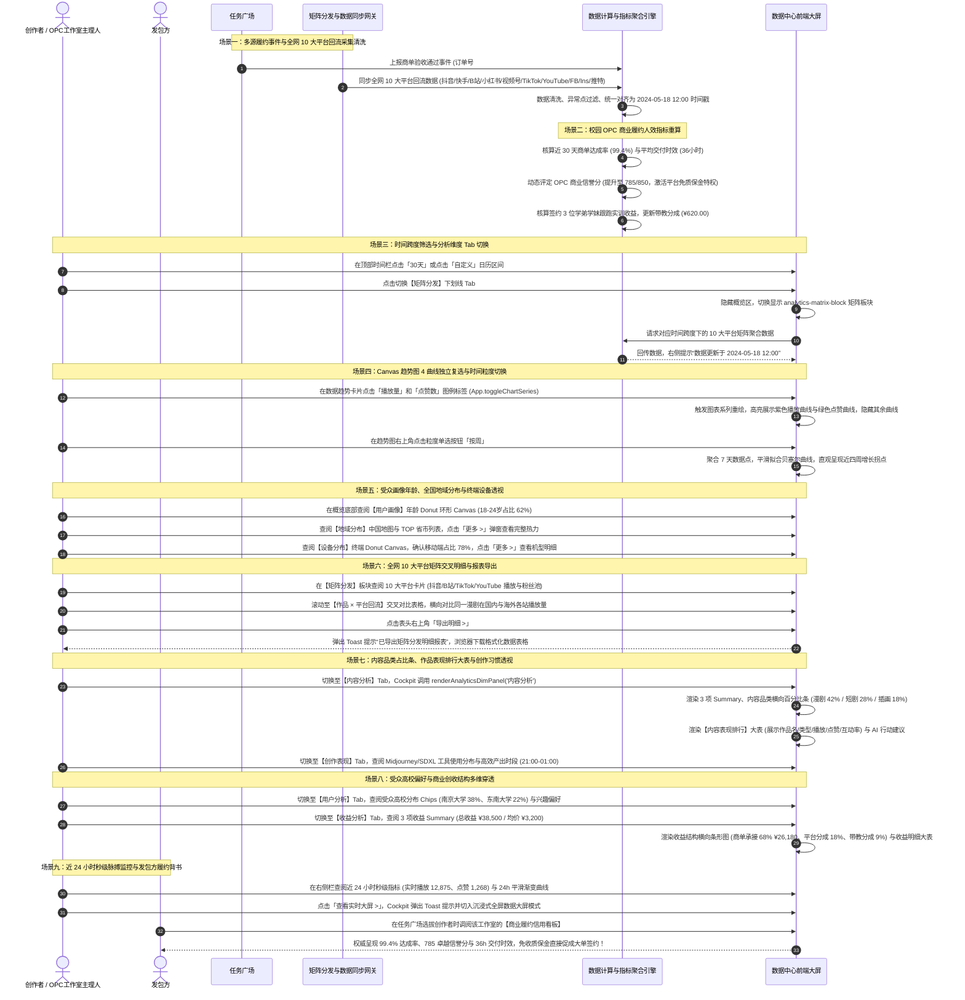
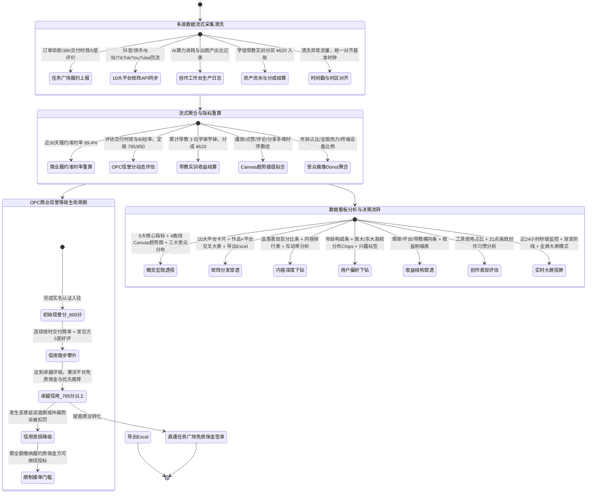

# 数据中心（商业决策罗盘、OPC 履约看板与全域数据透视）全业务架构设计方案

## 一、 用户故事

### 1. 本模块解决了什么问题？
在 AI 创作者向专业创作者（OPC）和商业工作室进阶的过程中，普遍面临“数据黑盒与经营盲人”困境：
- **全域分发数据割裂孤立**：作品分发到抖音、快手、哔哩哔哩、小红书、微信视频号、TikTok、YouTube、Facebook、Instagram、推特 (X) 等十个平台后，各站播放与互动数据碎片化，创作者需逐个登录后台手动统计，耗时耗力且无法形成全局认知；
- **商业履约效能缺乏量化凭据**：面对企业大单采购，创作者无法直观证明自身的“商单准时交付率、平均交付时效与商业信誉等级”，导致签约谈判议价权弱、需缴纳高额质保金；
- **创作决策缺乏科学指引**：不知晓目标受众的真实年龄层、高校分布与终端设备偏好，缺乏趋势粒度分析，导致选题全凭运气、工具产出比模糊；
- **学徒带教与协同经营账目不清**：OPC 工作室带领学弟学妹实训跟跑时，缺乏清晰透明的人效分成与团队履约贡献看板。

### 2. 实现了什么目标？
数据中心（Data Cockpit）定位为创作者与校园 OPC 工作室的**商业决策导航仪、履约效能信用大屏与全网矩阵回流中枢**：
- **全域矩阵分发深度穿透**：聚合国内与出海 10 大主流平台回流数据，提供【作品 × 平台回流】交叉对比明细大表与 AI 分发洞察建议，支持一键导出明细报表；
- **校园 OPC 商业履约与人效全景量化**：专设商业履约人效看板，权威公开“99.4%准时达成率、36h平均交付时效、785分商业信誉与学弟学妹带教分成 ¥620”，作为免保证金与平台直通签单的核心资产；
- **多维科学决策与平滑可视化**：提供 6 大核心维度 Tab、4 曲线自由复选叠加的 Canvas 动态趋势图（天/周/月粒度）、受众三大分布图（年龄 Donut Canvas / 全国省市地域分布图 / 设备 Donut Canvas）及近 24 小时实时脉搏大屏；
- **二级维度动态下钻面板**：无缝下钻【内容分析】（品类占比条与作品排行表）、【用户分析】（年龄构成条与高校/兴趣 Chips）、【收益分析】（收益结构条与明细表）、【创作表现】（工具分布与创作习惯）及配套行动建议。

### 3. 涵盖哪些核心功能？
- **Banner 区域**：
  - 背景大图：`assets/banners/banner_analytics.png`；
  - 主标题【数据中心】，副标“全面的数据分析与洞察，助你优化创作策略，提升内容影响力”；
- **6 大核心维度 Tab（analytics-dimension-tabs）**：
  - `概览`（核心宏观大盘、OPC 履约看板、多曲线趋势图与受众分布）；
  - `内容分析`（3 项 Summary 统计、内容品类表现横向百分比条、内容表现排行大表及行动建议）；
  - `用户分析`（3 项 Summary 统计、年龄构成百分比条、高校分布 Chips、兴趣偏好 Chips 及行动建议）；
  - `收益分析`（3 项 Summary 统计、收益结构横向百分比条、收益明细大表及行动建议）；
  - `创作表现`（3 项 Summary 统计、生产工具使用分布百分比条、创作习惯网格及行动建议）；
  - `矩阵分发`（矩阵汇总大盘、10 大平台矩阵卡片网格、【作品 × 平台回流】交叉明细大表与分发洞察 AI 建议）；
- **时间跨度筛选与更新戳（analytics-timeframe-row）**：
  - 周期胶囊组：`7天`、`30天`（默认激活）、`90天`、`自定义`（日历图标按钮）；
  - 顶部状态更新提示：“数据更新于 2024-05-18 12:00”；
- **概览板块（analytics-overview-block）**：
  - **1. 校园 OPC 商业履约与人效看板（opc-analytics-banner）**：
    - 认证抬头：【星芒 AI 视觉工作室 · OPC 商业履约与人效看板】+ 金色【南京大学创客空间认证】勋章；
    - 4 大经营指标：
      - **商单准时达成率**：`99.4%`（近 30 天 0 违约延误）；
      - **平均交付时效**：`36 小时`（比行业均值快 45%）；
      - **OPC 商业信誉分**：`785 / 850`（卓越信用 · 平台免质保金）；
      - **学弟学妹带教分成**：`¥ 620.00`（签约 3 位学弟跟跑实训）；
  - **2. 6 大核心宏观指标卡片（analytics-metric-cards）**：
    - 全域播放量、点赞数、评论数、分享数、商业总创收、整体完播率；
  - **3. 多曲线 Canvas 动态趋势图（chart-trend-card）**：
    - 4 条独立可复选曲线：播放量（紫色 `#6366F1`）、点赞数（绿色 `#10B981`）、评论数（深紫 `#8B5CF6`）、分享数（橙黄 `#F59E0B`），点击图例标签独立开关；
    - 粒度单选按钮组：`按天`（默认）、`按周`、`按月` 聚合切换重绘；
  - **4. 底部三大受众分布图表（bottom-charts-row）**：
    - **用户画像**：年龄分布 Donut 环形 Canvas + 年龄段百分比图例；
    - **地域分布**：中国地图视觉图 + TOP 省市占比列表 + 点击【更多 >】；
    - **设备分布**：移动端/桌面端/平板终端 Donut 环形 Canvas + 机型占比图例 + 点击【更多 >】；
- **矩阵分发深度看板（analytics-matrix-block）**：
  - 矩阵数据汇总栏（分发作品数 28 篇、全网总粉丝池 32.8w、跨平台总曝光 186.5w）；
  - **10 大主流平台卡片**：抖音、快手、哔哩哔哩、小红书、视频号、TikTok、YouTube、Facebook、Instagram、推特 (X)，展示各平台绑定状态与数据；
  - **【作品 × 平台回流】交叉明细大表**：横向对比社区大本营与 10 大外站数据，点击表头【导出明细 >】下载 Excel 报表；
  - **分发洞察 AI 建议**：平台推荐分发时段、长视频拆条与标签优化策略；
- **二级维度动态面板（analytics-dim-block）**：
  - 承接【内容分析】、【用户分析】、【收益分析】、【创作表现】的指标 Summary、可视化条形图、明细大表与 AI 行动建议；
- **右侧侧边栏辅助功能舱（col-side）**：
  - **实时数据大屏（近 24 小时）**：
    - 4 项秒级实时指标：实时播放量（12,875）、实时点赞数（1,268）、实时评论数（286）、实时分享数（532）；
    - 24 小时平滑渐变曲线图（`realtime-24h-canvas`）；
    - 点击【查看实时大屏 >】进入全屏投屏模式；
  - **热门内容 TOP 5**：展示近周期表现最佳的 5 部作品及播放转化效率，点击【更多 >】；
  - **数据洞察周报**：平台 AI 智能运营策略周报卡片，点击【更多 >】生成新策略。

---

## 二、 多方角色业务交互时序图

---

## 三、 全生命周期业务/任务状态机

---

## 四、 核心功能模块与操作权限矩阵

| 界面区域与板块 | 对应前端控件与触发动作 | 核心业务与分析功能 | 关键数据指标与状态 | 普通创作者权限 | OPC/商业工作室权限 |
| :--- | :--- | :--- | :--- | :--- | :--- |
| **顶部时间筛选栏** | `7天` / `30天` (默认) / `90天` / `自定义` 日历 | 切换全站数据统计时间窗口 | 顶部精确更新时间戳“数据更新于 2024-05-18 12:00” | 允许查阅 7 天与 30 天历史数据 | 允许查阅 90 天与全生命周期自定义数据 |
| **6 大核心维度 Tab** | `概览`/`内容分析`/`用户分析`/`收益分析`/`创作表现`/`矩阵分发` | 六维一体穿透式立体数据透视 | 维度切换流畅渲染，无刷新就地展示 | 允许查阅全部 6 大维度基础看板 | 允许深度下钻单篇内容与高级矩阵报表 |
| **OPC 商业履约看板** | 认证主体与 4 大指标卡片 | 商业团队履约信用与人效量化资产 | **达成率99.4%/交付时效36h/信誉785/学徒分成¥620** | 个人基础数据展示，信誉分驱动接单门槛 | **工作室全景看板，享平台免质保金、学徒带教分成管理** |
| **6 大核心宏观指标卡片** | 播放量/点赞数/评论数/分享数/总收益/完播率 | 宏观大盘关键核心指标速览 | 环比涨跌幅动态标记，支持多维度汇总 | 查阅个人作品大盘 | 查阅团队聚合大盘，支持多账号汇总 |
| **多曲线趋势图 (Canvas)** | 4 曲线复选勾选 / `按天`/`按周`/`按月` 粒度切换 | 动态可视化平滑折线走势图 | 播放(紫)/点赞(绿)/评论(深紫)/分享(橙)自由叠加 | 支持 4 曲线对比与天/周/月粒度切换 | 支持 4 曲线对比，导出高精度图表素材 |
| **三大受众分布图表** | 年龄 Donut / 全国地域图 / 设备 Donut | 深度洞察受众年龄、地理与终端画像 | 年龄段占比、省市热力列表、机型占比；支持点击【更多 >】 | 允许查阅基础分布图表 | 允许点击【更多 >】查看全量省市热力与终端版本明细 |
| **矩阵分发深度看板** | 10 大平台网格卡片 / 【作品×平台】交叉明细表 / 【导出明细>】 | 穿透全网 10 大平台播放与互动回流 | 覆盖抖音/快手/B站/小红书/视频号/TikTok/YouTube等 | 允许绑定 3 个平台账号查看分发数据 | **允许绑定全平台无上限账号，一键导出交叉报表** |
| **二级维度下钻面板** | `renderAnalyticsDimPanel(dim)` 动态渲染 | 品类条形图、作品排行表、高校分布Chips、收益明细、工具分布 | 结构化百分比条、明细表格、行动建议 | 查阅当前周期基础分析 | 深度下钻全量历史作品互动率与收益明细 |
| **右侧：实时数据大屏** | 近 24 小时 4 项秒级指标 / 渐变折线 / 【查看实时大屏>】 | 秒级捕捉近 24 小时流量爆发脉搏 | 实时播放/点赞/评论/分享；点击进入数据大屏模式 | 允许查看 24 小时趋势 | 允许一键进入【全屏实时数据大屏投屏模式】 |
| **右侧：TOP 5 与洞察** | 热门内容排行 / AI 智能策略周报卡片 | 识别爆款内容模式，获取 AI 运营优化建议 | 爆款作品效能诊断与周报建议；点击【更多 >】 | 允许查阅 TOP5 与系统基础诊断 | 专享 AI 深度运营策略周报与针对性选品建议 |

---

## 五、 与全局各模块的深度联动体系说明

1. **与【任务广场】深度联动（商业信用与人效背书）**：
   - 数据中心计算出的“商单准时达成率（99.4%）”、“平均交付时效（36h）”和“OPC 商业信誉分（785分）”，直接作为创作者在【任务广场】接单竞标时的官方信用徽章；
   - 达到 750 分以上的创作者，系统自动为其在任务广场免除履约保证金，并赋予企业发包方签约优先推荐权。
2. **与【发现页】深度联动（矩阵大盘与展品流量回流）**：
   - 发现页右侧栏的“7天矩阵分发大盘数据”与数据中心的矩阵分发板块保持底层同构与秒级实时同步；
   - 创作者在发现页展出的作品，其播放量、点赞数与 Prompt 套用转化数据，直接回流至数据中心的【内容分析】与【用户画像】中。
3. **与【我的资产】深度联动（收益穿透与分成清算）**：
   - OPC 看板中的“学弟学妹带教分成（¥620.00）”和商业收益走势，与【我的资产-账户余额】中的资金流水毫秒级对齐，随时支持发起合规提现；
   - 数据中心生成的对账报表，直接作为企业完税凭证与开具专票的审核附录。
4. **与【成长学院】深度联动（技能完课与学分认定）**：
   - 创作者在成长学院的课程研习进度与实战案例考核成绩，自动转化为数据中心的“专业技能表现”，并与高校实训认证进度联动。
5. **与【创作工具】深度联动（算力消耗产出比量化）**：
   - 数据中心的【创作表现】维度精确记录创作者使用 Midjourney、Stable Diffusion XL 等工具的使用频次与耗时习惯，清晰呈现生产工具使用分布与算力 ROI 产出比。
6. **与【用户管理】深度联动（身份等级与安全风控）**：
   - 数据中心完整区分双轨积分流向：清晰呈现跑模型消耗的 **AI 积分** 产出比（算力 ROI），以及通过商单履约、好评与社区分享沉淀的 **创作积分**，严禁两者混淆；创作者在安全设置中绑定的学校直接映射为数据中心的高校认证勋章。
