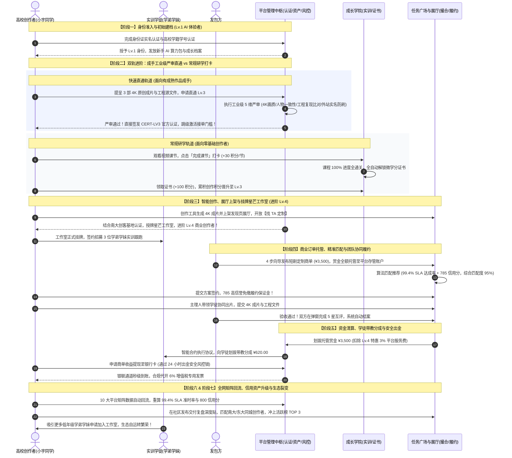

# AI创作者社区 · 全局业务全生命周期一级整体架构与状态机设计方案

## 一、 宏观业务架构与用户全景故事

### 1. 宏观解决的核心痛点
在传统的数字创意与自由职业平台中，创作者通常面临**“学习无商业出路、创作无订单转化、履约无信用资产、团队无协同机制、出金无风控保障”**的五大割裂断层。各大功能模块常常各自为政，无法形成正向商业飞轮。

### 2. 平台核心定位与顶层目标
本项目定位为专为高校创作者、商业创作者（OPC）及发包方打造的**“产-学-研-创-商-服”六位一体**超级商业赋能枢纽：
- **贯通高校创作者 5 级进阶全通路（双轨准入：常规研学轨 + 成手严审直通轨）**：
  - **Lv.1 AI 体验者**：入驻建档完成身份证实名认证与高校学籍认证，体验基础 AI 工具与公开课，获取新手算力；
  - **Lv.2 AI 创作者**：在成长学院完成视频课节研习打卡，掌握工作流并稳定进行社区内容创作与发布；
  - **Lv.3 内容创作者（商业接单准入门槛）**：
    - **轨道 A（常规研学进阶）**：零基础创作者通过成长学院全部课节打卡，系统结业解锁微学分证书，累积创作积分晋升至 Lv.3；
    - **轨道 B（成手快速直审 · 工业级严审）**：针对已有作品集或外站经验的资深创作者，支持提呈 3 部商业级成片（附带提示词与工程源文件）或登记全网矩阵账号发起直通申请。**平台执行工业级严格审核（4K 超清画质、人物光影一致性、工程可复现性比对、外站同名防刷粉核验、原创指纹查重）**。审核通过后官方直发 `CERT-LV3 内容创作者认证`，免修初级通识课直接激活接单资格；审核未达标则出具缺陷诊断清单，引导进入成长学院专项补强；
  - **Lv.4 商业创作者**（当前主理人小宇同学所在层级）：依托南京大学创客基地认证，组建校园 OPC 商业工作室（星芒 AI 视觉工作室），签约带教学弟学妹协同交付，承接高赏金商单，沉淀 99.4% SLA 准时达成率与 785 商业信誉分，享展厅优先推荐与平台免质保金特权；
  - **Lv.5 OPC 创业者**：个人品牌工作室化成熟运作，孵化标杆商业 IP，享有全平台全网矩阵顶流倾斜与企业直通签单渠道。
- **构建高可信的商业履约信用飞轮**：以“商单准时达成率 99.4%、平均交付时效 36h、OPC 商业信誉分 785/850”为核心量化资产，反哺任务广场免保证金签约、发现页展厅商业定制与全网 10 大平台矩阵分发；
- **全站一站式闭环体验**：打破传统后台跳转壁垒，全站所有场景均以无感抽屉（Drawer）、原生模态框（Modal）及全屏响应式子页面就地闭环，实现“学完即练、练完即创、创完即售、售完即结、结完即投”。

### 3. 一级业务主线全景图
平台完整的端到端核心业务闭环由 **7 大一级核心业务阶段** + **1 个全局治理底座** 构成：
1. **阶段一：用户建档与身份准入**（实名认证、高校学籍认证、初始 Lv.1 身份与算力权益发放）；
2. **阶段二：知识研习与技能实训**（视频课节研习、打卡领积分、全课通关解锁微学分证书，驱动 Lv.1 ➔ Lv.2 ➔ Lv.3 跃迁；成手可经工业级严审跨级直通 Lv.3）；
3. **阶段三：智能创作与资产沉淀**（工作台 GPU 渲染、成片上架展厅、创客基地认证挂牌工作室进阶 Lv.4）；
4. **阶段四：商业撮合与团队履约**（Lv.4 工作室带教学徒承接商单、资金全额托管、算法匹配、返修与仲裁保障）；
5. **阶段五：资金清算与学徒分润**（放款结算、自动划拨学徒带教分成 ¥620、24h 防盗刷看门狗、提现与代开专票）；
6. **阶段六：全域矩阵与信用反哺**（10 大平台矩阵回流、OPC 履约看板更新、信誉分冲刺 800 分迈向 Lv.5）；
7. **阶段七：社区共鸣与生态裂变**（复盘发帖、同城高校创作者联结、活跃榜冲榜、吸引新创作者加入工作室）；
- **全局治理底座：RBAC 权限隔离与宏观调控**（4 视角无缝切换、Pro 会员特权、双轨积分宏观调控）。

---

## 二、 全局端到端多方角色业务协同交互时序图



---

## 三、 全局一级全生命周期业务/任务状态机

### 3.1 一级全生命周期三大篇章与 8 大子模块横纵映射总览

为确保创作者与开发者清楚知晓每个阶段**位于哪个业务模块**并**结合哪份详细设计文档**，下表对全局状态机的主干流转进行了横纵维度的精准解构：

| 业务篇章（宏观纵向推进） | 一级核心业务阶段 | 承接核心模块 | 详细设计对应文档（点击直达） | 阶段核心状态流转与输入输出凭据 |
| :--- | :--- | :--- | :--- | :--- |
| **上篇：准入建档与双轨孵化** | **阶段 1：建档与身份准入** | 用户管理 / 我的资产 | [用户管理设计.md](file:///Users/huangjianbin/Desktop/AI创作者社区/ai-creator-community/design/用户管理设计.md)<br>[我的资产设计.md](file:///Users/huangjianbin/Desktop/AI创作者社区/ai-creator-community/design/我的资产设计.md) | 统一身份账号绑定 ➔ 身份证实名认证 ➔ 高校学籍学号校验 ➔ 授予 **Lv.1 AI 体验者** 档案 |
|  | **阶段 2A：常规研学进阶轨** | 成长学院 | [成长学院设计.md](file:///Users/huangjianbin/Desktop/AI创作者社区/ai-creator-community/design/成长学院设计.md) | 选修商业实战课 ➔ 视频研习打卡（+30分）➔ 100% 通关结业发证（+100分）➔ 晋升 **Lv.2** ➔ 晋升 **Lv.3 内容创作者**（解锁接单） |
|  | **阶段 2B：成手快速严审通道** | 发现页（申报）/ 平台严审 | [整体设计.md](file:///Users/huangjianbin/Desktop/AI创作者社区/ai-creator-community/design/整体设计.md)<br>[发现页设计.md](file:///Users/huangjianbin/Desktop/AI创作者社区/ai-creator-community/design/发现页设计.md) | 提交 3 部 4K 成片与工程源文件 ➔ 5 维工业级严格机审 ➔ 通过直发 **`CERT-LV3`** 跨级接单；驳回出具清单引导转入研学轨 |
| **中篇：商业创作与履约清算** | **阶段 3：智能创作与空间挂牌** | 创作工具 / 发现页 | [创作工具设计.md](file:///Users/huangjianbin/Desktop/AI创作者社区/ai-creator-community/design/创作工具设计.md)<br>[发现页设计.md](file:///Users/huangjianbin/Desktop/AI创作者社区/ai-creator-community/design/发现页设计.md) | AI 工作台生产（扣算力）➔ 展厅上架（开放定制）➔ 创客空间授牌挂牌星芒工作室 ➔ 晋阶 **Lv.4 商业创作者** 并组建 3 人团队 |
|  | **阶段 4：商单撮合与团队履约** | 任务广场 | [任务广场设计.md](file:///Users/huangjianbin/Desktop/AI创作者社区/ai-creator-community/design/任务广场设计.md) | 企业全额资金托管发包 ➔ 6 维算法撮合 ➔ 785 信誉分免保证金竞标签约 ➔ 师徒协同交付成片与工程 ➔ 验收结案与 5 星互评 |
|  | **阶段 5：资金清算与合规分润** | 我的资产 / 用户管理 | [我的资产设计.md](file:///Users/huangjianbin/Desktop/AI创作者社区/ai-creator-community/design/我的资产设计.md)<br>[用户管理设计.md](file:///Users/huangjianbin/Desktop/AI创作者社区/ai-creator-community/design/用户管理设计.md) | 赏金解冻划拨（扣3%优惠费率）➔ 学徒分成自动划拨 ¥620 ➔ 满 ¥50 提现申请 ➔ 24h 风控与银联秒级到账 ➔ 开具 6% 增值税专票 |
| **下篇：全域赋能与生态自运转** | **阶段 6：全域矩阵与数据赋能** | 数据中心 | [数据中心设计.md](file:///Users/huangjianbin/Desktop/AI创作者社区/ai-creator-community/design/数据中心设计.md) | 10 大社媒平台矩阵数据回流 ➔ 交叉报表导出 ➔ OPC 看板重算 99.4% SLA 与 800 信用分 ➔ 赋能冲刺 **Lv.5 OPC 创业者** |
|  | **阶段 7：社区共鸣与生态裂变** | 社区中心 | [社区中心设计.md](file:///Users/huangjianbin/Desktop/AI创作者社区/ai-creator-community/design/社区中心设计.md) | 商业交付复盘发帖 ➔ 匹配同城高校创作者 ➔ 冲刺活跃度排行榜 TOP3 ➔ 吸引新学徒加盟 ➔ **闭环反哺上游阶段 3/4** |

---

### 3.2 全局一级业务/任务状态机

```mermaid
stateDiagram-v2
    direction TB

    [*] --> 阶段1_建档准入_用户管理

    %% 阶段 1：用户管理 / 我的资产
    state 阶段1_建档准入_用户管理 {
        [*] --> 基础建档_绑定账号
        基础建档_绑定账号 --> 身份证实名认证通过: 结合 用户管理设计.md
        身份证实名认证通过 --> 高校学籍学号校验有效: 结合 用户管理设计.md
        高校学籍学号校验有效 --> 授予Lv1_AI体验者身份: 完成建档准入
    }

    %% 双轨横向分流
    阶段1_建档准入_用户管理 --> 阶段2A_研学进阶_成长学院: 【零基础创作者路径】选修实战课程
    阶段1_建档准入_用户管理 --> 阶段2B_严审直通_发现页与严审机制: 【有经验成手路径】提呈3部成片直审

    %% 阶段 2B：成手快速严审直通（结合：整体设计.md & 发现页设计.md）
    state 阶段2B_严审直通_发现页与严审机制 {
        [*] --> 提呈3部商业成片与源工程: 发现页入口申报
        提呈3部商业成片与源工程 --> 工业级5维严格机审: 4K画质/人物一致/工程复现/防刷通过
        工业级5维严格机审 --> 严审通过_官方直发CERT_LV3: 跨级解锁商业接单资质
        工业级5维严格机审 --> 严审驳回_出具质检清单: 存在缺陷阻断直通
    }

    严审驳回_出具质检清单 --> 阶段2A_研学进阶_成长学院: 引导转入研学补强
    阶段2B_严审直通_发现页与严审机制 --> 阶段3_创作挂牌_创作工具与发现页: 凭CERT_LV3直接入场接单

    %% 阶段 2A：常规研学进阶（结合：成长学院设计.md）
    state 阶段2A_研学进阶_成长学院 {
        [*] --> 选修商业实战课: 结合 成长学院设计.md
        选修商业实战课 --> 视频课节研习: 课节打卡完成加30积分
        视频课节研习 --> 全课100百分比通关: 系统自动结业发证
        全课100百分比通关 --> 领取结业证书: 结业加100积分
        领取结业证书 --> 晋升Lv2_AI创作者: 掌握基础生产流
        晋升Lv2_AI创作者 --> 晋升Lv3_内容创作者: 积分达标解锁接单
    }

    阶段2A_研学进阶_成长学院 --> 阶段3_创作挂牌_创作工具与发现页: 晋升Lv3入场接单

    %% 阶段 3：智能创作与工作室挂牌（结合：创作工具设计.md & 发现页设计.md）
    state 阶段3_创作挂牌_创作工具与发现页 {
        [*] --> 工作台启动生产: 扣除算力积分【创作工具设计.md】
        工作台启动生产 --> 发现页展厅上架: 开放找TA定制【发现页设计.md】
        发现页展厅上架 --> 创客空间授牌挂牌: 挂牌星芒工作室进阶Lv4
        创客空间授牌挂牌 --> 签约实训学徒: 组建3人实训交付团队
    }

    阶段3_创作挂牌_创作工具与发现页 --> 阶段4_商单履约_任务广场: 挂牌承接商单【结合：任务广场设计.md】

    %% 阶段 4：商单撮合与履约交付（结合：任务广场设计.md）
    state 阶段4_商单履约_任务广场 {
        [*] --> 商业需求托管发布: 企业发包全额托管资金
        商业需求托管发布 --> 6维算法智能匹配: SLA与技能加权
        6维算法智能匹配 --> 免保证金竞标签约: 785信用分免质保
        免保证金竞标签约 --> 团队协同交付成片: 交付4K成片与源工程
        团队协同交付成片 --> 验收结案与5星互评: 沉淀履约信誉资产
    }

    阶段4_商单履约_任务广场 --> 阶段5_资金清算_我的资产: 验收合格结案【结合：我的资产设计.md】

    %% 阶段 5：资金清算与合规分润（结合：我的资产设计.md & 用户管理设计.md）
    state 阶段5_资金清算_我的资产 {
        [*] --> 赏金解冻划拨: 扣除Lv4特惠3百分比服务费
        赏金解冻划拨 --> 学徒带教分成结算: 自动划拨620元
        学徒带教分成结算 --> 收益提现申请: 满50元发起出金申请
        收益提现申请 --> 24h安全风控校验: 银联代付秒级到账
        24h安全风控校验 --> 发票合规代开: 开具6百分比增值税专票
    }

    阶段5_资金清算_我的资产 --> 阶段6_数据赋能_数据中心: 交易履约数据回流【结合：数据中心设计.md】

    %% 阶段 6：全域矩阵与数据赋能（结合：数据中心设计.md）
    state 阶段6_数据赋能_数据中心 {
        [*] --> 10大平台矩阵回流: 抖音/B站/TikTok等回流
        10大平台矩阵回流 --> 交叉明细报表导出: 作品x平台综合分析
        交叉明细报表导出 --> OPC履约看板重算: 刷新99点4百分比SLA与800信用分
        OPC履约看板重算 --> 赋能冲刺Lv5: 具备更大商业单标承接资质
    }

    阶段6_数据赋能_数据中心 --> 阶段7_社区裂变_社区中心: 信用声量反哺社区【结合：社区中心设计.md】

    %% 阶段 7：社区共鸣与生态裂变（结合：社区中心设计.md）
    state 阶段7_社区裂变_社区中心 {
        [*] --> 商业交付复盘发帖: 沉淀干货与工程交付经验
        商业交付复盘发帖 --> 匹配同城高校创作者: 附近高校精准触达
        匹配同城高校创作者 --> 活跃排行榜冲榜: 跻身日周榜TOP3
        活跃排行榜冲榜 --> 吸引新创作者拜师: 扩大工作室实训团队规模
    }

    阶段7_社区裂变_社区中心 --> 阶段3_创作挂牌_创作工具与发现页: 灵感激发持续出片【闭环回流】
    阶段7_社区裂变_社区中心 --> 阶段4_商单履约_任务广场: 官方信誉加权持续签约【闭环回流】
    阶段7_社区裂变_社区中心 --> [*]: 生态正向自运转繁荣
```



---

## 四、 一级流程与 8 大子模块功能/权限映射矩阵

为保证全局各环节有据可查，下表清晰定义了一级流程在各子模块中的**具体前端 DOM 载体、触发函数、依赖凭据及对应的设计文档**：

| 一级业务阶段 | 承接子模块 | 对应前端 DOM 控件 / 入口 | 核心调用的 JS 函数 / 逻辑 | 流转前提与核验凭据 | 详查子设计文档 |
| :--- | :--- | :--- | :--- | :--- | :--- |
| **阶段 1：建档准入** | 用户管理 / 我的资产 | `#modal-security-settings`<br>`.header-opc-tag` | `App.openSecuritySettings()`<br>`App.openModal('modal-security-settings')` | 身份证实名认证通过；南大学籍认证有效；初始建档为 **Lv.1 AI 体验者** | [用户管理设计.md](file:///Users/huangjianbin/Desktop/AI创作者社区/ai-creator-community/design/用户管理设计.md) |
| **支线：成手严审直通** | 发现页 / 创作工具 | `#modal-publish`<br>`#modal-studio` | `App.submitPublishWork()`<br>平台官方工业级严审机制 | 提交 3 部 4K 成片与工程源文件；通过画质、人物一致性与原创防刷 5 维严审；直发 **`CERT-LV3`** | [整体设计.md](file:///Users/huangjianbin/Desktop/AI创作者社区/ai-creator-community/design/整体设计.md) |
| **支线：Pro 订阅增值** | 用户管理 / 我的资产 | `#modal-pro`<br>`#modal-pro-pay-qr` | `App.selectProPlan()`<br>`App.handleUpgradePro()`<br>`App.confirmProPayment()` | 会员订阅走**独立结算通道**：扫码支付成功后打标 `PRO` 并写入到期时间，**不占用账户余额、不产生冻结额、不写资产流水**；资产页资料条同步回显「有效期至 YYYY-MM-DD」 | [用户管理设计.md](file:///Users/huangjianbin/Desktop/AI创作者社区/ai-creator-community/design/用户管理设计.md) |
| **阶段 2：技能实训** | 成长学院 | `#academy-courses-page`<br>`#academy-lesson-page`<br>`#modal-my-certs` | `App.showAcademyCoursesPage()`<br>`App.openAcademyLesson()`<br>`App.openMyCerts()` | 完成 100% 视频课节打卡研习；系统即时结业发证；创作积分累积驱动晋升 **Lv.2 创作者** 与 **Lv.3 内容创作者** | [成长学院设计.md](file:///Users/huangjianbin/Desktop/AI创作者社区/ai-creator-community/design/成长学院设计.md) |
| **阶段 3：智能创作** | 创作工具 / 发现页 | `#modal-studio`<br>`.work-card`<br>`#modal-gallery-custom` | `App.openStudioModal()`<br>`App.applyPromptToStudio()`<br>`App.publishStudioToShowcase()` | AI 算力充足 (≥15点)；作品上架展厅；南大创客空间认证挂牌星芒工作室，进阶 **Lv.4 商业创作者** | [创作工具设计.md](file:///Users/huangjianbin/Desktop/AI创作者社区/ai-creator-community/design/创作工具设计.md)<br>[发现页设计.md](file:///Users/huangjianbin/Desktop/AI创作者社区/ai-creator-community/design/发现页设计.md) |
| **阶段 4：商单履约** | 任务广场 | `#tasks-publish-page`<br>`#tasks-detail-page`<br>`#modal-submit-delivery` | `App.showTaskPublishPage()`<br>`App.openTaskDetail()`<br>`App.doSubmitDelivery()` | 企业资金全额托管；Lv.4 主理人凭 785 信誉免保证金投标签约；带教学徒协同交付合规成片 | [任务广场设计.md](file:///Users/huangjianbin/Desktop/AI创作者社区/ai-creator-community/design/任务广场设计.md) |
| **阶段 5：清算合规** | 我的资产 / 用户管理 | `#view-assets`<br>`#modal-withdraw` | `App.navigateTo('assets')`<br>`App.openWithdrawModal()`<br>`App.submitWithdraw()` | 账户可提现余额 ≥ ¥50；自动划拨学徒分成 ¥620；24小时内无改密换绑敏感记录；收款实名一致 | [我的资产设计.md](file:///Users/huangjianbin/Desktop/AI创作者社区/ai-creator-community/design/我的资产设计.md) |
| **阶段 6：矩阵反哺** | 数据中心 | `#view-analytics`<br>`.opc-analytics-banner`<br>`#analytics-trend-canvas` | `App.navigateTo('analytics')`<br>`App.applyAnalyticsDimension()`<br>`App.toggleChartSeries()` | 全网 10 大平台授权 API 联通；商单结案数据流式回流；重算 99.4% SLA 与 785 信用分，冲刺 **Lv.5** | [数据中心设计.md](file:///Users/huangjianbin/Desktop/AI创作者社区/ai-creator-community/design/数据中心设计.md) |
| **阶段 7：社区裂变** | 社区中心 | `#view-community`<br>`#modal-publish`<br>`#modal-edge-list` | `App.focusHotCircle()`<br>`App.openActiveRanksModal()`<br>`App.openTopicsMoreModal()` | 创作者拥有有效实名档案；内容符合社区规范；活跃度达标上榜，吸引更多学弟学妹加入团队 | [社区中心设计.md](file:///Users/huangjianbin/Desktop/AI创作者社区/ai-creator-community/design/社区中心设计.md) |
| **全局治理底座** | 用户管理 | `#modal-system-admin`<br>`#modal-pro`<br>`#modal-confirm` | `App.openSystemAdminModal()`<br>`App.switchSystemAdminTab()`<br>`App.openConfirmModal()` | 具备系统级管理治理权限；支持创作者/导师/企业/管理员 4 视角无感切换 | [用户管理设计.md](file:///Users/huangjianbin/Desktop/AI创作者社区/ai-creator-community/design/用户管理设计.md) |

---

## 五、 全链路业务闭环与四大飞轮驱动机制

平台并非由零散模块拼凑而成，而是由**四大紧密啮合的核心业务飞轮**驱动自运转生态：

```
       ┌─────────────────────────────────────────────────────────┐
       │                飞轮一：双轨积分资产解耦飞轮                │
       │    【AI 算力积分（消费型）】 ⟷ 【创作积分（成长型）】      │
       └────────────────────────────┬────────────────────────────┘
                                    │
                                    ▼
       ┌─────────────────────────────────────────────────────────┐
       │                飞轮二：商业履约与信誉驱动飞轮              │
       │   99.4%达成率 + 36h时效 + 785信誉分 ➔ 免保证金高额接单     │
       │   （前置工业级严格准入审核，确保高标交付质量与0违约履约）   │
       └────────────────────────────┬────────────────────────────┘
                                    │
                                    ▼
       ┌─────────────────────────────────────────────────────────┐
       │                飞轮三：内容-展厅-商单商业转化飞轮          │
       │    工具4K成片 ➔ 发现页展厅上架 ➔ 【找TA定制】定向商单成交    │
       └────────────────────────────┬────────────────────────────┘
                                    │
                                    ▼
       ┌─────────────────────────────────────────────────────────┐
       │              飞轮四：高校产教融合与学徒实训分润飞轮        │
       │    创作者研习认证 ➔ 组建OPC团队 ➔ 带教学弟学妹实训分润¥620    │
       └─────────────────────────────────────────────────────────┘
```

### 1. 飞轮一：双轨积分解耦流转飞轮
- **AI 积分（算力池 · 生产资料）**：
  - 严格用于驱动 Midjourney、Stable Diffusion XL、Sora 等大模型 GPU 算力消耗；
  - 支持 Pro 会员 4 折优惠充值、礼品卡兑换码充值或平台新手赠送；按生成批次实时扣除，渲染失败或超时全额原路退还；
- **创作积分（成长池 · 信用资产）**：
  - 严格记录创作者的专业能力成长与社区声誉；
  - 仅通过成长学院视频课节打卡完课(+30/节)、结业证书领取(+100)、社区互动获高赞、商单履约获五星好评等正面行为累积，只增不减；
  - 直接决定创作者等级由 `Lv.1 AI 体验者` ➔ `Lv.2 AI 创作者` ➔ `Lv.3 内容创作者` ➔ `Lv.4 商业创作者` ➔ `Lv.5 OPC 创业者` 跃迁，严禁因日常跑模型出图而扣减，从根本上解决“越创作等级越低”的荒谬逻辑。

### 2. 飞轮二：商业履约与信誉驱动飞轮
- **前置严格门槛**：无论是常规研习晋升还是成手代表作直审，均需通过严格的交付能力考核与 5 维工业质检，杜绝不合格人员扰乱商单市场；
- **履约数据量化**：任务广场的每一笔商单履约（准时交付、返修轮次、发包方评价），毫秒级流式上报至数据中心；
- **信用资质沉淀**：数据中心据此计算出工作室权威经营指标（准时达成率 99.4%、平均交付时效 36 小时、OPC 商业信誉分 785/850）；
- **商业特权反哺**：该信用指标直接在任务广场中生效，系统自动为其免除全额投标履约保证金，并在发包方算法匹配大屏中置顶推荐，促成高单价商业大单持续成交。

### 3. 飞轮三：内容-展厅-商单商业转化飞轮
- **端内流转无缝**：创作者在【创作工具】生成的优秀作品，无需下载重传，点击「上架展厅」即可直通【发现页】展厅；
- **商业定制变现**：发包方在展厅浏览样片时，点击「找 TA 定制」即可就地调起 `modal-gallery-custom` 发起定向商单；
- **履约资产复用**：商单验收完成后，交付成片再次作为标杆案例陈列入创作者展位，实现“创作即样片、展出即获客、交付即资产”的连续变现。

### 4. 飞轮四：高校产教融合与学徒实训分润飞轮
- **学研一体进阶**：南大学子通过成长学院掌握行业最前沿的 AI 商业工作流，获得成长学院专项结业证书与高校微学分凭证；
- **实体团队孵化**：依托南京大学创客空间认证，创作者成立 OPC 商业工作室（星芒 AI 视觉工作室），签约 3 位学弟学妹跟跑实操；
- **带教收益透明**：在承接企业高额定制商单后，平台智能清算合约自动划拨学徒带教分成（¥620.00），既保障了主理人商业利润，又让低年级学生获得真实商业实训报酬，打造可持续演进的高校产教融合典范。
