# 用户管理（全生命周期账号、安全合规与系统治理底座）全业务架构设计方案

## 一、 用户故事

### 1. 本模块解决了什么问题？
在传统的平台架构中，用户中心往往被设计为一个冷冰冰的“独立后台页面”，导致创作者在业务推进中经常被迫“跳出打断”：
- **业务场景被打断割裂**：创作者在任务广场竞标商单、在资产中心申请提现或在成长学院学习时，若需要查看个人资质、安全设置或升级特权，必须跳出当前任务流进入独立后台，体验碎片化严重；
- **身份认证与校园学籍脱节**：平台缺乏将“身份证实名认证、校园学号学籍认证、高校创客空间认证”有机缝合的一站式凭据，导致学生创作者无法享受校园优惠，企业方也无法确认学生真实身份；
- **双轨权益与会员价值模糊**：缺乏清晰透明的成长等级阶梯（Lv.1~Lv.5）与 Pro 商业会员特权展示，创作者不明确如何进阶为年入百万的 OPC 团队；
- **多角色权限隔离与视角测试困难**：平台涉及创作者、高校导师、发包方与系统管理员多方角色，缺乏一站式的 RBAC 治理控制台与视角切换工具，难以快速验证不同角色的交互逻辑。

### 2. 实现了什么目标？
用户管理（User Management & System Governance）定位为贯穿全站所有模块的**无感通用支撑底座、安全合规盾牌与全局治理中枢**：
- **场景化就地抽屉与模态响应**：所有用户能力均以原生模态框（Modal）与抽屉（Drawer）形式就地唤起（如个人主页抽屉 `modal-creator-profile`、安全设置 `modal-security-settings`、Pro 会员 `modal-pro`、等级权益 `modal-level-perks`、我的证书 `modal-my-certs`），原地闭环后无需页面跳转；
- **个人信息与校园学籍安全认证沉淀**：在安全设置中严格维护真实姓名实名认证、手机号与邮箱换绑安全验证、学号与高校身份认证，并与南大创客空间 OPC 认证深度绑定；
- **双轨会员与等级成长体系全量公开**：
  - **创作者等级体系（Lv.1~Lv.5）**：从 Lv.1 体验者、Lv.2 进阶者、Lv.3 熟练工、Lv.4 OPC 团队（当前主理人）到 Lv.5 领军者，成长值透明公开；
  - **Pro 会员特权订阅（独立订阅结算通道）**：会员订阅是**账号级服务订购**，与平台账户余额**完全解耦**——不占用现金余额、不产生冻结额、不写入资产流水；扫码支付成功后即时打标 `PRO` 会员并写入到期时间，激活专属 4 折算力直充、商单免质保金、优先推荐与专属客服；
- **RBAC 权限隔离与系统管理治理控制中心**：提供系统管理控制台（`modal-system-admin`），支持 RBAC 角色权限与视角一键切换（创作者、高校导师、发包方、教务管理员）、双轨会员体系治理、24 小时改密风控看门狗与创作积分经济宏观调控；
- **全局优雅交互基础设施**：提供优雅的原生确认弹窗（`modal-confirm`）接管二次确认，以及帮助中心 FAQ（`modal-help-faq`）答疑闭环。

### 3. 涵盖哪些核心功能？
- **顶部用户状态栏与常驻入口**：
  - 用户头像（`assets/avatars/user_header.png`，小宇同学），点击直达个人资产中心；
  - 校园 OPC 认证标识标签：“南大 · 认证 OPC 工作室 (Lv.4)”；
  - 系统消息与通知中心（`notify-dropdown`）；
- **个人主页抽屉（modal-creator-profile）**：
  - 展示创作者大头像、姓名、高校标签、个性签名；
  - 统计卡片：获赞数、粉丝数、关注数、上架作品数；
  - 代表作网格展示与一键【关注】/【私信】互动；
- **安全设置与个人信息中心（modal-security-settings）**：
  - 个人身份卡片：大头像、姓名、学校及创作者等级；
  - 个人信息行：真实姓名（实名已认证）、手机号（点击【更换】发送验证码）、邮箱（点击【更换】换绑）、学号（点击【认证】校园认证）、所属学校（南京大学）；
  - 安全防护行：登录密码、支付密码、两步验证、登录设备管理等安全状态管理；
- **开通 Pro 会员特权弹窗（modal-pro）**：
  - 主标题“开通 Pro 会员 · 解锁创作者超级特权”，副标“会员订阅独立结算 · 扫码支付成功后即时生效”；
  - **会员状态条（pro-subscribe-strip）**：已开通展示「PRO 生效中 + 当前订阅方案 + 有效期至 YYYY-MM-DD（剩余 N 天）+ 续费顺延说明」；未开通展示「未开通 + 独立结算通道说明 + 不走账户余额 / 不产生冻结金额」（由 `App.renderProMembershipStrip()` 渲染）；
  - **订阅方案二选一**：`年费会员 ¥699 / 年`（立省 ¥477，送 50000 创作算力）与 `月度订阅 ¥98 / 月`（按月扣费，随时取消），点击卡片由 `App.selectProPlan()` 切换选中态；
  - 特权展示：专属算力 4 折直充、商单免质保金特权、任务大厅优先推荐、专属技术导师答疑；
  - 底部动作：【暂不需要】关闭；【立即开通 Pro 会员】由 `App.handleUpgradePro()` 生成订阅订单（`PRO` 单号 + 应付金额 + 结算后到期日）并唤起付款二维码弹窗；
- **Pro 会员订阅付款二维码弹窗（modal-pro-pay-qr）**：
  - 主标题“扫码支付 · 开通 Pro 会员”，副标“会员订阅独立结算通道 · 不占用账户余额”；
  - **订单回显条**：订阅方案（`#pro-qr-plan-name`）、应付金额（`#pro-qr-amount`）、订阅单号（`#pro-qr-order-no`）；
  - **扫码渠道切换**：`微信支付` / `支付宝` 双按钮（`App.switchProPayChannel()`），切换后二维码图案与中央徽标配色即时重绘（`App.renderProPayQr()`）；
  - **支付舞台（pro-qr-stage）**：由订阅单号与渠道派生的付款二维码（零依赖内联 SVG，含三个定位角与 `PRO` 中央徽标）、15 分钟支付倒计时（`App.startProQrCountdown()`，超时订单自动失效并关闭弹窗）、扫码提示与「支付成功后有效期至」预告；
  - **结算边界说明**：明确标注本笔订单走会员订阅独立结算通道，不从账户余额扣除、不产生冻结金额、不影响算力充值与资产流水；
  - 底部动作：【取消订单】由 `App.cancelProOrder()` 作废本次订阅（不写会员信息、不登记订单）；【我已完成支付】由 `App.confirmProPayment()` 回调 `App.activateProMembership()` 完成开通；
- **Pro 会员信息与到期时间展示（商户会员信息）**：
  - **资产页个人中心资料条（assets-profile-hub）**：Pro 生效后在姓名右侧点亮金色 `PRO` 徽章（`.badge-pro`），并在身份行下方展示「Pro 商业创作者会员 · 有效期至 YYYY-MM-DD（剩余 N 天）」（`.assets-profile-membership`）；未开通时展示「未开通 Pro 会员 · 会员扫码订阅独立结算 + 立即开通」引导；
  - **左侧栏 Pro 入口卡（pro-widget-card）**：未开通展示「开通 Pro 会员 + 立即开通」；Pro 生效后切换为「`PRO 会员` 徽章 + 订阅方案 + 有效期至 + 剩余天数」并给出【续费 / 管理】入口（`App.renderProSidebarWidget()`）；
  - **会员与等级双轨体系 Tab**：同步展示当前订阅方案、有效期至、剩余天数与自动续费状态，并列出年费 / 月度两档定价策略；未开通时展示「FREE MEMBER」与【去开通 Pro】按钮；
  - 三处展示位由 `App.refreshProViews()` 在订阅成功后统一刷新；到期天数由 `App.proDaysLeft()` 依据 `membership.expireDate` 实时计算；
- **创作者等级权益体系弹窗（modal-level-perks）**：
  - 主标题“创作者等级权益”，动态同步当前创作者等级；
  - 呈现 Lv.1 体验者至 Lv.5 OPC 团队的成长值阈值、商单交易手续费折扣（8% -> 2%）、每日免费算力配额与展厅展位特权；
- **我的证书与成就弹窗（modal-my-certs）**：
  - 主标题“我的证书与成就”，副标“学院认证 · 数字藏品 · 平台荣誉”；
  - 网格展示官方/学院证书（如 AI 短视频入门、短剧全流程实战等）、高校微学分凭证、成就勋章及数字藏品凭证，提供【去成长学院】跳转；
- **我的作品展示抽屉（modal-my-works）**：
  - 集中管理发现页与作品展厅已上架的商业设计、漫剧样片合集，支持点击跳转【去发现页】；
- **系统管理与治理控制中心（modal-system-admin）**：
  - 4 大治理 Tab：
    1. `👥 RBAC 角色权限与视角切换`：一键切换创作者（小宇同学）、高校导师（陈教授）、发包方（元象智能人事部）与系统管理员视角；
    2. `👑 会员与等级双轨体系`：管理 Pro 会员定价策略、权益清单与 Lv.1~Lv.5 等级经验值规则；
    3. `🛡️ 全域风控与交易看门狗`：监控 24 小时改密提现风控锁、大额商单仲裁介入、版权指纹比对；
    4. `💎 创作积分宏观经济调控`：宏观调控平台创作积分发行总量、日常任务产出与算力兑换汇率；
- **通用辅助基础设施**：
  - 沉浸式确认模态框（`modal-confirm`）：替代浏览器粗糙的 `window.confirm`，用于高危操作与撤销确认；
  - 帮助中心 FAQ（`modal-help-faq`）：展示新手常见问题、商单履约指南与算力使用说明。

---

## 二、 多方角色业务交互时序图

本模块的时序图按**「全景 → 单场景」**两层组织：先以一张全角色综合交互图总览场景一 ~ 场景九，再把每个场景单独抽成一张子时序图，只保留该场景真正参与的角色与泳道。

> 角色口径：**创作者** = 承接商单、产出作品的平台用户（含 OPC 主理人、创作者）；**发包方** = 发布商单、出资托管、验收付款的一方；**系统管理员** = 平台治理与风控视角。

### 全角色综合交互时序图（全局全景 · 场景一 ~ 场景九）

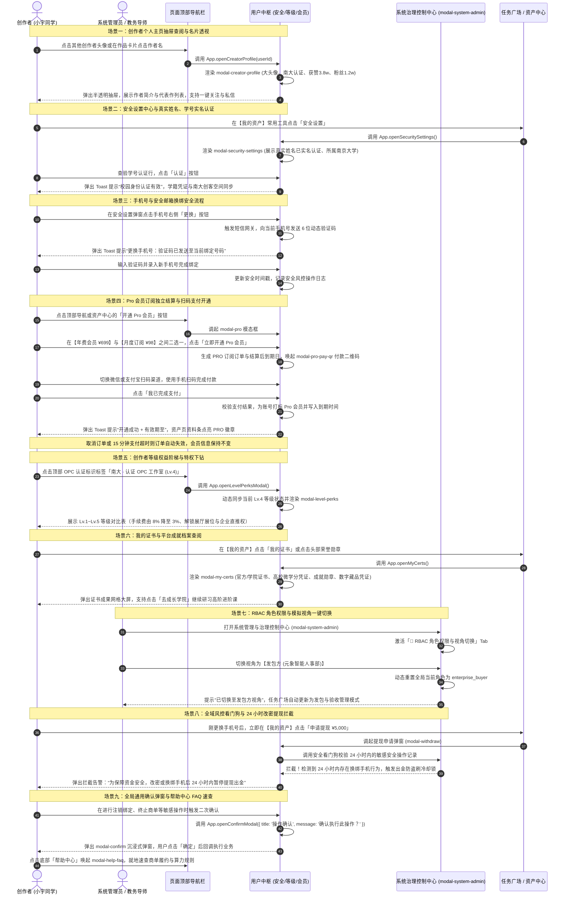

### 场景一子时序图：创作者个人主页抽屉查阅与名片透视

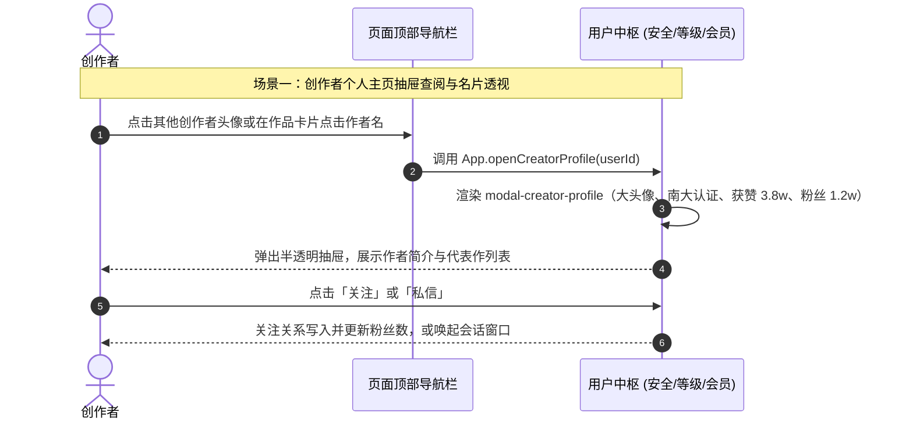

### 场景二子时序图：安全设置中心与真实姓名、校园学号实名认证

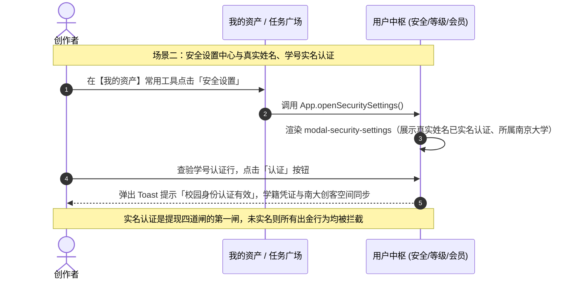

### 场景三子时序图：手机号与安全邮箱换绑验证码流程

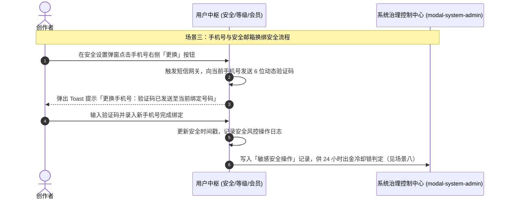

### 场景四子时序图：开通 Pro 会员（独立订阅结算 + 扫码支付打标）

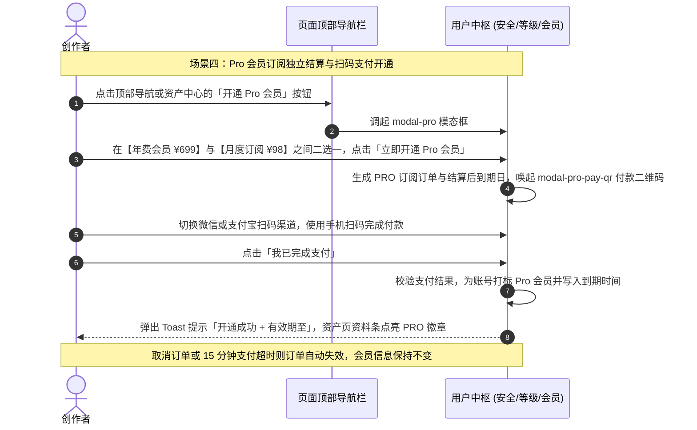

### 场景五子时序图：创作者等级权益阶梯与特权穿透

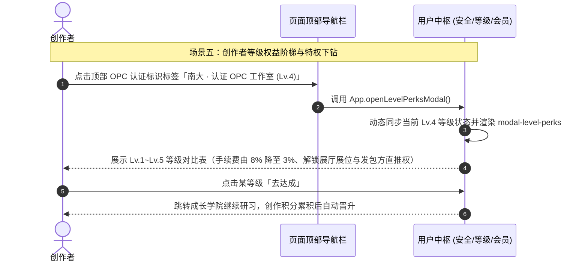

### 场景六子时序图：我的证书与平台成就档案查阅

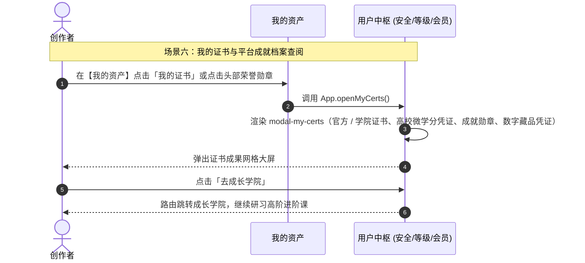

### 场景七子时序图：系统管理与 RBAC 角色权限、模拟视角一键切换

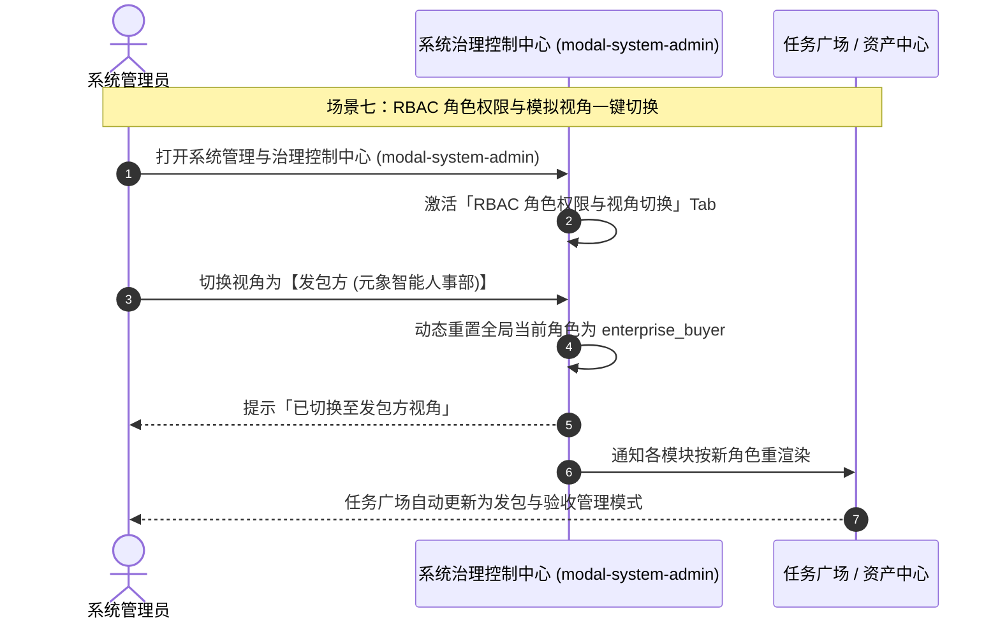

### 场景八子时序图：全域风控看门狗与 24 小时改密提现安全拦截

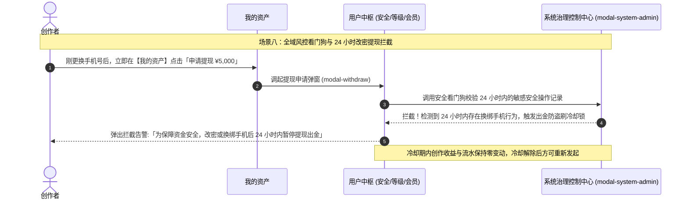

### 场景九子时序图：全局通用确认弹窗与帮助中心 FAQ 速查

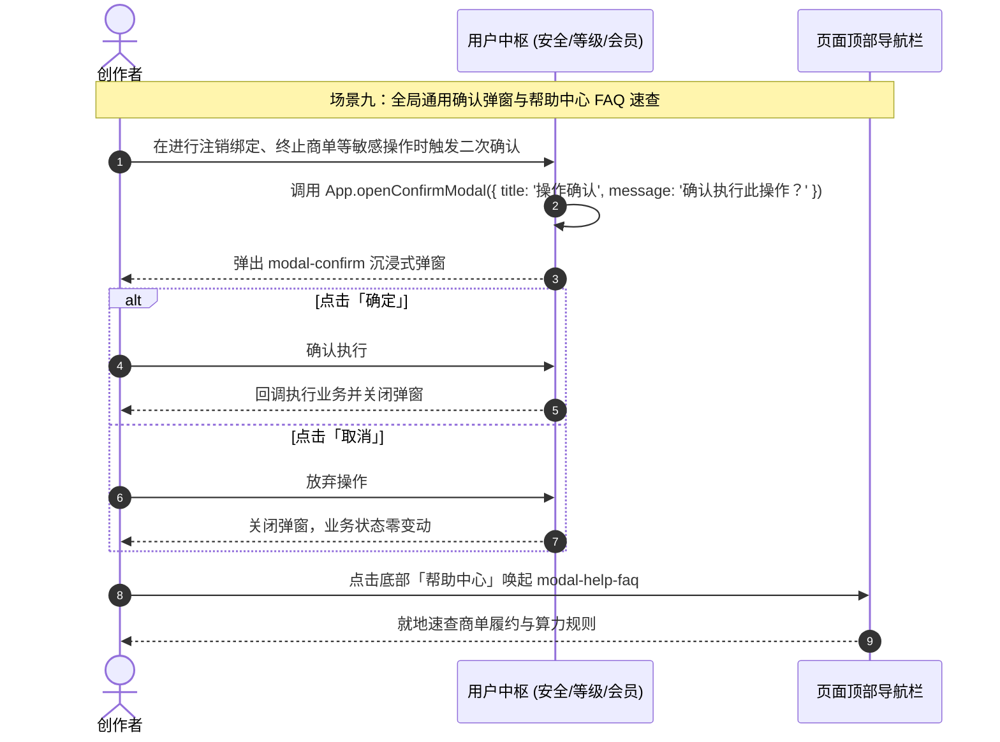

---

## 三、 全生命周期业务/任务状态机

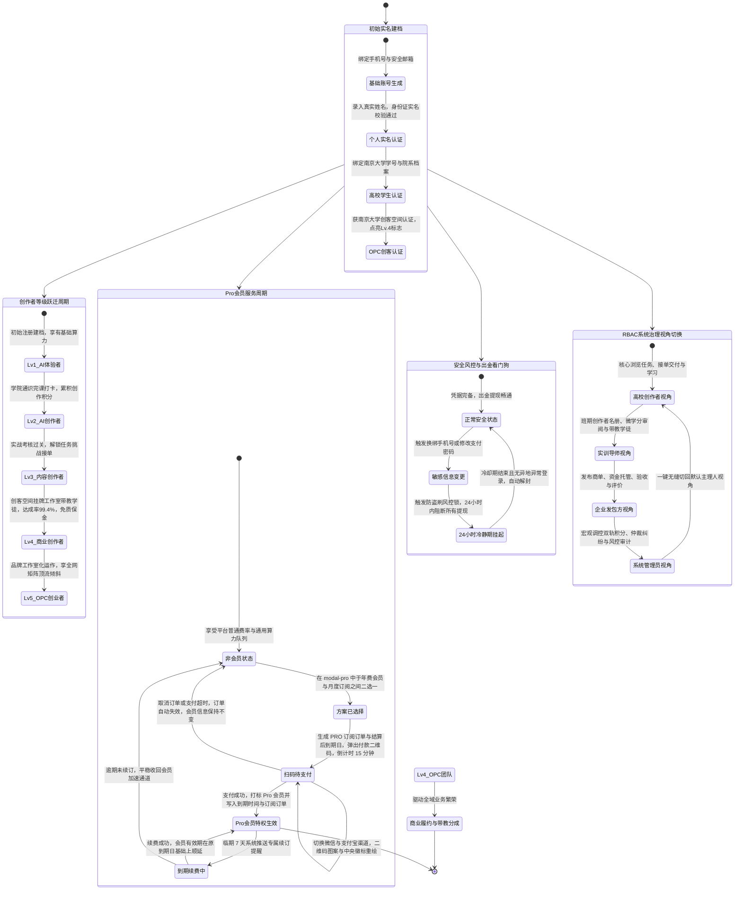

---

## 四、 核心功能模块与操作权限矩阵

| 功能模块与弹窗 | 对应前端 DOM 与触发方法 | 核心业务与治理功能 | 关键数据指标与状态 | 普通创作者权限 | OPC/商业工作室权限 |
| :--- | :--- | :--- | :--- | :--- | :--- |
| **顶部用户与认证栏** | `.header-opc-tag` / `.header-user-avatar` | 展示创作者当前身份徽章与高校认证状态 | “南大 · 认证 OPC 工作室 (Lv.4)” | 展示个人基础学籍标签 | **独享南大创客空间认证金色徽章与免质保金背书** |
| **创作者主页抽屉** | `#modal-creator-profile` / `App.openCreatorProfile` | 展现作者大头像、简介、获赞粉丝数与作品网格 | 获赞 3.8w / 粉丝 1.2w / 4 部代表作 | 查阅个人主页与他人名片 | 展示团队矩阵作品，支持直接发起定向定制 |
| **安全设置中心** | `#modal-security-settings` / `App.openSecuritySettings` | 维护真实姓名实名、手机换绑、邮箱换绑、学号认证 | 真实姓名已认证 / 手机号掩码 / 南大学号 | 查阅实名信息与安全状态 | **管理团队核心安全资产与实训学徒资质** |
| **开通 Pro 会员** | `#modal-pro` / `App.openModal('modal-pro')` `App.selectProPlan` | 订购 Pro 会员，解锁专属降本增效特权 | 算力 4 折 / 免质保金 / 优先推荐 | 支持选购月卡/年卡升级 | **享有工作室级专属多卡充值与高并发 GPU 算力** |
| **Pro 订阅扫码支付** | `#modal-pro-pay-qr` / `App.handleUpgradePro` `App.switchProPayChannel` `App.renderProPayQr` `App.confirmProPayment` `App.cancelProOrder` | 会员订阅独立结算通道：生成 `PRO` 订阅订单 → 微信 / 支付宝扫码付款 → 15 分钟倒计时超时失效 | 付费二维码 · 独立结算 · 不占用账户余额 | 扫码支付开通 Pro，不动现金余额 | **扫码支付开通 / 续费，账单与资产台账完全隔离** |
| **Pro 会员信息与到期时间** | `#pro-widget-card` `#assets-profile-hub` `App.activateProMembership` `App.renderProMembershipStrip` `App.renderProSidebarWidget` `App.refreshProViews` `App.proDaysLeft` `App.calcProExpireDate` | 支付成功后打标 `PRO` 会员，写入订阅方案、到期时间与订阅订单，并在资料条 / 侧栏入口卡 / 治理 Tab 三处回显「有效期至 YYYY-MM-DD（剩余 N 天）」 | 会员生命周期与到期时间 | 查看本人 Pro 有效期与续费入口 | **管理工作室 Pro 订阅与续费轮换** |
| **等级权益体系** | `#modal-level-perks` / `App.openLevelPerksModal` | 公开展现 Lv.1~Lv.5 等级成长阶梯与特权清单 | 当前 Lv.4，达成率 99.4%，交易手续费低至 3% | 查看升级至下一级的成长值进度 | **享有最高等级免质保金、学徒分成与展厅专属展位** |
| **我的证书与成就** | `#modal-my-certs` / `App.openMyCerts` | 集中展示技能证书、实训结业微学分与荣誉藏品 | 官方/学院证书、高校微学分凭证、成就勋章、数字藏品 | 查阅完课领取的证书 | 查阅商单准入与等级认证凭证 |
| **我的作品合集抽屉** | `#modal-my-works` / `App.openMyWorksModal` | 集中管理已在发现页与展厅上架的全部作品 | 作品状态（在售/展示中）、播放量与获赞 | 查阅个人已发布作品 | **管理展厅商业定制作品，设置档期与接单价格** |
| **系统管理控制中心** | `#modal-system-admin` / `App.openSystemAdminModal` | 4 大 Tab：RBAC视角切换、会员体系、全域风控、积分调控 | 创作者/导师/企业/管理员视角一键切换 | 默认创作者视图 | **支持一键切换发包方与导师视角进行全链路联调** |
| **沉浸式确认弹窗** | `#modal-confirm` / `App.openConfirmModal` | 接管全局高危操作、放弃商单与换绑确认 | 统一标题、警示文案、确定/取消双按钮 | 支持全部常规确认场景 | 支持全部商业解约与大额出金敏感确认场景 |
| **帮助中心 FAQ** | `#modal-help-faq` / `App.openModal('modal-help-faq')` | 汇总新手常见问题、商单履约指南与算力消耗规则 | 结构化折叠问答清单 | 支持随时呼出查阅答疑 | 支持查阅企业采购专票与 OPC 财税合规指南 |

---

## 五、 与全局各模块的深度联动体系说明

1. **与【任务广场】深度联动（实名准入、信用与免质保金）**：
   - 创作者在安全设置中完成的真实姓名实名认证与学号认证，直接作为任务广场接单准入的硬门槛；
   - 创作者通过 Lv.4 OPC 工作室认证与 Pro 会员特权，在任务广场直接享受免缴投标质保金与系统优先推单特权。
2. **与【我的资产】深度联动（出金看门狗与资金安全锁）**：
   - 创作者在资产中心申请提现时，用户中心的安全看门狗自动介入：校验身份证、收款银行卡与手机号实名一致性；若检测到 24 小时内有更换手机号或重置密码操作，立即触发熔断风控锁拦截出金，杜绝盗刷风险。
3. **与【创作工具】深度联动（双轨会员与算力 4 折特权）**：
   - 创作工具消耗用户的 **AI 积分（算力池）**；用户通过用户中心开通 Pro 会员后，在创作工具生成作品即可自动享受算力 4 折直充与高速 VIP 渲染通道。
4. **与【成长学院】深度联动（成长积分驱动等级跃迁）**：
   - 创作者在成长学院完成视频研习、课节打卡完课所获得的积分，全额归集为用户的 **创作积分（成长池）**，驱动用户在等级体系中从 Lv.1 逐步跃迁至 Lv.5，绝不因日常绘图算力消耗而扣减；全课通关后自动解锁证书归档至【我的证书】。
5. **与【发现页】及【社区中心】深度联动（个人主页名片穿透）**：
   - 社区贴文、评论区与发现页瀑布流卡片上的作者头像，均直接联动唤起创作者主页抽屉（`modal-creator-profile`），实现关注、代表作查阅与定向商单转化的原地闭环。
6. **与【数据中心】深度联动（全景画像与信誉沉淀）**：
   - 用户的实名认证状态、高校学籍、创作者等级、Pro 会员生命周期与履约达成率，全量实时同步至数据中心，构建创作者商业信用雷达大屏。
7. **与【我的资产】的支付边界划分（会员订阅独立结算）**：
   - **余额支付的边界**：资产中心的账户余额只承载**平台购买类行为**（专属普惠算力特权充值、成长学院付费课程选购），经统一支付引擎 `App.payFromAccountBalance()` 扣减并写入「支出」资产流水；
   - **会员订阅独立结算**：Pro 会员开通与续费走 `modal-pro-pay-qr` 扫码支付，**不占用账户余额、不产生冻结金额、不写入资产流水**，仅登记在 `membership.orders`，从而保证资产侧「总额 = 可提现 + 冻结」恒等式与资金台账不被订阅业务污染；
   - **会员信息在资产页回显**：订阅成功后 `membership.currentTier` / `plan` / `expireDate` 即时生效，资产页资料条同步点亮 `PRO` 徽章并展示「有效期至 YYYY-MM-DD（剩余 N 天）」。

---

## 六、 变更记录

| 日期 | 变更类型 | 变更内容 | 影响范围 |
| :--- | :--- | :--- | :--- |
| 2026-09-24 | 文档结构优化 | **时序图按场景拆分 + 全站角色名词统一**： **① 子时序图拆分**——§二 完整保留「全角色综合交互时序图（全局全景 · 场景一 ~ 场景九）」并补齐标题与角色口径说明，其下新增**九张子时序图**：场景一 创作者主页抽屉与名片透视、场景二 安全中心与实名 / 学号认证、场景三 手机号与邮箱换绑、场景四 Pro 会员订阅独立结算与扫码开通、场景五 等级权益阶梯与特权下钻、场景六 我的证书与成就档案、场景七 RBAC 角色权限与模拟视角切换、场景八 24 小时改密提现风控拦截、场景九 通用确认弹窗与帮助中心 FAQ。 **② 名词统一**——两类用户统一为**「创作者」**与**「发包方」** | §二（新增 9 张子图）/ 全文档名词；无新增契约、无代码改动；L1 32 ERROR 持平（本文件 1 条为历史遗留）、WARN 0；Mermaid 59 块 0 问题 |
| 2026-09-22 | 实现 + 契约修订 | **Pro 会员开通改为独立订阅结算（与账户余额解耦）**：① §一 目标补充「账号级服务订购，与账户余额完全解耦」；② §一 核心功能重写【开通 Pro 会员特权弹窗】为「方案二选一 + 会员状态条」，新增【Pro 会员订阅付款二维码弹窗（modal-pro-pay-qr）】与【Pro 会员信息与到期时间展示】两块功能定义；③ §二 场景四时序图重写为「方案选择 → 生成 PRO 订阅订单 → 扫码支付 → 打标 Pro + 写入到期时间」，并补充取消 / 超时失效分支；④ §三「Pro会员服务周期」状态机新增 `方案已选择` / `扫码待支付` 节点与取消超时回退、续费顺延转移；⑤ §四 更新「开通 Pro 会员」行并新增「Pro 订阅扫码支付」「Pro 会员信息与到期时间」两行契约；⑥ §五 新增第 7 条「与我的资产的支付边界划分」；⑦ 新建 §六 变更记录（补齐模块文档六节结构） | §一 ~ §六；新增 DOM `#modal-pro-pay-qr` `#pro-subscribe-strip` `#pro-widget-card`；新增方法 `App.getProPlan` `App.selectProPlan` `App.handleUpgradePro` `App.openProPayQrModal` `App.switchProPayChannel` `App.renderProPayQr` `App.startProQrCountdown` `App.stopProQrCountdown` `App.cancelProOrder` `App.confirmProPayment` `App.activateProMembership` `App.renderProMembershipStrip` `App.renderProSidebarWidget` `App.refreshProViews` `App.proDaysLeft` `App.calcProExpireDate` `App.formatDate`；`membership` 新增 `plan` / `planLabel` / `expireDate` / `activatedAt` / `isAutoRenew` / `orders` / `plans` 字段，演示账号初始改为 `free` 以完整走通开通闭环；【我的资产设计.md】同步收窄余额支付口径并新增支付边界划分 |
