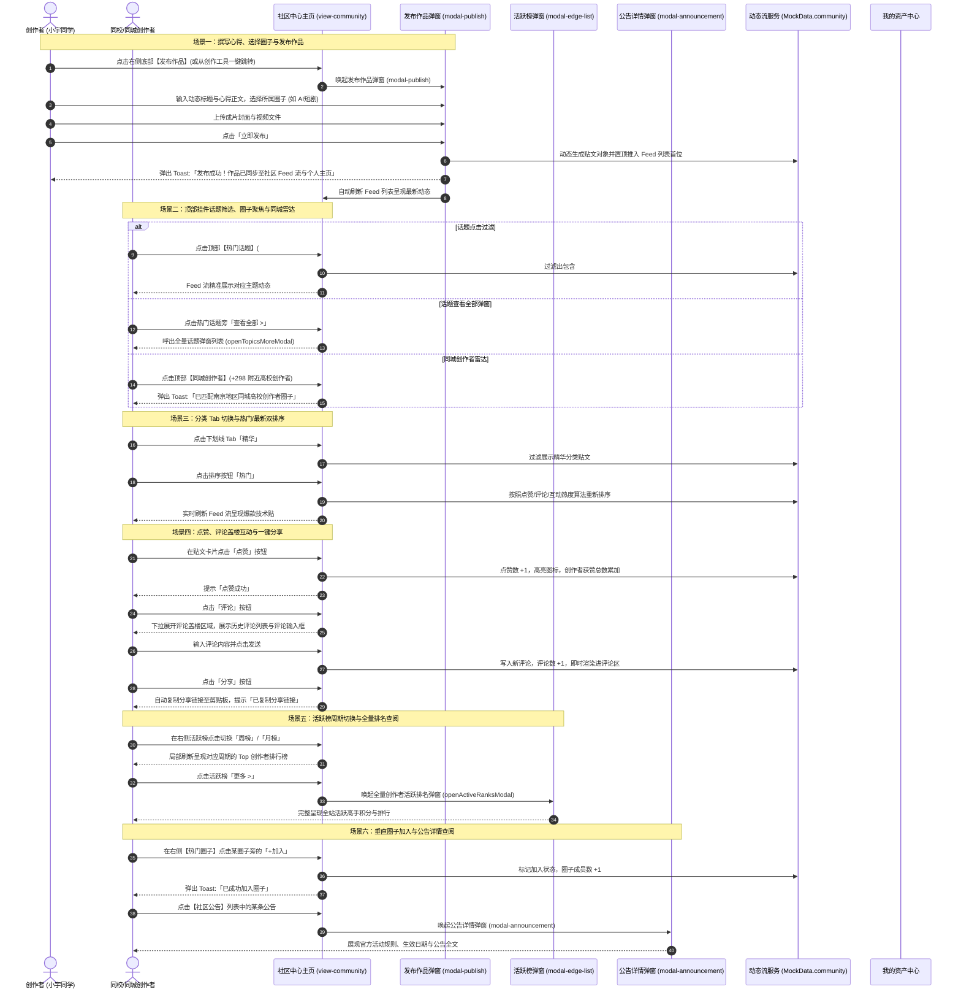
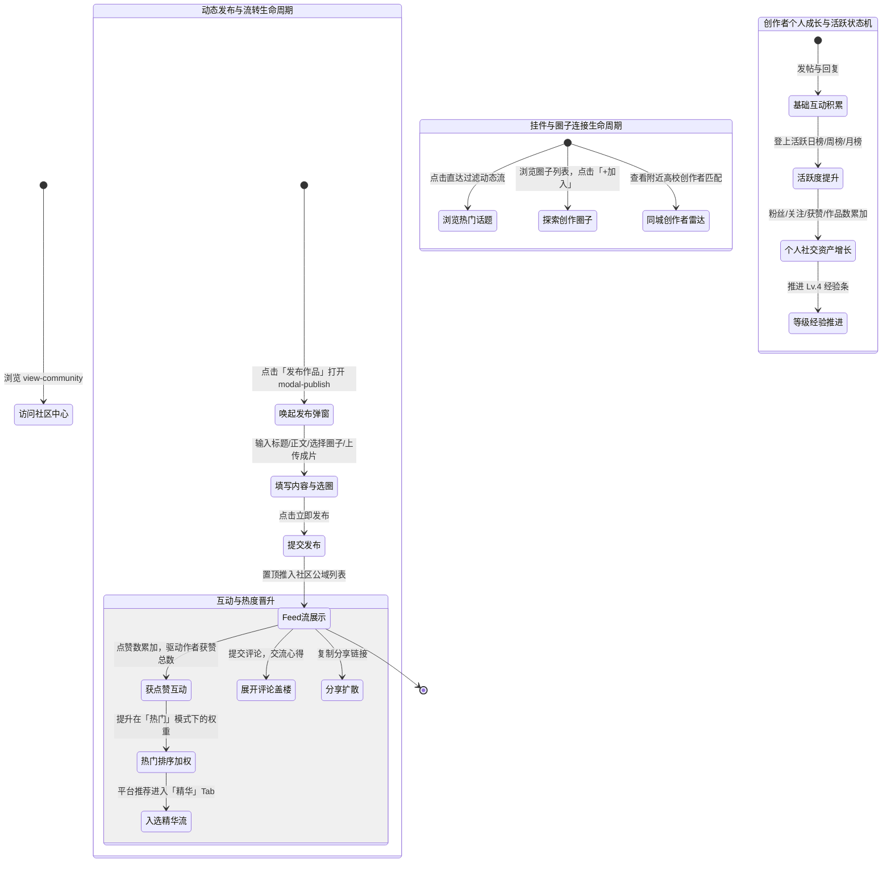

# 社区中心（创作者互动、技术互助与同城圈子生态）全业务架构设计方案

## 一、 用户故事

### 1. 本模块解决了什么问题？
在独立创作和商业变现过程中，青年创作者常处于“孤岛式创作”状态，面临四大现实阻碍：
- **同行交流与人脉网络匮乏**：缺乏同城、同校或同垂直领域的创作者连接管道，无法就近组队与技术切磋；
- **灵感与优质内容获取割裂**：海量动态缺乏清晰分类与排序，优质经验分享与最新动态难以高效索引；
- **缺乏圈子归属与即时互动**：不同细分垂类（短剧、漫剧、数字人等）创作者缺乏垂直公会交流阵地；
- **创作者社交资产与影响力缺乏直观展现**：缺乏量化的粉丝、点赞、作品与成长等级看板，难以形成正向激励。

### 2. 实现了什么目标？
社区中心（Community Hub）定位为整个 AI 创作者生态的**社交神经中枢、经验分享池与同城人脉聚合阵地**：
- **顶部三大特色互动挂件高密链接**：
  - **热门话题**：聚合前沿技术热词标签，支持点击即时过滤贴文流与弹窗查看全量话题（`openTopicsMoreModal`）；
  - **创作圈子**：推荐高活跃垂直圈子，支持点击过滤与一键聚焦（`focusHotCircle`）；
  - **同城创作者雷达**：展示附近高校创作者头像墙与 `+298` 同城创作者匹配徽章，实现就近人脉匹配；
- **5 维分类 Feed 流与热门/最新双排序**：提供覆盖【全部/关注/推荐/最新/精华】的分类流，支持【热门/最新】排序，集成点赞（`likePost`）、评论展开与提交（`toggleComments` / `submitComment`）、一键分享（`sharePost`）；
- **右侧多功能社交看板与全站发布入口**：创作者个人资料卡（粉丝/获赞/作品/成长等级）、日/周/月活跃榜（`openActiveRanksModal`）、热门圈子加入（`joinCircle`）、社区公告详情（`openAnnouncementDetail`）与全站发布作品弹窗（`modal-publish`）。

### 3. 涵盖哪些核心功能？
- **Banner 视觉区**：主标【创作者社区】，副标“交流创作经验，分享灵感与成长，遇见志同道合的伙伴”；
- **顶部三大特色并排挂件（community-header-widgets）**：
  - **热门话题**：前沿技术标签列表，点击标签即时过滤动态（`filterFeedByTopic`），点击【查看全部 >】唤起全量话题列表弹窗；
  - **创作圈子**：垂直圈子列表，点击过滤动态，点击【查看全部 >】聚焦至右侧热门圈子栏目（`focusHotCircle`）；
  - **同城创作者**：展示附近高校创作者头像墙与 `+298` 徽章，点击提示匹配本地同城创作者圈子；
- **社区 Feed 动态流系统**：
  - **5 大下划线分类 Tab**：`全部`、`关注`、`推荐`、`最新`、`精华`；
  - **双重排序按钮组**：`热门` 排序（`sort-hot`）与 `最新` 排序（`sort-latest`）；
  - **动态流卡片元素**：发布者头像、姓名、认证身份/学校、Lv 等级徽章、发布时间、正文心得、高清配图或成片；
  - **互动操作栏**：点赞按钮（点赞数即时 +1 并高亮）、评论按钮（展开评论列表与输入框）、分享按钮（一键分享链接）；
- **右侧侧边栏辅助功能舱（col-side）**：
  - **创作者个人社交卡片（creator-profile-card）**：
    - 展示用户头像、姓名（小宇同学）、Lv.4 创作等级勋章、认证身份（南京大学 ｜ 商业创作者）；
    - 【我的主页 >】快捷跳转至【我的资产】中心；
    - 4 项关键社交数据：关注数（128）、粉丝数（2.8万）、获赞数（12.6万）、作品数（36）；
    - 创作等级经验条：创作等级 Lv.4（3450 / 5000，进度 69%）；
  - **活跃榜单（日/周/月榜）**：支持 `日榜`、`周榜`、`月榜` 周期切换，展示全站活跃 Top 创作者，支持点击【更多 >】唤起全量活跃榜弹窗（`openActiveRanksModal`）；
  - **热门圈子推荐**：垂直圈子卡片堆叠（圈子名、成员数、帖子数），内置【+加入】按钮（`joinCircle`）；
  - **社区公告**：展示官方运营活动与规范通报，点击【更多 >】或单条公告唤起公告详情弹窗（`modal-announcement`）；
  - **底部悬浮发布引导卡片**：展示“分享你的创作，收获更多关注与机会”，点击【发布作品】唤起全站发布弹窗（`modal-publish`）。

---

## 二、 多方角色业务交互时序图

---

## 三、 全生命周期业务/任务状态机

---

## 四、 核心功能模块与操作权限矩阵

| 界面区域与功能模块 | 对应前端控件与触发动作 | 核心管理能力 | 社交与荣誉属性 | 普通创作者权限 | OPC/工作室主理人权限 |
| :--- | :--- | :--- | :--- | :--- | :--- |
| **顶部三大挂件** | 话题点击过滤 / 圈子点击 / 同城匹配提示 | 热门话题聚合、垂直圈子直达、附近创作者连接 | 社交连接枢纽 | 查阅全部话题、圈子与附近创作者 | 查阅全部话题，建立圈子与同城影响力 |
| **Feed 流分类与排序** | 5 大分类 Tab / 热门与最新排序切换 | 覆盖关注、推荐、精华分类，支持热度与时效排序 | 内容消费与分发 | 查阅所有公开贴文流并自由排序 | 查阅所有公开贴文流，精选贴优先曝光 |
| **动态卡片交互** | 点赞 / 展开评论与发表 / 一键分享 | 实时互动点赞、评论盖楼讨论、外部分享传播 | 社交资产积累 | 自由点赞、发表评论与复制分享链接 | 自由点赞、发表评论与复制分享链接 |
| **全站发布作品 (modal-publish)** | 标题、正文、圈子选择、成片上传、发布 | 发布原创心得教程、成片与经验分享 | 原创内容沉淀 | 自由发布动态，同步至个人主页 | 发布专业作品动态，带商业认证标识 |
| **个人社交卡片** | 关注/粉丝/获赞/作品展示，【我的主页】直达 | 展现创作者个人社交资产与 Lv.4 成长经验条 | 创作者身份名片 | 查看个人社交数据与跳转资产金库 | 展现卓越创作者认证与商业主页穿透 |
| **活跃榜单 (日/周/月)** | 周期切换按钮 / 【更多 >】(`openActiveRanksModal`) | 统计日度、周度、月度活跃度 Top 创作者大盘 | 社区公域曝光 | 查阅全周期榜单并参与活跃角逐 | 争夺活跃榜 Top，享有全网置顶曝光 |
| **热门圈子与公告** | 点击加入圈子 (`joinCircle`) / 查看公告 (`modal-announcement`) | 加入垂直方向公会、查阅官方活动与平台规则 | 社群与合规中枢 | 自由加入垂直圈子，查阅官方公告 | 自由加入垂直圈子，查阅官方公告 |

---

## 五、 与全局各模块的深度联动体系说明

1. **与【创作工具】深度联动（创作成果一键分享）**：
   - 创作者在创作工作台（`modal-studio`）完成作品后，点击【💬 分享至社区 (`App.publishFromStudio()`)】，系统自动携带生成的标题、提示词与封面，唤起社区发布弹窗（`modal-publish`），实现创作成果的即时发布交流。
2. **与【我的资产】深度联动（个人主页资产穿透）**：
   - 社区右侧创作者个人卡片内置【我的主页 >】，点击可直接跳转至【我的资产】中心；
   - 社区发布的优秀作品自动沉淀至【我的作品 (`modal-my-works`)】中。
3. **与【发现页】深度联动（同城创作者与灵感反哺）**：
   - 社区中心的同城创作者雷达为整个平台提供附近创作者匹配能力；
   - 社区中的高赞技术帖与作品心得为发现页精选作品提供源源不断的内容供给。
4. **与【成长学院】深度联动（微信共学圈打通）**：
   - 成长学院资源库 R6（创作者共学圈）沉淀的创作者群体，无缝流转融入社区中心的各细分创作圈子，展开日常技术互助。
5. **与【用户管理】深度联动（创作者等级与信誉同步）**：
   - 创作者在社区获得的获赞与关注，实时同步累加至用户中心的个人成长档案；
   - 社区卡片上的 Lv 等级与经验条实时与平台全局创作者等级系统保持强一致。
